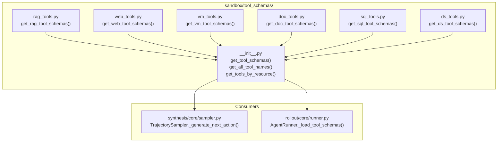
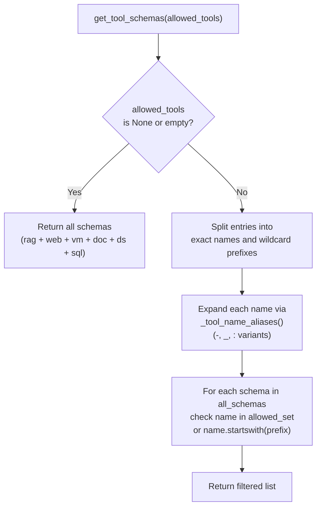
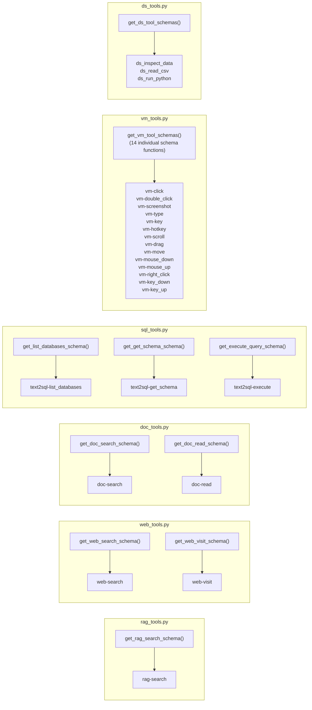

<!-- source: DeepWiki mcp.deepwiki.com · repo OpenDCAI/AgentFlow · page 3.3 Tool Schemas Reference · fetched 2026-11-02 -->

# Tool Schemas Reference

<details>
<summary>Relevant source files</summary>

The following files were used as context for generating this wiki page:

- [rollout/core/runner.py](rollout/core/runner.py)
- [sandbox/tests/test_tool_schemas.py](sandbox/tests/test_tool_schemas.py)
- [sandbox/tool_schemas/__init__.py](sandbox/tool_schemas/__init__.py)
- [sandbox/tool_schemas/doc_tools.py](sandbox/tool_schemas/doc_tools.py)
- [sandbox/tool_schemas/rag_tools.py](sandbox/tool_schemas/rag_tools.py)
- [sandbox/tool_schemas/sql_tools.py](sandbox/tool_schemas/sql_tools.py)
- [sandbox/tool_schemas/vm_tools.py](sandbox/tool_schemas/vm_tools.py)
- [sandbox/tool_schemas/web_tools.py](sandbox/tool_schemas/web_tools.py)
- [synthesis/core/sampler.py](synthesis/core/sampler.py)

</details>


This page is a complete reference for all tool schemas defined in the `sandbox/tool_schemas/` package. Tool schemas are structured dictionaries that describe available tools to the LLM agent — they control which tools appear in prompts and what parameters those tools accept. This page covers the schema format, the registry API, and the full parameter specification for every tool grouped by resource type.

This page focuses on the **schema definitions** themselves. For how the sandbox server executes these tools at runtime, see [Backend Resources](#3.2). For how to configure which tools are available to an agent, see [Synthesis Configuration](#4.1) and [Inference Config Schema](#8.4).

---

## Schema Structure

Every tool schema is a Python `dict` with three top-level keys. Parameter entries inside `parameters` support an additional `array_type` key when `type` is `"array"`.

| Key | Type | Description |
|---|---|---|
| `name` | `string` | Unique tool identifier. Used as the function name in LLM API calls. |
| `description` | `string` | Natural-language description passed to the LLM. |
| `parameters` | `list[dict]` | Ordered list of parameter descriptors. |

Each entry in `parameters` has:

| Key | Type | Description |
|---|---|---|
| `name` | `string` | Parameter name. |
| `type` | `string` | One of `string`, `integer`, `number`, `boolean`, `array`, `object`. |
| `description` | `string` | Shown to the LLM to guide usage. |
| `required` | `boolean` | Whether the LLM must supply this parameter. |
| `array_type` | `string` | Element type when `type` is `"array"` (e.g., `"string"`). |

Sources: [sandbox/tool_schemas/__init__.py:1-127](), [sandbox/tests/test_tool_schemas.py:95-104]()

---

## Registry API

All tool schemas are aggregated in `sandbox/tool_schemas/__init__.py`. Three public functions form the registry interface.

**`get_tool_schemas(allowed_tools=None)`** — Returns all schemas, or a filtered subset when `allowed_tools` is supplied. Accepts exact tool names and wildcard patterns (see [Filtering](#filtering-and-wildcards) below).

**`get_all_tool_names()`** — Returns a flat list of every registered tool name string.

**`get_tools_by_resource(resource_type)`** — Returns all tools whose name begins with `resource_type:`, `resource_type_`, or `resource_type-`.

Sources: [sandbox/tool_schemas/__init__.py:34-114]()

### Module Dependency Map

**Diagram: Tool Schema Registry — Module Structure**



Sources: [sandbox/tool_schemas/__init__.py:10-16](), [synthesis/core/sampler.py:17-17](), [rollout/core/runner.py:132-142]()

---

## Filtering and Wildcards

`get_tool_schemas()` applies name matching when `allowed_tools` is a non-empty list. Names are compared after expanding across the three separator styles (`-`, `_`, `:`) via the internal `_tool_name_aliases()` helper, so `"rag-search"`, `"rag_search"`, and `"rag:search"` are all treated as equivalent.

**Exact match** — include a specific tool name:
```
allowed_tools=["web-search", "rag-search"]
```

**Wildcard by prefix** — include all tools matching a prefix followed by `*`. The separator before `*` can be any of `-`, `_`, or `:`:
```
allowed_tools=["vm-*"]        # all vm tools
allowed_tools=["text2sql:*"]  # all SQL tools
```

**Mixed**:
```
allowed_tools=["web-search", "vm-*"]
```

Sources: [sandbox/tool_schemas/__init__.py:59-87](), [sandbox/tests/test_tool_schemas.py:33-48]()

### Filtering Logic

**Diagram: `get_tool_schemas` Filtering Flow**



Sources: [sandbox/tool_schemas/__init__.py:59-87]()

---

## Tool Reference by Resource Type

### RAG Tools

Defined in `sandbox/tool_schemas/rag_tools.py`. Exposes one tool backed by the E5 + Faiss retrieval backend.

#### `rag-search`

> Search the pre-built RAG index for the most relevant text chunks.

| Parameter | Type | Required | Default | Description |
|---|---|---|---|---|
| `query` | `string` | Yes | — | Query text to look up in the index. |
| `top_k` | `integer` | No | 10 | Number of top relevant text chunks to retrieve. |

Sources: [sandbox/tool_schemas/rag_tools.py:23-49]()

---

### Web Tools

Defined in `sandbox/tool_schemas/web_tools.py`. Two tools backed by Serper and Jina APIs.

#### `web-search`

> Perform batched web searches and return top results for each query.

| Parameter | Type | Required | Description |
|---|---|---|---|
| `query` | `array of string` | Yes | Array of query strings. Multiple complementary queries can be sent in a single call. |

#### `web-visit`

> Visit web pages and extract relevant content based on the goal.

| Parameter | Type | Required | Description |
|---|---|---|---|
| `urls` | `array of string` | Yes | Array of URLs to visit and extract content from. |
| `goal` | `string` | Yes | The purpose for content extraction; guides what is extracted from each page. |

Sources: [sandbox/tool_schemas/web_tools.py:24-74]()

---

### Document Tools

Defined in `sandbox/tool_schemas/doc_tools.py`. Two tools backed by a VLM (e.g., `gpt-4o-mini`) and PDF parsing. The `seed_path` parameter is injected automatically from `seed.jsonl` kwargs at runtime — the LLM should not supply it.

#### `doc-search`

> Search for keywords in the document across headings, paragraphs, tables, and image captions.

| Parameter | Type | Required | Default | Description |
|---|---|---|---|---|
| `key_words` | `array of string` | Yes | — | Keywords to search for in the document. |
| `max_search_results` | `integer` | No | 10 | Maximum results returned per keyword. |

#### `doc-read`

> Read specific document sections using a visual language model, processing both text and images.

| Parameter | Type | Required | Default | Description |
|---|---|---|---|---|
| `section_ids` | `array of string` | Yes | — | Section IDs to read (e.g., `["1.2.1", "1.2.2"]`). Obtained from `doc-search` results. |
| `goal` | `string` | Yes | — | Guides the VLM to focus on relevant content within the sections. |
| `max_image_num` | `integer` | No | 10 | Maximum number of visual inputs (pages/images/tables) to include. |
| `max_text_token` | `integer` | No | 20000 | Maximum text length in characters. |

Sources: [sandbox/tool_schemas/doc_tools.py:24-102]()

---

### SQL Tools

Defined in `sandbox/tool_schemas/sql_tools.py`. Three tools using a registration pattern: each schema function calls `register_sql_tool()` at module load time, which appends to a module-level `_REGISTERED_SQL_TOOLS` list. Tool names use the `text2sql-` prefix.

#### `text2sql-list_databases`

> List all available databases that can be queried.

No parameters.

#### `text2sql-get_schema`

> Get table structure (tables, columns, foreign keys) of a specific database.

| Parameter | Type | Required | Description |
|---|---|---|---|
| `db_id` | `string` | Yes | Database ID as returned by `text2sql-list_databases`. |
| `table_names` | `array of string` | No | Filter to specific tables. If omitted, all tables are returned. |

#### `text2sql-execute`

> Execute a SQL SELECT query on a specific database.

| Parameter | Type | Required | Description |
|---|---|---|---|
| `db_id` | `string` | Yes | Database ID to query. |
| `query` | `string` | Yes | SQL query string. Only `SELECT` statements are permitted. |

Sources: [sandbox/tool_schemas/sql_tools.py:24-77]()

---

### VM Tools

Defined in `sandbox/tool_schemas/vm_tools.py`. Fourteen tools for desktop GUI automation backed by Docker VM containers. All tools return an accessibility tree; the shared note `VM_RESPONSE_NOTE` appended to each description discourages redundant `vm-screenshot` calls for UI state.

| Tool Name | Description | Required Parameters | Optional Parameters |
|---|---|---|---|
| `vm-click` | Click at `(x, y)`. | `x: integer`, `y: integer` | `button: string` (left/right/middle) |
| `vm-double_click` | Double-click at `(x, y)`. | `x: integer`, `y: integer` | — |
| `vm-screenshot` | Capture the current VM screen. | — | — |
| `vm-type` | Type text into the active input. | `text: string` | `interval: number` (seconds between keystrokes) |
| `vm-key` | Press a single key (e.g., `enter`, `tab`, `escape`). | `key: string` | — |
| `vm-hotkey` | Press a key combination (e.g., `['ctrl','c']`). | `keys: array of string` | — |
| `vm-scroll` | Scroll at `(x, y)`. | `x: integer`, `y: integer`, `clicks: integer` (positive=up) | — |
| `vm-drag` | Drag from `(start_x, start_y)` to `(end_x, end_y)`. | `start_x`, `start_y`, `end_x`, `end_y: integer` | — |
| `vm-move` | Move mouse to `(x, y)`. | `x: integer`, `y: integer` | — |
| `vm-mouse_down` | Press and hold a mouse button. | — | `button: string` |
| `vm-mouse_up` | Release a mouse button. | — | `button: string` |
| `vm-right_click` | Right-click at `(x, y)` or current cursor if omitted. | — | `x: integer`, `y: integer` |
| `vm-key_down` | Press and hold a key. | `key: string` | — |
| `vm-key_up` | Release a key. | `key: string` | — |

Sources: [sandbox/tool_schemas/vm_tools.py:15-241]()

---

### Data Science (DS) Tools

Defined in `sandbox/tool_schemas/ds_tools.py` and imported via `get_ds_tool_schemas()`. The backend executes Python in a sandboxed environment with a security whitelist. Three tools are registered:

| Tool Name | Description |
|---|---|
| `ds_inspect_data` | Inspect available datasets and their metadata. |
| `ds_read_csv` | Read and preview CSV data files. |
| `ds_run_python` | Execute Python code (pandas, NumPy) in the sandbox. |

> **Note:** The source file `sandbox/tool_schemas/ds_tools.py` is not reproduced here. Parameter details are available by inspecting the file directly. The tools are accessible through `get_tool_schemas(["ds_*"])` or `get_tools_by_resource("ds")`.

Sources: [sandbox/tool_schemas/__init__.py:14-14](), [sandbox/tool_schemas/__init__.py:47-54]()

---

## Tool Name to Schema Function Map

**Diagram: Tool Names and Their Defining Functions**



Sources: [sandbox/tool_schemas/rag_tools.py:11-20](), [sandbox/tool_schemas/web_tools.py:11-21](), [sandbox/tool_schemas/doc_tools.py:11-21](), [sandbox/tool_schemas/sql_tools.py:20-77](), [sandbox/tool_schemas/vm_tools.py:15-37](), [sandbox/tool_schemas/__init__.py:10-16]()

---

## How Schemas Are Consumed

Schemas flow from the registry into two runtime contexts:

1. **Synthesis pipeline** — `TrajectorySampler` in `synthesis/core/sampler.py` calls `get_tool_schemas(self.config.available_tools)` at the start of each trajectory tree. It formats the schemas into human-readable tool descriptions embedded in the exploration prompt (the `_build_exploration_prompt` method renders name, description, and each parameter with type and required flag).

2. **Rollout/inference pipeline** — `AgentRunner` in `rollout/core/runner.py` calls `get_tool_schemas(allowed_tools)` in `_load_tool_schemas()`, then converts each schema to OpenAI function-calling format via `convert_tool_schema_to_openai()` before passing it to the LLM API as the `tools` argument.

The `available_tools` field in synthesis and rollout configuration files (e.g., `["rag-search"]`, `["vm-*"]`) maps directly to the `allowed_tools` argument of `get_tool_schemas()`.

Sources: [synthesis/core/sampler.py:70-74](), [synthesis/core/sampler.py:247-263](), [rollout/core/runner.py:129-142]()

---

