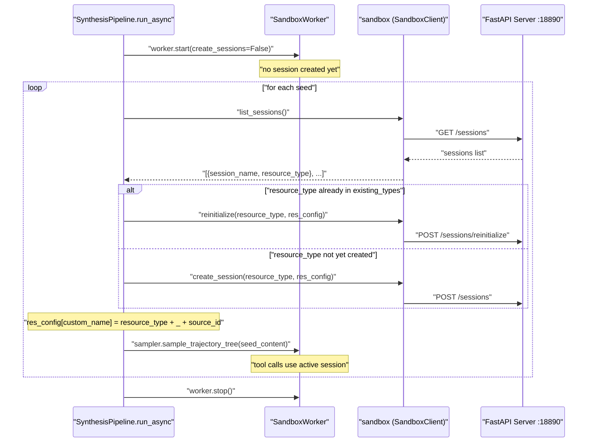
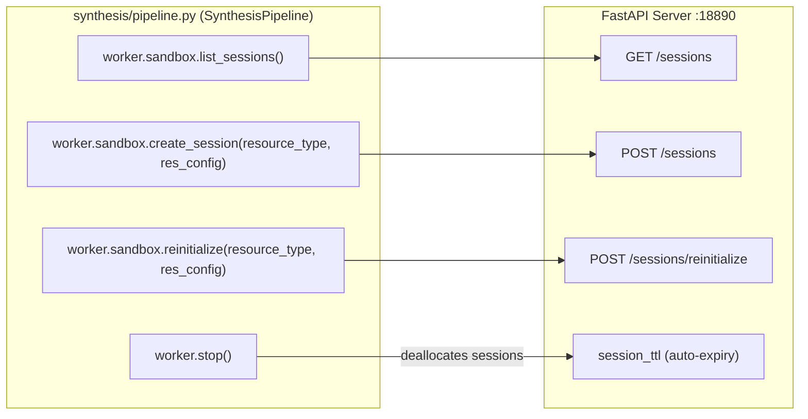

<!-- source: DeepWiki mcp.deepwiki.com · repo OpenDCAI/AgentFlow · page 3.4 Session Management · fetched 2026-11-02 -->

# Session Management

<details>
<summary>Relevant source files</summary>

The following files were used as context for generating this wiki page:

- [configs/sandbox-server/doc_config.json](configs/sandbox-server/doc_config.json)
- [configs/sandbox-server/rag_config.json](configs/sandbox-server/rag_config.json)
- [configs/sandbox-server/text2sql_config.json](configs/sandbox-server/text2sql_config.json)
- [configs/sandbox-server/web_config.json](configs/sandbox-server/web_config.json)
- [configs/synthesis/doc_ds_config.json](configs/synthesis/doc_ds_config.json)
- [configs/synthesis/ds_config.json](configs/synthesis/ds_config.json)
- [sandbox/tool_schemas/ds_tools.py](sandbox/tool_schemas/ds_tools.py)
- [synthesis/pipeline.py](synthesis/pipeline.py)

</details>


This page explains how the sandbox server creates, tracks, reuses, and expires sessions for agent tool execution. Sessions are the mechanism by which the sandbox server associates stateful backend resources (databases, document indexes, VM environments) with a particular agent run.

This page focuses on the sandbox server's session layer. For the configuration of the server itself, see [Server Configuration](#3.1). For the backend resources that sessions wrap, see [Backend Resources](#3.2).

---

## What Is a Session?

A **session** is a server-side object that binds a named `resource_type` to a live backend instance. When the synthesis or rollout pipeline calls a tool, the sandbox server routes the call to the backend associated with the active session for that resource type.

Sessions carry two identifying fields:

| Field | Description |
|---|---|
| `session_name` | A string identifier for the session, set via `custom_name` in the init config |
| `resource_type` | The backend type the session wraps (e.g., `rag`, `text2sql`, `doc`) |

Sessions are relevant mainly for **stateful** backends. Stateless backends (e.g., the web search backend) do not require explicit session management — their tools operate without shared server-side state between calls.

Sources: [synthesis/pipeline.py:119-129]()

---

## Session Lifecycle

**Diagram: Session States and Client-Side Operations**

```mermaid
stateDiagram-v2
    [*] --> "nonexistent": "Server starts"
    "nonexistent" --> "active": "create_session(resource_type, res_config)"
    "active" --> "active": "tool call succeeds"
    "active" --> "active": "reinitialize(resource_type, res_config)"
    "active" --> "expired": "TTL elapsed (session_ttl seconds)"
    "expired" --> "active": "create_session() recreates"
    "active" --> "nonexistent": "worker.stop()"
```

Sources: [synthesis/pipeline.py:111-196](), [configs/sandbox-server/text2sql_config.json:5-7](), [configs/sandbox-server/doc_config.json:4-6]()

The three client-side operations that change session state are:

- `worker.sandbox.create_session(resource_type, res_config)` — allocates a new backend instance for the given resource type
- `worker.sandbox.reinitialize(resource_type, res_config)` — resets an existing session's backend state without deallocating it
- `worker.sandbox.list_sessions()` — returns all currently active sessions on the server

---

## Session TTL

Each server configuration defines a `session_ttl` (in seconds) under the `server` block. After a session has been idle for this many seconds, the server expires it automatically.

| Config File | Backend | `session_ttl` |
|---|---|---|
| `configs/sandbox-server/text2sql_config.json` | Text2SQL | 600 s |
| `configs/sandbox-server/doc_config.json` | Document | 300 s |
| `configs/sandbox-server/rag_config.json` | RAG | *(not set; server default applies)* |
| `configs/sandbox-server/web_config.json` | Web search | *(not set; stateless)* |

The `session_ttl` value should be chosen to be longer than the expected duration of a single seed's tool-call sequence. For Text2SQL, which may involve many exploratory queries, the default is 600 s; for document processing, 300 s is sufficient.

Sources: [configs/sandbox-server/text2sql_config.json:5-7](), [configs/sandbox-server/doc_config.json:4-6](), [configs/sandbox-server/rag_config.json:1-35](), [configs/sandbox-server/web_config.json:1-18]()

---

## Server-Side Endpoints

The sandbox server (FastAPI, port `18890`) exposes the following session management endpoints, accessed via the sandbox client:

| Operation | Client method | HTTP endpoint |
|---|---|---|
| Create session | `sandbox.create_session(resource_type, config)` | `POST /sessions` |
| List sessions | `sandbox.list_sessions()` | `GET /sessions` |
| Reinitialize session | `sandbox.reinitialize(resource_type, config)` | `POST /sessions/reinitialize` |

These endpoints are consumed by both the `SandboxWorker` in the synthesis pipeline and the sandbox client in the rollout pipeline.

Sources: [synthesis/pipeline.py:114-143]()

---

## Per-Seed Session Isolation in the Synthesis Pipeline

The synthesis pipeline in `synthesis/pipeline.py` uses sessions to enforce **per-seed isolation**: each seed is processed with a freshly initialized backend, so artifacts from one seed's tool calls do not bleed into the next seed's trajectory.

**Diagram: Per-Seed Session Management in `SynthesisPipeline.run_async`**



Sources: [synthesis/pipeline.py:79-196]()

### Key behaviors

1. **Deferred session creation**: `worker.start(create_sessions=False)` is called at startup [synthesis/pipeline.py:85](), meaning no session is allocated until the first seed begins processing.

2. **Conditional reinit vs. create**: Before each seed, `list_sessions()` is called to check which resource types already have sessions [synthesis/pipeline.py:113-131](). If a session for the required `resource_type` already exists, `reinitialize()` is called instead of `create_session()` [synthesis/pipeline.py:140-143](). This avoids leaking stale backend state across seeds.

3. **Custom session naming**: Each session receives a `custom_name` composed of the resource type and the seed's `source_id` (e.g., `text2sql_src_0001_ab12cd34`) [synthesis/pipeline.py:139](). This makes sessions identifiable in logs and `list_sessions()` output.

4. **Config-driven init**: The `res_config` passed to `create_session` or `reinitialize` is read from `config.resource_init_configs[resource_type]` [synthesis/pipeline.py:134-138](). This allows per-resource initialization parameters (e.g., database path, seed document path) to be controlled through the synthesis configuration.

---

## `resource_init_configs` and Session Initialization Parameters

The synthesis config field `resource_init_configs` maps each `resource_type` to a dictionary of initialization parameters sent to the server during `create_session` or `reinitialize`. The relevant structure in the pipeline is:

```
resource_init_configs:
  <resource_type>:
    content:
      <key>: <value>
      ...
```

At runtime, the pipeline extracts `init_config["content"]` as the base dict [synthesis/pipeline.py:135-138](), appends `custom_name`, and sends the result. This allows callers to pass resource-specific startup parameters (such as a database path or document directory) without modifying the synthesis pipeline code.

Sources: [synthesis/pipeline.py:134-143](), [configs/synthesis/ds_config.json:1-52](), [configs/synthesis/doc_ds_config.json:14-18]()

---

## Session Management in `list_sessions()` Response

The `list_sessions()` call returns either a plain list or a dict with a `sessions` key. The pipeline handles both formats:

[synthesis/pipeline.py:115-129]()

Each item in the sessions list is a dict expected to contain at minimum:

| Key | Type | Description |
|---|---|---|
| `session_name` | string | The custom name assigned at creation |
| `resource_type` | string | Backend type (e.g., `rag`, `text2sql`) |

These fields are used to detect existing sessions by resource type before deciding whether to call `create_session` or `reinitialize`.

---

## Summary: Session API at a Glance

**Diagram: Client–Server Session API Mapping**



Sources: [synthesis/pipeline.py:113-196](), [configs/sandbox-server/text2sql_config.json:1-22](), [configs/sandbox-server/doc_config.json:1-24]()

---

