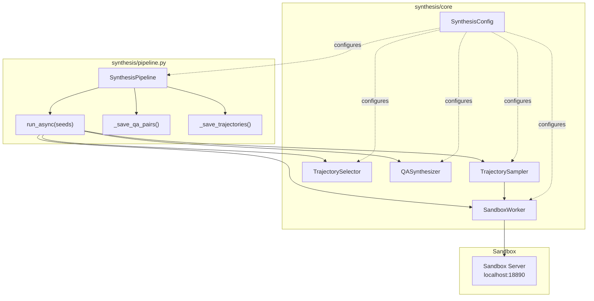
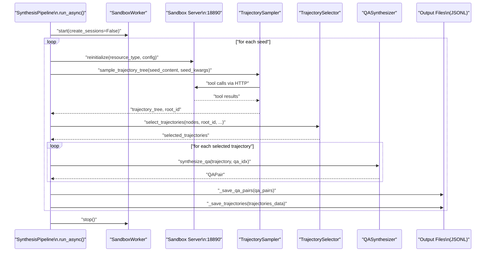
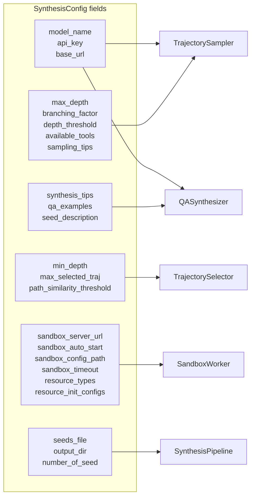

<!-- source: DeepWiki mcp.deepwiki.com · repo OpenDCAI/AgentFlow · page 4 Data Synthesis Pipeline · fetched 2026-11-02 -->

# Data Synthesis Pipeline

<details>
<summary>Relevant source files</summary>

The following files were used as context for generating this wiki page:

- [configs/synthesis/doc_config.json](configs/synthesis/doc_config.json)
- [configs/synthesis/doc_ds_config.json](configs/synthesis/doc_ds_config.json)
- [configs/synthesis/ds_config.json](configs/synthesis/ds_config.json)
- [configs/synthesis/rag_config.json](configs/synthesis/rag_config.json)
- [configs/synthesis/web_config.json](configs/synthesis/web_config.json)
- [configs/synthesis/web_rag_config.json](configs/synthesis/web_rag_config.json)
- [sandbox/tool_schemas/ds_tools.py](sandbox/tool_schemas/ds_tools.py)
- [synthesis/pipeline.py](synthesis/pipeline.py)

</details>


This page describes the data synthesis pipeline: the system that generates labeled QA pairs and tool-use trajectories from seed data. It covers the architecture, the three-stage execution flow, the primary classes, configuration parameters, and output artifacts.

For details on running the rollout pipeline against existing benchmarks (as opposed to synthesizing new data from seeds), see [Rollout and Inference](#5). For reference documentation on every configuration parameter, see [Synthesis Config Schema](#8.2).

---

## Overview

The synthesis pipeline takes a set of seed documents or topics and produces two artifacts:
1. **`synthesized_qa.jsonl`** — labeled QA pairs with multi-hop reasoning chains
2. **`trajectories.jsonl`** — the tool-use trajectories that ground those QA pairs

The pipeline consists of three sequential stages per seed, orchestrated by `SynthesisPipeline` in [synthesis/pipeline.py]():

| Stage | Class | Input | Output |
|---|---|---|---|
| 1. Trajectory Sampling | `TrajectorySampler` | Seed content + tools | Trajectory tree (nodes) |
| 2. Trajectory Selection | `TrajectorySelector` | Trajectory tree | Filtered trajectory list |
| 3. QA Synthesis | `QASynthesizer` | Selected trajectories | QA pairs |

The pipeline is modality-agnostic. Which tools an agent uses during sampling (e.g. `rag-search`, `web-search`, `doc-read`, `ds_run_python`) is controlled entirely by configuration. The same `SynthesisPipeline` class handles RAG, Web, Document, SQL, and Data Science agents.

Sources: [synthesis/pipeline.py:39-207]()

---

## Architecture

**Diagram: SynthesisPipeline class relationships**



Sources: [synthesis/pipeline.py:24-30](), [synthesis/pipeline.py:79-93]()

---

## Execution Flow

`SynthesisPipeline.run_async` processes seeds one at a time. For each seed, it reinitializes the sandbox session (for isolation), runs the three stages, and appends results to the output files.

**Diagram: run_async per-seed execution sequence**



Sources: [synthesis/pipeline.py:66-196]()

---

## Stage 1: Trajectory Sampling

`TrajectorySampler.sample_trajectory_tree` uses the LLM to explore information available via the configured tools. Starting from the seed content, it builds a tree of tool-call/observation nodes, branching at each step up to `branching_factor` alternative actions.

Key parameters that govern this stage:

| Parameter | Description | Example values |
|---|---|---|
| `max_depth` | Maximum number of tool-call steps per branch | `10` (RAG), `50` (Web), `20` (Doc) |
| `branching_factor` | Number of parallel branches at each step | `2` |
| `depth_threshold` | Minimum depth before branching is considered complete | `2` |
| `available_tools` | Which tool schemas the LLM can invoke | `["rag-search"]`, `["web-search","web-visit"]` |
| `sampling_tips` | Natural language hints injected into the LLM system prompt | See config files |

The `available_tools` list determines which schemas from the tool registry are presented to the LLM. For example, the RAG config exposes only `rag-search`, while the DS config exposes `ds_inspect_data`, `ds_read_csv`, and `ds_run_python`.

See [Trajectory Sampling](#4.3) for details.

Sources: [configs/synthesis/rag_config.json:7-13](), [configs/synthesis/web_config.json:6-11](), [configs/synthesis/ds_config.json:6-14]()

---

## Stage 2: Trajectory Selection

`TrajectorySelector.select_trajectories` filters the sampled tree down to a set of high-quality paths. It applies depth filtering and removes paths that are too similar to each other.

| Parameter | Description | Example |
|---|---|---|
| `min_depth` | Discard paths shorter than this many steps | `3` |
| `max_selected_traj` | Maximum number of trajectories to keep per seed | `1`–`3` |
| `path_similarity_threshold` | Cosine similarity threshold above which two paths are considered duplicates | `0.7` |

See [Trajectory Selection](#4.4) for details.

Sources: [configs/synthesis/rag_config.json:12-14](), [configs/synthesis/ds_config.json:9-11]()

---

## Stage 3: QA Synthesis

`QASynthesizer.synthesize_qa` takes a single selected trajectory and uses the LLM to generate a QA pair grounded in the tool-call evidence collected during sampling. The `synthesis_tips` and `qa_examples` fields in the config directly shape the prompt used for this step.

| Parameter | Description |
|---|---|
| `synthesis_tips` | List of instructions for the QA generation prompt |
| `qa_examples` | Few-shot examples of question/answer format |
| `seed_description` | Label for what the seed represents (used in prompts) |

Example `qa_examples` from the RAG config:
```json
[
  {
    "question": "What year was the company founded that developed the framework used in the project?",
    "answer": "2004"
  }
]
```

See [QA Synthesis](#4.5) for details.

Sources: [configs/synthesis/rag_config.json:43-56](), [configs/synthesis/doc_config.json:41-69](), [configs/synthesis/ds_config.json:23-47]()

---

## Configuration by Modality

All synthesis configs live in `configs/synthesis/`. The following table summarizes the key behavioral differences across modalities:

**Diagram: SynthesisConfig fields mapped to components**



Sources: [configs/synthesis/rag_config.json:1-60](), [configs/synthesis/web_config.json:1-44](), [configs/synthesis/doc_config.json:1-73](), [configs/synthesis/ds_config.json:1-52]()

| Config file | `available_tools` | `max_depth` | `max_selected_traj` | `resource_types` |
|---|---|---|---|---|
| `rag_config.json` | `["rag-search"]` | 10 | 2 | `["rag"]` |
| `web_config.json` | `["web-search","web-visit"]` | 50 | 2 | `[]` |
| `web_rag_config.json` | `["rag-search","web-search","web-visit"]` | 50 | 2 | `[]` |
| `doc_config.json` | `["doc-search","doc-read"]` | 20 | 2 | `[]` |
| `ds_config.json` | `["ds_inspect_data","ds_read_csv","ds_run_python"]` | 20 | 1 | `[]` |
| `doc_ds_config.json` | `["doc-search","doc-read","ds_inspect_data","ds_read_csv","ds_run_python"]` | 20 | 3 | `[]` |

Sources: [configs/synthesis/rag_config.json](), [configs/synthesis/web_config.json](), [configs/synthesis/web_rag_config.json](), [configs/synthesis/doc_config.json](), [configs/synthesis/ds_config.json](), [configs/synthesis/doc_ds_config.json]()

---

## Outputs

`SynthesisPipeline` writes results to two JSONL files under `results/ds_synthesized_qa/`:

| File | Written by | Content |
|---|---|---|
| `synthesized_qa.jsonl` | `_save_qa_pairs()` | One JSON object per QA pair, appended after each seed |
| `trajectories.jsonl` | `_save_trajectories()` | One JSON object per selected trajectory, appended after each seed |

Both files are appended incrementally, so a partially completed run preserves already-synthesized data.

Sources: [synthesis/pipeline.py:42-64](), [synthesis/pipeline.py:209-219]()

---

## Seed Isolation

Each seed gets its own fresh sandbox session. Before processing a seed, `run_async` calls `reinitialize` on any existing sessions of the required resource types, or `create_session` if none exists. The session is named `{resource_type}_{source_id}` where `source_id` is a hash of the seed content and index. This ensures tool state (e.g., a RAG index, a SQL database) is reset between seeds.

Sources: [synthesis/pipeline.py:111-143]()

---

## Entry Point

The pipeline can be invoked from the command line via `synthesis/pipeline.py`:

```
python -m synthesis.pipeline \
  --config configs/synthesis/rag_config.json \
  --seeds seeds/rag/seeds.jsonl \
  --output-dir results/rag
```

Or programmatically:

```python
config = SynthesisConfig.from_json("configs/synthesis/rag_config.json")
pipeline = SynthesisPipeline(config=config)
pipeline.run(seeds)  # synchronous wrapper over run_async
```

`SynthesisConfig` supports both `.json` and `.yaml` formats. Seeds must be in JSONL format, where each line is a JSON object with at minimum a `"content"` field and an optional `"kwargs"` field.

See [Running Synthesis](#4.6) for full invocation examples, and [Seed Data Format](#4.2) for the required seed file format.

Sources: [synthesis/pipeline.py:222-282]()

---

