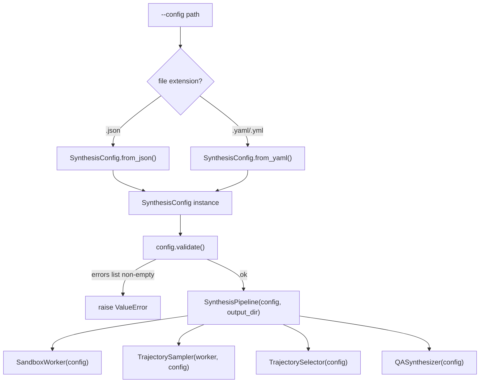
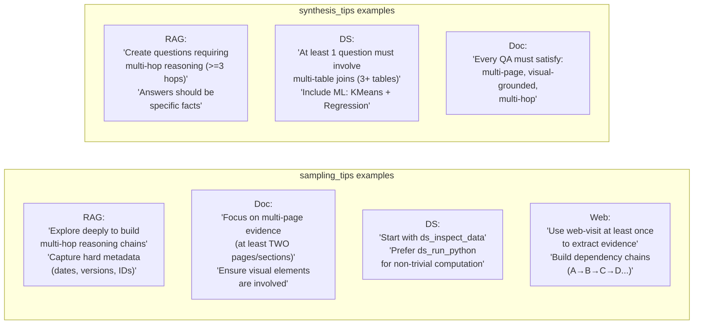

<!-- source: DeepWiki mcp.deepwiki.com · repo OpenDCAI/AgentFlow · page 4.1 Synthesis Configuration · fetched 2026-11-02 -->

# Synthesis Configuration

<details>
<summary>Relevant source files</summary>

The following files were used as context for generating this wiki page:

- [configs/synthesis/doc_config.json](configs/synthesis/doc_config.json)
- [configs/synthesis/doc_ds_config.json](configs/synthesis/doc_ds_config.json)
- [configs/synthesis/ds_config.json](configs/synthesis/ds_config.json)
- [configs/synthesis/rag_config.json](configs/synthesis/rag_config.json)
- [configs/synthesis/web_config.json](configs/synthesis/web_config.json)
- [configs/synthesis/web_rag_config.json](configs/synthesis/web_rag_config.json)
- [sandbox/tool_schemas/ds_tools.py](sandbox/tool_schemas/ds_tools.py)
- [synthesis/pipeline.py](synthesis/pipeline.py)

</details>


This page covers the synthesis configuration files consumed by the data synthesis pipeline — specifically the JSON/YAML files under `configs/synthesis/` and the `SynthesisConfig` class that parses them. These settings govern LLM access, trajectory tree exploration, trajectory selection, sandbox connectivity, and QA generation guidance.

For information on how these configs are used at runtime, see [Running Synthesis](#4.6). For the sandbox server configs they reference, see [Server Configuration](#3.1). For the trajectory and inference configs used in the rollout pipeline, see [Trajectory Config Schema](#8.3) and [Inference Config Schema](#8.4).

---

## Overview

Each synthesis config is a single JSON (or YAML) file passed to `SynthesisPipeline` via `SynthesisConfig.from_json()` or `SynthesisConfig.from_yaml()`. It captures everything the pipeline needs to run one modality end-to-end: which LLM to call, how deep to explore, which tools the agent may use, how to filter trajectories, and what hints to inject into LLM prompts.

**Config files by modality:**

| File | Modality | Available Tools | Max Depth |
|---|---|---|---|
| `configs/synthesis/rag_config.json` | RAG | `rag-search` | 10 |
| `configs/synthesis/doc_config.json` | Document | `doc-search`, `doc-read` | 20 |
| `configs/synthesis/ds_config.json` | Data Science | `ds_inspect_data`, `ds_read_csv`, `ds_run_python` | 20 |
| `configs/synthesis/web_config.json` | Web | `web-search`, `web-visit` | 50 |
| `configs/synthesis/web_rag_config.json` | Web + RAG | `rag-search`, `web-search`, `web-visit` | 50 |
| `configs/synthesis/doc_ds_config.json` | Doc + DS | `doc-search`, `doc-read`, `ds_inspect_data`, `ds_read_csv`, `ds_run_python` | 20 |

Sources: [configs/synthesis/rag_config.json:1-60](), [configs/synthesis/doc_config.json:1-73](), [configs/synthesis/ds_config.json:1-52](), [configs/synthesis/web_config.json:1-44](), [configs/synthesis/web_rag_config.json:1-51](), [configs/synthesis/doc_ds_config.json:1-51]()

---

## How the Config is Loaded

`SynthesisConfig` is imported in [synthesis/pipeline.py:24-30]() from `synthesis/core`. The `main()` function in [synthesis/pipeline.py:222-282]() shows the two loading paths:

- `SynthesisConfig.from_json(path)` — for `.json` files
- `SynthesisConfig.from_yaml(path)` — for `.yaml` / `.yml` files

After loading, `config.validate()` is called in [synthesis/pipeline.py:51-53](); a non-empty error list raises `ValueError`. The config object is then threaded into all three pipeline components:

**Config loading and dispatch:**



Sources: [synthesis/pipeline.py:222-282](), [synthesis/pipeline.py:39-65](), [synthesis/pipeline.py:78-93]()

---

## Parameter Reference

Parameters fall into six groups. Each is described below.

### LLM Settings

Controls which model is called during both trajectory sampling and QA synthesis.

| Parameter | Type | Description |
|---|---|---|
| `model_name` | string | Model identifier passed to the API (e.g., `"openai/gpt-oss-120b"`) |
| `api_key` | string | API key; supports `${ENV_VAR}` substitution |
| `base_url` | string | Base URL for the API endpoint |

`api_key` and `base_url` support environment variable substitution using `${VAR_NAME}` syntax. For example, `"${OPENROUTER_API_KEY}"` is replaced at load time with the value of `$OPENROUTER_API_KEY`. See [Environment Variables](#8.5) for all recognized variables.

Sources: [configs/synthesis/rag_config.json:3-5](), [configs/synthesis/web_config.json:2-4]()

---

### Trajectory Sampling Parameters

These parameters control how the `TrajectorySampler` builds the trajectory tree. See [Trajectory Sampling](#4.3) for implementation details.

| Parameter | Type | Description |
|---|---|---|
| `max_depth` | integer | Maximum number of turns in a single trajectory branch |
| `branching_factor` | integer | Number of child branches to expand at each node |
| `depth_threshold` | integer | Minimum depth at which branching may begin |
| `number_of_seed` | integer \| null | Truncate seed list to this count; `null` processes all seeds |

`max_depth` is the primary lever for controlling trajectory richness. Web configs use 50 to allow for deep multi-hop research chains; RAG configs use 10 since retrieval chains are shorter.

Sources: [configs/synthesis/rag_config.json:7-10](), [configs/synthesis/doc_config.json:6-9](), [configs/synthesis/web_config.json:6-9](), [synthesis/pipeline.py:68-69]()

---

### Trajectory Selection Parameters

Used by `TrajectorySelector` to filter the sampled tree down to the highest-quality paths. See [Trajectory Selection](#4.4).

| Parameter | Type | Description |
|---|---|---|
| `min_depth` | integer | Minimum trajectory depth required for selection |
| `max_selected_traj` | integer | Maximum trajectories to select per seed |
| `path_similarity_threshold` | float | Jaccard/cosine similarity threshold above which two paths are considered duplicates and one is dropped |

`path_similarity_threshold` prevents redundant QA pairs from near-identical trajectories. The default `0.7` is consistent across all modality configs.

`max_selected_traj` is passed explicitly from the pipeline at [synthesis/pipeline.py:155-161]():

```
selector.select_trajectories(
    nodes=trajectory_tree,
    root_id=sampler.root_id,
    seed_data=seed_content,
    source_id=source_id,
    max_selected_traj=self.config.max_selected_traj
)
```

Sources: [configs/synthesis/rag_config.json:11-13](), [configs/synthesis/doc_config.json:10-12](), [synthesis/pipeline.py:155-161]()

---

### Sandbox and Tool Settings

These settings connect the synthesis pipeline to the running sandbox server. See [Server Configuration](#3.1) for the sandbox-server side of this relationship.

| Parameter | Type | Description |
|---|---|---|
| `sandbox_server_url` | string | HTTP URL of the sandbox server (default: `"http://127.0.0.1:18890"`) |
| `sandbox_auto_start` | boolean | If `true`, the pipeline attempts to start the sandbox process automatically |
| `sandbox_config_path` | string | Path to the sandbox server config JSON, used when `sandbox_auto_start` is `true` |
| `sandbox_timeout` | integer | HTTP request timeout in seconds for sandbox calls |
| `available_tools` | array of strings | Tool names the LLM agent is allowed to call during sampling |
| `resource_types` | array of strings | Resource type names for which sessions are created per seed |
| `resource_init_configs` | object | Per-resource-type initialization payloads; keyed by resource type name |

`available_tools` directly determines which tool schemas are injected into the LLM prompt. The tool names correspond to schemas defined in `sandbox/tool_schemas/` (see [Tool Schemas Reference](#3.3)).

`resource_types` and `resource_init_configs` control per-seed session lifecycle. For each listed resource type, the pipeline either creates a new session or reinitializes an existing one, injecting a `custom_name` derived from the source ID. This logic is in [synthesis/pipeline.py:111-143]().

**Example: RAG resource initialization:**

```json
"resource_types": ["rag"],
"resource_init_configs": {
  "rag": {
    "content": {
      "top_k": 10
    }
  }
}
```

Modalities that do not need session state (web, doc, DS in some configs) set `"resource_types": []`.

Sources: [configs/synthesis/rag_config.json:17-31](), [configs/synthesis/doc_config.json:16-22](), [synthesis/pipeline.py:111-143]()

---

### Seed and Output Settings

| Parameter | Type | Description |
|---|---|---|
| `seeds_file` | string | Default path to the seeds JSONL file; overridden by `--seeds` CLI arg |
| `seed_description` | string | Human-readable label for what a seed represents; injected into sampling prompts |
| `output_dir` | string | Default output directory; overridden by `--output-dir` CLI arg |

The `seeds_file` path resolution order is: `--seeds` CLI arg → `config.seeds_file` → `$SEEDS_FILE` env var ([synthesis/pipeline.py:245-247]()).

Sources: [configs/synthesis/rag_config.json:57-59](), [synthesis/pipeline.py:245-252]()

---

### Prompt Guidance: Tips and Examples

These fields are injected as natural-language guidance into LLM prompts. They are the primary mechanism for steering domain-specific sampling and QA generation behavior.

| Parameter | Type | Used In | Purpose |
|---|---|---|---|
| `sampling_tips` | array of strings | `TrajectorySampler` | Instructs the LLM how to explore the trajectory tree |
| `synthesis_tips` | array of strings | `QASynthesizer` | Instructs the LLM how to form QA pairs from a trajectory |
| `qa_examples` | array of `{question, answer}` | `QASynthesizer` | Few-shot examples demonstrating expected QA format and complexity |

**How tips differ per modality:**



Sources: [configs/synthesis/rag_config.json:35-55](), [configs/synthesis/doc_config.json:28-68](), [configs/synthesis/ds_config.json:16-47](), [configs/synthesis/web_config.json:17-39]()

---

## Parameter-to-Pipeline-Stage Mapping

The following diagram shows which config fields are consumed by each stage of the three-stage pipeline.

**SynthesisConfig field consumption by pipeline component:**

```mermaid
flowchart TD
    CFG["SynthesisConfig"]

    subgraph "Stage 1: TrajectorySampler"
        S1A["model_name / api_key / base_url"]
        S1B["max_depth"]
        S1C["branching_factor"]
        S1D["depth_threshold"]
        S1E["available_tools"]
        S1F["sampling_tips"]
        S1G["seed_description"]
    end

    subgraph "Stage 2: TrajectorySelector"
        S2A["min_depth"]
        S2B["max_selected_traj"]
        S2C["path_similarity_threshold"]
    end

    subgraph "Stage 3: QASynthesizer"
        S3A["model_name / api_key / base_url"]
        S3B["synthesis_tips"]
        S3C["qa_examples"]
    end

    subgraph "SandboxWorker"
        SW1["sandbox_server_url"]
        SW2["sandbox_auto_start"]
        SW3["sandbox_config_path"]
        SW4["sandbox_timeout"]
        SW5["resource_types"]
        SW6["resource_init_configs"]
    end

    subgraph "SynthesisPipeline (orchestrator)"
        PL1["number_of_seed"]
        PL2["seeds_file"]
        PL3["output_dir"]
    end

    CFG --> S1A & S1B & S1C & S1D & S1E & S1F & S1G
    CFG --> S2A & S2B & S2C
    CFG --> S3A & S3B & S3C
    CFG --> SW1 & SW2 & SW3 & SW4 & SW5 & SW6
    CFG --> PL1 & PL2 & PL3
```



Sources: [synthesis/pipeline.py:39-197](), [configs/synthesis/rag_config.json:1-60]()

---

## Cross-Modality Parameter Comparison

The table below compares key parameter values across all shipped synthesis configs to make it easy to adapt them for new modalities.

| Parameter | `rag_config` | `doc_config` | `ds_config` | `web_config` | `web_rag_config` | `doc_ds_config` |
|---|---|---|---|---|---|---|
| `max_depth` | 10 | 20 | 20 | 50 | 50 | 20 |
| `branching_factor` | 2 | 2 | 2 | 2 | 2 | 2 |
| `depth_threshold` | 2 | 2 | 2 | 2 | 2 | 2 |
| `min_depth` | 3 | 3 | 3 | 3 | 3 | 3 |
| `max_selected_traj` | 2 | 2 | 1 | 2 | 2 | 3 |
| `path_similarity_threshold` | 0.7 | 0.7 | 0.7 | 0.7 | 0.7 | 0.7 |
| `resource_types` | `["rag"]` | `[]` | *(absent)* | *(absent)* | *(absent)* | `[]` |
| `sandbox_auto_start` | `true` | `true` | *(absent)* | *(absent)* | *(absent)* | `true` |
| `sandbox_timeout` | 120 | 300 | *(absent)* | *(absent)* | *(absent)* | 300 |

> **Note:** Parameters marked *(absent)* indicate the field is not present in that config file, which means the `SynthesisConfig` class uses its default value for that field.

Sources: [configs/synthesis/rag_config.json:7-30](), [configs/synthesis/doc_config.json:6-22](), [configs/synthesis/ds_config.json:6-13](), [configs/synthesis/web_config.json:6-13](), [configs/synthesis/web_rag_config.json:7-15](), [configs/synthesis/doc_ds_config.json:6-22]()

---

## Environment Variable Substitution

Config values may contain `${VAR_NAME}` placeholders that are substituted at load time from the process environment. This keeps credentials out of committed config files.

| Placeholder | Typical Use |
|---|---|
| `${OPENROUTER_API_KEY}` | `api_key` in most configs |
| `${OPENAI_API_KEY}` | `api_key` in `ds_config.json` |
| `${OPENAI_API_URL}` | `base_url` in `ds_config.json` |

For a complete list of all environment variables used across the system, see [Environment Variables](#8.5).

Sources: [configs/synthesis/rag_config.json:3-5](), [configs/synthesis/ds_config.json:2-4]()

---

## Annotated Example Config

The following is `configs/synthesis/rag_config.json` with each field annotated by its group:

```json
{
  // --- LLM Settings ---
  "model_name": "openai/gpt-oss-120b",
  "api_key": "${OPENROUTER_API_KEY}",
  "base_url": "https://openrouter.ai/api/v1",

  // --- Trajectory Sampling ---
  "max_depth": 10,
  "branching_factor": 2,
  "depth_threshold": 2,

  // --- Trajectory Selection ---
  "min_depth": 3,
  "max_selected_traj": 2,
  "path_similarity_threshold": 0.7,

  // --- Seed Settings ---
  "number_of_seed": null,
  "seed_description": "Starting entity and its description",

  // --- Sandbox / Tool Settings ---
  "resource_types": ["rag"],
  "resource_init_configs": {
    "rag": { "content": { "top_k": 10 } }
  },
  "sandbox_server_url": "http://127.0.0.1:18890",
  "sandbox_auto_start": true,
  "sandbox_config_path": "configs/sandbox-server/rag_config.json",
  "sandbox_timeout": 120,
  "available_tools": ["rag-search"],

  // --- Prompt Guidance ---
  "sampling_tips": ["Explore deeply...", "..."],
  "synthesis_tips": ["Create questions requiring multi-hop reasoning...", "..."],
  "qa_examples": [{ "question": "...", "answer": "2004" }],

  // --- Output Settings ---
  "seeds_file": "seeds/rag/seeds.jsonl",
  "output_dir": "results"
}
```

Sources: [configs/synthesis/rag_config.json:1-60]()

---

