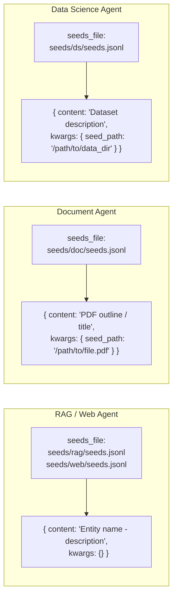
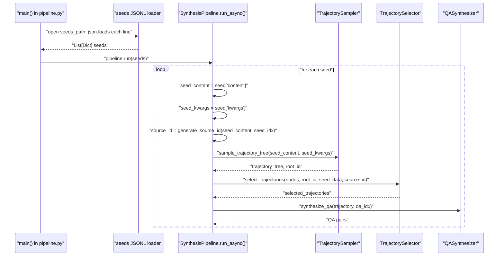

<!-- source: DeepWiki mcp.deepwiki.com · repo OpenDCAI/AgentFlow · page 4.2 Seed Data Format · fetched 2026-11-02 -->

# Seed Data Format

<details>
<summary>Relevant source files</summary>

The following files were used as context for generating this wiki page:

- [configs/synthesis/doc_config.json](configs/synthesis/doc_config.json)
- [configs/synthesis/doc_ds_config.json](configs/synthesis/doc_ds_config.json)
- [configs/synthesis/ds_config.json](configs/synthesis/ds_config.json)
- [configs/synthesis/rag_config.json](configs/synthesis/rag_config.json)
- [configs/synthesis/web_config.json](configs/synthesis/web_config.json)
- [configs/synthesis/web_rag_config.json](configs/synthesis/web_rag_config.json)
- [sandbox/tool_schemas/ds_tools.py](sandbox/tool_schemas/ds_tools.py)
- [synthesis/pipeline.py](synthesis/pipeline.py)

</details>


This page documents the format and structure of seed data files used as input to the AgentFlow data synthesis pipeline. Seeds define the starting context from which the `TrajectorySampler` builds trajectory trees for each agent type. For information on how seeds drive the trajectory exploration process, see [Trajectory Sampling](#4.3). For the configuration parameters that reference seed files (such as `seeds_file`, `seed_description`, and `number_of_seed`), see [Synthesis Configuration](#4.1).

---

## What Seeds Are

A seed is a single structured record that provides the LLM agent with a starting context — a topic, a resource path, or an entity description — from which it explores using the available tools. Each seed produces one trajectory tree during the sampling stage, and ultimately contributes zero or more QA pairs to the final output.

---

## File Location and Configuration

Seed files are stored under the `seeds/` directory, organized by agent type:

| Agent Type      | Default Seed File Path        | `seed_description` (from config)         |
|-----------------|-------------------------------|------------------------------------------|
| RAG             | `seeds/rag/seeds.jsonl`       | Starting entity and its description      |
| Document        | `seeds/doc/seeds.jsonl`       | Outline of PDF document                  |
| Data Science    | `seeds/ds/seeds.jsonl`        | Data directory containing CSV files      |
| Web             | `seeds/web/seeds.jsonl`       | Starting entity and its description      |

The active seed file is specified in the synthesis config via the `seeds_file` field. The pipeline also accepts the path via the `--seeds` CLI argument or the `SEEDS_FILE` environment variable, checked in that order of precedence ([synthesis/pipeline.py:244-248]()).

---

## File Format: JSONL

Seed files use **JSONL (JSON Lines)** format: each line is a complete, self-contained JSON object representing one seed. Blank lines are ignored.

```
{"content": "...", "kwargs": {...}}
{"content": "...", "kwargs": {...}}
```

The loader in `SynthesisPipeline.main()` reads the file line by line and calls `json.loads()` on each non-empty line ([synthesis/pipeline.py:256-270]()).

---

## Seed Object Structure

Every seed object must conform to the following structure:

**Diagram: Seed Object Field Mapping to Code**

```mermaid
graph TD
    SeedObj["seed (Dict)"]
    SeedObj --> ContentField["\"content\" (str)\nRequired"]
    SeedObj --> KwargsField["\"kwargs\" (dict)\nOptional, defaults to {}"]

    ContentField --> SeedContent["seed_content\n= seed.get('content', '')"]
    KwargsField --> SeedKwargs["seed_kwargs\n= seed.get('kwargs', {})"]

    SeedContent --> SamplerCall["sampler.sample_trajectory_tree\n(seed_content, seed_kwargs)"]
    SeedKwargs --> SamplerCall

    SeedContent --> SourceID["generate_source_id\n(seed_content, seed_idx)"]
    SourceID --> SessionName["session custom_name\n= resource_type + '_' + source_id"]
```

Sources: [synthesis/pipeline.py:97-99](), [synthesis/pipeline.py:147](), [synthesis/pipeline.py:139]()

### `content` (required, string)

A free-text description that tells the agent what to explore. The meaning of this field varies by agent type, and is captured in the `seed_description` synthesis config parameter.

- For **RAG and Web agents**: a named entity and a short factual description.
- For **Document agents**: a summary or outline of the PDF being explored.
- For **Data Science agents**: a brief description of the dataset (e.g., its domain and table names).

If a seed is missing the `content` key, the loader raises a `ValueError` ([synthesis/pipeline.py:264-265]()).

### `kwargs` (optional, dict)

A dictionary of extra parameters passed directly to the `TrajectorySampler`. If absent, it defaults to `{}` ([synthesis/pipeline.py:266-268]()). The most common use is to supply `seed_path`.

#### `seed_path` — Path Injection for File-Based Agents

For agents that operate on local files (Document and Data Science), `kwargs` must contain a `seed_path` key pointing to the resource directory or file. The sandbox backends and tool schemas for these agent types automatically inject `seed_path` from the seed context, so the LLM does not need to include it in tool call arguments.

From the DS tool schema documentation:
- `ds_inspect_data`: "Takes no parameters; `seed_path` is injected automatically." ([sandbox/tool_schemas/ds_tools.py:93-94]())
- `ds_read_csv`: "Do not include `seed_path` in `csv_file`. `seed_path` is injected automatically from seed context." ([sandbox/tool_schemas/ds_tools.py:33-35]())
- `ds_run_python`: "`seed_path` is injected automatically from seed context." ([sandbox/tool_schemas/ds_tools.py:64-65]())

The Document agent config sampling tips confirm the same pattern: "Note: `seed_path` is automatically provided from `seed.jsonl` kwargs, you don't need to specify it when calling `doc-search` or `doc-read`." ([configs/synthesis/doc_config.json:38]())

---

## Agent-Specific Seed Examples

The examples below illustrate valid seed records for each major agent type.

**Diagram: Seed Format by Agent Type (from configs to JSONL)**



Sources: [configs/synthesis/rag_config.json:32-58](), [configs/synthesis/doc_config.json:26-71](), [configs/synthesis/ds_config.json:16-51](), [configs/synthesis/web_config.json:16-43]()

### RAG Agent

```json
{"content": "Apple Inc. - American multinational technology company headquartered in Cupertino, California, founded in 1976", "kwargs": {}}
```

### Web Agent

```json
{"content": "OpenAI - AI research laboratory founded in 2015, known for developing GPT models and DALL-E", "kwargs": {}}
```

### Document Agent

```json
{"content": "Annual Report 2023 - Financial Highlights, Risk Factors, Board Composition, Revenue Breakdown by Segment", "kwargs": {"seed_path": "/data/docs/annual_report_2023.pdf"}}
```

### Data Science Agent

```json
{"content": "E-commerce dataset containing users, orders, and products tables for customer segmentation analysis", "kwargs": {"seed_path": "/data/ecommerce"}}
```

---

## How Seeds Are Consumed in the Pipeline

**Diagram: Seed Loading and Processing in `SynthesisPipeline`**



Sources: [synthesis/pipeline.py:66-203](), [synthesis/pipeline.py:96-107](), [synthesis/pipeline.py:145-185]()

Key behaviors:
- Seeds are processed one at a time, serially ([synthesis/pipeline.py:96]()).
- `generate_source_id` creates a stable identifier by MD5-hashing `seed_content` and combining it with the seed index ([synthesis/pipeline.py:33-36]()). This identifier is used to name sandbox sessions, making debugging easier.
- If `config.number_of_seed` is set (non-null), the seeds list is truncated before processing begins ([synthesis/pipeline.py:68-69]()).
- A failure in any individual seed is caught and logged without aborting the rest of the run ([synthesis/pipeline.py:187-191]()).

---

## Session Isolation Per Seed

For agent types that use stateful sandbox resources (e.g., RAG), the pipeline reinitializes or creates a new sandbox session for each seed. The session is named `{resource_type}_{source_id}` to provide isolation and traceability between seeds ([synthesis/pipeline.py:133-143]()).

This means each seed processes against a clean state, preventing tool results from one seed leaking into the trajectory of the next.

---

## Validation Rules

The following validations are applied when loading seeds ([synthesis/pipeline.py:262-270]()):

| Rule | Error |
|------|-------|
| Each line must deserialize to a `dict` | `ValueError: Each seed must be a dict...` |
| `content` key must be present | `ValueError: Seed missing 'content' field` |
| `kwargs` is optional; defaults to `{}` if absent | No error; silently filled in |

The `number_of_seed` config parameter (see [Synthesis Configuration](#4.1)) can be used to limit the number of seeds processed in a run, which is useful for testing with a small subset of a large seed file.

---

