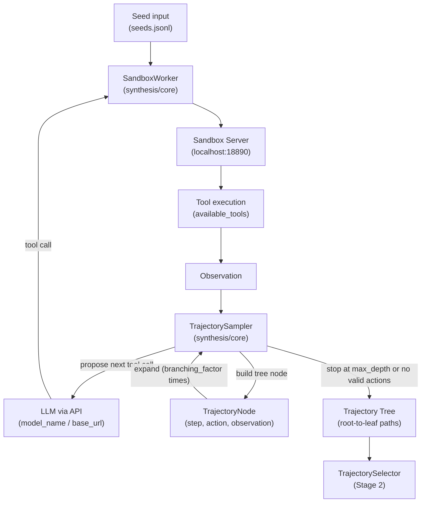
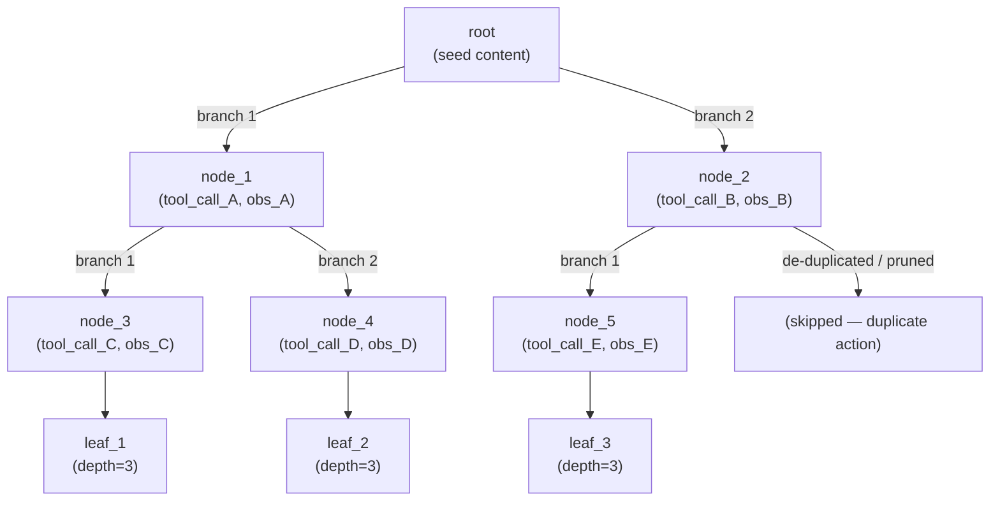
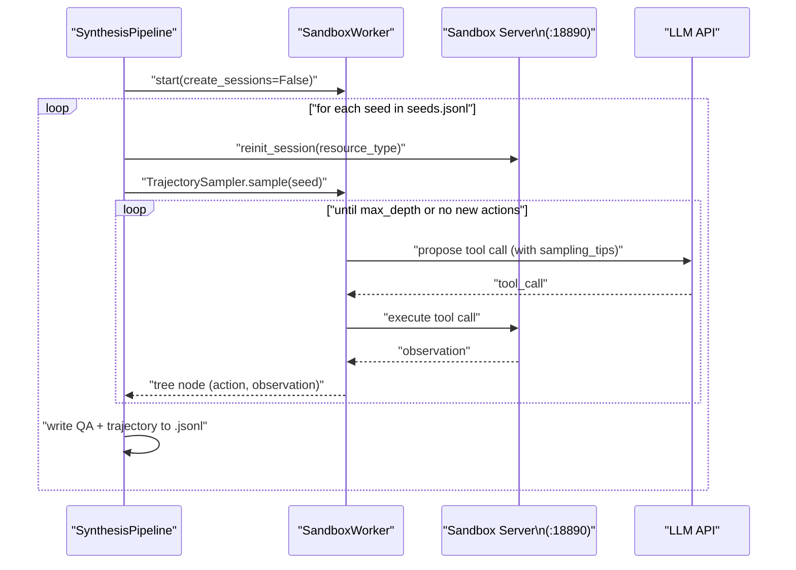

<!-- source: DeepWiki mcp.deepwiki.com · repo OpenDCAI/AgentFlow · page 4.3 Trajectory Sampling · fetched 2026-11-02 -->

# Trajectory Sampling

<details>
<summary>Relevant source files</summary>

The following files were used as context for generating this wiki page:

- [README.md](README.md)
- [README_zh.md](README_zh.md)
- [assets/intro.png](assets/intro.png)
- [assets/method.png](assets/method.png)
- [assets/wechat.jpg](assets/wechat.jpg)
- [assets/wechatshow.png](assets/wechatshow.png)
- [configs/synthesis/doc_ds_config.json](configs/synthesis/doc_ds_config.json)
- [configs/synthesis/ds_config.json](configs/synthesis/ds_config.json)
- [sandbox/tool_schemas/ds_tools.py](sandbox/tool_schemas/ds_tools.py)
- [synthesis/pipeline.py](synthesis/pipeline.py)

</details>


This page describes the trajectory sampling stage — the first of three stages in AgentFlow's data synthesis pipeline. It covers the tree construction process, the role of the LLM agent, how the sandbox is used during sampling, and the configuration parameters that control sampling behavior.

For how sampled trajectories are then filtered, see [Trajectory Selection](#4.4). For how QA pairs are generated from selected trajectories, see [QA Synthesis](#4.5). For an overview of all three stages, see [Three-Stage Data Synthesis Pipeline](#2.1).

---

## Purpose

Trajectory sampling produces a **trajectory tree**: a branching record of an LLM agent iteratively exploring a sandbox environment starting from a seed input. Each node in the tree is a (tool call, observation) pair. The result is a set of root-to-leaf paths that will be scored and filtered in the next stage.

The output of this stage feeds directly into `TrajectorySelector`.

---

## High-Level Flow

**Diagram: Trajectory Sampling Flow**



Sources: [README.md:79-80](), [synthesis/pipeline.py:91-93]()

---

## Key Components

| Component | Location | Role |
|---|---|---|
| `TrajectorySampler` | `synthesis/core/` | Builds the trajectory tree; drives the LLM + tool loop |
| `SandboxWorker` | `synthesis/core/` | HTTP client to the sandbox server; executes tool calls |
| `SynthesisConfig` | `synthesis/core/` | Holds all sampling parameters; validated on init |
| `SynthesisPipeline` | `synthesis/pipeline.py` | Orchestrates workers, samplers, selectors, synthesizers |
| Sandbox Server | `localhost:18890` | Executes tools (RAG, SQL, doc, web, DS, VM, etc.) |

The `SynthesisPipeline` instantiates these components and coordinates the per-seed sampling loop:

[synthesis/pipeline.py:79-93]()

---

## The Trajectory Tree

**Diagram: Trajectory Tree Structure (TrajectorySampler)**



**Tree construction rules:**

- **Root** is a seed input string from `seeds.jsonl`.
- At each non-leaf node, the LLM proposes up to `branching_factor` distinct tool calls.
- Each proposed tool call is executed against the sandbox; the observation becomes the new node's payload.
- **Action de-duplication**: if a proposed tool call is identical (or very similar) to one already seen at the same tree level, it is skipped.
- Expansion stops when `max_depth` is reached or no valid new tool calls are proposed.

Sources: [README.md:79-80](), [configs/synthesis/ds_config.json:1-52]()

---

## Sampling Configuration Parameters

These parameters live in `configs/synthesis/*.json` and are loaded into `SynthesisConfig`.

| Parameter | Type | Example | Description |
|---|---|---|---|
| `max_depth` | int | `20` | Maximum steps from root to leaf |
| `branching_factor` | int | `2` | Number of branches to attempt at each node |
| `depth_threshold` | int | `2` | Minimum depth before a branch is considered valid |
| `min_depth` | int | `3` | Minimum depth for a trajectory to be eligible for selection |
| `max_selected_traj` | int | `1–3` | Maximum trajectories selected per seed (used by `TrajectorySelector`) |
| `path_similarity_threshold` | float | `0.7` | Threshold for filtering near-duplicate paths (used in selection) |
| `model_name` | string | `"openai/gpt-oss-120b"` | LLM used to propose tool calls |
| `base_url` | string | `"https://openrouter.ai/api/v1"` | LLM API endpoint |
| `api_key` | string | `"${OPENROUTER_API_KEY}"` | API key (env var reference) |
| `available_tools` | list | `["ds_inspect_data", "ds_read_csv", "ds_run_python"]` | Tool names available to the LLM |
| `sampling_tips` | list of strings | (see below) | Injected into the LLM prompt during sampling |
| `sandbox_server_url` | string | `"http://127.0.0.1:18890"` | Address of the sandbox server |
| `sandbox_timeout` | int | `300` | Per-tool-call timeout (seconds) |
| `number_of_seed` | int or null | `null` | Limit seeds processed; `null` means all |

Sources: [configs/synthesis/ds_config.json:1-52](), [configs/synthesis/doc_ds_config.json:1-51]()

---

## Sampling Tips

`sampling_tips` is a list of strings injected into the LLM system prompt during the sampling loop. They guide the agent toward useful tool call sequences specific to the modality.

**Example — Data Science agent:**

```
"Your data lives under the provided seed_path; start with ds_inspect_data."
"Prefer ds_run_python for any non-trivial computation (joins, aggregation, segmentation, clustering)."
"When reading CSVs, use filenames like users.csv/products.csv/orders.csv (avoid embedding seed_path in csv_file)."
```

**Example — Document + DS combined agent:**

```
"For documents: use doc-search and doc-read to locate and extract evidence."
"For data: use ds:inspect_data, ds:read_csv, and ds:run_python for analysis."
"Chain operations appropriately based on the seed type."
```

These tips are modality-specific and tuned per config file.

Sources: [configs/synthesis/ds_config.json:16-22](), [configs/synthesis/doc_ds_config.json:33-39]()

---

## Per-Seed Session Lifecycle

Each seed is processed with a fresh sandbox session to ensure isolation between seeds. The `SynthesisPipeline` manages this lifecycle:

1. `SandboxWorker.start(create_sessions=False)` — starts the worker without creating any sessions.
2. For each seed: sessions matching `resource_types` are created or reinitialized via the sandbox server's session management API.
3. `TrajectorySampler` runs the sampling loop against the active session.
4. After the seed completes, results are written to the output files before the next seed begins.

This prevents state from leaking between seeds when the sandbox resource is stateful (e.g., SQL databases, VM state, document indexes).

**Diagram: Per-Seed Lifecycle in SynthesisPipeline**



Sources: [synthesis/pipeline.py:66-140]()

---

## Tool Availability and Agent Behavior

The LLM agent sees only the tools listed in `available_tools`. Tools are resolved against the sandbox's tool schema registry. Different synthesis configs expose different tool subsets:

| Config | Available Tools |
|---|---|
| `ds_config.json` | `ds_inspect_data`, `ds_read_csv`, `ds_run_python` |
| `doc_ds_config.json` | `doc-search`, `doc-read`, `ds_inspect_data`, `ds_read_csv`, `ds_run_python` |
| Web agent | `web-search`, `web-visit` |
| RAG agent | `rag-search` |
| SQL agent | `sql:list_databases`, `sql:get_schema`, `sql:execute` |

The tool schemas passed to the LLM are defined in `sandbox/tool_schemas/` — for example, DS tools are in [sandbox/tool_schemas/ds_tools.py:1-96](). Each schema includes a `description` field and a `parameters` list that become part of the LLM function-calling payload.

For a complete reference of tool schemas, see [Tool Schemas Reference](#3.3). For sandbox configuration, see [Server Configuration](#3.1).

Sources: [configs/synthesis/ds_config.json:14](), [configs/synthesis/doc_ds_config.json:24-30](), [sandbox/tool_schemas/ds_tools.py:11-22]()

---

## Output Files

After all seeds are processed, `SynthesisPipeline` writes two output files:

| File | Content |
|---|---|
| `results/ds_synthesized_qa/synthesized_qa.jsonl` | QA pairs generated by `QASynthesizer` (stage 3 output) |
| `results/ds_synthesized_qa/trajectories.jsonl` | Full trajectory records — one per selected path |

The trajectory records written here form the training data used downstream. Each record corresponds to one root-to-leaf path from the trajectory tree, carrying the full sequence of (tool call, observation) pairs.

For how trajectories are scored and filtered before being written, see [Trajectory Selection](#4.4).

Sources: [synthesis/pipeline.py:59-64]()

---

