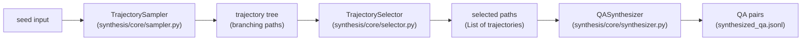
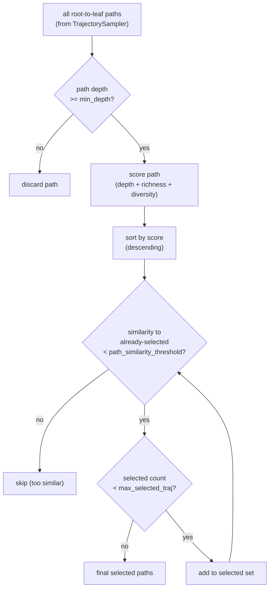

<!-- source: DeepWiki mcp.deepwiki.com · repo OpenDCAI/AgentFlow · page 4.4 Trajectory Selection · fetched 2026-11-02 -->

# Trajectory Selection

<details>
<summary>Relevant source files</summary>

The following files were used as context for generating this wiki page:

- [README.md](README.md)
- [README_zh.md](README_zh.md)
- [assets/intro.png](assets/intro.png)
- [assets/method.png](assets/method.png)
- [assets/wechat.jpg](assets/wechat.jpg)
- [assets/wechatshow.png](assets/wechatshow.png)
- [configs/synthesis/doc_ds_config.json](configs/synthesis/doc_ds_config.json)
- [configs/synthesis/ds_config.json](configs/synthesis/ds_config.json)
- [sandbox/tool_schemas/ds_tools.py](sandbox/tool_schemas/ds_tools.py)
- [synthesis/pipeline.py](synthesis/pipeline.py)

</details>


This page documents Stage 2 of AgentFlow's three-stage data synthesis pipeline: **Trajectory Selection**. It covers how root-to-leaf paths from the sampled trajectory tree are scored, filtered, and reduced to a high-quality subset before QA generation.

- For details on how the trajectory tree is built (Stage 1), see [4.3](#4.3).
- For details on how QA pairs are generated from selected paths (Stage 3), see [4.5](#4.5).
- For configuration parameters that govern selection behavior, see [8.2](#8.2).

---

## Role in the Pipeline

After `TrajectorySampler` builds a branching trajectory tree by exploring the sandbox environment from a seed input, `TrajectorySelector` is responsible for reducing that tree to a small set of high-quality, non-redundant root-to-leaf paths. Only the paths that pass selection are forwarded to `QASynthesizer`.

**Pipeline position — class-level view:**



Sources: [synthesis/pipeline.py:24-30](), [synthesis/pipeline.py:89-93](), README.md:77-83

---

## Selection Criteria

As stated in the README, all root-to-leaf paths are scored and filtered using three criteria:

| Criterion | Description |
|---|---|
| **Depth** | Longer paths (more tool calls) contain richer multi-hop evidence. Paths shorter than `min_depth` are discarded. |
| **Information richness** | Paths with larger or more substantive observations are preferred. |
| **Tool diversity** | Paths that exercise more varied tool types are scored higher, which encourages coverage across retrieval and reasoning steps. |

After scoring, a **similarity filter** removes paths that are too similar to already-selected paths. The similarity cutoff is set by `path_similarity_threshold`. Finally, selection is capped at `max_selected_traj` paths per seed.

Sources: README.md:81-82, [configs/synthesis/ds_config.json:9-11](), [configs/synthesis/doc_ds_config.json:9-11]()

---

## Selection Decision Flow

The following diagram maps each decision step to the configuration parameter that controls it.

**Selection logic — decision flow:**



Sources: README.md:81-82, [configs/synthesis/ds_config.json:6-11](), [configs/synthesis/doc_ds_config.json:6-11]()

---

## Configuration Parameters

These fields in the synthesis config JSON file directly control `TrajectorySelector` behavior. They are part of `SynthesisConfig` ([synthesis/pipeline.py:26]()).

| Parameter | Type | Description | Example value |
|---|---|---|---|
| `min_depth` | integer | Minimum number of steps a path must have to be eligible for selection. | `3` |
| `depth_threshold` | integer | Auxiliary depth threshold used in scoring; paths above this receive an additional score boost. | `2` |
| `max_selected_traj` | integer | Maximum number of paths to select per seed. | `1`–`3` |
| `path_similarity_threshold` | float (0–1) | Maximum allowed similarity between any two selected paths. Paths above this threshold relative to an already-selected path are dropped. | `0.7` |

Setting `max_selected_traj` to `1` (as in `ds_config.json`) selects only the single best-scoring path per seed. Setting it to `3` (as in `doc_ds_config.json`) allows up to three diverse paths, which produces more training samples per seed at the cost of some quality variance.

Sources: [configs/synthesis/ds_config.json:9-11](), [configs/synthesis/doc_ds_config.json:9-11]()

---

## TrajectorySelector in the Pipeline

`TrajectorySelector` is instantiated in `SynthesisPipeline.run_async` and operates synchronously on the trajectory tree produced by `TrajectorySampler` for each seed.

```
synthesis/pipeline.py
  └─ SynthesisPipeline.run_async()
       ├─ sampler = TrajectorySampler(worker, config)   # Stage 1
       ├─ selector = TrajectorySelector(config)          # Stage 2
       └─ synthesizer = QASynthesizer(config)            # Stage 3
```

The `TrajectorySelector` receives the `SynthesisConfig` object, which carries all selection parameters. It does not communicate with the sandbox server — selection is a pure in-memory operation on the trajectory data structure returned by the sampler.

Sources: [synthesis/pipeline.py:89-93](), [synthesis/pipeline.py:26-30]()

---

## Relationship Between Sampling and Selection Parameters

The selection parameters work in conjunction with the sampling parameters. The table below shows how parameters from both stages interact.

| Sampling parameter | Effect on tree | Selection parameter that responds |
|---|---|---|
| `max_depth` | Controls maximum path length | `min_depth` (lower bound on accepted depth) |
| `branching_factor` | Controls how many branches exist at each node | `max_selected_traj` (cap on paths kept from any subtree) |
| `max_depth` | Produces deeper paths with more tool calls | `depth_threshold` (score threshold for depth bonus) |
| (action de-duplication in sampler) | Reduces redundant siblings | `path_similarity_threshold` (further de-duplicates at the path level) |

The de-duplication happens at two levels: the sampler avoids identical tool calls at the same node, and the selector additionally removes paths that are too similar at the full-path level.

Sources: README.md:79-82, [configs/synthesis/ds_config.json:6-11](), [configs/synthesis/doc_ds_config.json:6-11]()

---

## Output

`TrajectorySelector` returns a list of path objects, each representing a full root-to-leaf sequence of `(tool_call, observation)` pairs. These paths are consumed by `QASynthesizer`, which uses the accumulated observations as grounding evidence to generate multi-hop QA pairs.

The number of selected paths per seed is bounded by `max_selected_traj`. In the pipeline, each selected path typically produces one QA pair, so `max_selected_traj` also controls the density of training examples generated per seed.

Selected trajectories are eventually written to `trajectories.jsonl` in the results directory, alongside `synthesized_qa.jsonl`.

Sources: [synthesis/pipeline.py:58-64](), [synthesis/pipeline.py:89-93](), README.md:82-83

---

