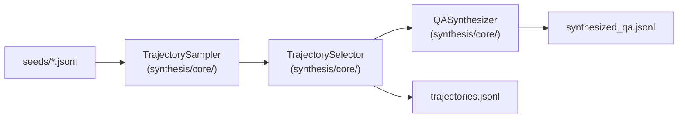
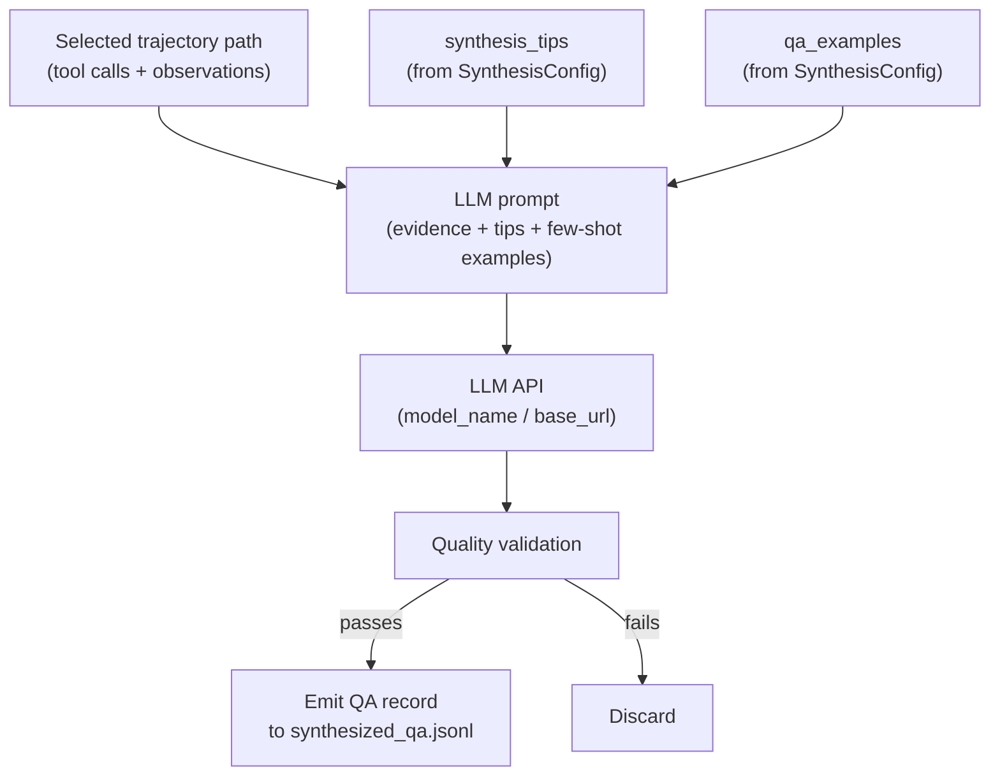
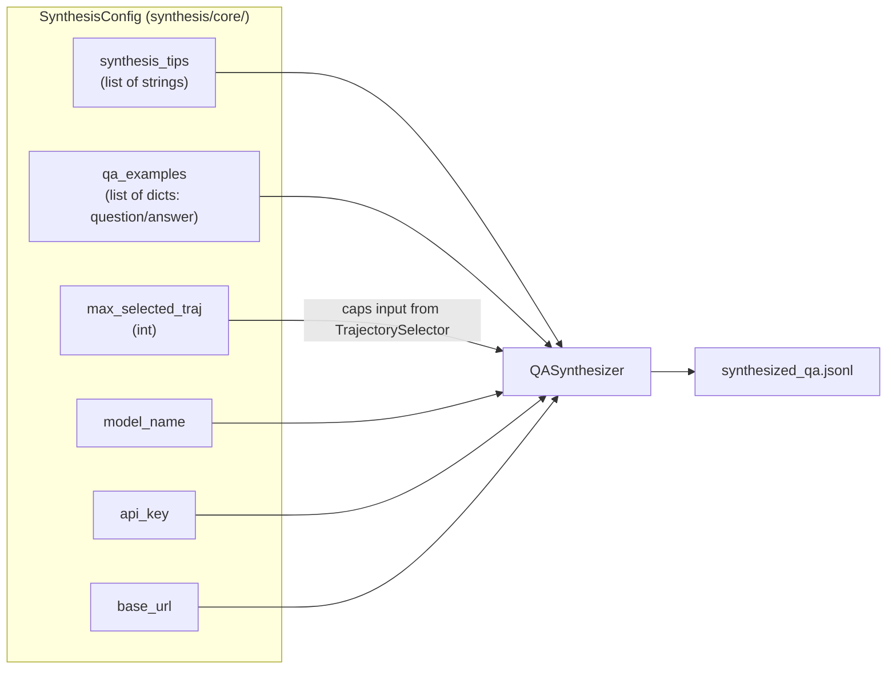

<!-- source: DeepWiki mcp.deepwiki.com · repo OpenDCAI/AgentFlow · page 4.5 QA Synthesis · fetched 2026-11-02 -->

# QA Synthesis

<details>
<summary>Relevant source files</summary>

The following files were used as context for generating this wiki page:

- [README.md](README.md)
- [README_zh.md](README_zh.md)
- [assets/intro.png](assets/intro.png)
- [assets/method.png](assets/method.png)
- [assets/wechat.jpg](assets/wechat.jpg)
- [assets/wechatshow.png](assets/wechatshow.png)
- [configs/synthesis/doc_ds_config.json](configs/synthesis/doc_ds_config.json)
- [configs/synthesis/ds_config.json](configs/synthesis/ds_config.json)
- [sandbox/tool_schemas/ds_tools.py](sandbox/tool_schemas/ds_tools.py)
- [synthesis/pipeline.py](synthesis/pipeline.py)

</details>


QA Synthesis is the third and final stage of AgentFlow's three-stage data synthesis pipeline. It takes the trajectories that survived the selection stage and uses an LLM to produce multi-hop, factoid question-answer pairs grounded in the evidence collected during agent exploration. The output — `synthesized_qa.jsonl` — is the primary training artifact for supervised fine-tuning of agentic models.

This page covers the QA generation and validation logic inside `QASynthesizer`. For the preceding stage that produces the input to this stage, see [Trajectory Selection](#4.4). For how to invoke the full pipeline that includes this stage, see [Running Synthesis](#4.6). For the configuration file fields that control QA generation behaviour, see [Synthesis Configuration](#4.1).

---

## Position in the Pipeline

**Diagram: QASynthesizer in the three-stage pipeline**



Sources: [synthesis/pipeline.py:88-93](), [synthesis/pipeline.py:58-60]()

The three components are instantiated sequentially in `SynthesisPipeline.run_async`:

| Component | Class | Role |
|---|---|---|
| Stage 1 | `TrajectorySampler` | Explores the sandbox, builds a trajectory tree |
| Stage 2 | `TrajectorySelector` | Scores and filters paths by depth, richness, diversity |
| Stage 3 | `QASynthesizer` | Generates QA pairs from selected paths |

The `QASynthesizer` receives its configuration through the shared `SynthesisConfig` object, which carries all three stages' parameters.

Sources: [synthesis/pipeline.py:24-30](), [synthesis/pipeline.py:88-93]()

---

## Input: Selected Trajectories

`TrajectorySelector` produces a list of `(path, observations)` pairs. Each path is a root-to-leaf sequence of tool calls and their responses drawn from the trajectory tree sampled in Stage 1. A selected path has already passed filters for:

- Minimum depth (`min_depth`)
- Maximum depth (`max_depth`)
- Similarity de-duplication (`path_similarity_threshold`)
- Maximum count per seed (`max_selected_traj`)

`QASynthesizer` receives this filtered set. For each path, it assembles the concatenated observations as the factual "evidence document" and asks the LLM to derive a question-answer pair from it.

Sources: [synthesis/pipeline.py:88-95](), [configs/synthesis/ds_config.json:7-11]()

---

## QA Generation Process

**Diagram: QASynthesizer data flow**



Sources: [synthesis/pipeline.py:88-93](), [configs/synthesis/ds_config.json:24-47](), [configs/synthesis/doc_ds_config.json:41-45]()

The LLM prompt is constructed from three sources:

| Prompt Component | Config Field | Purpose |
|---|---|---|
| Collected observations (evidence) | *(derived from trajectory)* | Grounds the question in verifiable facts |
| Generation directives | `synthesis_tips` | Steers the LLM toward desired question types |
| Few-shot examples | `qa_examples` | Demonstrates expected output format and difficulty level |

As described in the README, the process includes "built-in quality checks" — generated QA pairs that do not meet the required format or that are unanswerable from the provided evidence are discarded rather than written to the output file.

Sources: [README.md:79-83](), [configs/synthesis/ds_config.json:24-47]()

---

## Configuration Parameters

The following fields in the synthesis config file directly control QA Synthesis behaviour. All other fields (e.g. `max_depth`, `branching_factor`) belong to the earlier stages.

**Diagram: Config fields consumed by QASynthesizer**



Sources: [configs/synthesis/ds_config.json:1-52](), [configs/synthesis/doc_ds_config.json:1-51]()

| Field | Type | Description |
|---|---|---|
| `synthesis_tips` | `list[str]` | Directives injected into the LLM prompt to control question type, difficulty, and format |
| `qa_examples` | `list[dict]` | Few-shot `{question, answer}` pairs that demonstrate the desired output style |
| `max_selected_traj` | `int` | Upper bound on trajectories fed to the synthesizer per seed (also a `TrajectorySelector` parameter) |
| `model_name` | `str` | LLM used for generation (same model used by the sampler) |
| `api_key` | `str` | API key; supports `${ENV_VAR}` substitution |
| `base_url` | `str` | API endpoint (OpenRouter, OpenAI-compatible) |

Sources: [configs/synthesis/ds_config.json:1-52]()

---

## Synthesis Tips by Modality

`synthesis_tips` is the primary knob for controlling QA quality. The content differs substantially across agent types to match the evidence available in each domain.

**Data Science (`ds_config.json`)**

```
"synthesis_tips": [
    "Generate ONLY complex data-analysis questions grounded in the provided CSV schema.",
    "At least 1 question must involve multi-table joins (3+ tables).",
    "Include at least 1 question requiring Statistical Hypothesis Testing.",
    "At least 2 questions must involve Machine Learning (Clustering + Predictive Modeling).",
    "Include questions on Feature Correlation (Pearson/Spearman).",
    "Answers must be computed from the full, cleaned dataset.",
    "Numeric results rounded to 2 decimal places."
]
```

**Document + Data Science (`doc_ds_config.json`)**

```
"synthesis_tips": [
    "Create questions requiring multi-hop reasoning.",
    "If using data analysis, ensure answers are grounded in computed results.",
    "If using documents, ensure answers are grounded in extracted evidence."
]
```

The tips are modality-specific but share a common pattern: they require answers to be **grounded in the trajectory observations**, **multi-hop** in nature, and **unambiguous** (one correct factoid answer).

Sources: [configs/synthesis/ds_config.json:24-32](), [configs/synthesis/doc_ds_config.json:41-45]()

---

## Few-Shot Examples (`qa_examples`)

The `qa_examples` field provides concrete demonstrations of the desired output. For DS synthesis, these illustrate the precision expected of numerical answers:

| Example question (abbreviated) | Answer |
|---|---|
| "Total revenue = sum(quantity * unit_price) across all orders?" | `"10734"` |
| "How many orders have a user_id missing from users.csv?" | `"invalid_users=0, invalid_products=0"` |
| "Which KMeans cluster has the highest mean total_revenue?" | `"cluster=1, size=2"` |

An empty `qa_examples` list (as in `doc_ds_config.json`) relies entirely on `synthesis_tips` and the evidence text to guide output format.

Sources: [configs/synthesis/ds_config.json:34-47](), [configs/synthesis/doc_ds_config.json:47]()

---

## Output Format

Successfully validated QA pairs are appended to `synthesized_qa.jsonl` (one JSON object per line). The corresponding trajectories are written separately to `trajectories.jsonl`.

| Output file | Content |
|---|---|
| `synthesized_qa.jsonl` | One QA record per line; includes `question`, `answer`, and provenance fields |
| `trajectories.jsonl` | The selected trajectory paths used to ground each QA pair |

Both files are written to `results/ds_synthesized_qa/` as determined by `SynthesisPipeline.__init__`.

Sources: [synthesis/pipeline.py:44-64]()

---

## Quality Validation

The README states that QA synthesis has "built-in quality checks." The following conditions cause a generated pair to be discarded:

- The answer is not derivable from the observed evidence in the trajectory.
- The output does not conform to the required schema (missing `question` or `answer` fields).
- The question is trivially answerable without multi-hop reasoning (checked against `synthesis_tips` constraints).

Failed validations result in no record being written; the seed is not retried with a new trajectory unless additional trajectories remain within `max_selected_traj`.

Sources: [README.md:79-83](), [synthesis/pipeline.py:88-180]()

---

