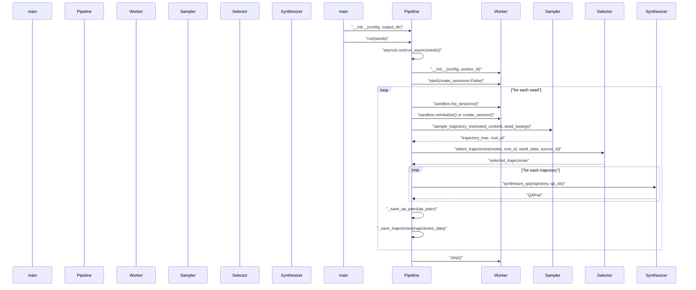
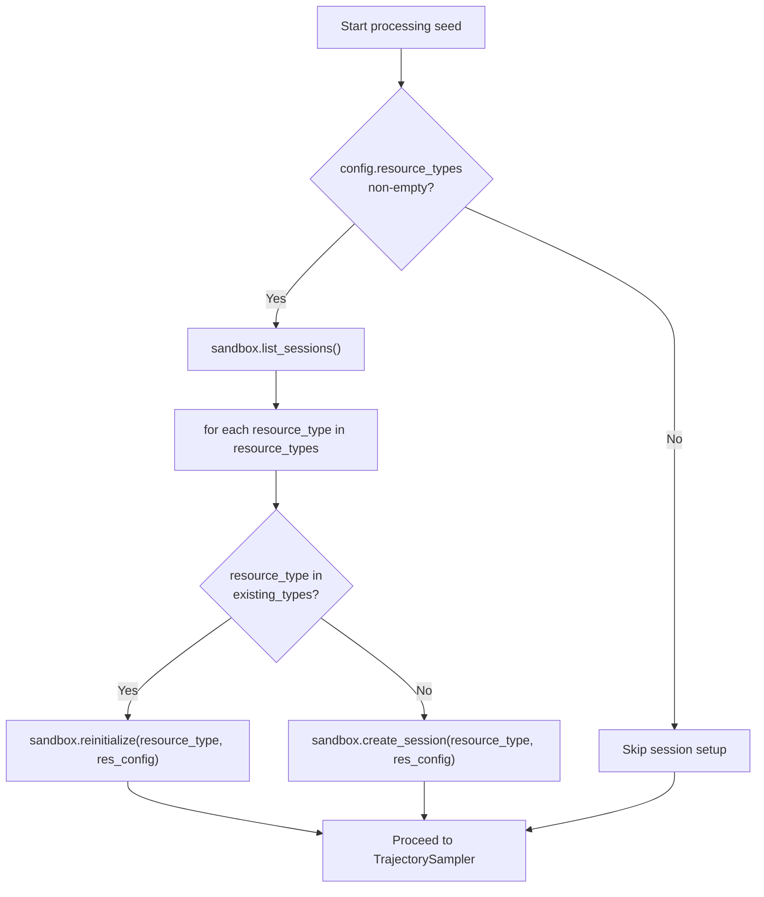
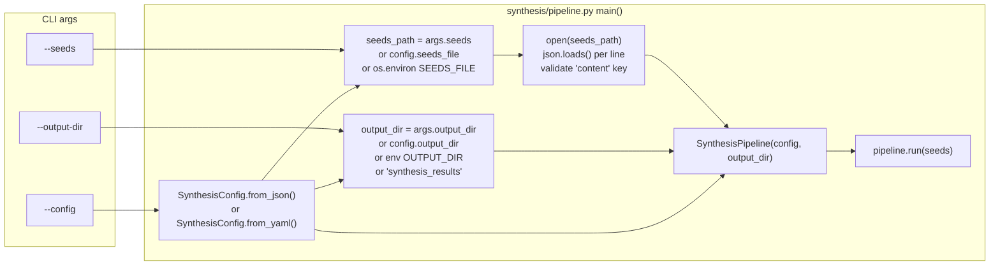

<!-- source: DeepWiki mcp.deepwiki.com · repo OpenDCAI/AgentFlow · page 4.6 Running Synthesis · fetched 2026-11-02 -->

# Running Synthesis

<details>
<summary>Relevant source files</summary>

The following files were used as context for generating this wiki page:

- [configs/synthesis/doc_config.json](configs/synthesis/doc_config.json)
- [configs/synthesis/doc_ds_config.json](configs/synthesis/doc_ds_config.json)
- [configs/synthesis/ds_config.json](configs/synthesis/ds_config.json)
- [configs/synthesis/rag_config.json](configs/synthesis/rag_config.json)
- [configs/synthesis/web_config.json](configs/synthesis/web_config.json)
- [configs/synthesis/web_rag_config.json](configs/synthesis/web_rag_config.json)
- [sandbox/tool_schemas/ds_tools.py](sandbox/tool_schemas/ds_tools.py)
- [synthesis/pipeline.py](synthesis/pipeline.py)

</details>


This page explains how to execute the data synthesis pipeline — both via command line and the Python API — and describes the inputs, outputs, and runtime behavior. It covers the operational mechanics of launching a synthesis run.

For details on what each stage does internally, see the dedicated pages: [Trajectory Sampling](#4.3), [Trajectory Selection](#4.4), and [QA Synthesis](#4.5). For configuration parameter reference, see [Synthesis Configuration](#4.1) and [Seed Data Format](#4.2).

---

## Prerequisites

Before running synthesis, the sandbox server must be running and accessible. Synthesis issues HTTP requests to the sandbox server for every tool call made during trajectory sampling.

| Prerequisite | Details |
|---|---|
| Sandbox server | Must be running at the URL specified by `sandbox_server_url` in the config |
| LLM API access | `OPENROUTER_API_KEY` or `OPENAI_API_KEY` must be set, depending on config |
| Seed file | A `.jsonl` file with at least one valid seed object (see [Seed Data Format](#4.2)) |
| Config file | A `.json` or `.yaml` synthesis config (see [Synthesis Configuration](#4.1)) |

If `sandbox_auto_start` is set to `true` in the config, the pipeline will attempt to start the sandbox server automatically using `sandbox_config_path`. Otherwise, the sandbox must be started manually before invoking synthesis.

Sources: [configs/synthesis/rag_config.json:26-29](), [configs/synthesis/doc_config.json:19-22]()

---

## Command-Line Execution

The synthesis pipeline is invoked through `synthesis/pipeline.py`. It uses Python's `argparse` module and exposes three arguments.

**Signature:**

```
python -m synthesis.pipeline \
  --config <path-to-config.json> \
  [--seeds <path-to-seeds.jsonl>] \
  [--output-dir <output-directory>]
```

| Argument | Required | Description |
|---|---|---|
| `--config` | Yes | Path to a `.json` or `.yaml` synthesis config file |
| `--seeds` | No | Path to a `.jsonl` seeds file; overrides `seeds_file` in config |
| `--output-dir` | No | Output directory; overrides `output_dir` in config and the `OUTPUT_DIR` env var |

**Seed path resolution order:**
1. `--seeds` CLI argument
2. `seeds_file` field in the config file
3. `SEEDS_FILE` environment variable

If none of these resolve to a path, the process raises a `ValueError` and exits.

Sources: [synthesis/pipeline.py:222-276]()

---

### Examples by Agent Type

The following table shows the corresponding config file for each agent type.

| Agent Type | Config File |
|---|---|
| RAG | `configs/synthesis/rag_config.json` |
| Document | `configs/synthesis/doc_config.json` |
| Web | `configs/synthesis/web_config.json` |
| Data Science | `configs/synthesis/ds_config.json` |
| Doc + DS (combined) | `configs/synthesis/doc_ds_config.json` |
| Web + RAG (combined) | `configs/synthesis/web_rag_config.json` |

**RAG Agent:**
```bash
python -m synthesis.pipeline \
  --config configs/synthesis/rag_config.json \
  --seeds seeds/rag/seeds.jsonl
```

**Document Agent:**
```bash
python -m synthesis.pipeline \
  --config configs/synthesis/doc_config.json \
  --seeds seeds/doc/seeds.jsonl
```

**Data Science Agent:**
```bash
python -m synthesis.pipeline \
  --config configs/synthesis/ds_config.json \
  --seeds seeds/ds/seeds.jsonl
```

**Web Agent:**
```bash
python -m synthesis.pipeline \
  --config configs/synthesis/web_config.json \
  --seeds seeds/web/seeds.jsonl
```

Sources: [configs/synthesis/rag_config.json:58-59](), [configs/synthesis/doc_config.json:71-72](), [configs/synthesis/ds_config.json:49-51](), [configs/synthesis/web_config.json:41-43]()

---

## Python API

`SynthesisPipeline` can be instantiated and called directly in Python, bypassing the CLI. This is useful for integration into notebooks or larger orchestration scripts.

```python
from synthesis.pipeline import SynthesisPipeline
from synthesis.core import SynthesisConfig
import json

# Load config
config = SynthesisConfig.from_json("configs/synthesis/rag_config.json")

# Load seeds
seeds = []
with open("seeds/rag/seeds.jsonl") as f:
    for line in f:
        seeds.append(json.loads(line))

# Run pipeline
pipeline = SynthesisPipeline(config=config, output_dir="results/rag_run_1")
pipeline.run(seeds)
```

`pipeline.run()` is a synchronous wrapper around `run_async()`. If you are already inside an async context, call `await pipeline.run_async(seeds)` directly.

Sources: [synthesis/pipeline.py:39-207]()

---

## Execution Flow

The following diagram maps runtime execution to the classes and methods involved.

**Diagram: SynthesisPipeline execution flow**



Sources: [synthesis/pipeline.py:66-207]()

---

## Output Files

`SynthesisPipeline.__init__` resolves the output directory to `results/ds_synthesized_qa/` relative to the project root, regardless of the `--output-dir` argument passed at the CLI (the `output_dir` argument is accepted but the implementation overrides it with this fixed path).

Two files are written incrementally as each seed is processed:

| File | Content |
|---|---|
| `synthesized_qa.jsonl` | One JSON object per line; each is a QA pair with question, answer, reasoning, and trajectory reference |
| `trajectories.jsonl` | One JSON object per line; each is a selected trajectory with its full tool-call sequence |

Both files are opened in **append mode** (`"a"`), so re-running synthesis adds to existing output rather than overwriting it. Take care to clean up or rename output files if starting a fresh run.

Sources: [synthesis/pipeline.py:42-64](), [synthesis/pipeline.py:209-219]()

---

## Session Lifecycle Per Seed

For agent types that use stateful sandbox resources (e.g., RAG with a vector index, SQL with a database), the pipeline reinitializes the session for each new seed to ensure isolation. The logic applied per seed is:

1. Call `sandbox.list_sessions()` to find which resource types already have active sessions.
2. For each `resource_type` in `config.resource_types`:
   - If a session for that type already exists → call `sandbox.reinitialize(resource_type, res_config)`.
   - If no session exists yet → call `sandbox.create_session(resource_type, res_config)`.
3. A `custom_name` of the form `{resource_type}_{source_id}` is injected into `res_config` to tag the session.

Agent types with an empty `resource_types` list (e.g., Web, Document) skip this step entirely.

**Diagram: Session initialization path per seed**



Sources: [synthesis/pipeline.py:110-144]()

---

## Config and Seeds File Resolution

The diagram below traces how configuration and seed data are loaded from disk before any synthesis runs.

**Diagram: Configuration and seed loading in main()**



Sources: [synthesis/pipeline.py:222-277]()

---

## Limiting Seeds for Testing

To run synthesis on a subset of seeds (for testing configuration or verifying a new agent type), set `number_of_seed` in the config to a positive integer. The pipeline trims the seed list before processing:

```json
"number_of_seed": 5
```

This is equivalent to passing only the first 5 seeds. Setting it to `null` processes all seeds.

Sources: [synthesis/pipeline.py:68-69](), [configs/synthesis/rag_config.json:15]()

---

## Common Failure Modes

| Symptom | Likely Cause |
|---|---|
| `ValueError: Configuration errors: ...` | Invalid or missing required fields in the config file; check `SynthesisConfig.validate()` |
| `ValueError: Missing seeds path` | No `--seeds` arg, no `seeds_file` in config, and no `SEEDS_FILE` env var set |
| `❌ Failed to start worker` | Sandbox server not reachable at `sandbox_server_url`; verify it is running |
| `⚠️ No trajectories sampled, skipping seed` | LLM produced no valid tool calls; check model credentials and `available_tools` |
| `⚠️ No trajectories selected, skipping seed` | All sampled trajectories failed the depth/similarity filter; lower `min_depth` or `path_similarity_threshold` |
| Output file grows unexpectedly | Files are opened in append mode; delete or rotate output files before re-running |

Sources: [synthesis/pipeline.py:81-191]()

---

