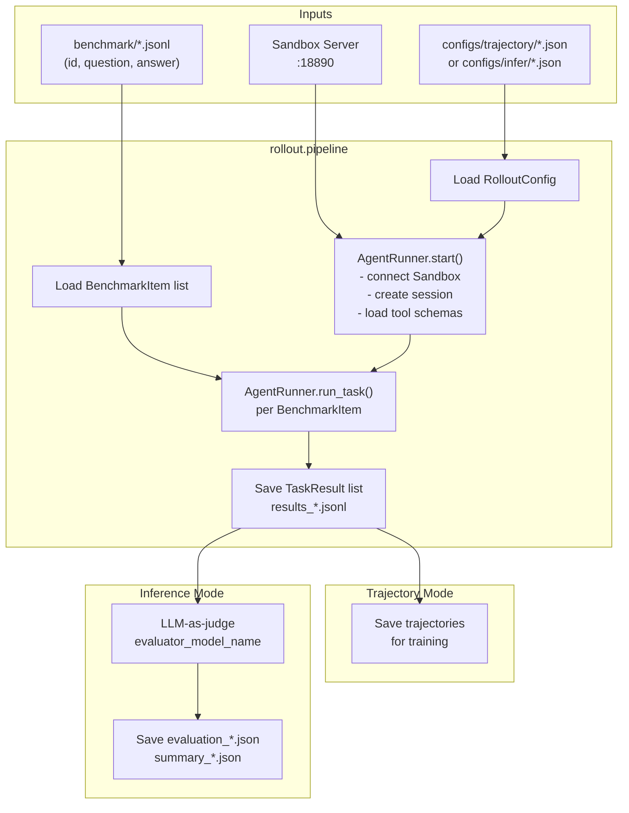
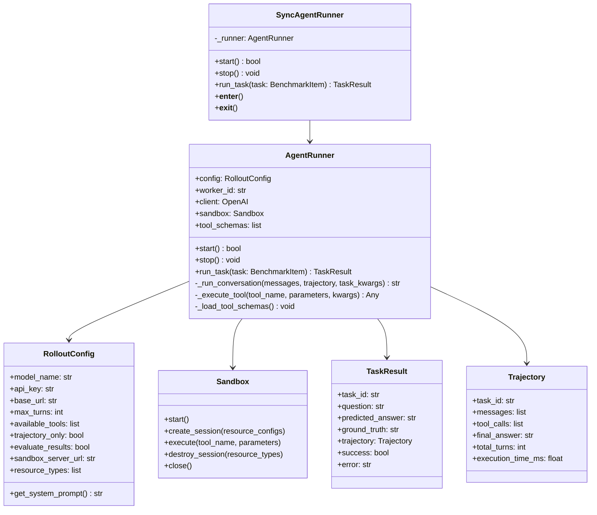
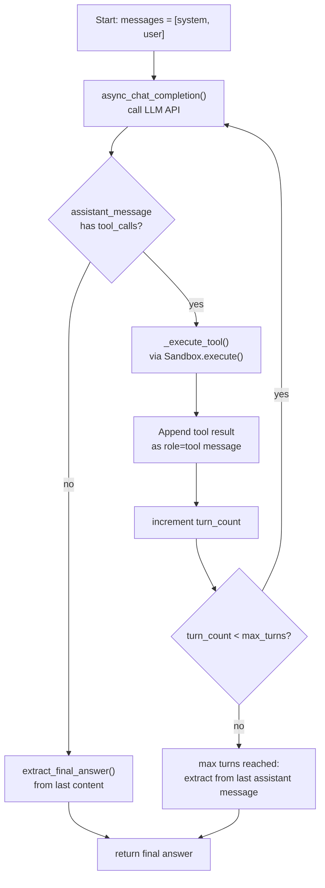
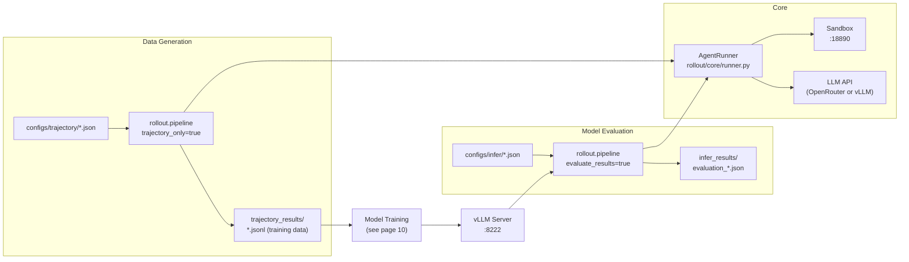

<!-- source: DeepWiki mcp.deepwiki.com · repo OpenDCAI/AgentFlow · page 5 Rollout and Inference · fetched 2026-11-02 -->

# Rollout and Inference

<details>
<summary>Relevant source files</summary>

The following files were used as context for generating this wiki page:

- [configs/infer/rag_infer.json](configs/infer/rag_infer.json)
- [configs/trajectory/rag_trajectory.json](configs/trajectory/rag_trajectory.json)
- [examples/RAGAgent.md](examples/RAGAgent.md)
- [rollout/core/runner.py](rollout/core/runner.py)
- [sandbox/tests/test_tool_schemas.py](sandbox/tests/test_tool_schemas.py)
- [sandbox/tool_schemas/__init__.py](sandbox/tool_schemas/__init__.py)
- [sandbox/tool_schemas/doc_tools.py](sandbox/tool_schemas/doc_tools.py)
- [sandbox/tool_schemas/rag_tools.py](sandbox/tool_schemas/rag_tools.py)
- [sandbox/tool_schemas/sql_tools.py](sandbox/tool_schemas/sql_tools.py)
- [sandbox/tool_schemas/vm_tools.py](sandbox/tool_schemas/vm_tools.py)
- [sandbox/tool_schemas/web_tools.py](sandbox/tool_schemas/web_tools.py)
- [seeds/rag/seeds.jsonl](seeds/rag/seeds.jsonl)
- [synthesis/core/sampler.py](synthesis/core/sampler.py)

</details>


This page documents the **rollout pipeline**, which serves two distinct purposes in AgentFlow: (1) running a capable LLM agent on benchmark data to generate **training trajectories**, and (2) running a trained model on benchmark data to produce **evaluated inference results**. Both modes share the same code path (`rollout.pipeline`) and differ only in configuration flags.

For the three-stage data synthesis pipeline that generates QA pairs from seed data, see [Data Synthesis Pipeline](#4). For model training and deployment with vLLM, see [Model Training and Deployment](#10).

---

## Overview

The rollout pipeline executes a tool-using agent on a set of benchmark questions. Depending on configuration, it either records the agent's trajectories for use as training data, or scores the agent's answers against ground truth for evaluation.

**Two operational modes:**

| Mode | Key Config Flags | Primary Use |
|------|-----------------|-------------|
| Trajectory Rollout | `trajectory_only: true`, `evaluate_results: false` | Generate training data from strong LLM |
| Model Inference | `evaluate_results: true`, `trajectory_only: false` | Evaluate trained model on benchmarks |

The entry point for both modes is `rollout.pipeline`, configured via JSON files in `configs/trajectory/` (rollout mode) or `configs/infer/` (inference mode).

---

## Pipeline Flow

**Rollout and Inference Pipeline Modes**



Sources: [configs/trajectory/rag_trajectory.json](), [configs/infer/rag_infer.json](), [rollout/core/runner.py:30-349](), [examples/RAGAgent.md:287-406]()

---

## Benchmark Data Format

Both modes read from a `.jsonl` file where each line is a task:

```jsonl
{"id": "task_001", "question": "What is the capital of France?", "answer": "Paris"}
{"id": "task_002", "question": "Who wrote 'Romeo and Juliet'?", "answer": "William Shakespeare"}
```

These are loaded into `BenchmarkItem` instances (defined in `rollout/core/models.py`). The `kwargs` field on a `BenchmarkItem` is forwarded to tool calls — for example, Document agent tasks include a `seed_path` in `kwargs` that the `doc-search` and `doc-read` tools require.

Sources: [examples/RAGAgent.md:326-342](), [rollout/core/runner.py:144-198]()

---

## 5.1 Trajectory Rollout

Trajectory rollout runs a capable frontier LLM (e.g., `gpt-4.1-2025-04-14`) against a benchmark dataset and records the full tool-use trajectory for each question. These trajectories serve as supervised training data for smaller models.

**Invoking trajectory rollout:**

```python
from rollout import pipeline
pipeline(config_path="configs/trajectory/rag_trajectory.json")
```

Or via CLI:

```bash
python -m rollout.pipeline --config configs/trajectory/rag_trajectory.json
```

**Key configuration fields for trajectory mode** (`configs/trajectory/rag_trajectory.json`):

| Field | Value | Purpose |
|-------|-------|---------|
| `model_name` | `gpt-4.1-2025-04-14` | Strong LLM to generate trajectories |
| `trajectory_only` | `true` | Skip evaluation, just record trajectories |
| `evaluate_results` | `false` | No scoring |
| `save_trajectories` | `true` | Persist trajectory messages to disk |
| `data_path` | `benchmark/rag_benchmark.jsonl` | Source benchmark |
| `output_dir` | `trajectory_results/rag` | Output location |
| `available_tools` | `["rag_search"]` | Tools exposed to the agent |
| `sandbox_server_url` | `http://127.0.0.1:18890` | Sandbox endpoint |

The output is a single timestamped file `results_rag_trajectory_{timestamp}.jsonl` in `output_dir`, containing `TaskResult` objects with the full `Trajectory` embedded.

Sources: [configs/trajectory/rag_trajectory.json](), [examples/RAGAgent.md:287-342]()

---

## 5.2 Model Inference

Model inference runs a trained model (served via vLLM) against a benchmark and scores its answers. The model endpoint is configured as the `base_url` pointing to the vLLM server (default port `8222`).

**Invoking model inference:**

```python
from rollout import pipeline
pipeline(config_path="configs/infer/rag_infer.json")
```

**Key configuration fields for inference mode** (`configs/infer/rag_infer.json`):

| Field | Value | Purpose |
|-------|-------|---------|
| `model_name` | `YOUR_MODEL_NAME` | Model name as served by vLLM |
| `base_url` | `VLLM_URL` | vLLM server URL |
| `evaluate_results` | `true` | Run evaluation after inference |
| `evaluation_metric` | `f1_score` | Scoring function |
| `evaluator_model_name` | `openai/gpt-oss-120b` | LLM-as-judge model |
| `evaluator_base_url` | `YOUR_BASE_URL` | Evaluator API endpoint |
| `max_workers` | `1` | Parallel task execution |
| `max_retries` | `3` | Retry failed LLM calls |

**Output files** (in `infer_results/rag/`):

| File | Contents |
|------|----------|
| `results_rag_infer_{timestamp}.jsonl` | Per-task inference results (`TaskResult`) |
| `evaluation_rag_infer_{timestamp}.json` | Per-task scores, includes `average_score` |
| `summary_rag_infer_{timestamp}.json` | Aggregate run summary |

Sources: [configs/infer/rag_infer.json](), [examples/RAGAgent.md:364-405]()

---

## 5.3 Evaluation System

When `evaluate_results` is `true`, the pipeline runs an LLM-as-judge evaluation after all tasks complete. The evaluator model receives the predicted answer and ground truth and returns a numeric score.

**Supported evaluation metrics:**

| Metric | Description |
|--------|-------------|
| `f1_score` | Token-level F1 between predicted and ground truth answer |
| `exact_match` | Binary match after normalization |

The evaluator is configured as a separate LLM endpoint from the agent model:

```
evaluator_model_name  →  evaluator_base_url  →  evaluator_api_key
```

This allows using a different (often stronger) model as judge than the model being evaluated. Evaluator behavior is tuned with `evaluator_temperature` (default `0.0`) and `evaluator_max_retries`.

**Evaluation Configuration Fields:**

| Field | Type | Description |
|-------|------|-------------|
| `evaluate_results` | `bool` | Enable evaluation pass |
| `evaluation_metric` | `str` | `f1_score` or `exact_match` |
| `evaluator_model_name` | `str` | LLM judge model identifier |
| `evaluator_api_key` | `str` | API key for evaluator endpoint |
| `evaluator_base_url` | `str` | Base URL for evaluator API |
| `evaluator_temperature` | `float` | Temperature for judge (typically `0.0`) |
| `evaluator_max_retries` | `int` | Retry limit for evaluator calls |
| `evaluator_extra_params` | `dict` | Additional kwargs for evaluator API |

Sources: [configs/infer/rag_infer.json:28-35](), [examples/RAGAgent.md:430-449]()

---

## 5.4 Agent Runner Architecture

The `AgentRunner` class in [rollout/core/runner.py]() is the central component that executes the agent loop for a single task. It manages the sandbox connection, tool schemas, and the multi-turn conversation with the LLM.

**AgentRunner Internal Structure**



Sources: [rollout/core/runner.py:30-380]()

### Lifecycle

The `AgentRunner` follows a start/run/stop lifecycle:

1. **`start()`** — Creates a `Sandbox` instance, connects to the sandbox server, creates sessions for `resource_types`, and loads tool schemas via `get_tool_schemas(allowed_tools)` from `sandbox.tool_schemas`.
2. **`run_task(task)`** — Executes one `BenchmarkItem` and returns a `TaskResult`. Builds the initial `messages` list (system prompt + user question) and calls `_run_conversation`.
3. **`stop()`** — Destroys sandbox sessions and closes the HTTP connection.

`SyncAgentRunner` wraps `AgentRunner` with a synchronous interface using `asyncio.new_event_loop()`, enabling use without `async/await`. It also supports the context manager protocol (`__enter__`/`__exit__`).

Sources: [rollout/core/runner.py:59-128](), [rollout/core/runner.py:351-380]()

### Multi-Turn Conversation Loop

`_run_conversation()` implements the agent loop [rollout/core/runner.py:221-321]():

**Agent Conversation Loop**



Key behaviors:
- Only the first tool call per LLM response is executed (one at a time): [rollout/core/runner.py:269]()
- `task_kwargs` from the `BenchmarkItem` are merged into tool parameters at [rollout/core/runner.py:280](), enabling per-task context (e.g., `seed_path` for document agents)
- `extract_final_answer()` post-processes the LLM's content to strip reasoning prefixes

Sources: [rollout/core/runner.py:221-321]()

### Tool Schema Loading

During `start()`, `AgentRunner._load_tool_schemas()` calls `get_tool_schemas(allowed_tools)` from `sandbox.tool_schemas` [rollout/core/runner.py:129-142](). The `allowed_tools` list comes from `RolloutConfig.available_tools`.

The `get_tool_schemas` function in [sandbox/tool_schemas/__init__.py:34-87]() supports:
- **Exact names**: `"rag_search"`, `"web-search"`
- **Wildcards**: `"vm_*"` matches all VM tools
- **Name aliases**: `rag_search`, `rag-search`, and `rag:search` are all equivalent

The resulting schemas are converted to OpenAI function-calling format via `convert_tool_schema_to_openai()` before being passed to the LLM API.

**Tool Schema Resolution**

```mermaid
flowchart LR
    subgraph "Config"
        available_tools["available_tools:\n[\"rag_search\"]"]
    end

    subgraph "sandbox/tool_schemas/__init__.py"
        get_tool_schemas["get_tool_schemas(allowed_tools)"]
        aliases["_tool_name_aliases()\nrag_search / rag-search / rag:search"]
        all_schemas["All schemas:\nget_rag_tool_schemas()\nget_web_tool_schemas()\nget_vm_tool_schemas()\nget_doc_tool_schemas()\nget_ds_tool_schemas()\nget_sql_tool_schemas()"]
    end

    subgraph "rollout/core/runner.py"
        convert["convert_tool_schema_to_openai()"]
        tool_schemas["self.tool_schemas\n(OpenAI format)"]
    end

    available_tools --> get_tool_schemas
    get_tool_schemas --> aliases
    all_schemas --> get_tool_schemas
    get_tool_schemas --> convert
    convert --> tool_schemas
```

Sources: [rollout/core/runner.py:129-142](), [sandbox/tool_schemas/__init__.py:34-87]()

---

## Configuration Reference

### `RolloutConfig` Fields

The full set of parameters accepted by trajectory and inference config files:

| Parameter | Type | Default | Description |
|-----------|------|---------|-------------|
| `benchmark_name` | `str` | — | Identifier used in output filenames |
| `model_name` | `str` | `"gpt-4.1-2025-04-14"` | LLM model name or served model name |
| `api_key` | `str` | `""` | API key (use `${ENV_VAR}` for secrets) |
| `base_url` | `str` | `""` | API base URL (OpenRouter or vLLM) |
| `max_turns` | `int` | `100` | Max conversation turns before forced termination |
| `max_retries` | `int` | `3` | LLM API call retry limit |
| `max_workers` | `int` | `1` | Number of parallel task workers |
| `available_tools` | `list[str]` | `[]` | Tools exposed to agent (supports wildcards) |
| `system_prompt` | `str\|list` | built-in | Agent system prompt (list is joined with `\n`) |
| `evaluate_results` | `bool` | `true` | Whether to score agent answers |
| `evaluation_metric` | `str` | `"exact_match"` | Scoring function |
| `trajectory_only` | `bool` | `false` | Skip evaluation, record trajectories only |
| `data_path` | `str` | — | Path to benchmark `.jsonl` |
| `output_dir` | `str` | — | Output directory |
| `sandbox_server_url` | `str` | `"http://127.0.0.1:18890"` | Sandbox server address |
| `sandbox_timeout` | `int` | `120` | Sandbox HTTP timeout (seconds) |
| `save_results` | `bool` | `true` | Write `results_*.jsonl` |
| `save_trajectories` | `bool` | `true` | Embed trajectory in results |
| `save_summary` | `bool` | `false` | Write `summary_*.json` |
| `parallel` | `bool` | `false` | Enable parallel execution |
| `resource_types` | `list[str]` | `[]` | Resource types for session init |

Sources: [configs/trajectory/rag_trajectory.json](), [configs/infer/rag_infer.json](), [examples/RAGAgent.md:430-449]()

---

## Relationship to Other Components



Sources: [rollout/core/runner.py](), [examples/RAGAgent.md:287-406]()

---

