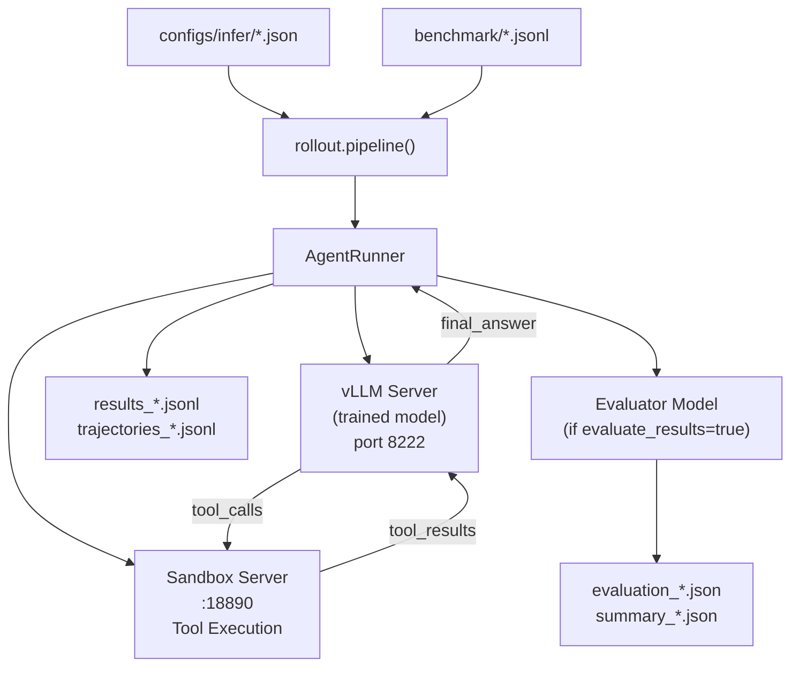
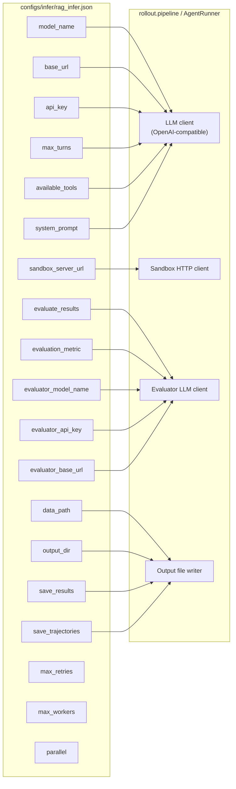
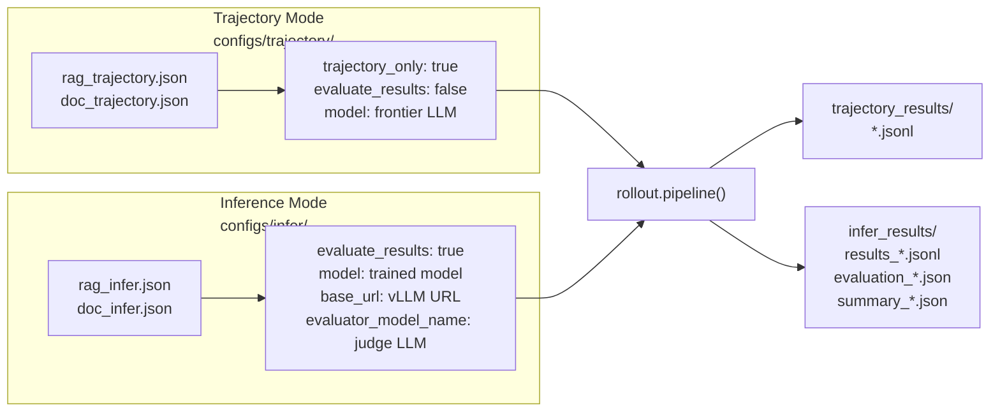

<!-- source: DeepWiki mcp.deepwiki.com · repo OpenDCAI/AgentFlow · page 5.2 Model Inference · fetched 2026-11-02 -->

# Model Inference

<details>
<summary>Relevant source files</summary>

The following files were used as context for generating this wiki page:

- [configs/infer/doc_infer.json](configs/infer/doc_infer.json)
- [configs/infer/rag_infer.json](configs/infer/rag_infer.json)
- [configs/synthesis/text2sql_config.json](configs/synthesis/text2sql_config.json)
- [configs/trajectory/doc_trajectory.json](configs/trajectory/doc_trajectory.json)
- [configs/trajectory/rag_trajectory.json](configs/trajectory/rag_trajectory.json)
- [examples/RAGAgent.md](examples/RAGAgent.md)
- [seeds/rag/seeds.jsonl](seeds/rag/seeds.jsonl)

</details>


This page covers how to run a trained model against benchmark datasets using the AgentFlow rollout pipeline in inference mode. It focuses on the specific configuration and behaviors that distinguish inference from trajectory generation.

- For generating trajectories from benchmark data using a frontier model (not a trained model), see [Trajectory Rollout](#5.1).
- For details on the evaluation scoring logic, see [Evaluation System](#5.3).
- For deploying a trained model with vLLM before running inference, see [Model Deployment with vLLM](#10.2).
- For details on the `AgentRunner` class that executes each task, see [Agent Runner Architecture](#5.4).

---

## Overview

Model inference in AgentFlow reuses the same `rollout.pipeline` entry point used for trajectory generation. The distinction is in how the configuration file is written: inference configs live under `configs/infer/`, point `base_url` at a vLLM-served trained model, and typically set `evaluate_results: true` to score outputs automatically.

The pipeline connects three external services: the vLLM model server, the sandbox server (for tool execution), and optionally a separate evaluator model for scoring.

**Comparison of rollout modes:**

| Parameter | Trajectory Rollout | Model Inference |
|---|---|---|
| Config location | `configs/trajectory/` | `configs/infer/` |
| `model_name` | Frontier model (e.g. `gpt-4.1-2025-04-14`) | Trained model name |
| `base_url` | OpenRouter / OpenAI | vLLM server URL |
| `trajectory_only` | `true` | `false` (absent or omitted) |
| `evaluate_results` | `false` | `true` (typically) |
| `evaluator_model_name` | Not needed | Required if evaluating |
| Primary purpose | Generate training data | Benchmark a trained model |

Sources: [configs/trajectory/rag_trajectory.json:1-39](), [configs/infer/rag_infer.json:1-46](), [configs/infer/doc_infer.json:1-29]()

---

## How Inference Works

**Inference pipeline data flow:**



Sources: [examples/RAGAgent.md:364-406](), [configs/infer/rag_infer.json:1-46]()

The `rollout.pipeline` function is called with a path to an inference config file. It reads the benchmark data from `data_path`, runs the trained model through multi-turn conversations with tool access, optionally evaluates each answer, and writes output files to `output_dir`.

---

## Step 1: Deploy the Trained Model

Before running inference, the trained model must be served via vLLM. Tool-call support requires `--enable-auto-tool-choice` and a compatible parser.

```bash
vllm serve \
    --model YOUR_TRAINED_MODEL \
    --served-model-name ragagent \
    --tensor-parallel-size 8 \
    --enable-auto-tool-choice \
    --tool-call-parser hermes \
    --port 8222
```

The `--tool-call-parser hermes` flag is required for AgentFlow's tool-call format. Once running, the model is reachable at `http://localhost:8222/v1`.

Sources: [examples/RAGAgent.md:344-360]()

---

## Step 2: Start the Sandbox Server

The sandbox server must be running during inference so the agent can execute tool calls. Use the same config as during training/trajectory generation.

```bash
./start_sandbox_server.sh --config configs/sandbox-server/rag_config.json
```

The sandbox server listens at the URL specified in `sandbox_server_url` in the inference config (default `http://127.0.0.1:18890`).

Sources: [configs/infer/rag_infer.json:37-38](), [examples/RAGAgent.md:152-214]()

---

## Step 3: Run Inference

**Python API:**

```python
from rollout import pipeline

pipeline(config_path="configs/infer/rag_infer.json")
```

**CLI:**

```bash
python -m rollout.pipeline --config configs/infer/rag_infer.json
```

Sources: [examples/RAGAgent.md:368-373]()

---

## Inference Configuration

Inference configs reside in `configs/infer/`. Each agent type has its own file. The structure mirrors the rollout config but with inference-specific fields filled in.

**Diagram: Config fields mapped to code parameters**



Sources: [configs/infer/rag_infer.json:1-46](), [configs/infer/doc_infer.json:1-29]()

### Full Parameter Reference

| Parameter | Type | Description |
|---|---|---|
| `benchmark_name` | `str` | Identifier used in output filenames |
| `model_name` | `str` | Model name as registered in vLLM (`--served-model-name`) |
| `api_key` | `str` | API key for the vLLM server (often empty for local) |
| `base_url` | `str` | vLLM server base URL (e.g. `http://localhost:8222/v1`) |
| `max_turns` | `int` | Maximum multi-turn conversation depth per task |
| `max_retries` | `int` | LLM call retry attempts on transient failures |
| `max_workers` | `int` | Parallel worker count (set to 1 when `parallel: false`) |
| `available_tools` | `list[str]` | Tool names the model may call (must match sandbox server) |
| `system_prompt` | `str` or `list[str]` | System prompt injected at conversation start |
| `evaluate_results` | `bool` | Whether to score model answers after inference |
| `evaluation_metric` | `str` | Metric passed to the evaluator (`f1_score`, `exact_match`, etc.) |
| `evaluator_model_name` | `str` | Model used to judge answers (e.g. `openai/gpt-oss-120b`) |
| `evaluator_api_key` | `str` | API key for the evaluator model |
| `evaluator_base_url` | `str` | Base URL for the evaluator model API |
| `evaluator_temperature` | `float` | Temperature for evaluator calls (typically `0.0`) |
| `evaluator_max_retries` | `int` | Retry count for evaluator API calls |
| `evaluator_extra_params` | `dict` | Extra kwargs forwarded to evaluator API calls |
| `sandbox_server_url` | `str` | Sandbox server address (default `http://127.0.0.1:18890`) |
| `sandbox_timeout` | `int` | Tool call timeout in seconds |
| `data_path` | `str` | Path to benchmark JSONL file |
| `output_dir` | `str` | Directory where output files are written |
| `save_results` | `bool` | Write per-task results to JSONL |
| `save_trajectories` | `bool` | Write full multi-turn trajectories to JSONL |
| `parallel` | `bool` | Enable concurrent task execution |

Sources: [configs/infer/rag_infer.json:1-46](), [configs/infer/doc_infer.json:1-29](), [examples/RAGAgent.md:430-449]()

---

## Benchmark Data Format

The benchmark file at `data_path` must be a JSONL file with one task per line:

```jsonl
{"id": "task_001", "question": "What is the capital of France?", "answer": "Paris"}
{"id": "task_002", "question": "Who wrote 'Romeo and Juliet'?", "answer": "William Shakespeare"}
```

- `id`: unique task identifier, used in output filenames
- `question`: the input prompt given to the agent
- `answer`: the ground truth, used by the evaluator when `evaluate_results: true`

Sources: [examples/RAGAgent.md:327-332]()

---

## Output Files

All output is written to `output_dir`. Filenames include the `benchmark_name` and a timestamp.

| File | Written when | Contents |
|---|---|---|
| `results_{benchmark_name}_{timestamp}.jsonl` | `save_results: true` | Per-task model answers and metadata |
| `trajectories_{benchmark_name}_{timestamp}.jsonl` | `save_trajectories: true` | Full multi-turn conversation logs |
| `evaluation_{benchmark_name}_{timestamp}.json` | `evaluate_results: true` | Per-task scores and aggregate metrics |
| `summary_{benchmark_name}_{timestamp}.json` | Default | Run-level summary including `average_score` |

Sources: [examples/RAGAgent.md:399-406](), [configs/infer/rag_infer.json:41-45]()

---

## Inference vs. Trajectory Rollout: Configuration Contrast

**Diagram: rollout.pipeline operating in two modes**



Sources: [configs/trajectory/rag_trajectory.json:1-39](), [configs/trajectory/doc_trajectory.json:1-28](), [configs/infer/rag_infer.json:1-46](), [configs/infer/doc_infer.json:1-29]()

---

## Per-Agent Inference Configs

Each agent type ships with its own inference config under `configs/infer/`. Key differences are in `available_tools` and `system_prompt`.

| Agent | Config file | `available_tools` | Notes |
|---|---|---|---|
| RAG | `configs/infer/rag_infer.json` | `["rag_search"]` | `evaluate_results: true`, `evaluation_metric: f1_score` |
| Document | `configs/infer/doc_infer.json` | `["doc_search", "doc_read"]` | `evaluate_results: false` by default |

Additional agent configs (Web, SQL, DS, GUI) follow the same structure with their respective tool sets. Refer to [Inference Config Schema](#8.4) for the complete schema reference.

Sources: [configs/infer/rag_infer.json:13-29](), [configs/infer/doc_infer.json:13-28]()

---

## Evaluation During Inference

When `evaluate_results: true`, the pipeline invokes a separate evaluator LLM after each task completes. The evaluator receives the model's final answer and the ground truth from the benchmark and returns a score using the specified `evaluation_metric`.

Supported metrics include `f1_score` and `exact_match`. The evaluator model is configured independently from the inference model, allowing a strong judge model (e.g. `openai/gpt-oss-120b`) to score outputs from a smaller trained model.

See [Evaluation System](#5.3) for full details on how the LLM-as-judge system works and how to add custom metrics.

Sources: [configs/infer/rag_infer.json:28-35](), [examples/RAGAgent.md:386-396]()

---

