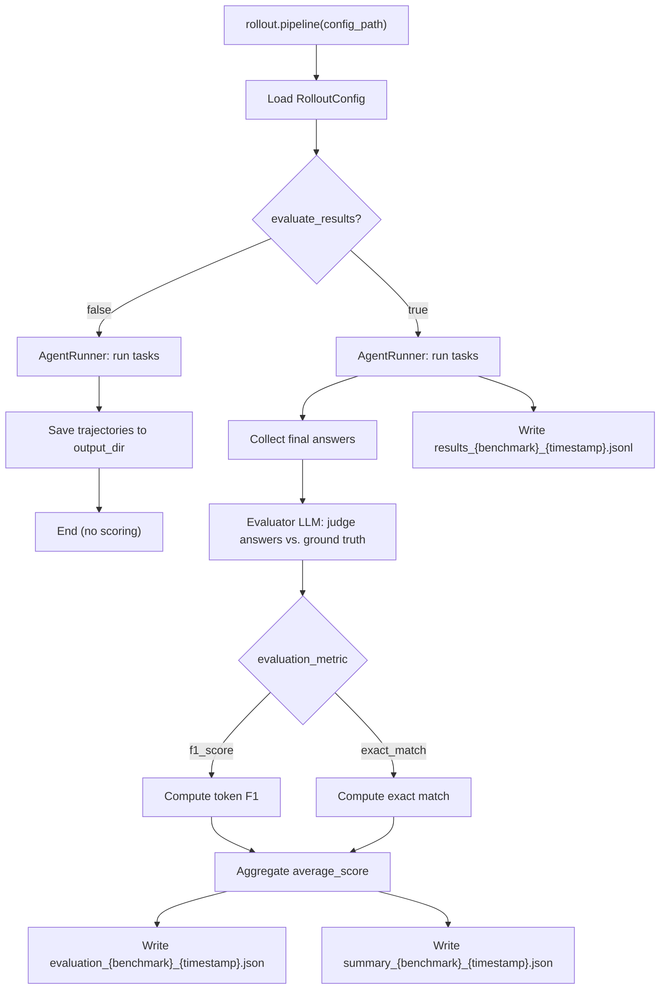
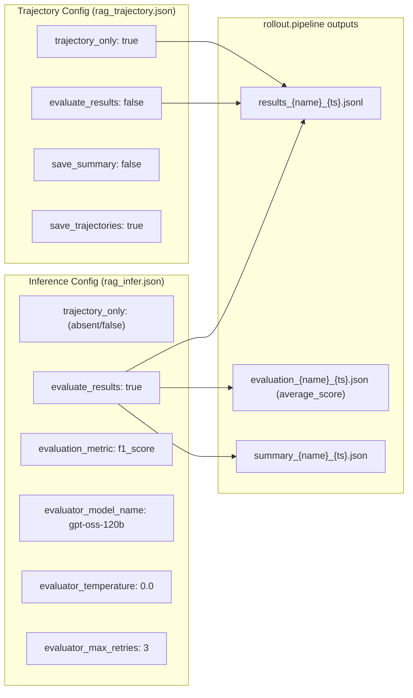

<!-- source: DeepWiki mcp.deepwiki.com · repo OpenDCAI/AgentFlow · page 5.3 Evaluation System · fetched 2026-11-02 -->

# Evaluation System

<details>
<summary>Relevant source files</summary>

The following files were used as context for generating this wiki page:

- [configs/infer/doc_infer.json](configs/infer/doc_infer.json)
- [configs/infer/rag_infer.json](configs/infer/rag_infer.json)
- [configs/synthesis/text2sql_config.json](configs/synthesis/text2sql_config.json)
- [configs/trajectory/doc_trajectory.json](configs/trajectory/doc_trajectory.json)
- [configs/trajectory/rag_trajectory.json](configs/trajectory/rag_trajectory.json)
- [examples/RAGAgent.md](examples/RAGAgent.md)
- [seeds/rag/seeds.jsonl](seeds/rag/seeds.jsonl)

</details>


This page documents the evaluation subsystem embedded in the rollout pipeline, which scores model outputs against ground truth using an LLM-as-judge approach. Evaluation is an optional step activated only during inference runs.

For context on the broader rollout pipeline that contains evaluation, see [Rollout and Inference](#5). For the configuration schema governing evaluator parameters, see [Inference Config Schema](#8.4). For details on the `AgentRunner` that produces the outputs being evaluated, see [Agent Runner Architecture](#5.4).

---

## Overview

The evaluation system activates when `evaluate_results: true` is set in an inference configuration. At that point, the rollout pipeline passes each agent's final answer and the benchmark's ground truth to a configurable LLM judge, which scores the response according to a specified metric.

There are two distinct operating modes for the rollout pipeline:

| Mode | `evaluate_results` | `trajectory_only` | Purpose |
|---|---|---|---|
| Trajectory generation | `false` | `true` | Collect training trajectories without scoring |
| Inference + evaluation | `true` | `false` | Score model outputs against ground truth |

Trajectory generation configs (e.g., `configs/trajectory/rag_trajectory.json`) explicitly set `evaluate_results: false`, even if `evaluation_metric` is present. Inference configs (e.g., `configs/infer/rag_infer.json`) set `evaluate_results: true` and supply the full evaluator configuration block.

---

## Activation and Configuration

Evaluation is governed by the `RolloutConfig` object. The relevant configuration keys are:

| Parameter | Type | Description |
|---|---|---|
| `evaluate_results` | `bool` | Master switch; set `true` to run evaluation after inference |
| `evaluation_metric` | `str` | Scoring method; see supported metrics below |
| `evaluator_model_name` | `str` | Model identifier for the LLM judge |
| `evaluator_api_key` | `str` | API key for the evaluator model endpoint |
| `evaluator_base_url` | `str` | Base URL for the evaluator model endpoint |
| `evaluator_temperature` | `float` | Sampling temperature for the judge (typically `0.0` for deterministic scoring) |
| `evaluator_max_retries` | `int` | Maximum retries on evaluator API failures |
| `evaluator_extra_params` | `dict` | Additional parameters forwarded to the evaluator API |

A representative configuration block from `configs/infer/rag_infer.json`:

```json
"evaluate_results": true,
"evaluation_metric": "f1_score",
"evaluator_model_name": "openai/gpt-oss-120b",
"evaluator_api_key": "sk-",
"evaluator_base_url": "YOUR_BASE_URL",
"evaluator_temperature": 0.0,
"evaluator_max_retries": 3,
"evaluator_extra_params": {}
```

The evaluator model is independent from the agent model. This separation allows a high-capacity judge (e.g., `openai/gpt-oss-120b`) to evaluate a smaller trained model being tested.

Sources: [configs/infer/rag_infer.json:28-45](), [configs/trajectory/rag_trajectory.json:26-38](), [examples/RAGAgent.md:376-406]()

---

## Supported Metrics

The `evaluation_metric` field selects the scoring strategy applied by the LLM judge. The following values appear in the codebase configurations:

| Metric | Config Value | Description |
|---|---|---|
| F1 Score | `f1_score` | Token-level overlap between predicted and reference answer |
| Exact Match | `exact_match` | Binary score; `1` if the answer exactly matches the reference |

The RAG inference config uses `f1_score` as its metric [configs/infer/rag_infer.json:29](). The trajectory config also declares `evaluation_metric: "f1_score"` [configs/trajectory/rag_trajectory.json:27](), but that field has no effect when `evaluate_results: false`.

Sources: [configs/infer/rag_infer.json:29](), [configs/trajectory/rag_trajectory.json:27](), [examples/RAGAgent.md:389]()

---

## Pipeline Integration

**Diagram: Evaluation Flow Within the Rollout Pipeline**



Sources: [examples/RAGAgent.md:364-406](), [configs/infer/rag_infer.json:28-45]()

---

## Trajectory Mode vs. Evaluation Mode

**Diagram: Configuration Flags Controlling Pipeline Behavior**



When `trajectory_only: true`, the pipeline skips evaluation entirely and omits the summary and evaluation output files. When `evaluate_results: true`, all three output file types are produced.

Sources: [configs/trajectory/rag_trajectory.json:26-38](), [configs/infer/rag_infer.json:28-45](), [examples/RAGAgent.md:399-406]()

---

## Output Files

After an inference run with `evaluate_results: true`, three output files are written to `output_dir`:

| File Pattern | Content |
|---|---|
| `results_{benchmark_name}_{timestamp}.jsonl` | Per-task inference results; one JSON object per line, containing the task ID, question, predicted answer, and full trajectory |
| `evaluation_{benchmark_name}_{timestamp}.json` | Per-task evaluation scores and aggregate `average_score` |
| `summary_{benchmark_name}_{timestamp}.json` | Run-level summary (model name, benchmark, total tasks, timing) |

For the RAG agent, these are written to `infer_results/rag/` as configured in `output_dir` [configs/infer/rag_infer.json:41]().

The `average_score` field in the evaluation file is the primary metric used to compare model performance across runs.

Sources: [examples/RAGAgent.md:399-406](), [configs/infer/rag_infer.json:41]()

---

## Evaluator Model Separation

The evaluator model is configured independently from the agent model. This design is intentional:

- The **agent model** (`model_name`, `api_key`, `base_url`) is the model under test — typically a trained model served via vLLM at a local endpoint.
- The **evaluator model** (`evaluator_model_name`, `evaluator_api_key`, `evaluator_base_url`) is a separate, typically more capable LLM used as the judge.

In the RAG inference config, the agent model is `YOUR_MODEL_NAME` at `VLLM_URL` (the fine-tuned model under test), while the evaluator is `openai/gpt-oss-120b` at a separate API endpoint [configs/infer/rag_infer.json:6-8]() [configs/infer/rag_infer.json:30-33]().

This separation means:
1. Evaluation quality is not bounded by the capability of the model being evaluated.
2. The evaluator endpoint can be a remote API (e.g., OpenRouter) while the agent runs locally via vLLM.
3. `evaluator_temperature: 0.0` is recommended to ensure deterministic, reproducible scoring.

Sources: [configs/infer/rag_infer.json:1-46](), [examples/RAGAgent.md:389-396]()

---

## Disabling Evaluation

Some inference configs ship with `evaluate_results: false` as a starting point. For example, `configs/infer/doc_infer.json` has evaluation disabled [configs/infer/doc_infer.json:21](), indicating that the user must manually enable it and supply evaluator credentials before running scored inference.

To enable evaluation for any agent type, update the inference config with:

```json
"evaluate_results": true,
"evaluation_metric": "f1_score",
"evaluator_model_name": "<judge_model>",
"evaluator_api_key": "<api_key>",
"evaluator_base_url": "<base_url>",
"evaluator_temperature": 0.0,
"evaluator_max_retries": 3
```

Sources: [configs/infer/doc_infer.json:21](), [configs/infer/rag_infer.json:28-35]()

---

