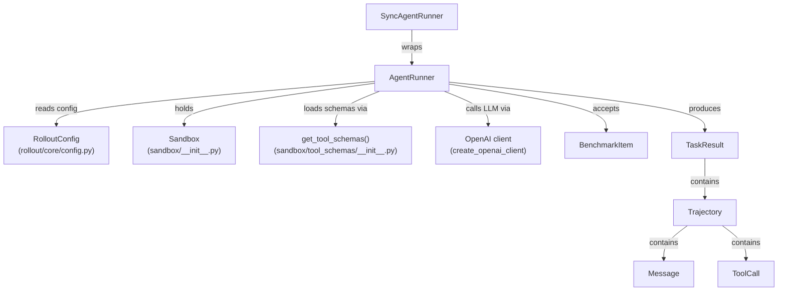
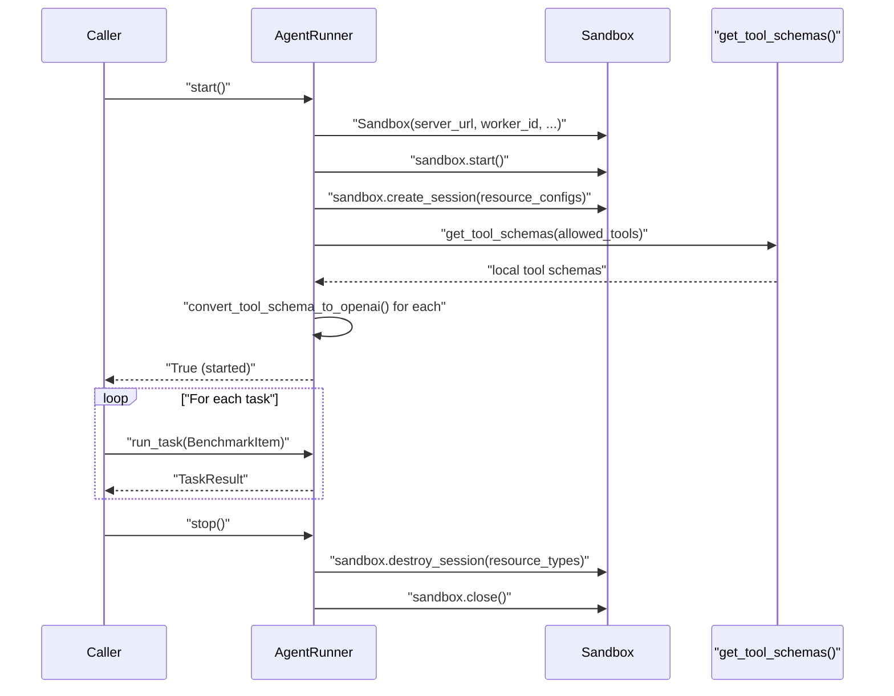

<!-- source: DeepWiki mcp.deepwiki.com · repo OpenDCAI/AgentFlow · page 5.4 Agent Runner Architecture · fetched 2026-11-02 -->

# Agent Runner Architecture

<details>
<summary>Relevant source files</summary>

The following files were used as context for generating this wiki page:

- [rollout/core/runner.py](rollout/core/runner.py)
- [sandbox/tests/test_tool_schemas.py](sandbox/tests/test_tool_schemas.py)
- [sandbox/tool_schemas/__init__.py](sandbox/tool_schemas/__init__.py)
- [sandbox/tool_schemas/doc_tools.py](sandbox/tool_schemas/doc_tools.py)
- [sandbox/tool_schemas/rag_tools.py](sandbox/tool_schemas/rag_tools.py)
- [sandbox/tool_schemas/sql_tools.py](sandbox/tool_schemas/sql_tools.py)
- [sandbox/tool_schemas/vm_tools.py](sandbox/tool_schemas/vm_tools.py)
- [sandbox/tool_schemas/web_tools.py](sandbox/tool_schemas/web_tools.py)
- [synthesis/core/sampler.py](synthesis/core/sampler.py)

</details>


This page describes the internal architecture of the `AgentRunner` class in `rollout/core/runner.py`, which orchestrates multi-turn LLM conversations with tool execution during rollout and inference. It covers initialization, the conversation loop, tool dispatch, and the synchronous wrapper.

For how `AgentRunner` is invoked as part of the broader rollout pipeline, see [Trajectory Rollout](#5.1) and [Model Inference](#5.2). For the evaluation system that consumes `TaskResult` outputs, see [Evaluation System](#5.3). For tool schema definitions and sandbox backends, see [Tool Schemas Reference](#3.3) and [Backend Resources](#3.2).

---

## Overview

`AgentRunner` is the core execution unit in the rollout subsystem. Given a `BenchmarkItem` (a question + optional kwargs), it drives a multi-turn conversation with an LLM, dispatches tool calls to the sandbox server, and returns a `TaskResult` containing the predicted answer and a full `Trajectory`.

Two classes serve this role:

| Class | Location | Use Case |
|---|---|---|
| `AgentRunner` | [rollout/core/runner.py:30-348]() | Async; used internally by the pipeline |
| `SyncAgentRunner` | [rollout/core/runner.py:351-379]() | Synchronous wrapper for contexts without an event loop |

`SyncAgentRunner` creates its own event loop per call via `asyncio.new_event_loop()` and delegates entirely to `AgentRunner`. It also implements the context manager protocol (`__enter__` / `__exit__`), making it usable with `with` statements.

Sources: [rollout/core/runner.py:1-379]()

---

## Class Relationships

**Class and dependency diagram**



Sources: [rollout/core/runner.py:14-27](), [rollout/core/runner.py:30-57](), [rollout/core/runner.py:351-379]()

---

## Lifecycle

An `AgentRunner` instance goes through three phases: **start**, **run tasks**, and **stop**.

**Lifecycle sequence diagram**



Sources: [rollout/core/runner.py:59-128]()

### Initialization (`__init__`)

[rollout/core/runner.py:37-57]()

The constructor stores the `RolloutConfig`, assigns a `worker_id` (defaulting to `runner_{timestamp}`), creates the OpenAI client, and sets up empty fields for the sandbox and tool schemas. No I/O occurs at construction time.

### Start (`start`)

[rollout/core/runner.py:59-109]()

`start()` performs three actions in sequence:

1. **Create and start the sandbox** — instantiates `Sandbox` using `config.sandbox_server_url`, `config.sandbox_auto_start`, `config.sandbox_config_path`, and `config.sandbox_timeout`. The `warmup_resources` parameter is set from `config.resource_types`.

2. **Create sessions** — calls `sandbox.create_session(resource_configs)` for all configured `resource_types`. Each resource type's init config is read from `config.resource_init_configs`. A `partial` status is treated as non-fatal.

3. **Load tool schemas** — calls `_load_tool_schemas()`, which queries `get_tool_schemas(allowed_tools)` and converts each schema to OpenAI function-calling format via `convert_tool_schema_to_openai()`.

If any step raises an exception, `stop()` is called before returning `False`.

### Stop (`stop`)

[rollout/core/runner.py:111-127]()

`stop()` calls `sandbox.destroy_session(resource_types)` and then `sandbox.close()`, resetting `self.sandbox` to `None` and `_started` to `False`.

---

## Tool Schema Loading

[rollout/core/runner.py:129-142]()

`_load_tool_schemas()` loads the AgentFlow-internal tool schema format from `sandbox/tool_schemas/__init__.py` and converts it to the OpenAI API format.

```
config.available_tools
       │
       ▼
get_tool_schemas(allowed_tools)    ← sandbox/tool_schemas/__init__.py
       │
       │  List[Dict]  (internal format)
       ▼
convert_tool_schema_to_openai()    ← rollout/core/utils.py
       │
       ▼
self.tool_schemas                  ← passed to chat completion API
```

`config.available_tools` is a list of tool name patterns (e.g., `["web-search", "web-visit"]` or wildcards like `["vm-*"]`). If `None`, all tools are loaded. See [Tool Schemas Reference](#3.3) for the full set of available tools.

Sources: [rollout/core/runner.py:129-142](), [sandbox/tool_schemas/__init__.py:34-87]()

---

## Task Execution (`run_task`)

[rollout/core/runner.py:144-219]()

`run_task` accepts a `BenchmarkItem` and returns a `TaskResult`. It:

1. Initializes a `Trajectory` with `task_id`, `question`, and `start_time`.
2. Builds the initial message list: a system message (from `config.get_system_prompt()`) and a user message (from `task.question`).
3. Calls `_run_conversation(messages, trajectory, task_kwargs=task.kwargs)`.
4. Populates `trajectory.final_answer`, `trajectory.success`, `trajectory.end_time`, and `trajectory.execution_time_ms`.
5. Returns a `TaskResult` with `predicted_answer`, `ground_truth`, and conditionally the `Trajectory` (only if `config.save_trajectories` is `True`).

On exception, `TaskResult` is returned with `success=False`, `predicted_answer=""`, and the error message. `bdb.BdbQuit` is re-raised to allow debugger interrupts to propagate.

Sources: [rollout/core/runner.py:144-219]()

---

## Conversation Loop (`_run_conversation`)

This is the core of the agent execution logic. It runs until the LLM produces a response with no tool calls, or until `config.max_turns` is reached.

**Conversation loop state machine**

```mermaid
stateDiagram-v2
    [*] --> "BuildMessages"
    "BuildMessages" --> "CallLLM" : "api_messages = [m.to_dict() for m in messages]"
    "CallLLM" --> "HasToolCalls" : "response = async_chat_completion(...)"
    "HasToolCalls" --> "ExecuteTool" : "assistant_message.tool_calls != None"
    "HasToolCalls" --> "ExtractAnswer" : "no tool calls"
    "ExecuteTool" --> "AppendToolResult" : "_execute_tool(tool_name, tool_args, **task_kwargs)"
    "AppendToolResult" --> "IncrementTurn"
    "IncrementTurn" --> "CheckMaxTurns"
    "CheckMaxTurns" --> "BuildMessages" : "turn_count < max_turns"
    "CheckMaxTurns" --> "FallbackExtract" : "turn_count >= max_turns"
    "ExtractAnswer" --> [*] : "extract_final_answer(content)"
    "FallbackExtract" --> [*] : "scan reversed messages for last assistant content"
```

Sources: [rollout/core/runner.py:221-321]()

Key behaviors:

- **One tool call per turn**: even when the LLM returns multiple tool calls, only the first is executed (`assistant_message.tool_calls[:1]`). [rollout/core/runner.py:269]()
- **Task kwargs injection**: `task.kwargs` from the `BenchmarkItem` are merged into tool parameters before execution. This is how document-agent tasks pass `seed_path` automatically. [rollout/core/runner.py:280]()
- **Message recording**: both assistant messages and tool result messages are appended to `trajectory.messages` as `Message` objects. Tool call metadata is recorded as `ToolCall` objects in `trajectory.tool_calls`. [rollout/core/runner.py:282-303]()
- **Final answer extraction**: `extract_final_answer()` from `rollout/core/utils.py` parses the assistant's final text response.
- **Max turns fallback**: if the loop exits without a clean answer, the last assistant message with non-empty content is used. [rollout/core/runner.py:316-321]()

### Message Format

Each message in the conversation is a `Message` object:

| Field | Purpose |
|---|---|
| `role` | `"system"`, `"user"`, `"assistant"`, or `"tool"` |
| `content` | Text content of the message |
| `tool_calls` | List of tool call dicts (assistant messages only) |
| `tool_call_id` | ID linking tool result to originating call |
| `name` | Tool name (tool result messages only) |

Sources: [rollout/core/runner.py:257-303]()

---

## Tool Execution (`_execute_tool`)

[rollout/core/runner.py:323-348]()

`_execute_tool` is a thin wrapper around `sandbox.execute(tool_name, parameters)`. It merges any `**kwargs` (from `task.kwargs`) into `parameters` before dispatch, enabling implicit parameter injection without modifying the LLM-generated tool arguments.

**Tool execution data flow**

```mermaid
graph LR
    LLM["LLM response\n(tool_name, arguments)"]
    Merge["Parameter merge\n{**tool_args, **task_kwargs}"]
    SandboxExecute["sandbox.execute(tool_name, parameters)"]
    SandboxServer["Sandbox Server\nlocalhost:18890"]
    Result["Tool result dict\n{code, message, data}"]
    Format["format_tool_result_for_message()"]
    ToolMsg["Message(role=tool, content=...)"]

    LLM --> Merge
    Merge --> SandboxExecute
    SandboxExecute -->|"HTTP POST"| SandboxServer
    SandboxServer --> Result
    Result --> Format
    Format --> ToolMsg
```



On sandbox exception, `_execute_tool` catches it and returns `{"code": -1, "message": str(e), "data": None}` rather than propagating the error, so the conversation loop can continue.

Sources: [rollout/core/runner.py:323-348](), [rollout/core/runner.py:291-303]()

---

## Data Models Reference

These models are defined in `rollout/core/models.py` and used throughout `AgentRunner`:

| Model | Fields | Description |
|---|---|---|
| `BenchmarkItem` | `id`, `question`, `answer`, `kwargs` | Input to `run_task` |
| `Trajectory` | `task_id`, `question`, `messages`, `tool_calls`, `final_answer`, `success`, `error`, `start_time`, `end_time`, `execution_time_ms`, `total_turns` | Full execution record |
| `Message` | `role`, `content`, `tool_calls`, `tool_call_id`, `name` | Single conversation turn |
| `ToolCall` | `tool_name`, `parameters`, `result`, `success` | Single tool invocation record |
| `TaskResult` | `task_id`, `question`, `predicted_answer`, `ground_truth`, `trajectory`, `success`, `error` | Output of `run_task` |

Sources: [rollout/core/runner.py:18-20]()

---

## SyncAgentRunner

[rollout/core/runner.py:351-379]()

`SyncAgentRunner` wraps `AgentRunner` for use in synchronous Python contexts. Each method creates a new event loop, runs the corresponding async coroutine to completion, and closes the loop.

```python
# Context manager usage
with SyncAgentRunner(config, worker_id="w1") as runner:
    result = runner.run_task(task)
```

`__enter__` calls `start()` and `__exit__` calls `stop()`. The `_run_async` helper [rollout/core/runner.py:357-362]() manages the loop lifecycle.

> **Note**: Because a new loop is created per call, `SyncAgentRunner` does not share state across calls at the event loop level. It is not suitable for high-concurrency use; the async `AgentRunner` should be used directly in those cases.

Sources: [rollout/core/runner.py:351-379]()

---

## Configuration Parameters Used

`AgentRunner` reads the following fields from `RolloutConfig`:

| Config Field | Used In | Effect |
|---|---|---|
| `api_key`, `base_url` | `__init__` | OpenAI client credentials |
| `sandbox_server_url` | `start()` | Sandbox HTTP endpoint |
| `sandbox_auto_start` | `start()` | Whether runner starts the sandbox process |
| `sandbox_config_path` | `start()` | Path to sandbox server config file |
| `sandbox_timeout` | `start()` | Request timeout for sandbox calls |
| `resource_types` | `start()` | Which resource sessions to create |
| `resource_init_configs` | `start()` | Per-resource initialization parameters |
| `available_tools` | `_load_tool_schemas()` | Tool name filter (supports wildcards) |
| `model_name` | `_run_conversation()` | LLM model identifier |
| `max_turns` | `_run_conversation()` | Turn limit per task |
| `max_retries` | `_run_conversation()` | LLM call retry count |
| `save_trajectories` | `run_task()` | Whether to include `Trajectory` in result |

For full configuration schema documentation, see [Inference Config Schema](#8.4) and [Trajectory Config Schema](#8.3).

Sources: [rollout/core/runner.py:37-57](), [rollout/core/runner.py:59-109](), [rollout/core/runner.py:241-252]()

---

