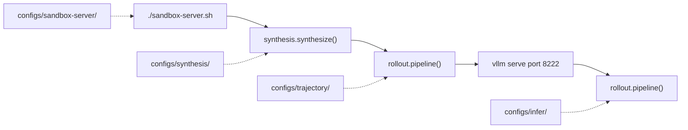

<!-- source: DeepWiki mcp.deepwiki.com · repo OpenDCAI/AgentFlow · page 6 Agent Examples · fetched 2026-11-02 -->

# Agent Examples

Relevant source files

The following files were used as context for generating this wiki page:

- [README.md](README.md)
- [README_zh.md](README_zh.md)
- [assets/intro.png](assets/intro.png)
- [assets/method.png](assets/method.png)
- [assets/wechat.jpg](assets/wechat.jpg)
- [assets/wechatshow.png](assets/wechatshow.png)

This page is the orientation guide for AgentFlow's agent example collection. It describes the five-step workflow shared by all agent types, shows how each modality maps to specific code entities, and provides representative sample interactions. Detailed, step-by-step instructions for each modality are in the sub-pages.

For background on the three-stage data synthesis methodology used in all examples, see [Three-Stage Data Synthesis Pipeline](#2.1). For conceptual descriptions of what each agent type does, see [Agent Types and Modalities](#2.2). For configuration file parameter reference, see [Configuration Reference](#8). For training and deploying models produced by these pipelines, see [Model Training and Deployment](#10).

---

## Common Workflow

All six agent examples follow the same five-step workflow. The modality is determined entirely by the config file paths — no code changes are required to switch between agent types.

**Five-Step Workflow: Entry Points and Config Directories**

Sources: [README.md:107-149]()

| Step | Entry Point | Config Path | Purpose |
| ---- | ----------- | ----------- | ------- |
| 1 | `./sandbox-server.sh` | `configs/sandbox-server/{agent}_config.json` | Start tool execution environment |
| 2 | `synthesis.synthesize()` | `configs/synthesis/{agent}_config.json` | Generate QA pairs from seed data |
| 3 | `rollout.pipeline()` | `configs/trajectory/{agent}_trajectory.json` | Generate training trajectories (`trajectory_only: true`) |
| 4 | `vllm serve` | — | Serve trained model, enable tool-calling |
| 5 | `rollout.pipeline()` | `configs/infer/{agent}_infer.json` | Run benchmark evaluation (`evaluate_results: true`) |

`rollout.pipeline` is reused in steps 3 and 5. The `trajectory_only` and `evaluate_results` flags in the respective config files determine its behavior. See [Rollout and Inference](#5) for details.

The vLLM serve command requires `--enable-auto-tool-choice --tool-call-parser hermes` to handle the structured tool calls produced by trained agent models. See [Model Deployment with vLLM](#10.2).

Sources: [README.md:131-149]()

---

## Agent Types at a Glance

**Agent Types Mapped to Tools, Backends, and Config Files**

```mermaid
graph TD
    RAGAgent["RAG Agent"] --> RAGTool["rag-search"]
    RAGAgent --> RAGBack["E5 + Faiss backend"]
    RAGAgent --> RAGCfg["rag_config.json"]

    DocAgent["Document Agent"] --> DocTool1["doc-search"]
    DocAgent --> DocTool2["doc-read"]
    DocAgent --> DocBack["VLM gpt-4o-mini + PDF parser"]
    DocAgent --> DocCfg["doc_config.json"]

    WebAgent["Web Agent"] --> WebTool1["web-search"]
    WebAgent --> WebTool2["web-visit"]
    WebAgent --> WebBack["Serper API + Jina API"]
    WebAgent --> WebCfg["web_config.json"]

    SQLAgent["Text2SQL Agent"] --> SQLTool1["sql:list_databases"]
    SQLAgent --> SQLTool2["sql:get_schema"]
    SQLAgent --> SQLTool3["sql:execute"]
    SQLAgent --> SQLBack["SQLite databases"]
    SQLAgent --> SQLCfg["text2sql_config.json"]

    DSAgent["Data Science Agent"] --> DSTool1["ds_inspect_data"]
    DSAgent --> DSTool2["ds_read_csv"]
    DSAgent --> DSTool3["ds_run_python"]
    DSAgent --> DSBack["Sandboxed Python executor"]
    DSAgent --> DSCfg["ds_config.json"]

    GUIAgent["GUI Agent"] --> GUITool1["vm-screenshot"]
    GUIAgent --> GUITool2["vm-click"]
    GUIAgent --> GUITool3["vm-type"]
    GUIAgent --> GUIBack["Docker VM Ubuntu Desktop"]
    GUIAgent --> GUICfg["vm_config.json"]
```

Sources: [README.md:22-36](), [README.md:153-158]()

The following table summarizes key properties of each agent type:

| Agent Type | Tools | Backend | Sandbox Config | Pre-trained Model | Sub-page |
| ---------- | ----- | ------- | -------------- | ----------------- | -------- |
| RAG | `rag-search` | E5 + Faiss | `rag_config.json` | RAGShaper | [RAG Agent](#6.1) |
| Document | `doc-search`, `doc-read` | VLM + PDF parser | `doc_config.json` | DocDancer | [Document Agent](#6.2) |
| Web | `web-search`, `web-visit` | Serper API, Jina API | `web_config.json` | DeepResearch Agent | [Web Agent](#6.3) |
| Text2SQL | `sql:list_databases`, `sql:get_schema`, `sql:execute` | SQLite (7 domains) | `text2sql_config.json` | — | [Text2SQL Agent](#6.4) |
| Data Science | `ds_inspect_data`, `ds_read_csv`, `ds_run_python` | Sandboxed Python | `ds_config.json` | — | [Data Science Agent](#6.5) |
| GUI | `vm-screenshot`, `vm-click`, `vm-type`, `vm-key`, `vm-scroll` | Docker VM (Ubuntu Desktop) | `vm_config.json` | — | [GUI Agent](#6.6) |

Sources: [README.md:22-36](), [README.md:173-181]()

---

## Configuration File Naming Convention

Each agent type has four configuration files, one per pipeline stage. All files live under `configs/`.

| Agent | Sandbox Config | Synthesis Config | Trajectory Config | Inference Config |
| ----- | -------------- | ---------------- | ----------------- | ---------------- |
| RAG | `sandbox-server/rag_config.json` | `synthesis/rag_config.json` | `trajectory/rag_trajectory.json` | `infer/rag_infer.json` |
| Document | `sandbox-server/doc_config.json` | `synthesis/doc_config.json` | `trajectory/doc_trajectory.json` | `infer/doc_infer.json` |
| Web | `sandbox-server/web_config.json` | `synthesis/web_config.json` | `trajectory/web_trajectory.json` | `infer/web_infer.json` |
| Text2SQL | `sandbox-server/text2sql_config.json` | `synthesis/text2sql_config.json` | `trajectory/text2sql_trajectory.json` | `infer/text2sql_infer.json` |
| Data Science | `sandbox-server/ds_config.json` | `synthesis/ds_config.json` | `trajectory/ds_trajectory.json` | `infer/ds_infer.json` |
| GUI | `sandbox-server/vm_config.json` | `synthesis/vm_config.json` | `trajectory/vm_trajectory.json` | `infer/vm_infer.json` |

Sources: [README.md:153-158]()

---

## Sample Interactions

The following examples illustrate the kinds of tasks each agent type handles.

### RAG Agent

The RAG agent uses `rag-search` iteratively to retrieve document passages, then reasons across the retrieved content to answer multi-hop factoid questions.

> **Question:** A major literary work commissioned by the Holy Roman Emperor whose reign began in 1508 was part of his grand artistic legacy. While this patron commissioned famous manuscript anthologies during this period, this specific allegorical epic was distinctively designed for the printing press to ensure a wider audience. What is the exact publication year of its first edition?
>
> **Answer:** 1517

Sources: [README.md:224-231]()

### Document Agent

The Document agent uses `doc-search` to locate relevant pages in a PDF and `doc-read` (which calls a VLM) to extract information from text, tables, and charts.

> **Question:** What is the difference in percentage-point increase between the overall mean score improvement shown in the bar chart of pre-test versus post-test scores and the improvement for the TIC Principle concept reported in the percentages table?
>
> **Answer:** 14.92%

Sources: [README.md:258-265]()

### Text2SQL Agent

The Text2SQL agent calls `sql:list_databases` to discover available schemas, `sql:get_schema` to inspect table structure, and `sql:execute` to run synthesized SQL. Below is a sample question against a movie rental database schema with tables `actor`, `film`, `film_actor`, `film_category`, `category`, `inventory`, and `rental`:

> **Question:** Which film categories have more than 10 actors who have appeared in popular films, and how many such actors are there in each category?

The agent generates a multi-CTE SQL query that joins `film`, `inventory`, `rental`, `film_actor`, and `category` to compute per-category actor counts against an average-rental-count threshold.

Sources: [README.md:290-399]()

### Data Science Agent

The Data Science agent calls `ds_read_csv` to load a dataset, then uses `ds_run_python` to execute pandas and scikit-learn code in a sandboxed Python environment.

Input table: `race_results.csv` — columns include `Rank`, `Driver`, `Team`, `Laps`, `Time / Retire`, `Grid`, `Points`.

> **Question:** Which feature has the highest importance in predicting 'time / retired' according to the Random Forest model?
>
> **Answer:** laps

Sources: [README.md:268-288]()

### GUI Agent

The GUI agent uses `vm-screenshot` to observe the desktop state, then issues `vm-click`, `vm-type`, `vm-key`, and `vm-scroll` to interact with the Ubuntu Desktop running in a Docker container.

> **Instruction:** Launch the terminal from the GUI, identify any home directory config files related to shell startup, and then generate a clean, sorted list that combines both currently active aliases and those hidden in your configuration files so I can see the full definitions of commands like `alert` or `ll`.

Sources: [README.md:401-412]()

---

## Pre-trained Models and Benchmarks

AgentFlow provides pre-trained models for the RAG, Document, and Web agent types. These can be used directly for evaluation or as a baseline before fine-tuning on custom data.

| Agent | Pre-trained Model | Base Architecture | Key Benchmarks |
| ----- | ----------------- | ----------------- | -------------- |
| RAG | RAGShaper (6.5k) | Qwen3-30B-A3B | Bamboogle, PopQA, NQ, AmbigQA |
| Document | DocDancer | Qwen3-30B-A3B | MMLongBench-Doc, DocBench |
| Web | DeepResearch Agent | Qwen3-30B-A3B | GAIA, BrowseComp, BrowseComp-zh |
| Multi-domain (data mixing) | Agent-datamix | Qwen3-30B-A3B | Web + Doc + RAG benchmarks |
| Multi-domain (param merging) | Agent-RegMeanpp | Qwen3-30B-A3B | Web + Doc + RAG benchmarks |

Sources: [README.md:173-205]()

The `Agent-datamix` model is trained by mixing trajectories from all domains into a single training run. `Agent-RegMeanpp` is produced by training specialist models per domain and then merging parameters using regularized averaging. On the GAIA benchmark, data-level mixing (64.08%) outperforms parameter-level merging (60.19%). For the full performance table, see [Benchmarks](#7).

For instructions on preparing training data from synthesized QA pairs and trajectories, see [Preparing Training Data](#10.1).

---

