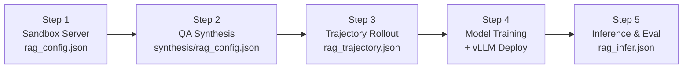
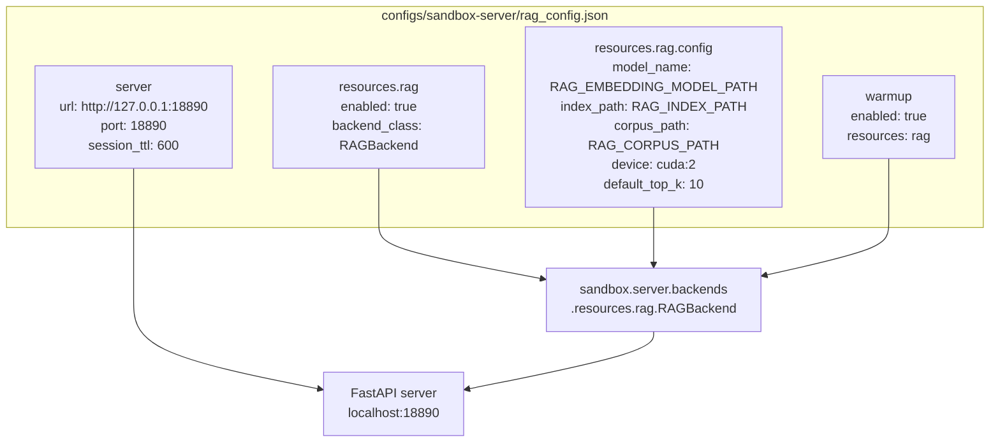
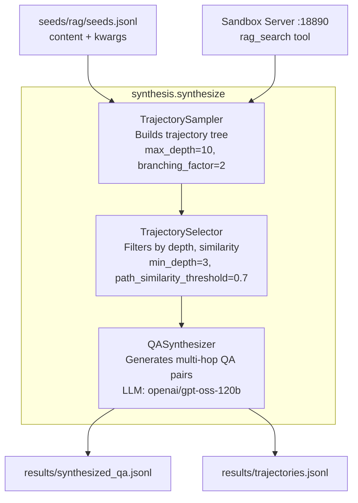
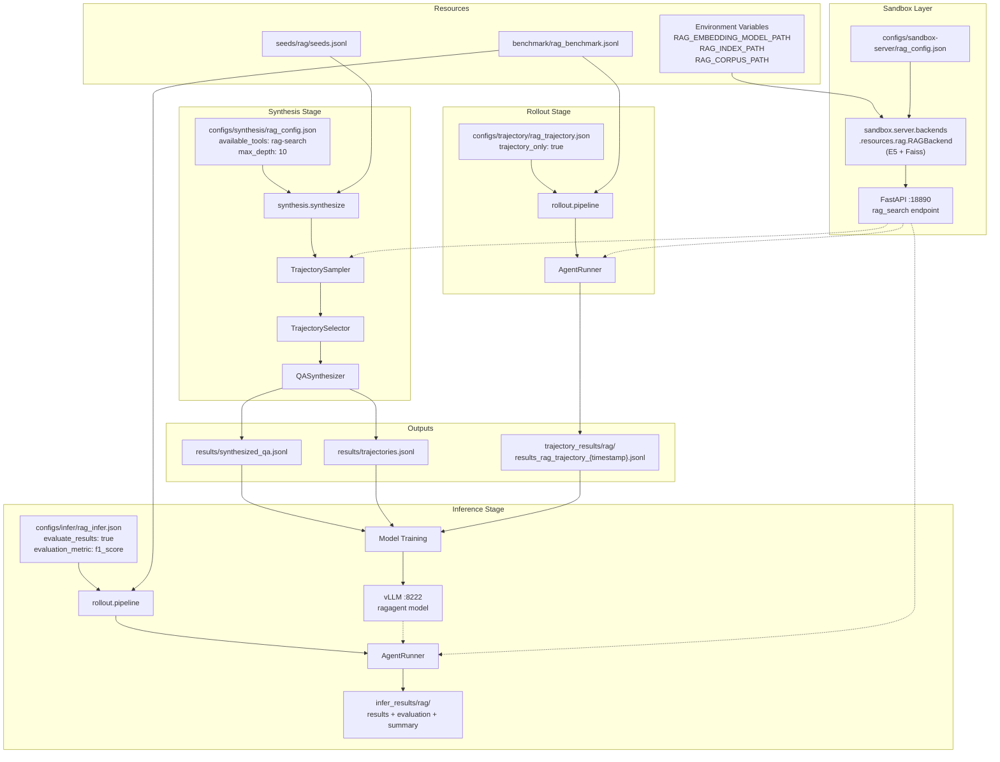
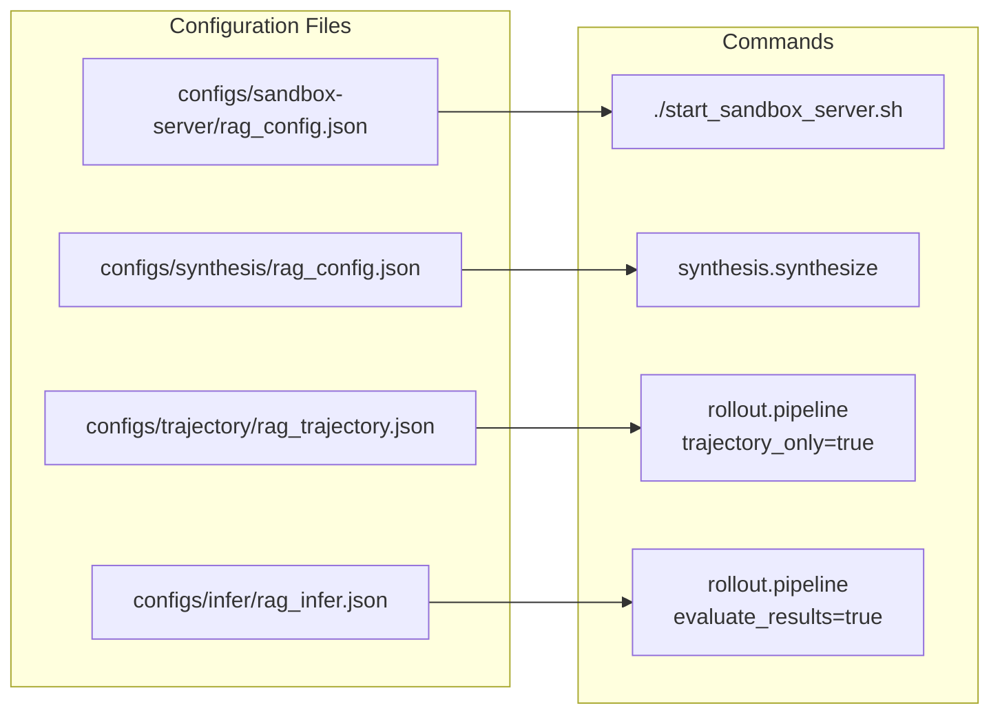

<!-- source: DeepWiki mcp.deepwiki.com · repo OpenDCAI/AgentFlow · page 6.1 RAG Agent · fetched 2026-11-02 -->

# RAG Agent

<details>
<summary>Relevant source files</summary>

The following files were used as context for generating this wiki page:

- [configs/infer/rag_infer.json](configs/infer/rag_infer.json)
- [configs/synthesis/doc_config.json](configs/synthesis/doc_config.json)
- [configs/synthesis/rag_config.json](configs/synthesis/rag_config.json)
- [configs/synthesis/web_config.json](configs/synthesis/web_config.json)
- [configs/synthesis/web_rag_config.json](configs/synthesis/web_rag_config.json)
- [configs/trajectory/rag_trajectory.json](configs/trajectory/rag_trajectory.json)
- [examples/RAGAgent.md](examples/RAGAgent.md)
- [seeds/rag/seeds.jsonl](seeds/rag/seeds.jsonl)

</details>


This page covers a complete end-to-end walkthrough of building, training, and evaluating a **RAG (Retrieval-Augmented Generation) Agent** using AgentFlow. The RAG Agent retrieves text chunks from a local vector index (E5 + Faiss) and synthesizes answers with an LLM. This page covers environment setup, sandbox configuration, QA data synthesis, trajectory rollout, model deployment, and inference evaluation.

For background on how the three-stage pipeline works conceptually, see [2.1](#2.1). For a reference of all synthesis config parameters, see [8.2](#8.2). For sandbox server configuration details, see [3.1](#3.1) and [3.2](#3.2).

---

## Overview

The RAG Agent answers questions by:
1. Issuing queries against a pre-built Faiss index using the `rag_search` tool
2. Synthesizing an answer from the retrieved text chunks

The tool name has three accepted variants: `rag_search`, `rag-search`, and `rag:search`. The sandbox normalizes all three to the canonical backend form `rag:search`.

| Tool | Description | Parameters |
|------|-------------|------------|
| `rag_search` | Retrieve top-k text chunks from the Faiss index | `query` (string), `top_k` (int, optional, default 10) |

The complete pipeline from data creation to evaluated inference runs in five stages:

**Pipeline stages diagram**



Sources: [examples/RAGAgent.md:24-26]()

---

## Prerequisites

### API Keys

| Variable | Purpose |
|----------|---------|
| `OPENROUTER_API_KEY` | LLM calls during synthesis and rollout |

### RAG Resources

The sandbox RAG backend (`sandbox.server.backends.resources.rag.RAGBackend`) requires three local resources, specified via environment variables:

| Variable | Content |
|----------|---------|
| `RAG_EMBEDDING_MODEL_PATH` | E5-compatible embedding model directory |
| `RAG_INDEX_PATH` | Faiss index file |
| `RAG_CORPUS_PATH` | Corpus in JSONL format (one passage per line) |

```bash
export RAG_EMBEDDING_MODEL_PATH=/path/to/e5-base-v2
export RAG_INDEX_PATH=/path/to/faiss.index
export RAG_CORPUS_PATH=/path/to/corpus.jsonl
```

Example resources compatible with the default configuration are available from Hugging Face (`intfloat/e5-base-v2`, `PeterJinGo/wiki-18-e5-index`, `PeterJinGo/wiki-18-corpus`).

> If the corpus is large, the backend checks for a `corpus.jsonl.offsets` file alongside `RAG_CORPUS_PATH` for random-access reads. If none is found, the full corpus is loaded into memory.

### Files Checklist

| File | Purpose |
|------|---------|
| `configs/sandbox-server/rag_config.json` | Sandbox server configuration |
| `configs/synthesis/rag_config.json` | QA synthesis parameters |
| `configs/trajectory/rag_trajectory.json` | Trajectory rollout parameters |
| `configs/infer/rag_infer.json` | Inference and evaluation parameters |
| `seeds/rag/seeds.jsonl` | Seed data for synthesis |
| `benchmark/rag_benchmark.jsonl` | Benchmark data for rollout and inference |

Sources: [examples/RAGAgent.md:38-107]()

---

## Step 1: Start the Sandbox Server

The sandbox server exposes the `rag_search` tool as an HTTP endpoint. It is started with the RAG-specific configuration file.

```bash
./start_sandbox_server.sh --config configs/sandbox-server/rag_config.json
```

**Sandbox server configuration diagram**



Sources: [examples/RAGAgent.md:164-214]()

### Key Configuration Fields

| Field | Description |
|-------|-------------|
| `server.url` | Address the server binds to |
| `server.port` | Port (default `18890`) |
| `server.session_ttl` | Session expiry in seconds |
| `resources.rag.backend_class` | `sandbox.server.backends.resources.rag.RAGBackend` |
| `resources.rag.config.model_name` | Resolved from `${RAG_EMBEDDING_MODEL_PATH}` |
| `resources.rag.config.index_path` | Resolved from `${RAG_INDEX_PATH}` |
| `resources.rag.config.corpus_path` | Resolved from `${RAG_CORPUS_PATH}` |
| `resources.rag.config.device` | `cpu`, `cuda:0`, etc. |
| `resources.rag.config.default_top_k` | Default number of retrieved chunks |
| `resources.rag.config.batcher_trigger_batch_size` | Batch trigger size (default `16`) |
| `resources.rag.config.batcher_max_batch_size` | Max batch size (default `32`) |
| `resources.rag.config.batcher_max_wait_time` | Max batch wait in seconds (default `0.05`) |
| `warmup.enabled` | Whether to warm up the backend at startup |

Sources: [examples/RAGAgent.md:164-210]()

---

## Step 2: Synthesize QA Data

QA synthesis generates multi-hop question–answer pairs and their corresponding agent trajectories from seed topics, using the three-stage pipeline internally (sampling → selection → synthesis).

### Seed Data Format

Seed file: `seeds/rag/seeds.jsonl`

Each line is a JSON object:

```
{"content": "Python programming language", "kwargs": {}}
{"content": "Machine learning", "kwargs": {}}
```

| Field | Required | Description |
|-------|----------|-------------|
| `content` | Yes | Starting entity/topic for the agent to explore |
| `kwargs` | No | Extra metadata, defaults to `{}` |

Seeds determine the knowledge domains covered by the synthesized training data. Each seed causes the `TrajectorySampler` to explore the RAG index from that topic, building a trajectory tree from which QA pairs are extracted.

Sources: [seeds/rag/seeds.jsonl:1-4](), [examples/RAGAgent.md:218-225]()

### Running QA Synthesis

**Python API:**
```python
from synthesis import synthesize
synthesize(config_path="configs/synthesis/rag_config.json")
```

**CLI:**
```bash
python -m synthesis.pipeline \
    --config configs/synthesis/rag_config.json \
    --seeds seeds/rag/seeds.jsonl \
    --output-dir synthesis_results/rag
```

**Internal data flow diagram**



Sources: [examples/RAGAgent.md:228-283](), [configs/synthesis/rag_config.json:1-60]()

### Synthesis Config Parameters

Config file: `configs/synthesis/rag_config.json`

| Parameter | Value | Description |
|-----------|-------|-------------|
| `model_name` | `openai/gpt-oss-120b` | LLM for sampling and QA generation |
| `max_depth` | `10` | Max depth of the trajectory tree |
| `branching_factor` | `2` | Branches created at each node |
| `depth_threshold` | `2` | Depth before branching begins |
| `min_depth` | `3` | Minimum trajectory depth to be selectable |
| `max_selected_traj` | `2` | Max trajectories selected per seed |
| `path_similarity_threshold` | `0.7` | Deduplicate similar paths above this threshold |
| `resource_types` | `["rag"]` | Backend resource types to initialize per session |
| `resource_init_configs.rag.content.top_k` | `10` | Chunks retrieved per `rag_search` call |
| `available_tools` | `["rag-search"]` | Tools exposed to the sampling LLM |
| `sandbox_auto_start` | `true` | Auto-start sandbox if not already running |
| `sandbox_config_path` | `configs/sandbox-server/rag_config.json` | Config used when auto-starting |
| `sandbox_timeout` | `120` | Timeout for sandbox tool calls (seconds) |

Sources: [configs/synthesis/rag_config.json:1-60]()

### Sampling and Synthesis Tips

These are included in the config and injected into LLM prompts to guide behavior.

**Sampling tips** (guide trajectory exploration):

- Explore deeply to build multi-hop reasoning chains
- Focus on gathering specific facts and evidence
- Build dependency chains (A→B→C→D...)
- Capture hard metadata (dates, versions, IDs, counts)

**Synthesis tips** (guide QA generation):

- Create questions requiring multi-hop reasoning (≥3 hops)
- Keep questions concise (≤2 sentences)
- Answers should be specific facts (names, dates, locations)
- Ensure answer is grounded in trajectory evidence

Sources: [configs/synthesis/rag_config.json:35-56]()

### Output Files

| File | Description |
|------|-------------|
| `results/synthesized_qa.jsonl` | Synthesized QA pairs, one JSON per line |
| `results/trajectories.jsonl` | Agent trajectories with tool calls and reasoning traces |

---

## Step 3: Synthesize Trajectory Data (Rollout)

This step runs an existing LLM (e.g., `gpt-4.1-2025-04-14`) against a benchmark dataset using the rollout pipeline to generate additional trajectory data for training. Unlike Step 2, this operates in `trajectory_only` mode — no QA generation, no evaluation.

**Python API:**
```python
from rollout import pipeline
pipeline(config_path="configs/trajectory/rag_trajectory.json")
```

**CLI:**
```bash
python -m rollout.pipeline \
    --config configs/trajectory/rag_trajectory.json \
    --output-dir trajectory_results/rag
```

### Trajectory Config Parameters

Config file: `configs/trajectory/rag_trajectory.json`

| Parameter | Value | Description |
|-----------|-------|-------------|
| `model_name` | `gpt-4.1-2025-04-14` | LLM to run against benchmark |
| `max_turns` | `50` | Max conversation turns per task |
| `available_tools` | `["rag_search"]` | Tools available to the agent |
| `evaluate_results` | `false` | Disable evaluation |
| `trajectory_only` | `true` | Save trajectories only, skip scoring |
| `data_path` | `benchmark/rag_benchmark.jsonl` | Input benchmark |
| `output_dir` | `trajectory_results/rag` | Output directory |
| `save_results` | `true` | Persist per-task results |
| `save_trajectories` | `true` | Persist trajectory files |
| `parallel` | `false` | Disable parallel execution |

Sources: [configs/trajectory/rag_trajectory.json:1-39]()

### Benchmark Data Format

`benchmark/rag_benchmark.jsonl` — one JSON per line:

```
{"id": "task_001", "question": "What is the capital of France?", "answer": "Paris"}
```

### System Prompt

The trajectory config specifies a system prompt injected at the start of each conversation. It instructs the agent to search the knowledge base first and ground answers in retrieved context.

Sources: [configs/trajectory/rag_trajectory.json:13-24]()

### Output

Results written to `trajectory_results/rag/`:

| File | Description |
|------|-------------|
| `results_rag_trajectory_{timestamp}.jsonl` | Per-task trajectory results |

---

## Step 4: Model Training and Deployment

After generating data in Steps 2 and 3, train a model on the combined output. For model training procedures, see [10.1](#10.1).

Once trained, deploy with vLLM:

```bash
vllm serve \
    --model YOUR_TRAINED_MODEL \
    --served-model-name ragagent \
    --tensor-parallel-size 8 \
    --enable-auto-tool-choice \
    --tool-call-parser hermes \
    --port 8222
```

The deployed model serves an OpenAI-compatible API at `http://localhost:8222`. For vLLM deployment details, see [10.2](#10.2).

Sources: [examples/RAGAgent.md:344-360]()

---

## Step 5: Inference and Evaluation

Run the trained model against the benchmark and score results using F1.

**Python API:**
```python
from rollout import pipeline
pipeline(config_path="configs/infer/rag_infer.json")
```

### Inference Config Parameters

Config file: `configs/infer/rag_infer.json`

| Parameter | Value | Description |
|-----------|-------|-------------|
| `model_name` | `YOUR_MODEL_NAME` | Trained model name |
| `base_url` | `VLLM_URL` | vLLM endpoint URL |
| `max_turns` | `50` | Max conversation turns |
| `max_retries` | `3` | Max LLM call retries |
| `max_workers` | `1` | Parallel workers |
| `available_tools` | `["rag_search"]` | Tools available to the agent |
| `evaluate_results` | `true` | Enable evaluation |
| `evaluation_metric` | `f1_score` | Scoring metric |
| `evaluator_model_name` | `openai/gpt-oss-120b` | Judge LLM |
| `evaluator_temperature` | `0.0` | Judge sampling temperature |
| `data_path` | `benchmark/rag_benchmark.jsonl` | Input benchmark |
| `output_dir` | `infer_results/rag` | Output directory |
| `save_results` | `true` | Persist per-task results |
| `save_trajectories` | `true` | Persist trajectory files |

Sources: [configs/infer/rag_infer.json:1-46]()

### Output Files

Results are written to `infer_results/rag/`:

| File | Description |
|------|-------------|
| `results_rag_infer_{timestamp}.jsonl` | Per-task inference results |
| `evaluation_rag_infer_{timestamp}.json` | Evaluation details including `average_score` |
| `summary_rag_infer_{timestamp}.json` | Run summary |

---

## End-to-End Architecture Diagram

**Code entity view of the full RAG Agent pipeline**



Sources: [examples/RAGAgent.md:112-148](), [configs/synthesis/rag_config.json:1-60](), [configs/trajectory/rag_trajectory.json:1-39](), [configs/infer/rag_infer.json:1-46]()

---

## Configuration Files Summary

**Config file to pipeline stage mapping**



Sources: [examples/RAGAgent.md:156-159](), [examples/RAGAgent.md:239-252](), [examples/RAGAgent.md:292-305](), [examples/RAGAgent.md:368-373]()

---

## FAQ

**Q: Which tool name variant should I use?**

All three variants (`rag_search`, `rag-search`, `rag:search`) are accepted. The sandbox normalizes them to `rag:search` internally. The synthesis config uses `rag-search` while the rollout and infer configs use `rag_search`; both work.

**Q: Why does `rag_search` return a single string instead of a list?**

The `RAGBackend` formats retrieved chunks into a single concatenated `context` string for prompt-friendly insertion. Adjust `top_k` in `resource_init_configs.rag.content.top_k` (synthesis) or pass it directly in the tool call to control chunk count.

**Q: The sandbox server fails to start with missing path errors.**

Confirm that `RAG_EMBEDDING_MODEL_PATH`, `RAG_INDEX_PATH`, and `RAG_CORPUS_PATH` are set in the environment before invoking `start_sandbox_server.sh`. The config uses `${VAR_NAME}` substitution syntax.

**Q: Can I use a hybrid RAG + web search agent?**

Yes. The `configs/synthesis/web_rag_config.json` config sets `available_tools` to `["rag-search", "web-search", "web-visit"]` and includes tips that require using both tool types within each trajectory.

Sources: [examples/RAGAgent.md:453-467](), [configs/synthesis/web_rag_config.json:17-17]()

---

