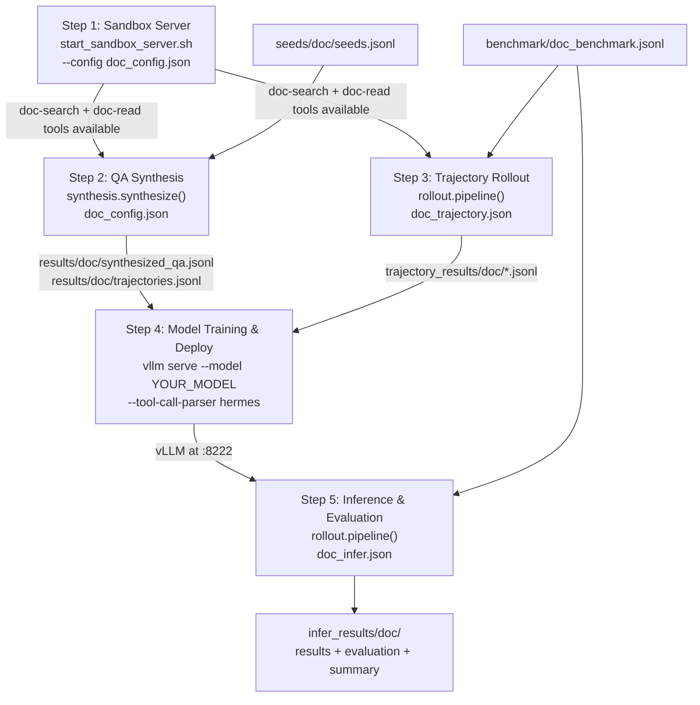
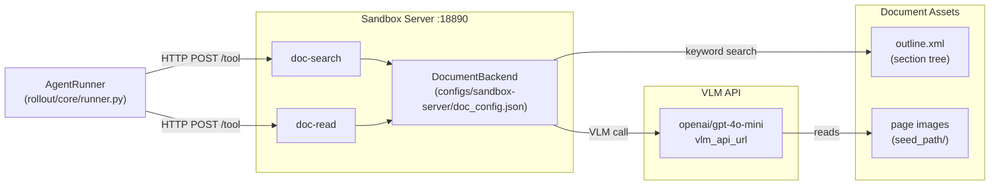
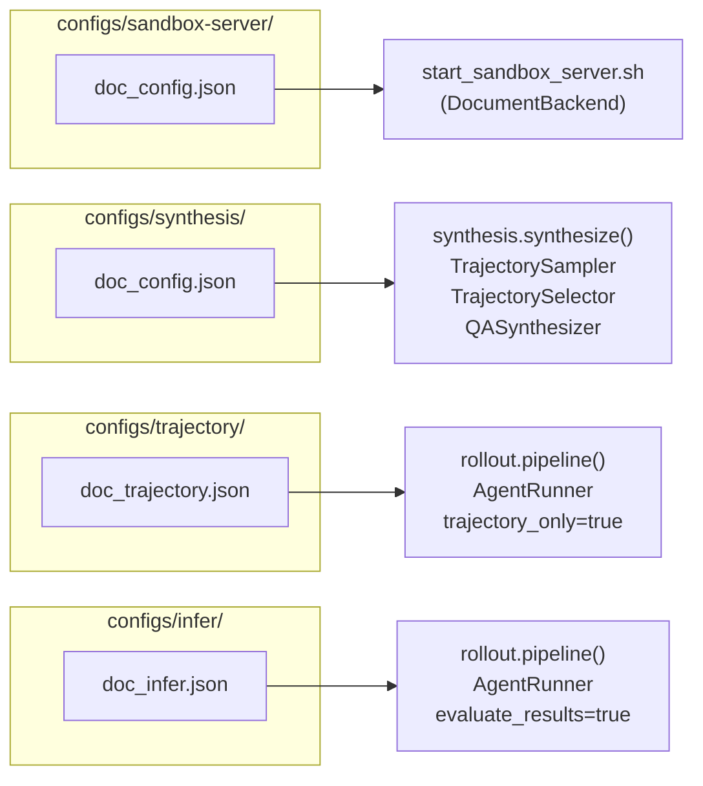

<!-- source: DeepWiki mcp.deepwiki.com · repo OpenDCAI/AgentFlow · page 6.2 Document Agent (DocDancer) · fetched 2026-11-02 -->

# Document Agent (DocDancer)

<details>
<summary>Relevant source files</summary>

The following files were used as context for generating this wiki page:

- [configs/synthesis/doc_config.json](configs/synthesis/doc_config.json)
- [configs/synthesis/rag_config.json](configs/synthesis/rag_config.json)
- [configs/synthesis/web_config.json](configs/synthesis/web_config.json)
- [configs/synthesis/web_rag_config.json](configs/synthesis/web_rag_config.json)
- [examples/DocDancer.md](examples/DocDancer.md)

</details>


This page covers the end-to-end workflow for building and using the **DocDancer** document understanding agent within AgentFlow. It explains the two document tools, the five-stage pipeline from sandbox setup through evaluation, configuration parameters, seed and benchmark data formats, and output file conventions.

For the generic three-stage synthesis pipeline that DocDancer uses internally, see [2.1](#2.1). For pre-trained model weights and benchmark comparisons (MMLongBench-Doc, DocBench), see [10.3](#10.3). For sandbox server configuration in general, see [3.1](#3.1).

---

## Overview

DocDancer is a multimodal document understanding agent. Given a long, structured PDF document (preprocessed into XML sections and page images), it answers complex questions that require reading across multiple pages and reasoning over both text and visual elements (figures, tables, charts).

The agent is equipped with two tools:

| Tool | Purpose |
|------|---------|
| `doc-search` | Search document headings, paragraphs, tables, and image captions by keyword |
| `doc-read` | Read specific sections by ID using a VLM, processing text and images together |

The generated model, **DocDancer (Qwen3-30B)**, is evaluated on **MMLongBench-Doc** and **DocBench**.

---

## Pipeline Architecture

**DocDancer Five-Stage Pipeline**



Sources: [examples/DocDancer.md:24-104]()

---

## Document Tools

**Tool-to-Backend Mapping**



Sources: [examples/DocDancer.md:28-34](), [examples/DocDancer.md:120-165]()

### `doc-search`

Scans the XML-structured document for sections containing any of the supplied keywords. Returns matching section IDs, headings, snippets, and page numbers.

| Parameter | Type | Required | Description |
|-----------|------|----------|-------------|
| `key_words` | `array[string]` | Yes | Keywords to search across headings, paragraphs, tables, image captions |
| `max_search_results` | `integer` | No | Max results per keyword (server default: `10`) |

### `doc-read`

Extracts structured information from one or more section IDs by issuing a VLM call. Processes both text content and rendered page images.

| Parameter | Type | Required | Description |
|-----------|------|----------|-------------|
| `section_ids` | `array[string]` | Yes | Section IDs returned by `doc-search` |
| `goal` | `string` | Yes | Extraction objective passed to the VLM |
| `max_image_num` | `integer` | No | Max visual inputs per call (server default: `10`) |
| `max_text_token` | `integer` | No | Max text characters (server default: `20000`) |

Sources: [examples/DocDancer.md:28-34]()

---

## Step 1: Start the Sandbox Server

```bash
./start_sandbox_server.sh --config configs/sandbox-server/doc_config.json
```

The `--port` and `--host` flags are ignored; all network settings come from the config file.

**`configs/sandbox-server/doc_config.json` fields:**

| Field | Description |
|-------|-------------|
| `server.url` | Listen address (e.g., `http://127.0.0.1:18890`) |
| `server.port` | Port number (default `18890`) |
| `server.session_ttl` | Session TTL in seconds (default `300`) |
| `apis.doc.seed_path` | Default document folder (overridden per-seed via `kwargs.seed_path`) |
| `apis.doc.max_search_results` | Per-keyword result cap |
| `apis.doc.max_image_num` | Max images per `doc-read` call |
| `apis.doc.max_text_token` | Max text characters per `doc-read` call |
| `apis.doc.vlm_model` | VLM model name (e.g., `openai/gpt-4o-mini`) |
| `apis.doc.vlm_api_key` | VLM API key — supports `${ENV_VAR}` substitution |
| `apis.doc.vlm_api_url` | VLM API base URL |
| `apis.doc.vlm_max_tokens` | Max tokens in VLM response |
| `apis.doc.vlm_timeout` | VLM request timeout (seconds) |
| `apis.doc.vlm_retry_max_attempts` | Retry count on VLM failure |

Sources: [examples/DocDancer.md:113-168]()

---

## Step 2: QA Synthesis

This step runs `TrajectorySampler` → `TrajectorySelector` → `QASynthesizer` over each document seed to produce training QA pairs and their backing trajectories.

```python
from synthesis import synthesize

synthesize(config_path="configs/synthesis/doc_config.json")
```

Or via CLI:

```bash
python -m synthesis.pipeline \
    --config configs/synthesis/doc_config.json \
    --seeds seeds/doc/seeds.jsonl \
    --output-dir synthesis_results
```

### Seed Data Format

Seed data lives at `seeds/doc/seeds.jsonl`, one JSON object per line.

```
{"content": "<XML outline of document>", "kwargs": {"seed_path": "seeds/doc/seed/2210.02442v1"}}
```

| Field | Required | Description |
|-------|----------|-------------|
| `content` | Yes | Full text of the preprocessed `outline.xml` file, representing the document's section hierarchy |
| `kwargs.seed_path` | Yes | Path to the document folder containing images, XML assets, and processed pages. Injected automatically into `doc-search` / `doc-read` calls — agents do not supply it manually |

For preprocessing PDFs into this format, see `./projects/docdancer/PDF_preprocess`.

Sources: [examples/DocDancer.md:55-64](), [examples/DocDancer.md:174-194]()

### Synthesis Config

Key parameters from `configs/synthesis/doc_config.json`:

| Parameter | Default | Description |
|-----------|---------|-------------|
| `model_name` | `openai/gpt-oss-120b` | LLM for sampling and QA generation |
| `max_depth` | `20` | Max depth of the trajectory exploration tree |
| `branching_factor` | `2` | Branches per node |
| `depth_threshold` | `2` | Min depth before branching begins |
| `min_depth` | `3` | Minimum depth for a trajectory to be eligible for selection |
| `max_selected_traj` | `2` | Max trajectories selected per seed |
| `path_similarity_threshold` | `0.7` | Deduplication threshold |
| `available_tools` | `["doc-search", "doc-read"]` | Tools offered to the agent |
| `sandbox_server_url` | `http://127.0.0.1:18890` | Must match Step 1 server address |
| `sandbox_timeout` | `300` | Seconds before sandbox call times out |
| `number_of_seed` | `null` | Limit seeds to process (null = all) |

Sources: [configs/synthesis/doc_config.json:1-73]()

### Sampling and Synthesis Tips

The config embeds two sets of prompt hints that guide the LLM agent's behavior.

**`sampling_tips`** (guide trajectory exploration):
- Require evidence from at least two different pages/sections
- Require at least one visual element (chart, figure, table, layout)
- Use `doc-search` with visual keywords (`Figure`, `Chart`, `Table`, `panel`, `footnote`)
- Chain across pages after finding a chart or table
- Avoid page numbers, section IDs, or figure numbers in search queries
- `seed_path` is injected automatically — do not pass it explicitly

**`synthesis_tips`** (guide QA generation):
- Each QA must satisfy: multi-page (≥2 pages), visual-grounded, multi-hop (≥2 reasoning steps)
- Questions must not reference page numbers, section IDs, or explicit figure numbers
- Preferred question templates: text claim + chart verification, table + chart consistency, footnote-constrained mapping, layout comparison
- Never hallucinate; discard trajectories that don't satisfy all constraints

Sources: [configs/synthesis/doc_config.json:28-68]()

### Synthesis Outputs

| File | Description |
|------|-------------|
| `results/doc/synthesized_qa.jsonl` | Generated QA pairs, one per line |
| `results/doc/trajectories.jsonl` | Agent exploration trajectories corresponding to each QA pair |

---

## Step 3: Trajectory Rollout

Runs the agent against an existing benchmark to collect raw trajectories for training (no evaluation).

```python
from rollout import pipeline

pipeline(config_path="configs/trajectory/doc_trajectory.json")
```

### Rollout Config (`configs/trajectory/doc_trajectory.json`)

| Parameter | Value | Description |
|-----------|-------|-------------|
| `max_turns` | `40` | Max conversation turns per task |
| `available_tools` | `["doc_search", "doc_read"]` | Tools available during rollout |
| `evaluate_results` | `false` | Do not score outputs |
| `trajectory_only` | `true` | Save trajectories only, skip QA evaluation |
| `save_trajectories` | `true` | Persist trajectory files |
| `data_path` | `benchmark/doc_benchmark.jsonl` | Benchmark input |
| `output_dir` | `trajectory_results/doc` | Where results are written |

### Benchmark Data Format (`benchmark/doc_benchmark.jsonl`)

```
{"doc_id": "task_001", "doc_type": "Administration/Industry file", "question": "...<XML outline>...", "answer": "Capt. John W. Sanders", "evidence_pages": "[2]", "evidence_sources": "['Figure', 'Pure-text (Plain-text)']", "answer_format": "Str", "kwargs": {"seed_path": "benchmark/doc_benchmark/Input/0b85477..."}}
```

| Field | Required | Description |
|-------|----------|-------------|
| `doc_id` | Yes | Unique task ID (also accepts `task_id`, `id`) |
| `question` | Yes | Full question text including XML document outline (also accepts `query`, `input`) |
| `answer` | Yes | Ground truth answer (also accepts `ground_truth`, `expected`) |
| `doc_type` | No | Document category label |
| `evidence_pages` | No | String representation of a list of relevant page numbers |
| `evidence_sources` | No | String representation of evidence types (e.g., `Figure`, `Pure-text`) |
| `answer_format` | No | Expected answer type: `Str`, `Int`, `List`, `None`, etc. |
| `kwargs.seed_path` | Yes | Path to the preprocessed document folder |

### Rollout Outputs

Results are written to `trajectory_results/doc/`:

| File | Description |
|------|-------------|
| `results_doc_trajectory_{timestamp}.jsonl` | One entry per task with the full agent trajectory |

Sources: [examples/DocDancer.md:302-393]()

---

## Step 4: Model Training and Deployment

Combine `synthesized_qa.jsonl` and trajectory files from Steps 2–3 into a training dataset, then train your model. For detailed training data preparation and training procedures, see [10.1](#10.1).

After training, deploy with vLLM:

```bash
vllm serve \
    --model YOUR_TRAINED_MODEL \
    --served-model-name docagent \
    --tensor-parallel-size 8 \
    --enable-auto-tool-choice \
    --tool-call-parser hermes \
    --port 8222
```

| Flag | Description |
|------|-------------|
| `--served-model-name docagent` | Model alias used in API calls |
| `--enable-auto-tool-choice` | Required for tool-calling agents |
| `--tool-call-parser hermes` | Parser format for tool call output |
| `--port 8222` | Port referenced in `doc_infer.json` |

Once running, the model exposes an OpenAI-compatible API at `http://localhost:8222`.

Sources: [examples/DocDancer.md:396-424]()

---

## Step 5: Inference and Evaluation

```python
from rollout import pipeline

pipeline(config_path="configs/infer/doc_infer.json")
```

### Inference Config (`configs/infer/doc_infer.json`)

| Parameter | Default | Description |
|-----------|---------|-------------|
| `model_name` | `gpt-4.1-2025-04-14` | Model to run inference with |
| `max_turns` | `50` | Max turns per task |
| `max_retries` | `3` | LLM call retries on failure |
| `max_workers` | `1` | Parallel workers |
| `available_tools` | `["doc_search", "doc_read"]` | Tools available during inference |
| `evaluate_results` | `false` | Set to `true` to score outputs |
| `evaluation_metric` | — | e.g., `"contains_answer"`, `"exact_match"` |
| `evaluator_model_name` | — | LLM used for LLM-as-judge evaluation |
| `data_path` | `benchmark/doc_benchmark.jsonl` | Benchmark input |
| `output_dir` | `infer_results/doc` | Output location |
| `parallel` | `false` | Enable parallel task execution |

### Inference Outputs

| File | Description |
|------|-------------|
| `results_doc_infer_{timestamp}.jsonl` | Per-task inference results |
| `evaluation_doc_infer_{timestamp}.json` | Evaluation details including `average_score` |
| `summary_doc_infer_{timestamp}.json` | Run-level summary statistics |

### Evaluation Benchmarks

Official evaluation follows the procedures of:
- **MMLongBench-Doc** — uses the LasJ (LLM-as-Judge) metric; prompt documented at `./projects/docdancer/eval/LasJ_prompt_for_MMLongDocBench.md`
- **DocBench** — uses the official DocBench evaluation scripts

For benchmark datasets and reported scores, see [7.2](#7.2).

Sources: [examples/DocDancer.md:427-494]()

---

## Configuration Summary

The diagram below maps each configuration file to the pipeline stage and code entry point that consumes it.

**Config Files to Code Entry Points**



Sources: [examples/DocDancer.md:67-103](), [configs/synthesis/doc_config.json:1-73]()

---

## Environment Variables

| Variable | Used By | Description |
|----------|---------|-------------|
| `OPENROUTER_API_KEY` | `configs/synthesis/doc_config.json` | LLM API key for synthesis and rollout |
| `OPENAI_API_KEY` | `configs/sandbox-server/doc_config.json` | VLM API key for `doc-read` tool |

Both are referenced via `${VAR_NAME}` substitution in JSON config files. See [8.5](#8.5) for the full environment variable reference.

Sources: [configs/synthesis/doc_config.json:3](), [examples/DocDancer.md:49-52]()

---

