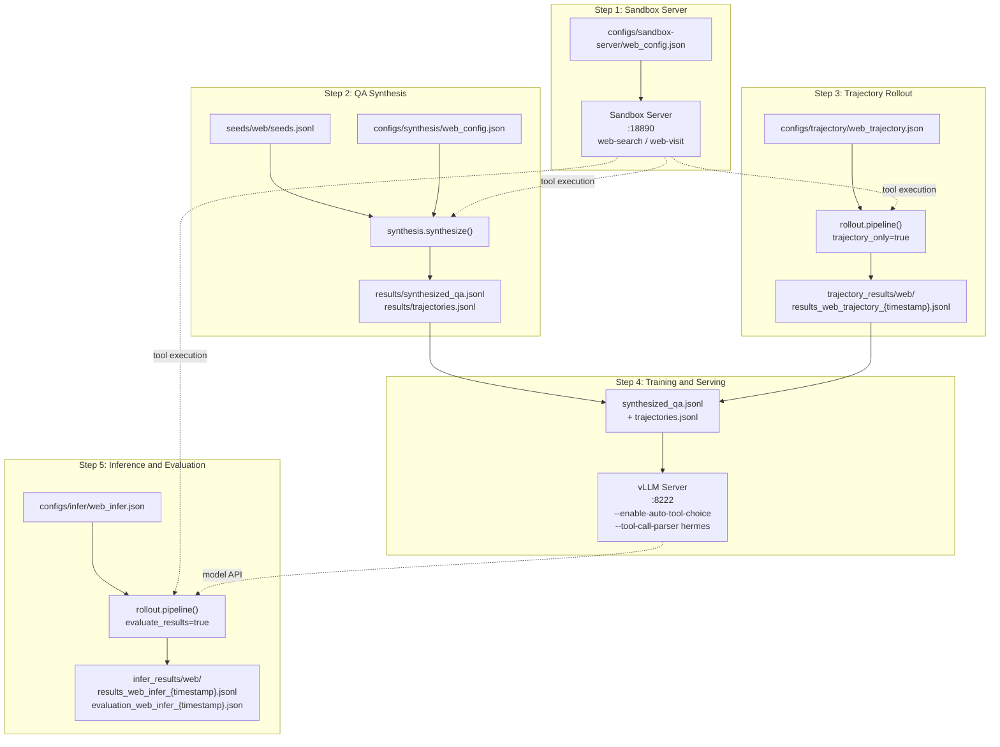
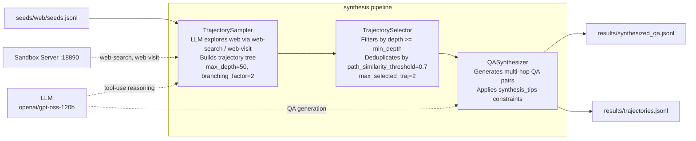
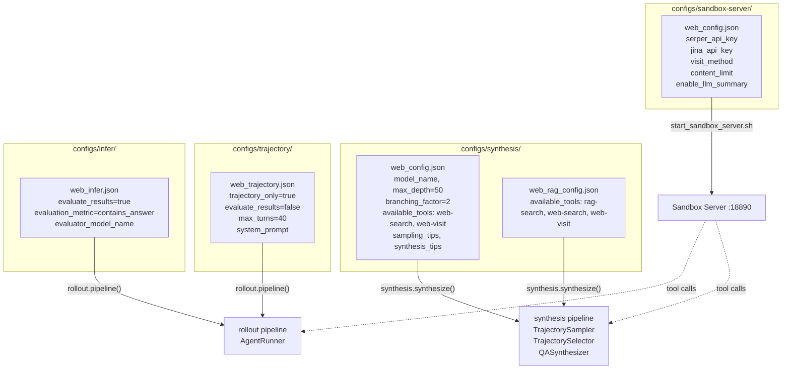

<!-- source: DeepWiki mcp.deepwiki.com · repo OpenDCAI/AgentFlow · page 6.3 Web Agent · fetched 2026-11-02 -->

# Web Agent

<details>
<summary>Relevant source files</summary>

The following files were used as context for generating this wiki page:

- [configs/infer/web_infer.json](configs/infer/web_infer.json)
- [configs/synthesis/doc_config.json](configs/synthesis/doc_config.json)
- [configs/synthesis/rag_config.json](configs/synthesis/rag_config.json)
- [configs/synthesis/web_config.json](configs/synthesis/web_config.json)
- [configs/synthesis/web_rag_config.json](configs/synthesis/web_rag_config.json)
- [examples/WebAgent.md](examples/WebAgent.md)

</details>


This page covers the **Web Agent** (also referred to as the Deep Research Agent) in AgentFlow, documenting its tools, configuration, seed data format, and the end-to-end workflow from data synthesis through model inference. The Web Agent uses `web-search` and `web-visit` as its two core tools to answer multi-hop research questions by searching and browsing the internet.

For general information on the three-stage synthesis pipeline that powers data generation, see [2.1](#2.1). For the rollout and inference system, see [5](#5). For the BrowseComp-V3 benchmark used to evaluate web agents, see [7.1](#7.1).

---

## Overview

The Web Agent is configured to perform **deep web research**: given a question, it formulates search queries, visits specific URLs to extract content, and synthesizes multi-hop answers from gathered evidence. The AgentFlow framework supports data synthesis for training this agent, trajectory rollout against benchmarks, and evaluation of trained models.

**Tools available to the Web Agent:**

| Tool | Description | Key Parameters |
|---|---|---|
| `web-search` | Batch web search via Serper API | `query`: array of search query strings |
| `web-visit` | Visit URLs and extract goal-relevant content | `urls`: array of URLs, `goal`: extraction objective string |

The sandbox server backend for both tools is configured in `configs/sandbox-server/web_config.json` and relies on three external services:

| Service | Purpose | Config Key |
|---|---|---|
| Serper API | Google search results | `apis.websearch.serper_api_key` |
| Jina API | Web content extraction | `apis.websearch.jina_api_key` |
| OpenAI-compatible LLM | Optional content summarization | `apis.websearch.summary_model` |

---

## Pipeline Architecture

**Diagram: Web Agent end-to-end pipeline with configuration files and code modules**



Sources: [examples/WebAgent.md:71-107]()

---

## Step 1: Sandbox Server

Start the sandbox server before running any synthesis or inference steps.

```bash
./start_sandbox_server.sh --config configs/sandbox-server/web_config.json
```

The server listens on `http://127.0.0.1:18890` by default. The `--port` and `--host` CLI flags are ignored; use `server.url` and `server.port` inside the config file to control the listen address.

**Sandbox server configuration fields** ([examples/WebAgent.md:123-145]()):

| Field | Description |
|---|---|
| `server.url` | Address the server listens on |
| `server.port` | Port number (default `18890`) |
| `server.log_level` | `DEBUG` / `INFO` / `WARNING` / `ERROR` |
| `apis.websearch.serper_api_key` | Serper search API key |
| `apis.websearch.jina_api_key` | Jina content extraction API key |
| `apis.websearch.visit_method` | Web visit backend; `"jina"` is recommended |
| `apis.websearch.content_limit` | Maximum characters returned per extraction |
| `apis.websearch.enable_llm_summary` | Whether to run LLM summarization on extracted content |
| `apis.websearch.summary_model` | Model used for summarization (OpenAI-compatible) |
| `apis.websearch.openai_api_key` | API key for the summarization model |
| `apis.websearch.openai_api_url` | Base URL for the summarization model endpoint |

Sources: [examples/WebAgent.md:111-165]()

---

## Step 2: QA Synthesis

### Seed Data Format

Seed data drives where the agent starts exploring. Each seed represents a topic or entity; the agent searches, visits pages, builds an evidence chain, and generates multi-hop QA pairs from the resulting trajectory.

**File location:** `seeds/web/seeds.jsonl`
**Format:** JSONL — one JSON object per line.

```
{"content": "Python programming language", "kwargs": {}}
{"content": "Machine learning", "kwargs": {}}
{"content": "Natural language processing", "kwargs": {}}
```

| Field | Required | Description |
|---|---|---|
| `content` | Yes | Seed topic or entity string. The agent begins web exploration here. |
| `kwargs` | No | Extra parameters passed into the synthesis pipeline. Defaults to `{}`. |

The `seeds_file` field in `configs/synthesis/web_config.json` must point to this file.

Sources: [examples/WebAgent.md:56-67](), [examples/WebAgent.md:175-192]()

### Running QA Synthesis

The synthesis pipeline uses `synthesis.synthesize()` (Python API) or `python -m synthesis.pipeline` (CLI):

```python
from synthesis import synthesize

synthesize(config_path="configs/synthesis/web_config.json")
```

Internally this instantiates `TrajectorySampler`, `TrajectorySelector`, and `QASynthesizer` in sequence.

**Diagram: synthesis pipeline code entities for the Web Agent**



Sources: [examples/WebAgent.md:199-207](), [configs/synthesis/web_config.json:1-44]()

### Synthesis Configuration

Full reference: `configs/synthesis/web_config.json` [configs/synthesis/web_config.json:1-44]()

| Parameter | Default in web_config | Description |
|---|---|---|
| `model_name` | `"openai/gpt-oss-120b"` | LLM for trajectory sampling and QA synthesis |
| `api_key` | `${OPENROUTER_API_KEY}` | API key (supports env var substitution) |
| `base_url` | `https://openrouter.ai/api/v1` | LLM API base URL |
| `max_depth` | `50` | Maximum depth of the trajectory tree |
| `branching_factor` | `2` | Number of child branches per tree node |
| `depth_threshold` | `2` | Minimum depth before branching begins |
| `min_depth` | `3` | Minimum depth for a trajectory to be eligible for selection |
| `max_selected_traj` | `2` | Maximum trajectories selected per seed |
| `path_similarity_threshold` | `0.7` | Cosine similarity threshold for deduplication |
| `available_tools` | `["web-search", "web-visit"]` | Tools the agent can invoke |
| `sandbox_server_url` | `http://127.0.0.1:18890` | Must match the running sandbox server |
| `seeds_file` | `seeds/web/seeds.jsonl` | Input seed data |
| `output_dir` | `results` | Directory for synthesized QA and trajectory output |
| `number_of_seed` | `null` | If set, limits how many seeds are processed |

**Sampling tips** control agent exploration behavior during trajectory tree construction. **Synthesis tips** constrain QA generation quality. The web config enforces:
- At least one `web-visit` call per trajectory (to ensure page-level evidence)
- Multi-hop questions requiring ≥ 3 reasoning hops
- Answers as specific facts (names, dates, locations)

Sources: [configs/synthesis/web_config.json:1-44](), [examples/WebAgent.md:225-288]()

---

## Step 3: Trajectory Rollout

This step runs the agent on an existing benchmark dataset to produce training trajectories without generating QA pairs.

```python
from rollout import pipeline

pipeline(config_path="configs/trajectory/web_trajectory.json")
```

**Key fields in `configs/trajectory/web_trajectory.json`** ([examples/WebAgent.md:311-351]()):

| Field | Value | Description |
|---|---|---|
| `max_turns` | `40` | Maximum conversation turns per task |
| `available_tools` | `["web-search", "web-visit"]` | Tools enabled during rollout |
| `trajectory_only` | `true` | Saves trajectory data, skips evaluation |
| `evaluate_results` | `false` | No evaluation scoring |
| `data_path` | `benchmark/web_benchmark.jsonl` | Benchmark input file |
| `output_dir` | `trajectory_results/web` | Where results are saved |
| `system_prompt` | array of strings | Injected system prompt describing tool usage and strategy |

**Benchmark data format** (`benchmark/web_benchmark.jsonl`):

```
{"id": "web_001", "question": "...", "answer": "..."}
```

Supported field aliases:

| Canonical field | Accepted aliases |
|---|---|
| `id` | `task_id` |
| `question` | `query`, `input` |
| `answer` | `ground_truth`, `expected` |

**Output:** `trajectory_results/web/results_web_trajectory_{timestamp}.jsonl`

Sources: [examples/WebAgent.md:291-382]()

---

## Step 4: Model Training and Deployment

After collecting training data from Steps 2 and 3, train a model externally, then deploy it with vLLM. See [10.2](#10.2) for full vLLM deployment documentation.

```bash
vllm serve \
    --model YOUR_TRAINED_MODEL \
    --served-model-name webagent \
    --tensor-parallel-size 8 \
    --enable-auto-tool-choice \
    --tool-call-parser hermes \
    --port 8222
```

The `--enable-auto-tool-choice` and `--tool-call-parser hermes` flags are required for the agent to emit tool calls in a format the sandbox server understands.

Sources: [examples/WebAgent.md:385-413]()

---

## Step 5: Inference and Evaluation

Run the trained model against a benchmark and score results using an LLM judge.

```python
from rollout import pipeline

pipeline(config_path="configs/infer/web_infer.json")
```

**Key fields in `configs/infer/web_infer.json`** [configs/infer/web_infer.json:1-49]():

| Field | Description |
|---|---|
| `model_name` | Model to evaluate (point to your vLLM deployment) |
| `base_url` | vLLM API endpoint URL |
| `max_turns` | Max turns per task (`40`) |
| `available_tools` | `["web_search", "web_visit"]` |
| `evaluate_results` | `true` — enables evaluation |
| `evaluation_metric` | `"contains_answer"` — checks if the answer is contained in the model output |
| `evaluator_model_name` | LLM used as the judge |
| `evaluator_api_key` | API key for the evaluator LLM |
| `evaluator_base_url` | Base URL for the evaluator LLM |
| `data_path` | Benchmark data path |
| `output_dir` | `infer_results/web` |

**Output files** (saved to `infer_results/web/`):

| File | Contents |
|---|---|
| `results_web_infer_{timestamp}.jsonl` | Per-task inference results |
| `evaluation_web_infer_{timestamp}.json` | Evaluation details including `average_score` |
| `summary_web_infer_{timestamp}.json` | Run summary |

Sources: [examples/WebAgent.md:416-461](), [configs/infer/web_infer.json:1-49]()

---

## Variant: Combined Web + RAG Config

A hybrid configuration (`configs/synthesis/web_rag_config.json`) is available that enables both `rag-search` and web tools in the same synthesis run. This forces the agent to use both retrieval sources, producing training data that requires combining internal knowledge base lookups with live web evidence.

**Tools enabled:** `["rag-search", "web-search", "web-visit"]`

Additional synthesis tips specific to this config [configs/synthesis/web_rag_config.json:21-40]():
- Use both RAG and web tools at least once per trajectory
- Prefer web tools for public/fresh facts, RAG for internal context
- Generated questions must require both RAG and web evidence to answer

Sources: [configs/synthesis/web_rag_config.json:1-51]()

---

## Configuration Summary

**Diagram: configuration files and their roles in code**



Sources: [examples/WebAgent.md:1-507](), [configs/synthesis/web_config.json:1-44](), [configs/infer/web_infer.json:1-49]()

---

