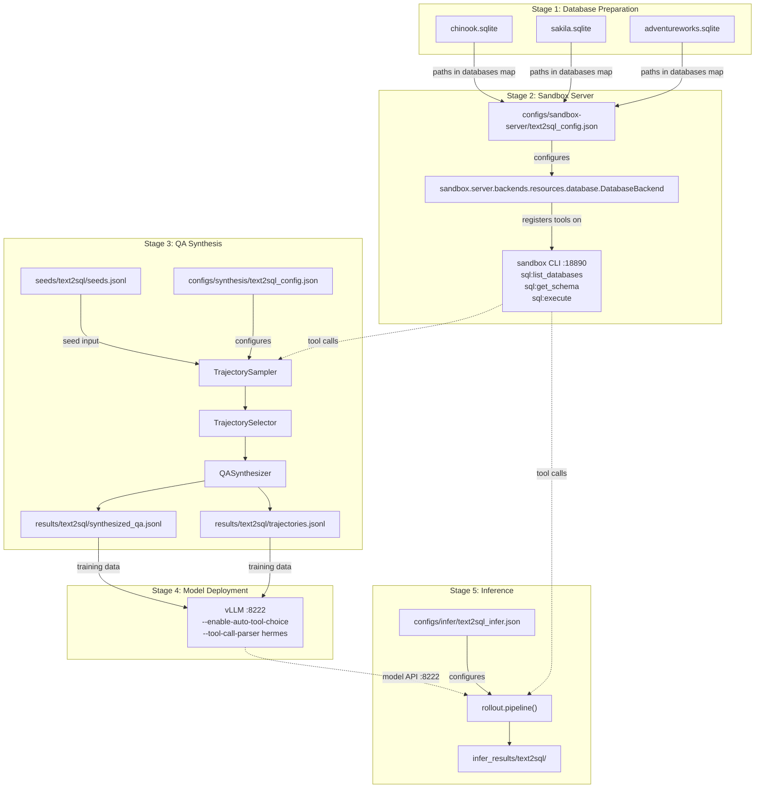
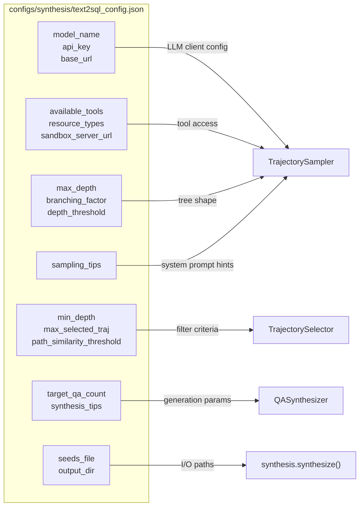
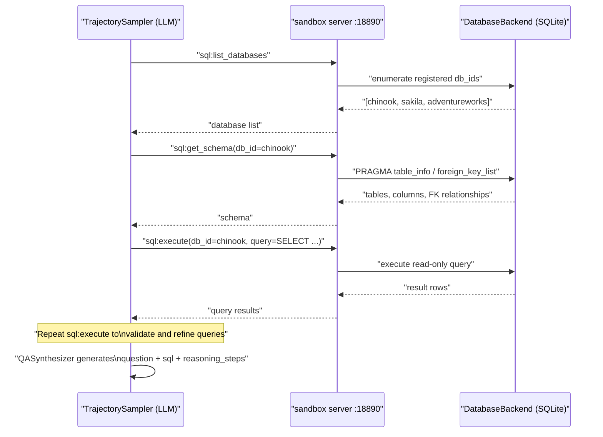

<!-- source: DeepWiki mcp.deepwiki.com · repo OpenDCAI/AgentFlow · page 6.4 Text2SQL Agent · fetched 2026-11-02 -->

# Text2SQL Agent

<details>
<summary>Relevant source files</summary>

The following files were used as context for generating this wiki page:

- [configs/sandbox-server/GUI_config.json](configs/sandbox-server/GUI_config.json)
- [configs/sandbox-server/doc_config.json](configs/sandbox-server/doc_config.json)
- [configs/sandbox-server/rag_config.json](configs/sandbox-server/rag_config.json)
- [configs/sandbox-server/text2sql_config.json](configs/sandbox-server/text2sql_config.json)
- [configs/sandbox-server/web_config.json](configs/sandbox-server/web_config.json)
- [configs/synthesis/GUI_config.json](configs/synthesis/GUI_config.json)
- [examples/Text2SQL.md](examples/Text2SQL.md)
- [seeds/GUI/seeds.jsonl](seeds/GUI/seeds.jsonl)

</details>


This page covers the complete workflow for building a Text2SQL agent using AgentFlow: database preparation, sandbox server setup, QA data synthesis, model deployment, and inference evaluation. The Text2SQL agent translates natural language questions into executable SQL queries against one or more SQLite databases.

For general concepts about how the three-stage synthesis pipeline works, see [2.1](#2.1). For a reference of all synthesis configuration parameters, see [8.2](#8.2). For the sandbox server's configuration schema, see [8.1](#8.1).

---

## Overview

The Text2SQL agent uses three tools exposed by the `DatabaseBackend` in the sandbox server:

| Tool | Description | Required Parameters |
|------|-------------|---------------------|
| `sql:list_databases` | Lists all database IDs registered in the sandbox | None |
| `sql:get_schema` | Returns tables, columns, and foreign key relationships | `db_id` (required), `table_names` (optional) |
| `sql:execute` | Executes a read-only SQL query (`SELECT`/`WITH`/`PRAGMA`) | `db_id` (required), `query` (required) |

The agent is restricted to read-only queries. Any attempt to execute `INSERT`, `UPDATE`, `DELETE`, or `DROP` will be rejected by the backend.

**Pipeline stages:**

```
Database Setup → Sandbox Server → QA Synthesis → Model Training → Inference & Evaluation
```

Sources: [examples/Text2SQL.md:20-35]()

---

## Pipeline Architecture

The following diagram maps each pipeline stage to its corresponding configuration files and code components.

**Diagram: Text2SQL Pipeline — Code Entities**



Sources: [examples/Text2SQL.md:67-103](), [configs/sandbox-server/text2sql_config.json:1-22]()

---

## Step 1: Database Preparation

Place SQLite database files (`.sqlite` or `.db`) in a local directory. The sandbox server references these files by absolute path.

**Expected directory layout:**

```
sample_databases/
└── sqlite/
    ├── chinook.sqlite
    ├── sakila.sqlite
    └── adventureworks.sqlite
```

The actual database IDs (used in tool calls) are the keys in the `databases` map within the sandbox config, not the filenames.

Sources: [examples/Text2SQL.md:107-120]()

---

## Step 2: Sandbox Server

### Configuration

The sandbox server for Text2SQL is configured in [configs/sandbox-server/text2sql_config.json:1-22](). The `resources.sql.config.databases` map binds a logical database ID to an absolute file path.

```json
{
  "server": {
    "url": "http://127.0.0.1:18890",
    "port": 18890,
    "session_ttl": 600
  },
  "apis": {
    "text2sql": {
      "databases": {
        "retail":        "${TEXT2SQL_RETAIL_DB_PATH:-}",
        "music":         "${TEXT2SQL_MUSIC_DB_PATH:-}",
        "hospital":      "${TEXT2SQL_HOSPITAL_DB_PATH:-}",
        "finance":       "${TEXT2SQL_FINANCE_DB_PATH:-}",
        "chinook":       "${TEXT2SQL_CHINOOK_DB_PATH:-}",
        "sakila":        "${TEXT2SQL_SAKILA_DB_PATH:-}",
        "adventureworks":"${TEXT2SQL_ADVENTUREWORKS_DB_PATH:-}"
      }
    }
  }
}
```

Database paths use environment variable substitution (`${VAR_NAME:-default}`) to avoid hardcoding machine-specific paths. For the complete reference on environment variables, see [8.5](#8.5).

**Key configuration fields:**

| Field | Type | Description |
|-------|------|-------------|
| `server.url` | `str` | Server bind address |
| `server.port` | `int` | HTTP port (default `18890`) |
| `server.session_ttl` | `int` | Session expiry in seconds |
| `apis.text2sql.databases` | `dict[str, str]` | Map of `db_id` → absolute path to `.sqlite` file |

Sources: [configs/sandbox-server/text2sql_config.json:1-22]()

### Starting the Server

```bash
python3 -m sandbox.cli.sandbox-server \
    --config configs/sandbox-server/text2sql_config.json
```

On startup, the server registers three tools under the `sql:` namespace. Verify with:

```bash
curl http://127.0.0.1:18890/health
# {"status": "healthy"}
```

Expected log lines on successful start:

```
INFO:ResourceRouter:Registered resource type: sql
INFO:HTTPServiceServer:Registered tool: sql:execute
INFO:HTTPServiceServer:Registered tool: sql:get_schema
INFO:HTTPServiceServer:Registered tool: sql:list_databases
```

Sources: [examples/Text2SQL.md:159-196]()

---

## Step 3: QA Data Synthesis

### Seed Data

Seeds define the starting point for trajectory exploration. Each seed targets a specific database and optionally restricts the exploration to a set of tables.

**File:** `seeds/text2sql/seeds.jsonl`

```jsonl
{"content": "Database: chinook", "kwargs": {"focus_tables": ["Customer", "Invoice", "InvoiceLine", "Track", "Album", "Artist", "Genre"], "exploration_mode": "hard_customer_revenue_and_genre_mix"}}
{"content": "Database: sakila", "kwargs": {"focus_tables": ["film", "film_actor", "actor", "film_category", "category", "inventory", "rental", "payment"], "exploration_mode": "hard_category_revenue_and_actor_depth"}}
```

| Field | Required | Description |
|-------|----------|-------------|
| `content` | Yes | Database identifier string, e.g., `"Database: chinook"` |
| `kwargs.focus_tables` | No | Tables the agent should prioritize exploring |
| `kwargs.exploration_mode` | No | Free-form hint describing the exploration strategy |

For the full seed data format specification, see [4.2](#4.2).

Sources: [examples/Text2SQL.md:200-220]()

### Synthesis Configuration

The synthesis pipeline is configured in `configs/synthesis/text2sql_config.json`. Key parameters controlling exploration depth, tool access, and output quality are shown below.

**Diagram: Synthesis Config Parameters → Pipeline Components**



**Core synthesis configuration parameters:**

| Parameter | Type | Example | Description |
|-----------|------|---------|-------------|
| `model_name` | `str` | `"openai/gpt-4o"` | LLM used for trajectory sampling and QA generation |
| `max_depth` | `int` | `4` | Maximum depth of the trajectory tree |
| `branching_factor` | `int` | `1` | Branches generated per node |
| `depth_threshold` | `int` | `2` | Minimum depth before branching is allowed |
| `min_depth` | `int` | `2` | Minimum depth for a trajectory to qualify for selection |
| `max_selected_traj` | `int` | `1` | Maximum trajectories selected per seed |
| `path_similarity_threshold` | `float` | `0.8` | Cosine similarity threshold for deduplication |
| `target_qa_count` | `int` | `100` | Target number of synthesized QA pairs |
| `available_tools` | `list[str]` | `["sql:list_databases", "sql:get_schema", "sql:execute"]` | Tools the agent may invoke |
| `resource_types` | `list[str]` | `["sql"]` | Resource backends to activate |
| `sandbox_server_url` | `str` | `"http://127.0.0.1:18890"` | Sandbox server address |
| `sandbox_auto_start` | `bool` | `true` | Auto-start sandbox if unreachable |
| `seeds_file` | `str` | `"seeds/text2sql/seeds.jsonl"` | Path to seed JSONL file |
| `output_dir` | `str` | `"results/text2sql"` | Directory for output files |

`sampling_tips` and `synthesis_tips` are arrays of strings injected into the LLM system prompt to guide exploration and QA generation respectively. For Text2SQL, `sampling_tips` should emphasize multi-table joins, subqueries, and aggregations. `synthesis_tips` should specify SQL validity requirements.

Sources: [examples/Text2SQL.md:222-286]()

### Running Synthesis

**Python API:**

```python
from synthesis import synthesize

synthesize(config_path="configs/synthesis/text2sql_config.json")
```

**Output files:**

| File | Description |
|------|-------------|
| `results/text2sql/synthesized_qa.jsonl` | One JSON object per line: `question`, `sql`, `reasoning_steps`, `difficulty` |
| `results/text2sql/trajectories.jsonl` | Full agent trajectories corresponding to each QA pair |

**Sample output record:**

```json
{
  "question": "Which film categories have more than 10 actors who have appeared in popular films?",
  "sql": "WITH film_popularity AS (...) SELECT ...",
  "reasoning_steps": ["..."],
  "difficulty": "hard"
}
```

The pipeline validates that generated SQL is both executable and returns non-empty results. If a query produces empty results, the agent retries with relaxed filter conditions before discarding the trajectory.

Sources: [examples/Text2SQL.md:289-326]()

---

## Step 4: Model Training and Deployment

After generating training data in Step 3, train a model using the `synthesized_qa.jsonl` and `trajectories.jsonl` files. For training data preparation details, see [10.1](#10.1).

Deploy the trained model with vLLM:

```bash
vllm serve \
    --model YOUR_TRAINED_MODEL \
    --served-model-name text2sql-agent \
    --tensor-parallel-size 8 \
    --enable-auto-tool-choice \
    --tool-call-parser hermes \
    --port 8222
```

The `--enable-auto-tool-choice` and `--tool-call-parser hermes` flags are required for the model to emit structured tool calls. The deployed model exposes an OpenAI-compatible API at `http://localhost:8222/v1`. For full vLLM deployment documentation, see [10.2](#10.2).

Sources: [examples/Text2SQL.md:329-357]()

---

## Step 5: Inference and Evaluation

### Inference Configuration

`configs/infer/text2sql_infer.json` controls the rollout pipeline during inference.

```json
{
  "benchmark_name": "text2sql_infer",
  "model_name": "text2sql-agent",
  "api_key": "<YOUR_API_KEY>",
  "base_url": "http://localhost:8222/v1",

  "max_turns": 20,
  "max_retries": 3,

  "available_tools": ["sql:list_databases", "sql:get_schema", "sql:execute"],

  "system_prompt": [
    "You are an expert SQL assistant.",
    "Translate natural language questions into executable SQL queries.",
    "Always verify your SQL is executable before responding."
  ],

  "evaluate_results": true,
  "evaluation_metric": "execution_accuracy",
  "data_path": "benchmark/text2sql_benchmark.jsonl",
  "output_dir": "infer_results/text2sql"
}
```

| Parameter | Description |
|-----------|-------------|
| `model_name` | Must match `--served-model-name` in vLLM |
| `base_url` | vLLM server endpoint |
| `max_turns` | Maximum conversation turns per task |
| `evaluate_results` | If `true`, runs LLM-as-judge evaluation after inference |
| `evaluation_metric` | `"execution_accuracy"` compares executed query output |
| `data_path` | Benchmark JSONL file with ground truth |

### Running Inference

```python
from rollout import pipeline

pipeline(config_path="configs/infer/text2sql_infer.json")
```

### Output Files

| File | Description |
|------|-------------|
| `results_text2sql_infer_{timestamp}.jsonl` | Per-task inference results |
| `evaluation_text2sql_infer_{timestamp}.json` | Aggregate evaluation metrics |

For details on the evaluation system and supported metrics, see [5.3](#5.3).

Sources: [examples/Text2SQL.md:359-404]()

---

## Agent Exploration Strategy

The agent follows a consistent multi-step pattern when exploring a database during synthesis:

**Diagram: Agent Tool Call Sequence During Trajectory Sampling**



The `sampling_tips` config field shapes this behavior: the recommended tips instruct the agent to confirm database IDs first, then retrieve schema, then iteratively execute and verify SQL before recording the trajectory.

Sources: [examples/Text2SQL.md:247-267](), [examples/Text2SQL.md:289-312]()

---

## Supported Databases

The default `configs/sandbox-server/text2sql_config.json` pre-registers seven databases, all configured via environment variables:

| Environment Variable | Database ID | Domain |
|----------------------|-------------|--------|
| `TEXT2SQL_RETAIL_DB_PATH` | `retail` | Retail |
| `TEXT2SQL_MUSIC_DB_PATH` | `music` | Music |
| `TEXT2SQL_HOSPITAL_DB_PATH` | `hospital` | Healthcare |
| `TEXT2SQL_FINANCE_DB_PATH` | `finance` | Finance |
| `TEXT2SQL_CHINOOK_DB_PATH` | `chinook` | Music store |
| `TEXT2SQL_SAKILA_DB_PATH` | `sakila` | DVD rental |
| `TEXT2SQL_ADVENTUREWORKS_DB_PATH` | `adventureworks` | Sales/inventory |

Any entry with an empty path is effectively disabled. To add a new database, add an entry to the `databases` map in `configs/sandbox-server/text2sql_config.json` and restart the server.

Sources: [configs/sandbox-server/text2sql_config.json:1-22]()

---

## FAQ

**Why are generated SQL queries returning empty results?**

The synthesis pipeline validates both executability and non-empty results. The agent retries with relaxed `WHERE` conditions if a query returns zero rows. If failures persist, verify that the target tables in your database contain sufficient data for the query patterns requested in `sampling_tips`.

**How do I generate harder SQL?**

Modify the `sampling_tips` array in `configs/synthesis/text2sql_config.json` to emphasize:
- Multi-table JOINs (3+ tables)
- Nested subqueries and CTEs
- Window functions (`ROW_NUMBER`, `RANK`)
- Complex `HAVING` clauses

**How do I use a different LLM provider?**

Set `OPENAI_API_KEY` and `OPENAI_API_BASE` environment variables, or configure `api_key` and `base_url` directly in the synthesis config. See [8.5](#8.5) for the full environment variable reference.

**How do I add a new database at runtime?**

Add an entry to `apis.text2sql.databases` in `configs/sandbox-server/text2sql_config.json` and restart the sandbox server process.

Sources: [examples/Text2SQL.md:437-485]()

---

