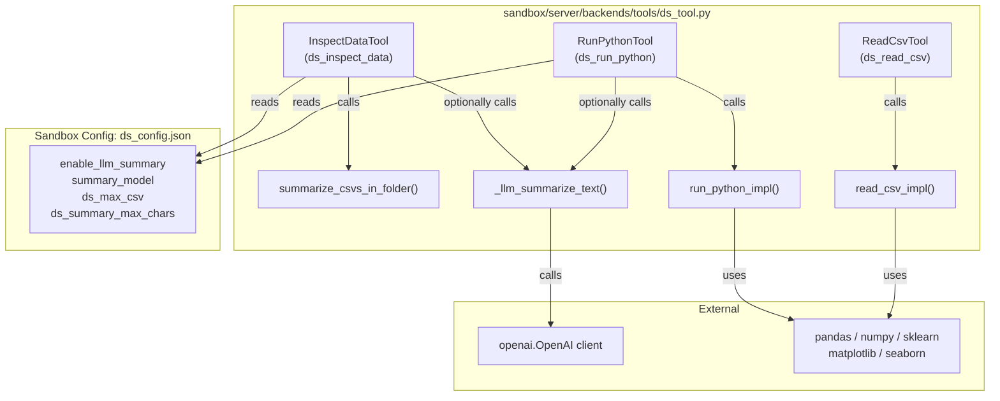
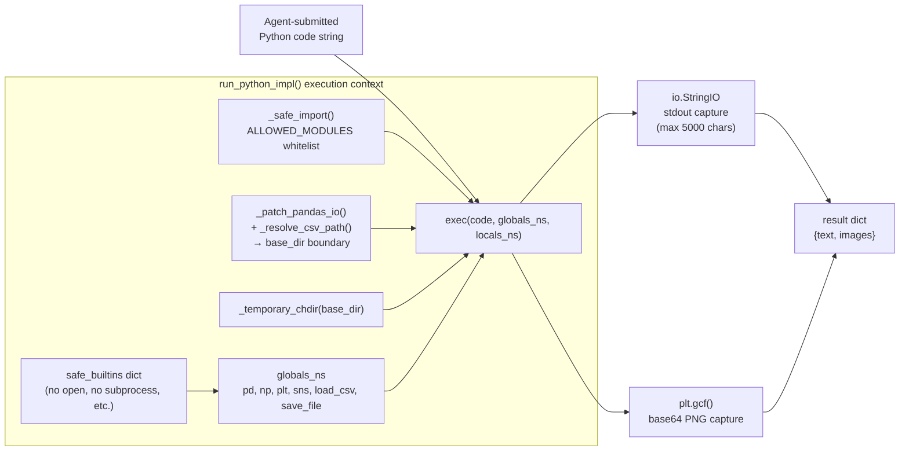
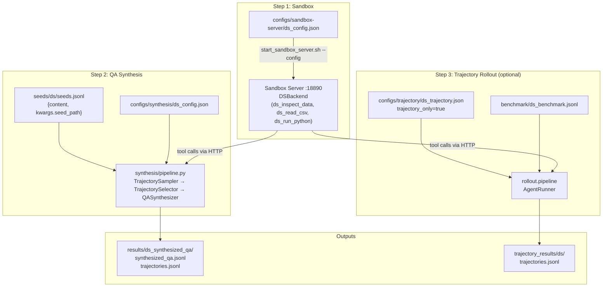

<!-- source: DeepWiki mcp.deepwiki.com · repo OpenDCAI/AgentFlow · page 6.5 Data Science Agent · fetched 2026-11-02 -->

# Data Science Agent

<details>
<summary>Relevant source files</summary>

The following files were used as context for generating this wiki page:

- [configs/infer/doc_infer.json](configs/infer/doc_infer.json)
- [configs/infer/ds_infer.json](configs/infer/ds_infer.json)
- [configs/sandbox-server/ds_config.json](configs/sandbox-server/ds_config.json)
- [configs/synthesis/text2sql_config.json](configs/synthesis/text2sql_config.json)
- [configs/trajectory/doc_trajectory.json](configs/trajectory/doc_trajectory.json)
- [configs/trajectory/ds_trajectory.json](configs/trajectory/ds_trajectory.json)
- [examples/DSAgent.md](examples/DSAgent.md)
- [sandbox/result_formatter.py](sandbox/result_formatter.py)
- [sandbox/server/backends/tools/ds_tool.py](sandbox/server/backends/tools/ds_tool.py)

</details>


This page covers the Data Science (DS) agent in AgentFlow: its tools, backend implementation, security model, seed format, configuration files, and end-to-end workflow for synthesizing QA pairs and trajectories from local CSV datasets. It does **not** cover model training or vLLM deployment (see [Model Training and Deployment](#10) for those topics), and it does not duplicate the general three-stage pipeline mechanics (see [Three-Stage Data Synthesis Pipeline](#2.1)).

---

## Overview

The DS agent performs multi-step data analysis by calling three sandbox tools against a directory of CSV files. The agent can inspect available datasets, preview individual files, and execute arbitrary Python analysis code in a sandboxed environment. Tool outputs are accumulated into trajectories; a QA synthesis step then derives question-answer pairs from the most informative trajectories.

The `resource_type` for all DS tools is `"ds"`, and tool names use the `ds_` prefix (underscores, not colons, unlike some other resource types).

---

## Tools

The DS agent exposes three tools, all implemented in [sandbox/server/backends/tools/ds_tool.py]().

| Tool Name | Class | Core Function | Description |
|---|---|---|---|
| `ds_inspect_data` | `InspectDataTool` | `summarize_csvs_in_folder()` | Scans a CSV directory; returns shape, column names, dtype counts, missing values, and duplicate counts for each file |
| `ds_read_csv` | `ReadCsvTool` | `read_csv_impl()` | Previews the first N rows of a named CSV (default 50); returns CSV text |
| `ds_run_python` | `RunPythonTool` | `run_python_impl()` | Executes Python code in a restricted sandbox with pandas, numpy, scipy, statsmodels, sklearn, matplotlib, seaborn pre-imported |

Each class inherits from `BaseApiTool` and is registered with `register_api_tool` at module load time.

Sources: [sandbox/server/backends/tools/ds_tool.py:424-602]()

---

## Backend Architecture

**Diagram: DS Tool Classes and Their Runtime Dependencies**



Sources: [sandbox/server/backends/tools/ds_tool.py:424-602](), [configs/sandbox-server/ds_config.json:1-20]()

---

## Python Execution Sandbox

`run_python_impl()` executes code via `exec()` inside a tightly controlled namespace rather than a subprocess. The design isolates the execution in three ways:

### 1. Module Whitelist

`_safe_import()` replaces the built-in `__import__` in the execution namespace. Any import whose root module is not in `ALLOWED_MODULES` raises `ImportError`.

[sandbox/server/backends/tools/ds_tool.py:222-239]()

Allowed root modules include: `pandas`, `numpy`, `scipy`, `statsmodels`, `sklearn`, `matplotlib`, `seaborn`, `plotly`, `os`, `sys`, `re`, `datetime`, `json`, `math`, `collections`, `itertools`, and others. Network libraries and subprocess are not on the whitelist.

### 2. Filesystem Restriction

`_patch_pandas_io()` is a context manager that monkey-patches `pd.read_csv` during execution. Any relative file path is resolved against `base_dir` via `_resolve_csv_path()`, which also rejects paths that escape `base_dir` via traversal (`..`).

[sandbox/server/backends/tools/ds_tool.py:241-263]()

`_temporary_chdir()` sets the working directory to `base_dir` for the duration of execution.

[sandbox/server/backends/tools/ds_tool.py:266-273]()

### 3. Controlled Globals

The `globals_ns` dictionary passed to `exec()` pre-imports all allowed libraries (`pd`, `np`, `scipy`, `sm`, `sklearn`, `plt`, `sns`, etc.) and injects two helper functions: `load_csv(name)` (path-safe CSV loader) and `save_file(data, name)` (path-safe file saver). Standard builtins are replaced with a safe subset.

[sandbox/server/backends/tools/ds_tool.py:306-351]()

**Diagram: Security Layers in run_python_impl**



Sources: [sandbox/server/backends/tools/ds_tool.py:276-417]()

---

## LLM Summary Feature

Both `InspectDataTool` and `RunPythonTool` support an optional LLM-based summarization step. When `enable_llm_summary` is `true` in the sandbox config and the raw output exceeds `ds_summary_max_chars`, `_llm_summarize_text()` is called using the configured `summary_model`. This condenses long outputs while preserving computed numbers and conclusions.

[sandbox/server/backends/tools/ds_tool.py:147-180](), [configs/sandbox-server/ds_config.json:8-18]()

Relevant sandbox config parameters:

| Parameter | Default | Description |
|---|---|---|
| `ds_max_csv` | 100 | Maximum number of CSVs scanned by `ds_inspect_data` |
| `ds_summary_max_chars` | 12000 | Character threshold before LLM summarization triggers |
| `enable_llm_summary` | `true` | Whether to enable LLM summarization |
| `summary_model` | `openai/gpt-oss-120b` | Model used for summaries |
| `llm_summary_temperature` | 0.3 | Temperature for summary model |
| `llm_summary_max_tokens` | 2000 | Max tokens for summary output |
| `content_limit` | 50000 | Characters fed to the LLM (input truncation) |

The API key and base URL are read from `openai_api_key` / `openai_api_url` in the config, falling back to `OPENROUTER_API_KEY` and `OPENAI_API_KEY` environment variables.

Sources: [sandbox/server/backends/tools/ds_tool.py:450-470](), [sandbox/server/backends/tools/ds_tool.py:552-576](), [configs/sandbox-server/ds_config.json:1-20]()

---

## Result Formatting

DS tool responses are formatted by `DocResult` in [sandbox/result_formatter.py](). The `ResultFormatter.format()` method matches any tool name starting with `ds_`, `ds:`, or `ds-` to this class.

[sandbox/result_formatter.py:545-571](), [sandbox/result_formatter.py:793-800]()

`DocResult.to_str()` extracts `data["result"]` as a plain string and strips trailing whitespace. On failure it returns `[Doc/DS tool failed] <message>`.

---

## Seed Data Format

DS seeds are JSONL files where each entry has two fields:

- `content`: a natural language description of the analysis task, used to guide trajectory sampling
- `kwargs.seed_path`: the **directory** containing the CSV files for this seed (relative or absolute path)

**Example seed entry:**
```json
{"content": "Analyze the data in the provided CSV files.", "kwargs": {"seed_path": "seeds/ds/seed"}}
```

The default seed file is `seeds/ds/seeds.jsonl`. The `seed_path` is passed directly through to tool execution; if it is incorrect, `ds_read_csv` will report `File does not exist` and `ds_inspect_data` will report the directory does not exist.

Sources: [examples/DSAgent.md:58-71]()

---

## Configuration Files

### Sandbox Server Config

**File:** `configs/sandbox-server/ds_config.json`

[configs/sandbox-server/ds_config.json:1-20]()

Controls the server network settings and the DS backend's behavior. The LLM summary API credentials should be set via environment variables (`OPENAI_API_KEY`, `OPENAI_API_URL`) and referenced as `${VAR}` in the config.

### Synthesis Config

**File:** `configs/synthesis/ds_config.json`

Key fields (same schema as other synthesis configs, see [Synthesis Config Schema](#8.2)):

| Field | Description |
|---|---|
| `model_name` / `api_key` / `base_url` | LLM for trajectory sampling and QA synthesis |
| `available_tools` | Must be `["ds_inspect_data", "ds_read_csv", "ds_run_python"]` |
| `resource_types` | `["ds"]` |
| `seeds_file` | Path to `seeds/ds/seeds.jsonl` |
| `max_depth` / `branching_factor` | Control trajectory tree shape |
| `max_selected_traj` | Max trajectories selected per seed |
| `sampling_tips` | Guidance injected into the LLM during tree exploration |
| `synthesis_tips` | Guidance injected into the LLM during QA generation |
| `sandbox_auto_start` | Set `true` to auto-launch sandbox from this config |

### Trajectory Rollout Config

**File:** `configs/trajectory/ds_trajectory.json`

[configs/trajectory/ds_trajectory.json:1-39]()

| Field | Value |
|---|---|
| `available_tools` | `["ds_inspect_data", "ds_read_csv", "ds_run_python"]` |
| `max_turns` | 30 |
| `trajectory_only` | `true` |
| `evaluate_results` | `false` |
| `data_path` | `benchmark/ds_benchmark.jsonl` |
| `output_dir` | `trajectory_results/ds` |

The system prompt instructs the model to start with `ds_inspect_data`, confirm schema with `ds_read_csv`, then compute with `ds_run_python`, and reply with only the final answer.

### Inference Config

**File:** `configs/infer/ds_infer.json`

[configs/infer/ds_infer.json:1-43]()

Differs from the trajectory config in two ways: `evaluate_results: true` and `evaluation_metric: "exact_match"`. The `model_name` and `base_url` must point to a deployed vLLM endpoint.

---

## End-to-End Workflow

**Diagram: DS Agent Data Synthesis Workflow**



Sources: [examples/DSAgent.md:76-150](), [configs/trajectory/ds_trajectory.json:1-39](), [configs/infer/ds_infer.json:1-43]()

### Step 1: Start the Sandbox Server

```bash
./start_sandbox_server.sh --config configs/sandbox-server/ds_config.json
```

Alternatively, set `"sandbox_auto_start": true` in the synthesis or rollout config to launch the server automatically.

### Step 2: Synthesize QA Data

```bash
python3 synthesis/pipeline.py \
  --config configs/synthesis/ds_config.json \
  --seeds seeds/ds/seeds.jsonl \
  --output-dir results/any_dir
```

Output files (appended incrementally):
- `results/ds_synthesized_qa/synthesized_qa.jsonl`
- `results/ds_synthesized_qa/trajectories.jsonl`

### Step 3: Trajectory Rollout (Optional)

To generate trajectory-only data from a benchmark without QA synthesis:

```bash
python -m rollout.pipeline \
  --config configs/trajectory/ds_trajectory.json \
  --output-dir trajectory_results/ds
```

With `trajectory_only: true`, the pipeline saves trajectories and skips evaluation. Running inference with evaluation requires a deployed model and ground-truth answers in the benchmark file; see [Model Inference](#5.2) and [Evaluation System](#5.3).

Sources: [examples/DSAgent.md:94-150]()

---

## Agent System Prompt

The system prompt (defined in both `ds_trajectory.json` and `ds_infer.json`) gives the agent a fixed three-step strategy:

1. Call `ds_inspect_data` first to enumerate available CSV files and understand their structure
2. Call `ds_read_csv` to preview a specific file and confirm column names/values
3. Call `ds_run_python` for any computation, aggregation, or statistical analysis

The agent is instructed to reply with the final answer only (no extra explanation) unless the question asks otherwise.

[configs/trajectory/ds_trajectory.json:12-28](), [configs/infer/ds_infer.json:16-32]()

---

## Relationship to Other Agent Types

The DS agent follows the same framework patterns as other agent types (see [Agent Types and Modalities](#2.2)). Compared to the Text2SQL agent (see [Text2SQL Agent](#6.4)), which uses structured SQL queries against a fixed schema, the DS agent uses free-form Python execution, making it suitable for statistical analysis, machine learning, and visualization tasks that cannot be expressed as SQL. The session-bound `seed_path` context plays a role analogous to the database path in the SQL backend.

---

