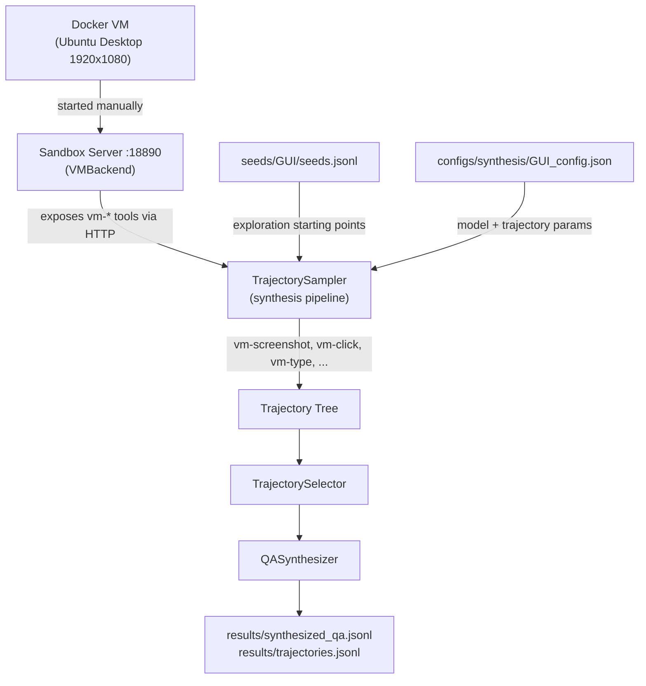
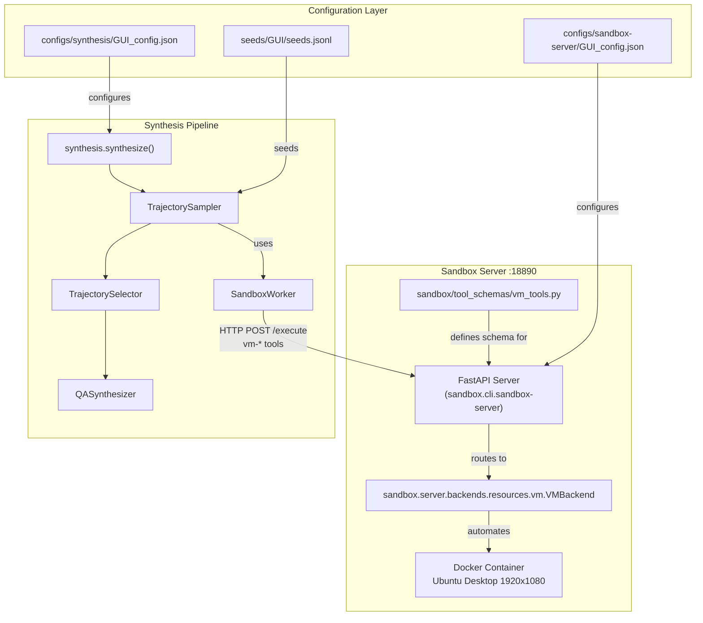
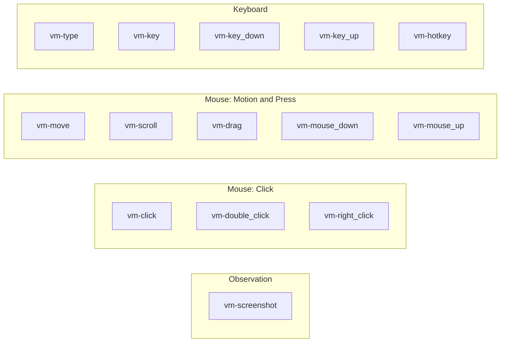
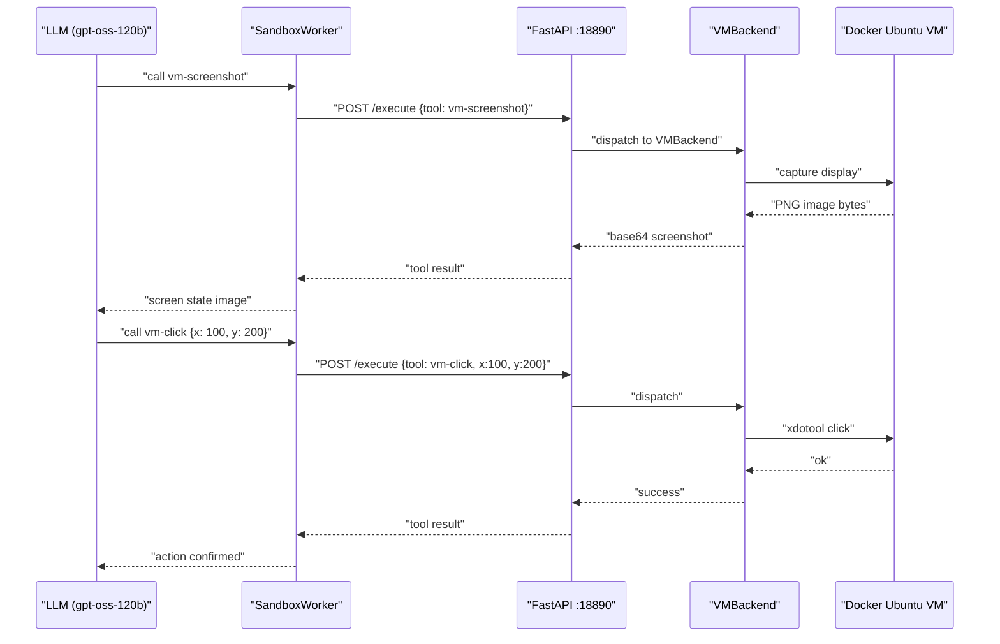

<!-- source: DeepWiki mcp.deepwiki.com · repo OpenDCAI/AgentFlow · page 6.6 GUI Agent · fetched 2026-11-02 -->

# GUI Agent

<details>
<summary>Relevant source files</summary>

The following files were used as context for generating this wiki page:

- [configs/sandbox-server/GUI_config.json](configs/sandbox-server/GUI_config.json)
- [configs/synthesis/GUI_config.json](configs/synthesis/GUI_config.json)
- [configs/synthesis/doc_config.json](configs/synthesis/doc_config.json)
- [configs/synthesis/rag_config.json](configs/synthesis/rag_config.json)
- [configs/synthesis/web_config.json](configs/synthesis/web_config.json)
- [configs/synthesis/web_rag_config.json](configs/synthesis/web_rag_config.json)
- [examples/Text2SQL.md](examples/Text2SQL.md)
- [seeds/GUI/seeds.jsonl](seeds/GUI/seeds.jsonl)

</details>


This page covers building and running a GUI agent with AgentFlow — an agent that interacts with a virtual machine's graphical desktop environment through mouse and keyboard automation tools. The GUI agent follows the same three-stage data synthesis pipeline used by all AgentFlow agent types, but is distinguished by its `VMBackend` resource, Docker-based VM provisioning, and a richer tool set for UI interaction.

For general information about the three-stage pipeline, see page [2.1](#2.1). For an overview of all agent types, see page [2.2](#2.2). For the sandbox server configuration system, see page [3](#3).

---

## Overview

The GUI agent enables an LLM to explore and interact with a full Ubuntu desktop environment. Instead of querying APIs or databases, the agent takes screenshots to observe the current UI state, then issues mouse and keyboard actions to navigate it. This allows the framework to synthesize training data grounded in real graphical interactions.

**Pipeline summary:**

```
VM Docker Setup → Sandbox Server (VMBackend) → QA Synthesis → Model Training → Inference
```

**Pipeline diagram: GUI Agent End-to-End**



Sources: [configs/synthesis/GUI_config.json:1-55](), [configs/sandbox-server/GUI_config.json:1-36](), [seeds/GUI/seeds.jsonl:1-5]()

---

## Prerequisites

Before running the GUI agent pipeline, the following must be in place:

| Requirement | Details |
|---|---|
| Docker | Required to run the Ubuntu desktop VM container |
| VM Docker image | An Ubuntu Desktop image accessible at `VM_IMAGE_PATH` |
| OpenRouter API key | Used by the LLM for synthesis (`OPENROUTER_API_KEY`) |
| VM client password | Password for the desktop environment (`VM_CLIENT_PASSWORD`) |
| Recording path | Directory for optional session recordings (`VM_RECORDING_PATH`) |

Unlike other agent types (RAG, SQL, DS), the GUI agent sets `sandbox_auto_start: false` in its synthesis config. The sandbox server must be started manually before running synthesis, because the Docker VM requires additional setup that cannot be reliably automated.

Sources: [configs/sandbox-server/GUI_config.json:23-29](), [configs/synthesis/GUI_config.json:26]()

---

## Environment Variables

The sandbox server configuration uses environment variable substitution for credentials and paths. These must be exported before starting the server.

| Variable | Used In | Description |
|---|---|---|
| `VM_CLIENT_PASSWORD` | `GUI_config.json` (sandbox) | Password for the VM desktop user |
| `VM_IMAGE_PATH` | `GUI_config.json` (sandbox) | Path to the Docker VM image |
| `VM_RECORDING_PATH` | `GUI_config.json` (sandbox) | Directory to store session screen recordings (defaults to `sandbox_recordings`) |
| `OPENROUTER_API_KEY` | `GUI_config.json` (synthesis) | API key for the LLM (OpenRouter) |

```bash
export VM_CLIENT_PASSWORD="your-vm-password"
export VM_IMAGE_PATH="/path/to/ubuntu-desktop-image"
export VM_RECORDING_PATH="sandbox_recordings"
export OPENROUTER_API_KEY="your-openrouter-key"
```

Sources: [configs/sandbox-server/GUI_config.json:24-28](), [configs/synthesis/GUI_config.json:3-4]()

---

## Sandbox Server Setup

### Configuration

The sandbox server for the GUI agent is configured in `configs/sandbox-server/GUI_config.json`. It registers a single resource of type `vm`, backed by `VMBackend`.

**Key configuration fields:**

| Field | Value | Description |
|---|---|---|
| `server.port` | `18890` | HTTP port for the sandbox server |
| `server.session_ttl` | `600` | Session lifetime in seconds (10 min — longer than most agents due to VM latency) |
| `resources.vm.backend_class` | `sandbox.server.backends.resources.vm.VMBackend` | Python class implementing the VM resource |
| `resources.vm.config.provider` | `docker` | Container runtime |
| `resources.vm.config.os_type` | `Ubuntu` | Guest operating system |
| `resources.vm.config.screen_size` | `[1920, 1080]` | Virtual display resolution |
| `resources.vm.config.headless` | `true` | No physical display required |
| `resources.vm.config.pool_size` | `1` | Number of pre-warmed VM instances |
| `resources.vm.config.recording` | `true` | Record sessions to `VM_RECORDING_PATH` |
| `warmup.enabled` | `true` | Pre-initialize VM pool on server start |

Sources: [configs/sandbox-server/GUI_config.json:1-36]()

### Starting the Server

```bash
python3 -m sandbox.cli.sandbox-server --config configs/sandbox-server/GUI_config.json
```

The server exposes VM tools at `http://127.0.0.1:18890`. Health check:

```bash
curl http://127.0.0.1:18890/health
# Expected: {"status": "healthy"}
```

> **Important:** Because `sandbox_auto_start: false` in the synthesis config, the server must be running before invoking `synthesis.synthesize`.

Sources: [configs/synthesis/GUI_config.json:26](), [configs/sandbox-server/GUI_config.json:3-5]()

---

## Component Architecture

**Diagram: GUI Agent Component Relationships (Code Entities)**



Sources: [configs/sandbox-server/GUI_config.json:1-36](), [configs/synthesis/GUI_config.json:1-55]()

---

## VM Tool Set

The GUI agent has access to 14 VM interaction tools, all prefixed with `vm-`. These are defined in `sandbox/tool_schemas/vm_tools.py` and registered by `VMBackend`.

**Diagram: VM Tool Categories**



**Tool reference table:**

| Tool | Category | Description |
|---|---|---|
| `vm-screenshot` | Observation | Capture the current state of the VM display |
| `vm-click` | Mouse | Left-click at a screen coordinate |
| `vm-double_click` | Mouse | Double-click at a screen coordinate |
| `vm-right_click` | Mouse | Right-click at a screen coordinate |
| `vm-scroll` | Mouse | Scroll up or down at a screen coordinate |
| `vm-drag` | Mouse | Click-drag from one coordinate to another |
| `vm-move` | Mouse | Move the mouse cursor without clicking |
| `vm-mouse_down` | Mouse | Press and hold a mouse button |
| `vm-mouse_up` | Mouse | Release a held mouse button |
| `vm-type` | Keyboard | Type a text string |
| `vm-key` | Keyboard | Press a single key (e.g., `Return`, `Escape`) |
| `vm-key_down` | Keyboard | Press and hold a key |
| `vm-key_up` | Keyboard | Release a held key |
| `vm-hotkey` | Keyboard | Execute a keyboard shortcut (e.g., `ctrl+c`) |

The agent always begins by calling `vm-screenshot` to observe the current screen state before deciding which action to take. This observe-then-act pattern is reinforced through `sampling_tips` in the synthesis configuration.

Sources: [configs/synthesis/GUI_config.json:29](), [configs/sandbox-server/GUI_config.json:8-30]()

---

## Seed Data Format

Seeds define the starting task descriptions for each trajectory exploration. For the GUI agent, each seed describes a high-level UI interaction goal.

**File location:** `seeds/GUI/seeds.jsonl`

**Format:**

```jsonl
{"content": "Explore the VM desktop GUI: open file manager, create a folder, and rename a file", "kwargs": {}}
{"content": "Explore the VM GUI: open a terminal, run a basic command, and verify the output", "kwargs": {}}
{"content": "Explore the VM GUI: use a web browser to visit a local or internal page and take a screenshot", "kwargs": {}}
```

| Field | Required | Description |
|---|---|---|
| `content` | ✅ Yes | Natural language description of the UI task to explore |
| `kwargs` | Optional | Additional parameters passed to the session initializer; typically empty `{}` for GUI tasks |

Unlike RAG or SQL seeds, GUI seeds do not need to reference a specific resource identifier — the VM is the implicit environment. The `content` field instructs the LLM on what to explore, and the trajectory tree is built from that starting point.

Sources: [seeds/GUI/seeds.jsonl:1-5]()

---

## Synthesis Configuration

The synthesis configuration `configs/synthesis/GUI_config.json` controls the LLM model, trajectory exploration parameters, and QA generation behavior.

**Key parameters:**

| Parameter | Value | Description |
|---|---|---|
| `model_name` | `openai/gpt-oss-120b` | LLM used during sampling and synthesis |
| `api_key` | `${OPENROUTER_API_KEY}` | API key via environment variable |
| `base_url` | `https://openrouter.ai/api/v1` | OpenRouter endpoint |
| `max_depth` | `10` | Maximum depth of the trajectory exploration tree |
| `branching_factor` | `1` | Number of child branches per node (linear exploration) |
| `depth_threshold` | `1` | Minimum depth before branching is considered |
| `min_depth` | `3` | Minimum depth for a trajectory to be eligible for selection |
| `max_selected_traj` | `1` | Maximum trajectories selected per seed |
| `path_similarity_threshold` | `0.7` | Cosine similarity cutoff for deduplication |
| `resource_types` | `["vm"]` | Tells the sandbox which resource to allocate |
| `sandbox_auto_start` | `false` | **Must start sandbox manually before synthesis** |
| `sandbox_config_path` | `configs/sandbox-server/vm_config.json` | Config used if auto-start were enabled |
| `available_tools` | *(14 vm-* tools)* | Full list of VM tools made available to the LLM |
| `seeds_file` | `seeds/vm/seeds.jsonl` | Path to seed data |
| `output_dir` | `results` | Directory for output files |

**Sampling tips** (from `GUI_config.json`):
- Use VM tools to explore the UI and gather concrete evidence
- Record precise UI states, labels, and values
- Prefer actionable steps that lead to verifiable facts

**Synthesis tips** (from `GUI_config.json`):
- Create questions requiring multi-step UI interactions
- Keep questions concise (≤3 sentences)
- Answers should be specific and verifiable from the UI state
- Provide clear reasoning steps based on observed UI evidence

**Example QA pair format:**

```json
{
  "question": "What is the displayed version number in the settings window?",
  "answer": "1.2.3"
}
```

Sources: [configs/synthesis/GUI_config.json:1-55]()

---

## Running the Synthesis Pipeline

### Step 1: Export Environment Variables

```bash
export VM_CLIENT_PASSWORD="your-vm-password"
export VM_IMAGE_PATH="/path/to/ubuntu-desktop-image"
export VM_RECORDING_PATH="sandbox_recordings"
export OPENROUTER_API_KEY="your-openrouter-key"
```

### Step 2: Start the Sandbox Server

The server must be started before synthesis because `sandbox_auto_start` is `false`.

```bash
python3 -m sandbox.cli.sandbox-server --config configs/sandbox-server/GUI_config.json
```

Confirm the server is ready and the VM pool is warmed up before proceeding.

### Step 3: Run QA Synthesis

**Python API:**

```python
from synthesis import synthesize

synthesize(config_path="configs/synthesis/GUI_config.json")
```

**Output files:**

| File | Description |
|---|---|
| `results/synthesized_qa.jsonl` | Generated QA pairs (one JSON per line) |
| `results/trajectories.jsonl` | Agent exploration trajectories with VM tool calls |

### Step 4: Model Training and Deployment

Train a model on the synthesized data and deploy with vLLM:

```bash
vllm serve \
    --model YOUR_TRAINED_MODEL \
    --served-model-name gui-agent \
    --tensor-parallel-size 8 \
    --enable-auto-tool-choice \
    --tool-call-parser hermes \
    --port 8222
```

### Step 5: Inference

```python
from rollout import pipeline

pipeline(config_path="configs/infer/gui_infer.json")
```

Sources: [configs/synthesis/GUI_config.json:26](), [configs/sandbox-server/GUI_config.json:1-36]()

---

## Differences from Other Agent Types

The GUI agent has several characteristics that distinguish it from other AgentFlow agents:

| Property | GUI Agent | Typical Other Agents |
|---|---|---|
| `sandbox_auto_start` | `false` | `true` |
| `session_ttl` | `600 s` | `300 s` |
| `branching_factor` | `1` | `1`–`2` |
| `max_depth` | `10` | `4`–`50` |
| Backend infrastructure | Docker VM | SQLite / Faiss / HTTP APIs |
| State persistence | Full desktop session | Per-request or pooled connection |
| Warmup required | Yes (VM pool) | No (or lightweight) |
| Recording support | Yes | No |

The `sandbox_auto_start: false` setting is the most significant operational difference. All other AgentFlow agents (RAG, SQL, DS, Web, Doc) can be started automatically by the synthesis pipeline if the sandbox server is not already running. The Docker VM backend requires manual startup so that the pool warmup completes and the Docker image is validated before agent sessions begin.

The higher `session_ttl` (600 vs 300 seconds) accommodates VM operations, which are slower than database queries or API calls. Each sandbox session holds an active Docker container with an X11 display session.

Sources: [configs/sandbox-server/GUI_config.json:5-6](), [configs/synthesis/GUI_config.json:26]()

---

## Trajectory Interaction Pattern

Every GUI agent trajectory follows a consistent observe-then-act loop driven by `sampling_tips`:

**Diagram: Single-Turn Interaction Pattern in TrajectorySampler**



Sources: [configs/synthesis/GUI_config.json:33-37](), [configs/sandbox-server/GUI_config.json:8-30]()

---

## Configuration Reference

### Sandbox Server Config (`configs/sandbox-server/GUI_config.json`)

| Field | Type | Description |
|---|---|---|
| `server.url` | `string` | Server bind URL |
| `server.port` | `int` | HTTP port (default `18890`) |
| `server.session_ttl` | `int` | Seconds before idle session is destroyed |
| `resources.vm.enabled` | `bool` | Enable the VM resource type |
| `resources.vm.backend_class` | `string` | Fully qualified Python class for backend |
| `resources.vm.config.provider` | `string` | Container provider (`docker`) |
| `resources.vm.config.os_type` | `string` | Guest OS (`Ubuntu`) |
| `resources.vm.config.screen_size` | `[int, int]` | Display resolution |
| `resources.vm.config.headless` | `bool` | Run without physical display |
| `resources.vm.config.pool_size` | `int` | Number of pre-warmed VM instances |
| `resources.vm.config.pool_reset` | `bool` | Reset VM to clean state between sessions |
| `resources.vm.config.client_password` | `string` | Desktop user password (`${VM_CLIENT_PASSWORD}`) |
| `resources.vm.config.vm_path` | `string` | Path to Docker image (`${VM_IMAGE_PATH}`) |
| `resources.vm.config.recording` | `bool` | Enable screen recording |
| `resources.vm.config.recording_path` | `string` | Recording directory (`${VM_RECORDING_PATH}`) |
| `warmup.enabled` | `bool` | Pre-initialize pool on server start |
| `warmup.resources` | `list[string]` | Resources to warm up (`["vm"]`) |

Sources: [configs/sandbox-server/GUI_config.json:1-36]()

### Synthesis Config (`configs/synthesis/GUI_config.json`)

| Field | Type | Description |
|---|---|---|
| `model_name` | `string` | LLM model for synthesis |
| `api_key` | `string` | API key (env var substitution supported) |
| `base_url` | `string` | LLM API endpoint |
| `max_depth` | `int` | Max trajectory tree depth |
| `branching_factor` | `int` | Branches per trajectory node |
| `depth_threshold` | `int` | Min depth before branching |
| `min_depth` | `int` | Min depth for trajectory selection |
| `max_selected_traj` | `int` | Max trajectories selected per seed |
| `path_similarity_threshold` | `float` | Deduplication threshold (0–1) |
| `number_of_seed` | `int \| null` | Limit seeds used (`null` = all) |
| `resource_types` | `list[string]` | Resource types to allocate (`["vm"]`) |
| `resource_init_configs` | `object` | Per-resource initialization overrides |
| `sandbox_server_url` | `string` | Sandbox server address |
| `sandbox_auto_start` | `bool` | Auto-start sandbox (`false` for GUI) |
| `sandbox_config_path` | `string` | Sandbox config path (used if auto-start) |
| `sandbox_timeout` | `int` | Tool call timeout in seconds |
| `available_tools` | `list[string]` | VM tools exposed to the LLM |
| `sampling_tips` | `list[string]` | Hints injected into trajectory sampling prompt |
| `synthesis_tips` | `list[string]` | Hints injected into QA generation prompt |
| `qa_examples` | `list[object]` | Few-shot QA examples for synthesis |
| `seeds_file` | `string` | Path to JSONL seed file |
| `output_dir` | `string` | Output directory for results |

Sources: [configs/synthesis/GUI_config.json:1-55]()

---

