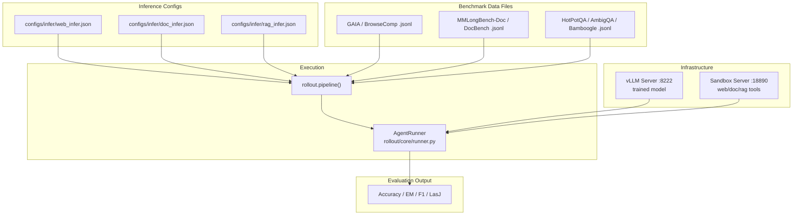
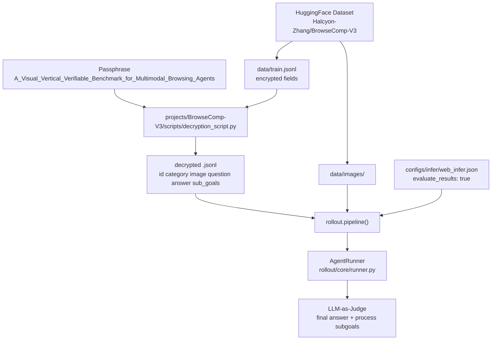

<!-- source: DeepWiki mcp.deepwiki.com · repo OpenDCAI/AgentFlow · page 7 Benchmarks · fetched 2026-11-02 -->

# Benchmarks

Relevant source files

The following files were used as context for generating this wiki page:

- [README.md](README.md)
- [README_zh.md](README_zh.md)
- [assets/intro.png](assets/intro.png)
- [assets/method.png](assets/method.png)
- [assets/wechat.jpg](assets/wechat.jpg)
- [assets/wechatshow.png](assets/wechatshow.png)
- [projects/BrowseComp-V3/.gitignore](projects/BrowseComp-V3/.gitignore)
- [projects/BrowseComp-V3/README.md](projects/BrowseComp-V3/README.md)
- [projects/BrowseComp-V3/data/.gitkeep](projects/BrowseComp-V3/data/.gitkeep)
- [projects/BrowseComp-V3/eval_rollout_results.py](projects/BrowseComp-V3/eval_rollout_results.py)
- [projects/BrowseComp-V3/image/ability_heatmap.png](projects/BrowseComp-V3/image/ability_heatmap.png)
- [projects/BrowseComp-V3/image/domain_2.png](projects/BrowseComp-V3/image/domain_2.png)
- [projects/BrowseComp-V3/image/fail_new.png](projects/BrowseComp-V3/image/fail_new.png)
- [projects/BrowseComp-V3/image/hop.png](projects/BrowseComp-V3/image/hop.png)
- [projects/BrowseComp-V3/image/main_result.png](projects/BrowseComp-V3/image/main_result.png)
- [projects/BrowseComp-V3/image/maxturn.png](projects/BrowseComp-V3/image/maxturn.png)
- [projects/BrowseComp-V3/image/overview.png](projects/BrowseComp-V3/image/overview.png)

This page describes the evaluation benchmarks supported by AgentFlow, how they integrate with the inference pipeline, and consolidated performance results for the AgentFlow model family.

- For BrowseComp-V3 specifics including data decryption and the OmniSeeker framework, see [BrowseComp-V3](#7.1).
- For individual dataset benchmark configurations (HotPotQA, MMLongBench-Doc, GAIA, etc.), see [Dataset Benchmarks](#7.2).
- For the LLM-as-judge evaluation implementation, see [Evaluation System](#5.3).
- For running model inference against these benchmarks, see [Model Inference](#5.2).

---

## Role of Benchmarks in AgentFlow

Benchmarks serve two distinct functions:

1. **Trajectory generation input** — Benchmark questions are passed into `rollout.pipeline` with `trajectory_only: true`. The resulting agent trajectories become supervised training data.
2. **Model evaluation** — After training, models are evaluated by running `rollout.pipeline` with `evaluate_results: true` and an `evaluation_metric` field set in the inference config under `configs/infer/`.

Both uses share the same `rollout.pipeline` entry point, differentiated only by configuration flags. See [Trajectory Config Schema](#8.3) and [Inference Config Schema](#8.4) for the parameter definitions.

---

## Benchmark Overview

| Modality | Benchmark | Metric | Inference Config |
|----------|-----------|--------|-----------------|
| Web | GAIA | Accuracy | `configs/infer/web_infer.json` |
| Web | BrowseComp (BC) | Accuracy | `configs/infer/web_infer.json` |
| Web | BrowseComp-zh (BC-zh) | Accuracy | `configs/infer/web_infer.json` |
| Document | MMLongBench-Doc (MMBD) | Accuracy, F1, LasJ | `configs/infer/doc_infer.json` |
| Document | DocBench (DocB) | LasJ | `configs/infer/doc_infer.json` |
| RAG | HotPotQA | EM / F1 | `configs/infer/rag_infer.json` |
| RAG | AmbigQA | EM / F1 | `configs/infer/rag_infer.json` |
| RAG | Bamboogle | EM / F1 | `configs/infer/rag_infer.json` |
| RAG | PopQA | EM / F1 | `configs/infer/rag_infer.json` |
| RAG | NQ (Natural Questions) | EM / F1 | `configs/infer/rag_infer.json` |

*LasJ = LLM-as-Judge score. EM = Exact Match.*

Sources: [README.md:199-256]()

---

## Evaluation Pipeline

The following diagram maps the evaluation workflow to specific code entities. The same `rollout.pipeline()` function is used for all modalities, differentiated by which inference config is passed.

**Benchmark Evaluation: Code Entity Map**

The inference config fields that distinguish evaluation from trajectory generation:

| Config Parameter | Trajectory Rollout | Benchmark Evaluation |
|---|---|---|
| `trajectory_only` | `true` | `false` |
| `evaluate_results` | `false` | `true` |
| `evaluation_metric` | *(absent)* | `"em"`, `"f1"`, `"llm_judge"` |
| `evaluator_model` | *(absent)* | model identifier string |

Sources: [README.md:152-158](), [configs/infer/]()

---

## BrowseComp-V3

BrowseComp-V3 lives in `projects/BrowseComp-V3/` and is hosted on HuggingFace at `Halcyon-Zhang/BrowseComp-V3`. It contains 300 hand-crafted multimodal questions requiring deep multi-hop reasoning over web-searched image and text evidence.

Key properties:

| Property | Value |
|---|---|
| Question count | 300 |
| Evidence type | Text + images (publicly searchable) |
| Encryption | AES-256-GCM on questions and answers |
| Evaluation | Final answer accuracy + subgoal-driven process score |
| SOTA accuracy | ~36% (GPT-5.2) |

The project also includes **OmniSeeker**, a general multimodal browsing agent framework designed for this benchmark.

**BrowseComp-V3: Data Decryption and Inference Flow**

### Encrypted Data Format

Each record in `train.jsonl` contains:

| Field | Type | Description |
|-------|------|-------------|
| `id` | string | Unique question identifier |
| `category` | string | Domain category |
| `sub_category` | string | Sub-domain |
| `image` | string | Primary image filename |
| `image_paths` | JSON string | All associated image paths |
| `encrypted_question` | string | AES-256-GCM encrypted question text |
| `encrypted_answer` | string | AES-256-GCM encrypted answer |
| `sub_goals` | JSON string | Expert-validated process subgoals |
| `metadata` | JSON string | Additional metadata |

Images are located under `data/images/` in the dataset. For the complete decryption procedure and evaluation setup, see [BrowseComp-V3](#7.1).

Sources: [projects/BrowseComp-V3/README.md:1-90]()

---

## Dataset Benchmarks

The remaining benchmarks are standard NLP and information-seeking datasets. Each requires the corresponding sandbox backend to be running before evaluation:

- **Web (GAIA)**: Multi-step English information-seeking tasks. Requires the web sandbox (`configs/sandbox-server/web_config.json`) with Serper and Jina API access.
- **RAG (HotPotQA, AmbigQA, Bamboogle, PopQA, NQ)**: Retrieval-augmented QA. Requires the RAG sandbox with E5 embeddings and a Faiss index loaded at `RAG_INDEX_PATH`.
- **Document (MMLongBench-Doc, DocBench)**: Multi-page, multimodal document QA. Requires the document sandbox with VLM API access.

For sandbox setup and seed data for each benchmark, see [Dataset Benchmarks](#7.2) and [Backend Resources](#3.2).

---

## Performance Results

### Consolidated Models (Qwen3-30B-A3B-Think)

Comparison of the two model consolidation strategies across all benchmark modalities. See [Agentic Model Consolidation](#2.4) for the methodology.

| Strategy | Model | GAIA | BC | BC-zh | MMBD | DocB | HotPotQA EM/F1 | AmbigQA EM/F1 | Bamboogle EM/F1 |
|---|---|---|---|---|---|---|---|---|---|
| Data Mixing | `Agent-datamix` | **64.08** | **28.00** | **34.00** | 63.59 | **83.29** | 38.00/42.53 | 49.50/58.84 | 53.10/60.20 |
| RegMean++ | `Agent-RegMeanpp` | 60.19 | 22.50 | 28.00 | **64.66** | 80.76 | 45.50/58.27 | **58.80/69.36** | **52.80/66.48** |

**Notable patterns:**
- Data mixing dominates all web benchmarks by a substantial margin.
- Parameter merging achieves a modest edge on MMLongBench-Doc.
- Parameter merging shows a large advantage on AmbigQA and Bamboogle F1.

Sources: [README.md:202-205]()

### RAG Agent: RAGShaper

`RAGShaper` is a Qwen3-30B-A3B fine-tune trained on AgentFlow-synthesized RAG trajectories (~6.5k examples). Evaluated on Bamboogle, PopQA, Natural Questions, and AmbigQA using EM and F1.

| Model | Bamboogle EM/F1 | PopQA EM/F1 | NQ EM/F1 | AmbigQA EM/F1 | Avg EM/F1 |
|-------|----------------|-------------|---------|--------------|----------|
| IR-COT | 16.0/27.9 | 32.4/39.9 | 19.3/35.5 | 24.5/40.6 | 23.1/36.0 |
| RECOMP | 21.7/28.6 | 40.5/45.8 | —/— | —/— | —/— |
| Search-o1 | 30.4/39.9 | 47.0/50.0 | 30.3/40.7 | 42.5/53.4 | 37.6/46.0 |
| Search-R1 | 30.4/43.2 | 41.3/46.4 | 36.0/45.0 | 49.2/60.4 | 39.2/48.8 |
| ReasonRAG | 22.4/29.1 | 41.1/44.4 | 28.1/38.9 | 39.7/51.9 | 32.8/41.1 |
| HL-Data 4.5k | 50.4/67.5 | 35.2/48.3 | 31.5/47.4 | 52.1/69.0 | 42.3/58.0 |
| **RAGShaper 4.5k** | 58.5/70.3 | 37.4/47.8 | 38.3/50.0 | **61.3/71.4** | 48.8/59.8 |
| **RAGShaper 6.5k** | **60.0/72.6** | 38.9/49.6 | **41.3/54.8** | 61.1/71.1 | **50.3/62.0** |

Sources: [README.md:210-222]()

### Document Agent: DocDancer

`DocDancer` is fine-tuned on Qwen3-4B and Qwen3-30B-A3B using AgentFlow-synthesized document trajectories. Uses `doc-search` and `doc-read` tools with a VLM backend.

| Method | Model | MMBD Acc. | F1 | LasJ | DocBench LasJ |
|--------|-------|-----------|----|------|---------------|
| Tesseract | GPT-4o | 30.1 | 30.5 | — | — |
| Tesseract | Gemini-2.0-Flash | 39.6 | 37.2 | — | — |
| VisRAG | GPT-4o | 29.0 | 27.8 | — | — |
| RAGAnything | GPT-4o-mini | 42.8 | — | — | 63.4 |
| Doc-React | GPT-4o | 38.1 | 38.3 | — | — |
| MDocAgent | GPT-4o | 42.0 | — | — | — |
| SimpleDoc | Claude-4-Sonnet | — | — | 58.6 | — |
| DocLens | Claude-4-Sonnet | — | — | 63.3 | — |
| **DocDancer** | Qwen3-4B (ft) | 48.4 | 49.2 | 59.4 | 79.8 |
| **DocDancer** | Qwen3-30B-A3B (ft) | **54.4** | **53.9** | **65.3** | **81.2** |
| Human Baseline | — | 65.8 | 66.0 | — | 81.2 |

Sources: [README.md:239-256]()

---

## Related Papers

| Paper | Relevance |
|-------|-----------|
| *RAGShaper: Eliciting Sophisticated Agentic RAG Skills via Automated Data Synthesis* | RAGShaper model, HotPotQA / AmbigQA / Bamboogle results |
| *DocDancer: Towards Agentic Document-Grounded Information Seeking* | DocDancer model, MMLongBench-Doc / DocBench results |
| *Exploring Information Seeking Agent Consolidation* | Agent-datamix / Agent-RegMeanpp, multi-benchmark comparison |
| *BrowseComp-V3: A Visual, Vertical, and Verifiable Benchmark for Multimodal Browsing Agents* | BrowseComp-V3 dataset and OmniSeeker framework |

Sources: [README.md:162-171]()

---

