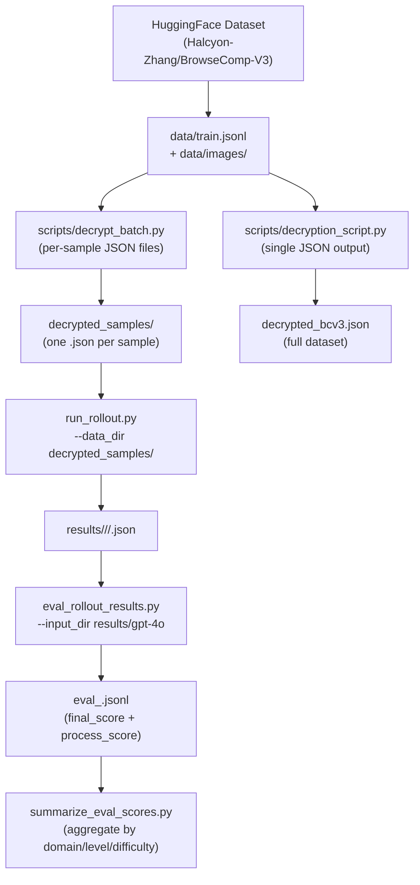
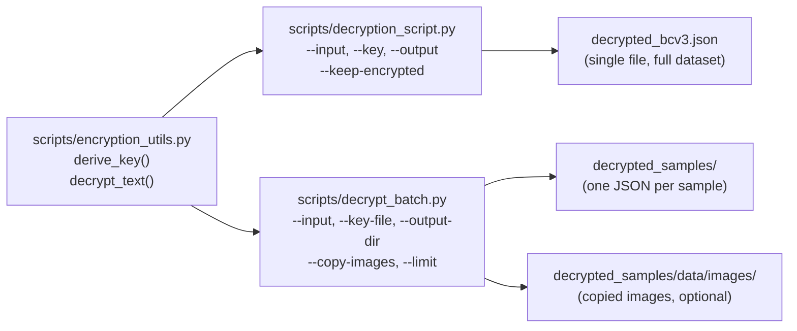
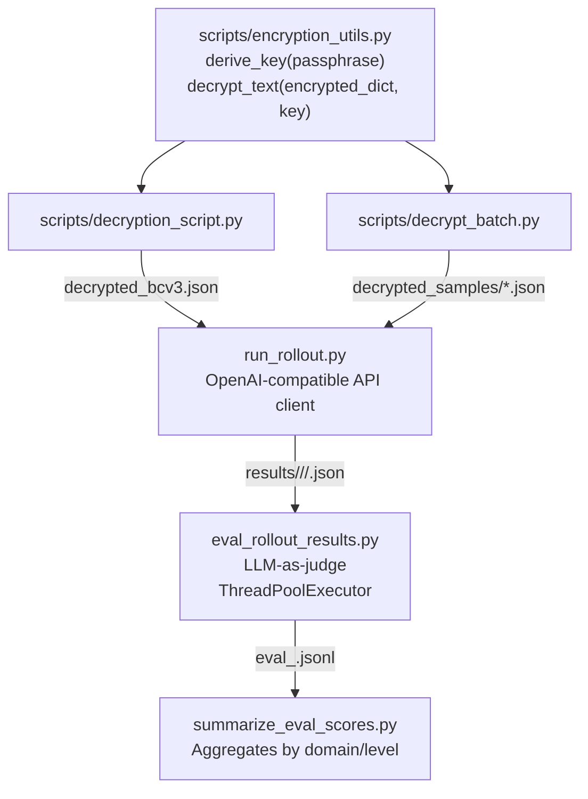

<!-- source: DeepWiki mcp.deepwiki.com · repo OpenDCAI/AgentFlow · page 7.1 BrowseComp-V3 · fetched 2026-11-02 -->

# BrowseComp-V3

<details>
<summary>Relevant source files</summary>

The following files were used as context for generating this wiki page:

- [projects/BrowseComp-V3/.gitignore](projects/BrowseComp-V3/.gitignore)
- [projects/BrowseComp-V3/README.md](projects/BrowseComp-V3/README.md)
- [projects/BrowseComp-V3/data/.gitkeep](projects/BrowseComp-V3/data/.gitkeep)
- [projects/BrowseComp-V3/eval_rollout_results.py](projects/BrowseComp-V3/eval_rollout_results.py)
- [projects/BrowseComp-V3/image/ability_heatmap.png](projects/BrowseComp-V3/image/ability_heatmap.png)
- [projects/BrowseComp-V3/image/domain_2.png](projects/BrowseComp-V3/image/domain_2.png)
- [projects/BrowseComp-V3/image/fail_new.png](projects/BrowseComp-V3/image/fail_new.png)
- [projects/BrowseComp-V3/image/hop.png](projects/BrowseComp-V3/image/hop.png)
- [projects/BrowseComp-V3/image/main_result.png](projects/BrowseComp-V3/image/main_result.png)
- [projects/BrowseComp-V3/image/maxturn.png](projects/BrowseComp-V3/image/maxturn.png)
- [projects/BrowseComp-V3/image/overview.png](projects/BrowseComp-V3/image/overview.png)

</details>


This page covers the **BrowseComp-V3** benchmark located in `projects/BrowseComp-V3/`. It describes the benchmark's purpose, dataset format, decryption workflow, inference pipeline, and evaluation methodology. For information about other evaluation benchmarks used across AgentFlow (HotPotQA, GAIA, MMLongBench-Doc), see [Dataset Benchmarks](#7.2). For training and deploying the Web Agent that this benchmark evaluates, see [Web Agent](#6.3).

---

## Overview

BrowseComp-V3 (BrowseComp-V³) is an evaluation benchmark for **multimodal web browsing agents**. It contains 300 hand-crafted questions that require multi-level, cross-modal reasoning and active web search — they cannot be resolved from a model's parametric knowledge alone. The benchmark emphasizes three properties encoded in the "V³" name:

| Dimension | Description |
|-----------|-------------|
| **Visual** | Tasks involve image inputs; models must integrate multimodal information |
| **Vertical** | Tasks require deep, multi-hop reasoning chains across multiple sources |
| **Verifiable** | All supporting evidence is publicly searchable; evaluation uses an expert-validated subgoal-driven process score |

Key findings from the benchmark: even state-of-the-art models achieve only ~36% final answer accuracy, with critical bottlenecks in multimodal information integration and fine-grained perception.

Sources: [projects/BrowseComp-V3/README.md:1-11]()

---

## Dataset Format and Encryption

The dataset is distributed with encrypted question-answer pairs to protect intellectual property. The encryption scheme is:

| Parameter | Value |
|-----------|-------|
| Algorithm | AES-256-GCM (Galois/Counter Mode) |
| Key derivation | SHA-256 hash of passphrase |
| IV and tag | 16-byte base64-encoded values per record |
| Passphrase | `A_Visual_Vertical_Verifiable_Benchmark_for_Multimodal_Browsing_Agents` |

### `train.jsonl` Record Schema

Each line in `train.jsonl` is a JSON object with the following fields:

| Field | Type | Description |
|-------|------|-------------|
| `id` | string | Unique sample identifier |
| `category` | string | Top-level domain (e.g., `Culture_Art`) |
| `sub_category` | string | More specific topic area |
| `image` | string | Primary image filename |
| `image_paths` | JSON string | List of all image paths for the sample |
| `encrypted_question` | dict | `{iv, ciphertext, tag}` — AES-256-GCM encrypted question text |
| `encrypted_answer` | dict | `{iv, ciphertext, tag}` — AES-256-GCM encrypted answer text |
| `metadata` | JSON string | Difficulty level and other annotations |
| `sub_goals` | JSON string | Expert-defined subgoals for process evaluation |

Images are stored under `data/images/` in the dataset root.

Sources: [projects/BrowseComp-V3/README.md:40-68]()

---

## End-to-End Pipeline

**Diagram: BrowseComp-V3 End-to-End Workflow**



Sources: [projects/BrowseComp-V3/README.md:40-175]()

---

## Step 1: Download and Decrypt

### Obtaining the Dataset

Download from Hugging Face (`Halcyon-Zhang/BrowseComp-V3`). Place `train.jsonl` and `data/images/` in a working directory (e.g. `data/`).

### Decryption Scripts

Two decryption scripts are provided under `projects/BrowseComp-V3/scripts/`:

**Diagram: Decryption Script Responsibilities**



#### `scripts/decryption_script.py` — Full Dataset

Outputs a single JSON file with all decrypted records. Use `--keep-encrypted` to retain the original encrypted fields alongside the plaintext.

```
python scripts/decryption_script.py \
  --input data/train.jsonl \
  --key "A_Visual_Vertical_Verifiable_Benchmark_for_Multimodal_Browsing_Agents" \
  --output decrypted_bcv3.json
```

#### `scripts/decrypt_batch.py` — Per-Sample Files (Recommended for Rollout)

Outputs one JSON file per sample named after the sample's `id` field (e.g. `001_Culture_Art_L3_p2_t2_m0_r2_w0_c0_g5.json`). The `--copy-images` flag copies referenced images into `output-dir/data/images/` so relative image paths resolve correctly at inference time. The `--limit N` flag decrypts only the first N samples for quick testing.

```
echo "A_Visual_Vertical_Verifiable_Benchmark_for_Multimodal_Browsing_Agents" > key.txt

python scripts/decrypt_batch.py \
  --input data/train.jsonl \
  --key-file key.txt \
  --output-dir decrypted_samples/ \
  --copy-images /path/to/dataset_root
```

> **Note:** Run from the repository root. The script resolves `scripts/encryption_utils.py` automatically.

#### Python API

The core cryptographic primitives are exposed directly via `scripts/encryption_utils.py`:

```python
import sys
sys.path.insert(0, "scripts")
from encryption_utils import derive_key, decrypt_text

key = derive_key("A_Visual_Vertical_Verifiable_Benchmark_for_Multimodal_Browsing_Agents")
# encrypted_dict = {"iv": "...", "ciphertext": "...", "tag": "..."}
# plaintext = decrypt_text(encrypted_dict, key)
```

### Troubleshooting

| Error | Cause | Fix |
|-------|-------|-----|
| Decryption failed / integrity error | Wrong passphrase or corrupted data | Use exact passphrase (case-sensitive); verify iv/ciphertext/tag |
| Unrecognized format | Input is not `train.jsonl`-style | Scripts skip lines without encrypted fields; check input format |
| File not found | Wrong working directory | Use absolute paths; for batch mode ensure key file exists |

Sources: [projects/BrowseComp-V3/README.md:40-127]()

---

## Step 2: Run Inference

`run_rollout.py` runs a single VLM call per sample (question + images) against the decrypted per-sample JSONs. It uses the OpenAI-compatible API.

```
export OPENAI_API_KEY="your-key"
# optional: export OPENAI_API_BASE="https://..."

python run_rollout.py \
  --data_dir decrypted_samples/ \
  --output_dir results \
  --model_name gpt-4o
```

### Key Arguments

| Argument | Description |
|----------|-------------|
| `--data_dir` | Directory containing per-sample decrypted JSON files |
| `--output_dir` | Root directory for results; output goes to `<output_dir>/<model_name>/<domain>/<id>.json` |
| `--model_name` | Model identifier passed to the OpenAI-compatible API |
| `--data_root` | Root for resolving relative image paths (default: same as `--data_dir`). Set to the directory containing `data/` if using `--copy-images` |
| `--dry_run` | Build messages and verify image encoding without making an API call; prints content structure for the first sample |

Output files are JSON objects stored at `results/<model_name>/<domain>/<id>.json`. These are the direct input for `eval_rollout_results.py`.

> For **tool-aided rollout** (using `web-search` and `web-visit` tools) and the **OmniSeeker** framework, see the upstream BrowseComp-V3 GitHub repository. Within AgentFlow, the Web Agent infrastructure described in [Web Agent](#6.3) provides the corresponding tool backends.

Sources: [projects/BrowseComp-V3/README.md:129-148]()

---

## Step 3: Evaluate Results

`eval_rollout_results.py` scores each rollout result file using an LLM judge. It computes two scores per sample:

| Score | Description |
|-------|-------------|
| `final_score` | Binary or graded correctness of the final answer |
| `process_score` | Subgoal-driven process evaluation — how many expert-defined sub-goals were achieved |

```
python eval_rollout_results.py \
  --input_dir results/gpt-4o \
  --judge_model gpt-4o
```

- `OPENAI_API_KEY` (and optionally `OPENAI_API_BASE`) must be set, or placed in a `.env` file in the working directory.
- Output: `eval_<model>.jsonl` written to the same directory as `--input_dir`, or to a path specified via `--output_path`.

The evaluator uses an LLM-as-judge pattern consistent with AgentFlow's broader evaluation system — see [Evaluation System](#5.3) for details on how LLM judging is implemented across the framework.

Sources: [projects/BrowseComp-V3/README.md:151-163](), [projects/BrowseComp-V3/eval_rollout_results.py:1-50]()

---

## Step 4: Summarize Results

`summarize_eval_scores.py` aggregates per-sample scores across multiple dimensions:

```
python summarize_eval_scores.py results/gpt-4o/eval_gpt-4o.jsonl
```

Output is printed to stdout and includes per-model bucketed statistics across:

| Dimension | Buckets |
|-----------|---------|
| Domain (1-level) | Top-level `category` values |
| Domain (2-level) | `category/sub_category` pairs |
| Level | Difficulty level annotation from `metadata` |
| Difficulty | Combined difficulty score |

Each bucket reports sample count and average `final_score` / `process_score`.

Sources: [projects/BrowseComp-V3/README.md:166-175]()

---

## Script and Module Map

**Diagram: Script Dependencies and Data Flow**



Sources: [projects/BrowseComp-V3/README.md:40-175](), [projects/BrowseComp-V3/eval_rollout_results.py:1-20]()

---

## Requirements

Install from the project root:

```
pip install -r requirements.txt
```

Dependencies: `openai`, `cryptography`, `python-dotenv`, `requests`. No `Pillow` is required for basic rollout (images are base64-encoded using the standard library).

Sources: [projects/BrowseComp-V3/README.md:178-187]()

---

## Dataset Statistics and Results Summary

| Metric | Value |
|--------|-------|
| Total questions | 300 |
| Construction method | Hand-crafted by human experts |
| SOTA accuracy (GPT-5.2) | ~36% |
| Evaluation dimensions | Final answer correctness + process score |
| License | CC BY 4.0 |

Domain distribution and dataset statistics are visualized in `image/domain_2.png` and `image/statistic.png`. For detailed analysis (scaling, failure modes, ability heatmaps), see the upstream project page.

Sources: [projects/BrowseComp-V3/README.md:1-4, 15-36]()

---

## Citation

```bibtex
@article{zhang2026browsecompv3,
  title   = {BrowseComp-$V^3$: A Visual, Vertical, and Verifiable Benchmark for Multimodal Browsing Agents},
  author  = {Huanyao Zhang and others},
  journal = {arXiv preprint arXiv:2602.12876},
  year    = {2026}
}
```

Sources: [projects/BrowseComp-V3/README.md:191-199]()

---

