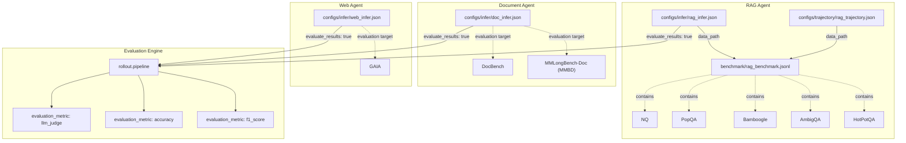
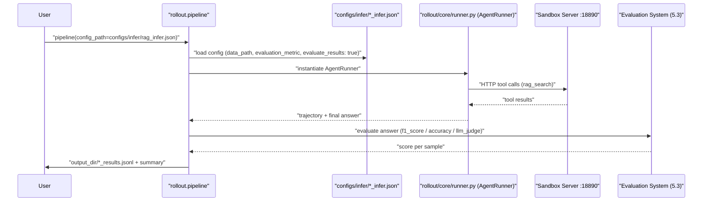

<!-- source: DeepWiki mcp.deepwiki.com · repo OpenDCAI/AgentFlow · page 7.2 Dataset Benchmarks · fetched 2026-11-02 -->

# Dataset Benchmarks

<details>
<summary>Relevant source files</summary>

The following files were used as context for generating this wiki page:

- [README.md](README.md)
- [README_zh.md](README_zh.md)
- [assets/intro.png](assets/intro.png)
- [assets/method.png](assets/method.png)
- [assets/wechat.jpg](assets/wechat.jpg)
- [assets/wechatshow.png](assets/wechatshow.png)
- [configs/infer/rag_infer.json](configs/infer/rag_infer.json)
- [configs/trajectory/rag_trajectory.json](configs/trajectory/rag_trajectory.json)
- [examples/RAGAgent.md](examples/RAGAgent.md)
- [seeds/rag/seeds.jsonl](seeds/rag/seeds.jsonl)

</details>


This page documents the standard evaluation benchmarks used in AgentFlow for RAG, Document, and Web agent types: **HotPotQA**, **AmbigQA**, **Bamboogle**, **PopQA**, **NQ**, **MMLongBench-Doc**, **DocBench**, and **GAIA**. For the BrowseComp-V3 benchmark (a multimodal web browsing benchmark shipped directly with AgentFlow), see [7.1](#7.1). For details on the evaluation system (LLM-as-judge, metrics, `rollout.pipeline`), see [5.3](#5.3).

---

## Benchmark Overview

| Benchmark | Abbreviation | Agent Type | Metrics | Domain |
|---|---|---|---|---|
| HotPotQA | — | RAG | EM, F1 | Multi-hop QA |
| AmbigQA | — | RAG | EM, F1 | Ambiguous questions |
| Bamboogle | — | RAG | EM, F1 | Google-proof questions |
| PopQA | — | RAG | EM, F1 | Popular entity QA |
| Natural Questions | NQ | RAG | EM, F1 | Open-domain QA |
| MMLongBench-Doc | MMBD | Document | Acc, F1, LasJ | Multimodal long documents |
| DocBench | DocB | Document | LasJ | Document QA |
| GAIA | — | Web (Deep Research) | Accuracy | General agent capability |

Each benchmark is consumed by `rollout.pipeline` via a `data_path` in the corresponding inference config under `configs/infer/`. The evaluation metric is declared as `evaluation_metric` in that config.

Sources: [README.md:202-222](), [configs/infer/rag_infer.json:1-46]()

---

## Benchmark-to-Configuration Mapping

**Diagram: Benchmark, Agent, Config, and Data Path Relationships**



Sources: [configs/infer/rag_infer.json:1-46](), [configs/trajectory/rag_trajectory.json:1-41](), [README.md:199-222]()

---

## Evaluation Pipeline Flow

**Diagram: Code Entities Involved in Benchmark Evaluation**



Sources: [configs/infer/rag_infer.json:1-46](), [configs/trajectory/rag_trajectory.json:1-41](), [README.md:143-149]()

---

## RAG Agent Benchmarks

These benchmarks evaluate the `rag_search` tool-based agent. The benchmark data is referenced by `data_path` in `configs/infer/rag_infer.json` and `configs/trajectory/rag_trajectory.json` as `benchmark/rag_benchmark.jsonl`. The evaluation metric is `f1_score`, with both Exact Match (EM) and F1 reported.

### HotPotQA

Multi-hop question answering requiring reasoning over multiple Wikipedia paragraphs. Requires the agent to chain several `rag_search` calls to bridge intermediate facts before forming an answer.

### AmbigQA

Questions with multiple valid interpretations. The agent must retrieve enough context to identify the correct interpretation and produce a specific answer. Evaluated on EM and F1.

### Bamboogle

A set of "Google-proof" questions specifically constructed to be unanswerable by a simple web or keyword search. Requires deep multi-hop retrieval reasoning.

### PopQA

Questions about popular entities extracted from Wikipedia. Tests the agent's ability to retrieve factual entity properties from the knowledge base.

### Natural Questions (NQ)

Open-domain questions from real Google search queries, answered against Wikipedia. Measures retrieval recall and answer precision.

---

### RAG Agent Performance Results

The following table compares RAGShaper models (trained with AgentFlow synthesized data) against baseline methods across all five RAG benchmarks:

| Model | Bamboogle EM | Bamboogle F1 | PopQA EM | PopQA F1 | NQ EM | NQ F1 | AmbigQA EM | AmbigQA F1 | Avg EM | Avg F1 |
|---|---|---|---|---|---|---|---|---|---|---|
| IR-COT | 16.0 | 27.9 | 32.4 | 39.9 | 19.3 | 35.5 | 24.5 | 40.6 | 23.1 | 36.0 |
| Search-o1 | 30.4 | 39.9 | 47.0 | 50.0 | 30.3 | 40.7 | 42.5 | 53.4 | 37.6 | 46.0 |
| Search-R1 | 30.4 | 43.2 | 41.3 | 46.4 | 36.0 | 45.0 | 49.2 | 60.4 | 39.2 | 48.8 |
| HL-Data 4.5k | 50.4 | 67.5 | 35.2 | 48.3 | 31.5 | 47.4 | 52.1 | 69.0 | 42.3 | 58.0 |
| **RAGShaper 4.5k** | 58.5 | 70.3 | 37.4 | 47.8 | 38.3 | 50.0 | **61.3** | **71.4** | 48.8 | 59.8 |
| **RAGShaper 6.5k** | **60.0** | **72.6** | 38.9 | 49.6 | **41.3** | **54.8** | 61.1 | 71.1 | **50.3** | **62.0** |

Sources: [README.md:207-222]()

---

## Document Agent Benchmarks

These benchmarks evaluate the `doc-search` and `doc-read` tool-based agent (DocDancer). The agent navigates multi-page documents with heterogeneous content including text, tables, charts, and images.

### MMLongBench-Doc (MMBD)

A multimodal long-document benchmark requiring the agent to answer questions grounded in visual and textual evidence across many pages. Reports Accuracy, F1, and LasJ (LLM-as-Judge).

### DocBench (DocB)

A document QA benchmark focused on precise information extraction. Evaluated using LasJ (LLM-as-Judge).

---

### Document Agent Performance Results

| Method | Model | MMBD Acc | MMBD F1 | MMBD LasJ | DocBench LasJ |
|---|---|---|---|---|---|
| Tesseract (OCR) | GPT-4o | 30.1 | 30.5 | — | — |
| Tesseract (OCR) | Gemini-2.0-Flash | 39.6 | 37.2 | — | — |
| VisRAG | GPT-4o | 29.0 | 27.8 | — | — |
| RAGAnything | GPT-4o-mini | 42.8 | — | — | 63.4 |
| Doc-React | GPT-4o | 38.1 | 38.3 | — | — |
| SimpleDoc | Claude-4-Sonnet | — | — | 58.6 | — |
| DocLens | Claude-4-Sonnet | — | — | 63.3 | — |
| **DocDancer** | Qwen3-4B (ft) | **48.4** | **49.2** | **59.4** | **79.8** |
| **DocDancer** | Qwen3-30B-A3B (ft) | **54.4** | **53.9** | **65.3** | **81.2** |
| Human Baseline | — | 65.8 | 66.0 | — | 81.2 |

Sources: [README.md:234-256]()

---

## Web Agent Benchmarks

### GAIA

The General AI Assistants benchmark measures multi-step tool-use and reasoning capability across diverse tasks. It is the primary web agent benchmark in AgentFlow's cross-domain evaluation. Metric: Accuracy.

GAIA is also used as the primary axis for comparing the two consolidation strategies (data-level vs. parameter-level). See [2.4](#2.4) for details on those strategies.

---

### Cross-Domain Performance (Qwen3-30B-A3B-Think)

This table shows how the consolidated models perform across all benchmark categories simultaneously:

| Strategy | GAIA Acc | BC Acc | BC-zh Acc | MMBD Acc | DocB Acc | HotPotQA EM/F1 | AmbigQA EM/F1 | Bamboogle EM/F1 |
|---|---|---|---|---|---|---|---|---|
| Data Mixing (Agent-datamix) | **64.08** | **28.00** | **34.00** | 63.59 | **83.29** | 38.00 / 42.53 | 49.50 / 58.84 | 53.10 / 60.20 |
| RegMean++ (Agent-RegMeanpp) | 60.19 | 22.50 | 28.00 | **64.66** | 80.76 | 45.50 / 58.27 | **58.80 / 69.36** | **52.80 / 66.48** |

Sources: [README.md:199-205]()

---

## Evaluation Metrics

| Metric | Abbreviation | Used By | Description |
|---|---|---|---|
| Exact Match | EM | RAG benchmarks | 1 if prediction exactly matches gold answer (normalized), else 0 |
| F1 Score | F1 | RAG benchmarks | Token-level overlap between prediction and gold answer |
| Accuracy | Acc | Web/Doc benchmarks | Fraction of correct predictions |
| LLM-as-Judge | LasJ | Doc benchmarks | LLM scores the answer quality; configured via `evaluator_model_name` |

The `evaluation_metric` field in inference configs selects which metric `rollout.pipeline` applies. For example, `configs/infer/rag_infer.json` sets `"evaluation_metric": "f1_score"`. The `evaluator_model_name`, `evaluator_api_key`, and related fields configure the LLM judge for LasJ scoring.

Sources: [configs/infer/rag_infer.json:27-35]()

---

## Running Inference on a Benchmark

To evaluate a trained model against a benchmark, populate `configs/infer/rag_infer.json` with your model's endpoint and call `rollout.pipeline`:

```python
from rollout import pipeline

pipeline(config_path="configs/infer/rag_infer.json")
```

Key fields to configure in the inference config:

| Field | Description | Example |
|---|---|---|
| `model_name` | Served model name | `"your-ragshaper-model"` |
| `base_url` | vLLM server URL | `"http://localhost:8222/v1"` |
| `data_path` | Benchmark data file | `"benchmark/rag_benchmark.jsonl"` |
| `evaluation_metric` | Metric to use | `"f1_score"` |
| `evaluate_results` | Whether to score outputs | `true` |
| `output_dir` | Where results are written | `"infer_results/rag"` |
| `evaluator_model_name` | LLM judge model (LasJ only) | `"openai/gpt-oss-120b"` |

For trajectory generation (no evaluation), use `configs/trajectory/rag_trajectory.json`, which sets `"evaluate_results": false` and `"trajectory_only": true`. For full inference config schema details, see [8.4](#8.4).

Sources: [configs/infer/rag_infer.json:1-46](), [configs/trajectory/rag_trajectory.json:1-41]()

---

