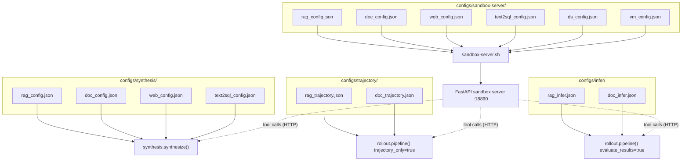
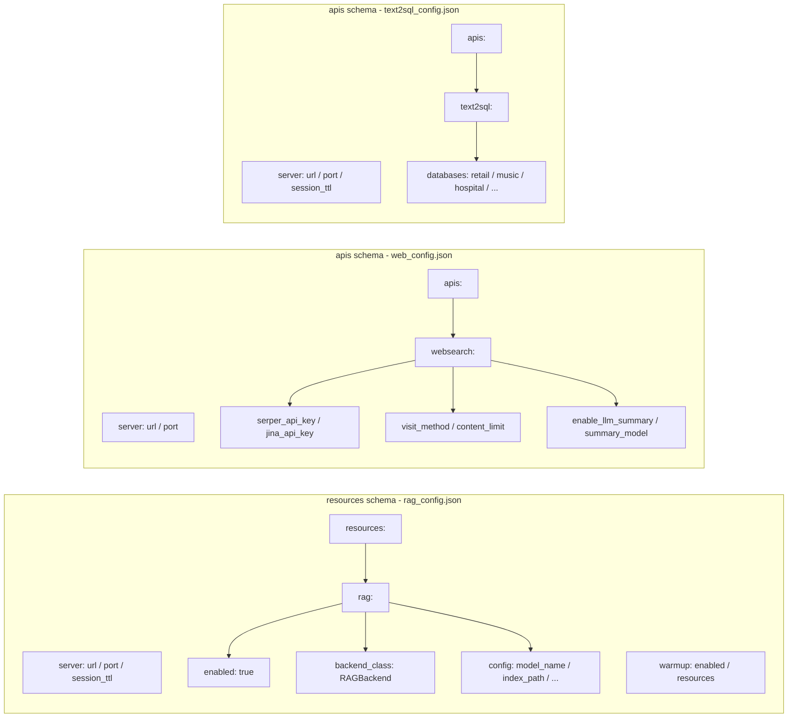
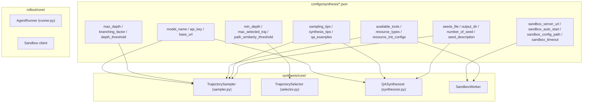

<!-- source: DeepWiki mcp.deepwiki.com · repo OpenDCAI/AgentFlow · page 8 Configuration Reference · fetched 2026-11-02 -->

# Configuration Reference

<details>
<summary>Relevant source files</summary>

The following files were used as context for generating this wiki page:

- [configs/sandbox-server/doc_config.json](configs/sandbox-server/doc_config.json)
- [configs/sandbox-server/rag_config.json](configs/sandbox-server/rag_config.json)
- [configs/sandbox-server/text2sql_config.json](configs/sandbox-server/text2sql_config.json)
- [configs/sandbox-server/web_config.json](configs/sandbox-server/web_config.json)
- [configs/synthesis/doc_config.json](configs/synthesis/doc_config.json)
- [configs/synthesis/rag_config.json](configs/synthesis/rag_config.json)
- [configs/synthesis/web_config.json](configs/synthesis/web_config.json)
- [configs/synthesis/web_rag_config.json](configs/synthesis/web_rag_config.json)

</details>


This page is a comprehensive reference for all configuration file formats used in AgentFlow. It documents the structure, parameters, and conventions for the four categories of configuration files: sandbox-server, synthesis, trajectory, and inference. It also covers the environment variable substitution mechanism used across all configs.

This page focuses on configuration *format and parameters*. For narrative guidance on running the pipeline, see the synthesis pipeline documentation ([4](#4)), rollout and inference documentation ([5](#5)), and the sandbox server documentation ([3](#3)). For detailed per-schema references, see the child pages of this section:

- Sandbox server config schema — [8.1](#8.1)
- Synthesis config schema — [8.2](#8.2)
- Trajectory config schema — [8.3](#8.3)
- Inference config schema — [8.4](#8.4)
- Environment variables — [8.5](#8.5)

---

## Configuration Directory Layout

All configuration files live under `configs/`, organized by operational purpose:

```
configs/
├── sandbox-server/       # Backend resource and server settings
│   ├── rag_config.json
│   ├── doc_config.json
│   ├── web_config.json
│   ├── text2sql_config.json
│   ├── vm_config.json
│   └── ds_config.json
├── synthesis/            # Synthesis pipeline settings (QA generation)
│   ├── rag_config.json
│   ├── doc_config.json
│   ├── web_config.json
│   ├── web_rag_config.json
│   └── text2sql_config.json
├── trajectory/           # Rollout: trajectory-only generation
│   ├── rag_trajectory.json
│   └── doc_trajectory.json
└── infer/                # Rollout: model inference and evaluation
    ├── rag_infer.json
    └── doc_infer.json
```

Each directory maps to a distinct stage in the operational pipeline.

Sources: [configs/sandbox-server/rag_config.json:1-35](), [configs/sandbox-server/doc_config.json:1-23](), [configs/synthesis/rag_config.json:1-60]()

---

## The Four Configuration Categories

| Category | Directory | Consumed By | Primary Purpose |
|---|---|---|---|
| Sandbox Server | `configs/sandbox-server/` | `sandbox-server.sh` startup | Define tool backends, ports, credentials |
| Synthesis | `configs/synthesis/` | `synthesis.synthesize()` | Control trajectory sampling and QA generation |
| Trajectory | `configs/trajectory/` | `rollout.pipeline()` | Run agent on benchmarks, output trajectories only |
| Inference | `configs/infer/` | `rollout.pipeline()` | Run agent on benchmarks with model evaluation |

The `rollout.pipeline()` function accepts both trajectory and inference configs, distinguished by the `trajectory_only` and `evaluate_results` boolean flags.

Sources: [configs/synthesis/rag_config.json:1-60](), [configs/synthesis/web_config.json:1-44]()

---

## Environment Variable Substitution

All configuration files support shell-style variable substitution. The config loader replaces `${VAR_NAME}` tokens with the corresponding environment variable value at load time. A default value can be specified with `${VAR_NAME:-default}`.

**Substitution syntax:**

| Syntax | Behavior |
|---|---|
| `"${VAR_NAME}"` | Substitutes the value of `VAR_NAME`; error if unset |
| `"${VAR_NAME:-}"` | Substitutes `VAR_NAME` or empty string if unset |
| `"${VAR_NAME:-default}"` | Substitutes `VAR_NAME` or `"default"` if unset |

**Examples from actual config files:**

From [configs/sandbox-server/rag_config.json:20-22]():
```json
"model_name": "${RAG_EMBEDDING_MODEL_PATH}",
"index_path":  "${RAG_INDEX_PATH}",
"corpus_path": "${RAG_CORPUS_PATH}"
```

From [configs/sandbox-server/text2sql_config.json:12-18]():
```json
"databases": {
  "retail":        "${TEXT2SQL_RETAIL_DB_PATH:-}",
  "music":         "${TEXT2SQL_MUSIC_DB_PATH:-}",
  "hospital":      "${TEXT2SQL_HOSPITAL_DB_PATH:-}"
}
```

From [configs/synthesis/rag_config.json:3-5]():
```json
"api_key":  "${OPENROUTER_API_KEY}",
"base_url": "https://openrouter.ai/api/v1"
```

The `:-` (empty default) pattern in text2sql configs is explicitly used to avoid committing machine-specific absolute paths, as noted in the inline `_comment_databases` field [configs/sandbox-server/text2sql_config.json:10]().

For the full list of all environment variables used across configs, see [8.5](#8.5).

Sources: [configs/sandbox-server/rag_config.json:19-27](), [configs/sandbox-server/text2sql_config.json:10-18](), [configs/sandbox-server/web_config.json:8-9]()

---

## Config Categories and Their Relationships

The following diagram shows how each configuration category maps to code components and pipeline stages.

**Diagram: Config Files to Code Component Mapping**



Sources: [configs/sandbox-server/rag_config.json:1-35](), [configs/synthesis/rag_config.json:26-29](), [configs/synthesis/doc_config.json:19-22]()

---

## Sandbox Server Config Structure

Sandbox server configs use one of two top-level structures depending on the backend type. The newer `resources`-based schema is used for backends like RAG; the `apis`-based schema is used for web, doc, and SQL backends.

**Diagram: Sandbox Server Config Schema Variants**



The `resources` schema uses a `backend_class` string (e.g., `"sandbox.server.backends.resources.rag.RAGBackend"`) to identify the Python class that handles the backend. The `apis` schema uses named keys under `apis` that match the tool group name.

For the complete parameter reference, see [8.1](#8.1).

Sources: [configs/sandbox-server/rag_config.json:1-35](), [configs/sandbox-server/web_config.json:1-18](), [configs/sandbox-server/text2sql_config.json:1-22](), [configs/sandbox-server/doc_config.json:1-23]()

---

## Synthesis Config Structure

All synthesis configs share a common set of top-level parameters. The table below lists each parameter with its type, default behavior, and the configs in which it appears.

**Shared synthesis config parameters:**

| Parameter | Type | Description |
|---|---|---|
| `model_name` | string | LLM model identifier (e.g., `"openai/gpt-oss-120b"`) |
| `api_key` | string | API key, typically `"${OPENROUTER_API_KEY}"` |
| `base_url` | string | API base URL |
| `max_depth` | integer | Maximum trajectory tree depth during sampling |
| `branching_factor` | integer | Number of child nodes per trajectory branch |
| `depth_threshold` | integer | Minimum depth before branching is allowed |
| `min_depth` | integer | Minimum depth for a trajectory to be selected |
| `max_selected_traj` | integer | Maximum number of trajectories to select per seed |
| `path_similarity_threshold` | float | Cosine similarity threshold for deduplication |
| `number_of_seed` | integer or null | Number of seeds to process; `null` means all |
| `resource_types` | array | Resource types to initialize (e.g., `["rag"]`) |
| `resource_init_configs` | object | Per-resource initialization parameters |
| `sandbox_server_url` | string | URL of the running sandbox server |
| `sandbox_auto_start` | boolean | Whether to auto-start the sandbox server |
| `sandbox_config_path` | string | Path to sandbox config if `sandbox_auto_start` is true |
| `sandbox_timeout` | integer | Timeout in seconds for sandbox tool calls |
| `available_tools` | array | Tool names exposed to the LLM agent |
| `seed_description` | string | Human-readable description of seed format |
| `sampling_tips` | array of strings | Prompt hints injected during trajectory sampling |
| `synthesis_tips` | array of strings | Prompt hints injected during QA synthesis |
| `qa_examples` | array of objects | Few-shot examples for QA generation; each has `question` and `answer` |
| `seeds_file` | string | Path to the `seeds.jsonl` input file |
| `output_dir` | string | Directory path for output files |

The `sampling_tips` and `synthesis_tips` arrays directly shape LLM behavior. Their content is injected into the prompts sent to the `TrajectorySampler` and `QASynthesizer` respectively. For agent-specific values, compare [configs/synthesis/rag_config.json:35-41]() vs [configs/synthesis/doc_config.json:28-40]().

For the full parameter reference, see [8.2](#8.2).

Sources: [configs/synthesis/rag_config.json:1-60](), [configs/synthesis/doc_config.json:1-73](), [configs/synthesis/web_config.json:1-44](), [configs/synthesis/web_rag_config.json:1-51]()

---

## Trajectory vs. Inference Config Structure

Trajectory and inference configs are both consumed by `rollout.pipeline()`, and share a common base structure with synthesis configs (model, sandbox, tools). They are distinguished by two boolean flags:

| Parameter | Trajectory Config | Inference Config |
|---|---|---|
| `trajectory_only` | `true` | `false` |
| `evaluate_results` | `false` | `true` |
| `evaluation_metric` | not set | e.g., `"em"`, `"f1"` |
| `evaluator_model` | not set | e.g., `"openai/gpt-4o"` |

For the complete parameter reference:
- Trajectory configs — [8.3](#8.3)
- Inference configs — [8.4](#8.4)

---

## Config Parameter Coverage by Agent Type

The following table summarizes which `available_tools` and `resource_types` values are used for each agent modality, illustrating how the same config schema supports different backends.

| Agent Type | `available_tools` | `resource_types` | Sandbox Config |
|---|---|---|---|
| RAG | `["rag-search"]` | `["rag"]` | `rag_config.json` |
| Document | `["doc-search", "doc-read"]` | `[]` | `doc_config.json` |
| Web | `["web-search", "web-visit"]` | `[]` | `web_config.json` |
| Web+RAG | `["rag-search", "web-search", "web-visit"]` | `[]` | `rag_config.json` + `web_config.json` |
| Text2SQL | `["sql:list_databases", "sql:get_schema", "sql:execute"]` | `[]` | `text2sql_config.json` |
| Data Science | `["ds_inspect_data", "ds_read_csv", "ds_run_python"]` | `[]` | `ds_config.json` |
| GUI | `["vm-screenshot", "vm-click", "vm-type", ...]` | `[]` | `vm_config.json` |

Sources: [configs/synthesis/rag_config.json:17-31](), [configs/synthesis/doc_config.json:16-24](), [configs/synthesis/web_config.json:13-14](), [configs/synthesis/web_rag_config.json:15-17]()

---

## Per-Parameter Cross-Reference Diagram

The following diagram connects synthesis config parameters to the internal code components that consume them.

**Diagram: Synthesis Config Parameters to Internal Classes**



Sources: [configs/synthesis/rag_config.json:1-60](), [configs/synthesis/doc_config.json:1-73]()

---

## Doc Config: Backend-Specific Fields

The document sandbox config (`configs/sandbox-server/doc_config.json`) exposes several fields specific to the VLM-backed document backend that do not appear in other sandbox configs:

| Field | Type | Description |
|---|---|---|
| `seed_path` | string | Default seed document path for the doc backend |
| `max_search_results` | integer | Maximum number of results returned per `doc-search` call |
| `max_image_num` | integer | Maximum images passed to the VLM per call |
| `max_text_token` | integer | Maximum text token budget per doc-read operation |
| `vlm_model` | string | VLM model identifier (e.g., `"openai/gpt-4o-mini"`) |
| `vlm_api_key` | string | API key for the VLM, typically `"${VLM_API_KEY}"` |
| `vlm_api_url` | string | Base URL for the VLM API |
| `vlm_max_tokens` | integer | Max token output from the VLM |
| `vlm_timeout` | integer | Per-request timeout in seconds |
| `vlm_retry_max_attempts` | integer | Number of retry attempts on VLM failure |

Sources: [configs/sandbox-server/doc_config.json:1-23]()

---

## Web Config: Backend-Specific Fields

The web sandbox config (`configs/sandbox-server/web_config.json`) configures the `WebBackend` which integrates Serper and Jina external APIs:

| Field | Type | Description |
|---|---|---|
| `serper_api_key` | string | API key for Serper web search |
| `jina_api_key` | string | API key for Jina content fetching |
| `visit_method` | string | Page visit method; `"jina"` is the default |
| `content_limit` | integer | Maximum characters fetched per page visit |
| `enable_llm_summary` | boolean | Whether to summarize fetched content with an LLM |
| `summary_model` | string | Model to use for LLM summarization |
| `openai_api_key` | string | API key for the summarization LLM |
| `openai_api_url` | string | Base URL for the summarization LLM API |

Sources: [configs/sandbox-server/web_config.json:1-18]()

---

## RAG Config: Backend-Specific Fields

The RAG sandbox config (`configs/sandbox-server/rag_config.json`) uses the `resources` schema and includes batching settings for the E5 + Faiss retrieval backend:

| Field (under `resources.rag.config`) | Type | Description |
|---|---|---|
| `model_name` | string | Path to the embedding model (`${RAG_EMBEDDING_MODEL_PATH}`) |
| `index_path` | string | Path to the Faiss index file |
| `corpus_path` | string | Path to the document corpus |
| `device` | string | Device string: `"cuda:0"`, `"cuda:0/cuda:1"`, or `"cpu"` |
| `default_top_k` | integer | Default number of results per retrieval |
| `batcher_trigger_batch_size` | integer | Batch size that triggers a forward pass |
| `batcher_max_batch_size` | integer | Maximum batch size for encoding |
| `batcher_max_wait_time` | float | Seconds to wait before flushing a partial batch |

The `warmup` section under the top-level key controls whether the backend is warmed up at server start:

```json
"warmup": {
  "enabled": true,
  "resources": ["rag"]
}
```

Sources: [configs/sandbox-server/rag_config.json:1-35]()

---

For detailed per-schema references with complete parameter tables, see the child pages:

- [8.1 Sandbox Server Config Schema](#8.1)
- [8.2 Synthesis Config Schema](#8.2)
- [8.3 Trajectory Config Schema](#8.3)
- [8.4 Inference Config Schema](#8.4)
- [8.5 Environment Variables](#8.5)

---

