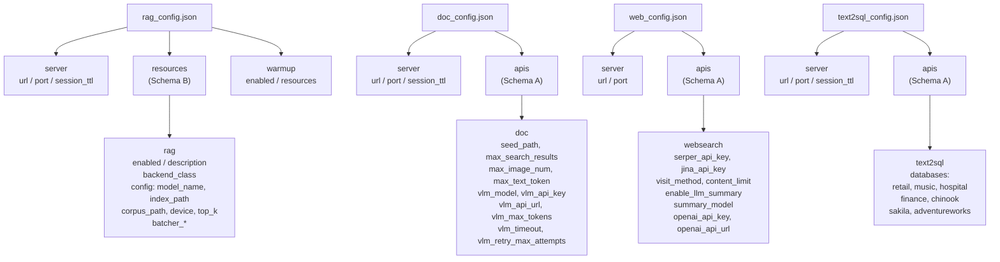
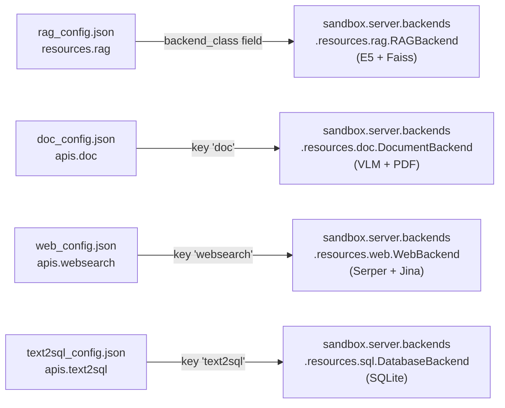

<!-- source: DeepWiki mcp.deepwiki.com · repo OpenDCAI/AgentFlow · page 8.1 Sandbox Server Config Schema · fetched 2026-11-02 -->

# Sandbox Server Config Schema

<details>
<summary>Relevant source files</summary>

The following files were used as context for generating this wiki page:

- [configs/sandbox-server/doc_config.json](configs/sandbox-server/doc_config.json)
- [configs/sandbox-server/rag_config.json](configs/sandbox-server/rag_config.json)
- [configs/sandbox-server/text2sql_config.json](configs/sandbox-server/text2sql_config.json)
- [configs/sandbox-server/web_config.json](configs/sandbox-server/web_config.json)

</details>


This page is a reference for all parameters in the `configs/sandbox-server/*.json` configuration files. These files control the sandbox server process: its network binding, backend resource initialization, and modality-specific API options.

This page covers **only the configuration file schema**. For a conceptual explanation of the sandbox server and how it fits into the pipeline, see [Server Configuration](#3.1). For documentation of the backend resource classes themselves, see [Backend Resources](#3.2). For environment variable definitions, see [Environment Variables](#8.5).

---

## File Layout

Each agent modality has its own config file under `configs/sandbox-server/`:

| File | Modality | Top-level blocks present |
|---|---|---|
| `configs/sandbox-server/rag_config.json` | RAG | `server`, `resources`, `warmup` |
| `configs/sandbox-server/doc_config.json` | Document (MM-Doc) | `server`, `apis` |
| `configs/sandbox-server/web_config.json` | Web (Deep Research) | `server`, `apis` |
| `configs/sandbox-server/text2sql_config.json` | Text2SQL | `server`, `apis` |
| `configs/sandbox-server/vm_config.json` | GUI | `server`, `apis` |
| `configs/sandbox-server/ds_config.json` | Data Science | `server`, `apis` |

The server is launched with one config at a time:

```
./sandbox-server.sh --config configs/sandbox-server/rag_config.json
```

The config file controls which backend is loaded, so different modalities require separate server processes.

Sources: [configs/sandbox-server/rag_config.json:1-35](), [configs/sandbox-server/doc_config.json:1-23](), [configs/sandbox-server/web_config.json:1-18](), [configs/sandbox-server/text2sql_config.json:1-22]()

---

## Top-Level Schema

Every config file follows one of two structural patterns depending on the backend architecture:

**Schema A — `apis`-style** (doc, web, text2sql, vm, ds):

```json
{
  "server": { ... },
  "apis": {
    "<backend_key>": { ... }
  }
}
```

**Schema B — `resources`-style** (rag):

```json
{
  "server": { ... },
  "resources": {
    "<resource_key>": {
      "enabled": true,
      "backend_class": "...",
      "config": { ... }
    }
  },
  "warmup": { ... }
}
```

The `resources` schema is more explicit: it names the backend class directly and declares whether the resource is active. The `apis` schema implicitly binds the backend by the key name.

Sources: [configs/sandbox-server/rag_config.json:1-35](), [configs/sandbox-server/doc_config.json:1-23]()

---

## `server` Block

Present in every config file. Controls how the FastAPI server binds and manages sessions.

| Parameter | Type | Required | Default | Description |
|---|---|---|---|---|
| `url` | string | yes | — | Full base URL the server announces (used by clients to call back). Typically `http://127.0.0.1:18890`. |
| `port` | integer | yes | — | Port the HTTP server listens on. Standard value is `18890`. |
| `session_ttl` | integer | no | backend-defined | Time-to-live in seconds for idle sessions. Omit to use backend default. |

`session_ttl` is relevant for stateful backends (RAG, doc, SQL) that hold per-session state between calls. Web has no session_ttl because it is stateless.

**Examples from configs:**

| Config | `port` | `session_ttl` |
|---|---|---|
| `rag_config.json` | 18890 | 600 |
| `doc_config.json` | 18890 | 300 |
| `web_config.json` | 18890 | *(absent)* |
| `text2sql_config.json` | 18890 | 600 |

Sources: [configs/sandbox-server/rag_config.json:2-6](), [configs/sandbox-server/doc_config.json:2-6](), [configs/sandbox-server/web_config.json:2-5](), [configs/sandbox-server/text2sql_config.json:3-7]()

---

## `resources` Block (RAG only)

Used by `rag_config.json`. Each key under `resources` defines one backend resource.

### Structure

```
resources
└── <resource_name>          # e.g. "rag"
    ├── enabled              # bool
    ├── description          # string (informational)
    ├── backend_class        # fully-qualified Python class path
    └── config               # dict passed directly to the backend constructor
```

### `rag` resource parameters

| Parameter | Type | Required | Description |
|---|---|---|---|
| `enabled` | bool | yes | Whether to load this resource at startup. |
| `description` | string | no | Human-readable label. |
| `backend_class` | string | yes | Dotted import path of the Python class. For RAG: `sandbox.server.backends.resources.rag.RAGBackend`. |
| `config.model_name` | string | yes | Path to the sentence-transformer / E5 embedding model. Supply via `${RAG_EMBEDDING_MODEL_PATH}`. |
| `config.index_path` | string | yes | Path to the Faiss index file. Supply via `${RAG_INDEX_PATH}`. |
| `config.corpus_path` | string | yes | Path to the text corpus file. Supply via `${RAG_CORPUS_PATH}`. |
| `config.device` | string | yes | Device string for encoder and index. Format: `"cuda:0"` (both on same device), `"cuda:0/cuda:1"` (split encoder/index), `"cpu"`. |
| `config.default_top_k` | integer | no | Default number of retrieved passages per query. |
| `config.batcher_trigger_batch_size` | integer | no | Batching queue threshold to trigger an encode call. |
| `config.batcher_max_batch_size` | integer | no | Maximum queries fused into one encode call. |
| `config.batcher_max_wait_time` | float | no | Maximum seconds to wait before flushing an incomplete batch. |

Sources: [configs/sandbox-server/rag_config.json:7-34]()

---

## `warmup` Block (RAG only)

Controls whether backends are pre-warmed at server startup before accepting requests.

| Parameter | Type | Description |
|---|---|---|
| `enabled` | bool | If `true`, listed resources are initialized and queried with a dummy request before the server begins serving. |
| `resources` | string[] | Names of resources to warm up. Must match keys in the `resources` block. |

```json
"warmup": {
  "enabled": true,
  "resources": ["rag"]
}
```

Sources: [configs/sandbox-server/rag_config.json:31-34]()

---

## `apis` Block

Used by all modalities except RAG. Each key under `apis` maps to a backend type. The supported keys are:

| Key | Config file | Backend |
|---|---|---|
| `doc` | `doc_config.json` | `DocumentBackend` |
| `websearch` | `web_config.json` | `WebBackend` |
| `text2sql` | `text2sql_config.json` | `DatabaseBackend` |
| `vm` | `vm_config.json` | `VMBackend` |
| `ds` | `ds_config.json` | `DSBackend` |

### `doc` backend parameters

| Parameter | Type | Required | Default | Description |
|---|---|---|---|---|
| `seed_path` | string | yes | — | Path to the root directory of the document corpus used for seeding. |
| `max_search_results` | integer | no | 10 | Maximum number of search results returned by `doc-search`. |
| `max_image_num` | integer | no | 10 | Maximum number of page images passed to the VLM per `doc-read` call. |
| `max_text_token` | integer | no | 20000 | Maximum number of text tokens extracted from a document. |
| `vlm_model` | string | yes | — | Model identifier for the VLM used to interpret document pages (e.g. `openai/gpt-4o-mini`). |
| `vlm_api_key` | string | yes | — | API key for the VLM. Supply via `${VLM_API_KEY}`. |
| `vlm_api_url` | string | yes | — | Base URL of the VLM API endpoint. |
| `vlm_max_tokens` | integer | no | 16384 | Maximum tokens in a single VLM response. |
| `vlm_timeout` | integer | no | 300 | Timeout in seconds for VLM API calls. |
| `vlm_retry_max_attempts` | integer | no | 10 | Number of retry attempts on VLM API failure. |

Sources: [configs/sandbox-server/doc_config.json:8-22]()

### `websearch` backend parameters

| Parameter | Type | Required | Default | Description |
|---|---|---|---|---|
| `serper_api_key` | string | yes | — | API key for Serper (Google Search). Supply via `${SERPER_API_KEY}`. |
| `jina_api_key` | string | yes | — | API key for Jina Reader (URL-to-text). Supply via `${JINA_API_KEY}`. |
| `visit_method` | string | no | `"jina"` | Method used to fetch and parse web pages. Only `"jina"` is currently supported. |
| `content_limit` | integer | no | 50000 | Maximum character length of the returned page content. |
| `enable_llm_summary` | bool | no | `true` | Whether to use an LLM to summarize retrieved pages. |
| `summary_model` | string | no | — | Model identifier for the summarization LLM. Only used when `enable_llm_summary` is `true`. |
| `openai_api_key` | string | conditional | — | API key for the summarization LLM. Required when `enable_llm_summary` is `true`. Supply via `${OPENROUTER_API_KEY}`. |
| `openai_api_url` | string | conditional | — | Base URL for the summarization LLM API. |

Sources: [configs/sandbox-server/web_config.json:7-16]()

### `text2sql` backend parameters

| Parameter | Type | Required | Description |
|---|---|---|---|
| `databases` | object | yes | A map of database names to their SQLite file paths. Keys are used as the logical database name in tool calls. Values are absolute file paths, typically supplied via environment variables. |

The `databases` map supports up to seven named databases. Each value uses the `${VAR:-}` env-var syntax so the key is present but empty when the variable is not set (preventing errors for unused databases).

```json
"databases": {
  "retail":         "${TEXT2SQL_RETAIL_DB_PATH:-}",
  "music":          "${TEXT2SQL_MUSIC_DB_PATH:-}",
  "hospital":       "${TEXT2SQL_HOSPITAL_DB_PATH:-}",
  "finance":        "${TEXT2SQL_FINANCE_DB_PATH:-}",
  "chinook":        "${TEXT2SQL_CHINOOK_DB_PATH:-}",
  "sakila":         "${TEXT2SQL_SAKILA_DB_PATH:-}",
  "adventureworks": "${TEXT2SQL_ADVENTUREWORKS_DB_PATH:-}"
}
```

Adding a new database requires adding a new key-value pair here and setting the corresponding environment variable.

Sources: [configs/sandbox-server/text2sql_config.json:9-20]()

---

## Environment Variable Substitution

Config values can reference environment variables using two syntaxes:

| Syntax | Behavior |
|---|---|
| `"${VAR_NAME}"` | Replaced with the value of `VAR_NAME`. Error if unset. |
| `"${VAR_NAME:-}"` | Replaced with the value of `VAR_NAME`, or empty string if unset. |
| `"${VAR_NAME:-default}"` | Replaced with the value of `VAR_NAME`, or `default` if unset. |

This substitution is applied at server startup before the config is parsed by backend constructors. Sensitive values (API keys, model paths) are **never** hardcoded in the config files—only env-var references appear.

Sources: [configs/sandbox-server/rag_config.json:19-22](), [configs/sandbox-server/text2sql_config.json:12-19](), [configs/sandbox-server/web_config.json:8-9](), [configs/sandbox-server/doc_config.json:16-17]()

---

## Schema Overview Diagram

**Diagram: Config File Schema by Block**



Sources: [configs/sandbox-server/rag_config.json:1-35](), [configs/sandbox-server/doc_config.json:1-23](), [configs/sandbox-server/web_config.json:1-18](), [configs/sandbox-server/text2sql_config.json:1-22]()

---

## Backend Class Mapping Diagram

**Diagram: Config Keys to Backend Python Classes**



Sources: [configs/sandbox-server/rag_config.json:11](), [configs/sandbox-server/doc_config.json:8](), [configs/sandbox-server/web_config.json:7](), [configs/sandbox-server/text2sql_config.json:9]()

---

## Common Configuration Mistakes

| Mistake | Symptom | Fix |
|---|---|---|
| Unset env var with `${VAR}` syntax (no `:-`) | Server startup error | Either set the variable or use `${VAR:-}` to allow empty |
| `session_ttl` missing for stateful backend | Sessions never expire, memory leak | Add `session_ttl` to `server` block |
| `visit_method` set to anything other than `"jina"` | Web tool errors | Use `"jina"` |
| Database path left empty via `:-` default | `sql:execute` returns "database not found" | Set the corresponding `TEXT2SQL_*_DB_PATH` env var |
| `device` specifying a CUDA device that doesn't exist | `RAGBackend` constructor crashes | Check `nvidia-smi` and update device string |

---

## Related Pages

- [Server Configuration](#3.1) — Conceptual overview of the sandbox server and how to launch it
- [Backend Resources](#3.2) — Documentation of what each backend does and how it executes tools
- [Tool Schemas Reference](#3.3) — Parameters and behavior of each tool exposed by the server
- [Session Management](#3.4) — How sessions are created and scoped per request
- [Environment Variables](#8.5) — Complete list of environment variables referenced in these configs

---

