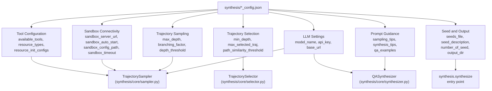
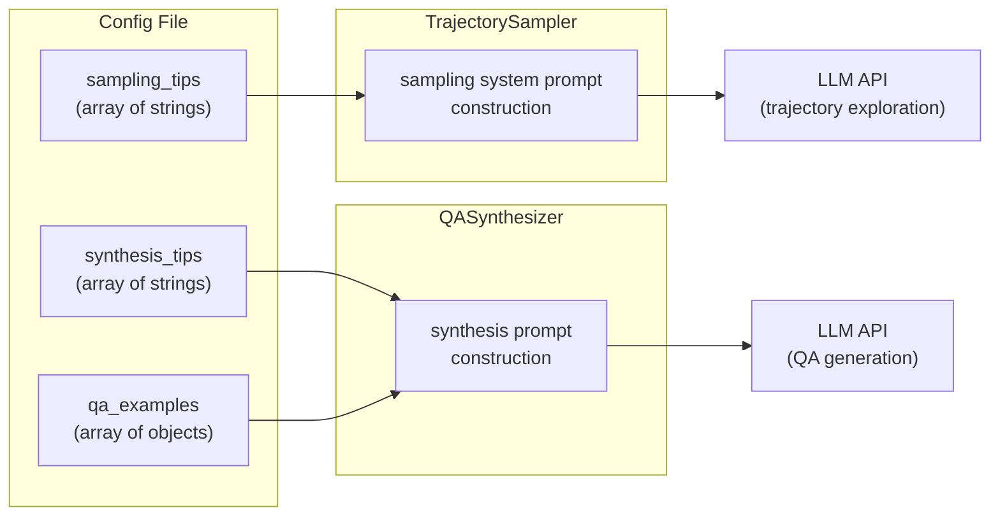
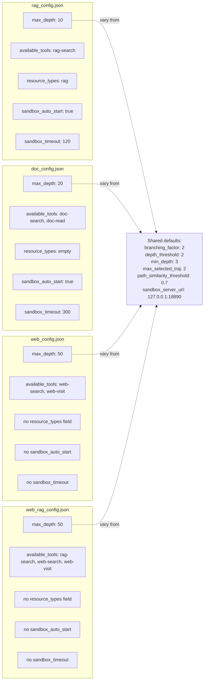

<!-- source: DeepWiki mcp.deepwiki.com · repo OpenDCAI/AgentFlow · page 8.2 Synthesis Config Schema · fetched 2026-11-02 -->

# Synthesis Config Schema

<details>
<summary>Relevant source files</summary>

The following files were used as context for generating this wiki page:

- [configs/synthesis/doc_config.json](configs/synthesis/doc_config.json)
- [configs/synthesis/rag_config.json](configs/synthesis/rag_config.json)
- [configs/synthesis/web_config.json](configs/synthesis/web_config.json)
- [configs/synthesis/web_rag_config.json](configs/synthesis/web_rag_config.json)

</details>


This page is a complete reference for the `configs/synthesis/*.json` configuration files. These files control the behavior of the three-stage data synthesis pipeline, covering LLM settings, trajectory exploration parameters, sandbox connectivity, tool availability, and QA generation guidance.

For a conceptual explanation of how these parameters interact during synthesis, see the [Data Synthesis Pipeline](#4) section, particularly [Synthesis Configuration](#4.1). For the configuration files used in trajectory-only rollout runs, see [Trajectory Config Schema](#8.3). For sandbox server configuration, see [Sandbox Server Config Schema](#8.1).

---

## Config File Locations

Each agent type has a dedicated synthesis config file under `configs/synthesis/`:

| File | Agent Type | Key Tools |
|---|---|---|
| `configs/synthesis/rag_config.json` | RAG Agent | `rag-search` |
| `configs/synthesis/doc_config.json` | Document Agent | `doc-search`, `doc-read` |
| `configs/synthesis/web_config.json` | Web Agent | `web-search`, `web-visit` |
| `configs/synthesis/web_rag_config.json` | Hybrid Web+RAG | `rag-search`, `web-search`, `web-visit` |

All files are consumed by `synthesis.synthesize` ([Diagram 2 in Architecture Overview](#1)).

---

## Parameter Groups Overview

**Diagram: Synthesis Config Parameter Groups and Their Consumers**



Sources: [configs/synthesis/rag_config.json:1-60](), [configs/synthesis/doc_config.json:1-73](), [configs/synthesis/web_config.json:1-44](), [configs/synthesis/web_rag_config.json:1-51]()

---

## Full Parameter Reference

### LLM Model Settings

These parameters configure the language model used for trajectory exploration and QA generation.

| Parameter | Type | Required | Example | Description |
|---|---|---|---|---|
| `model_name` | string | Yes | `"openai/gpt-oss-120b"` | Model identifier passed to the LLM API. Accepts OpenRouter or OpenAI model strings. |
| `api_key` | string | Yes | `"${OPENROUTER_API_KEY}"` | API key. Supports `${ENV_VAR}` substitution. |
| `base_url` | string | Yes | `"https://openrouter.ai/api/v1"` | Base URL for the LLM API endpoint. |

The `${...}` syntax triggers environment variable substitution at config load time. See [Environment Variables](#8.5) for the full list of recognized variables.

Sources: [configs/synthesis/rag_config.json:3-5](), [configs/synthesis/doc_config.json:2-4]()

---

### Trajectory Sampling Parameters

These parameters govern how the `TrajectorySampler` builds the trajectory tree from each seed.

| Parameter | Type | Required | Default | Description |
|---|---|---|---|---|
| `max_depth` | integer | Yes | — | Maximum number of tool-call steps in a single trajectory path. Larger values allow deeper reasoning chains but increase cost. |
| `branching_factor` | integer | Yes | — | Number of parallel branches explored at each step of the trajectory tree. |
| `depth_threshold` | integer | Yes | — | Minimum depth a trajectory branch must reach before it is eligible for selection. Branches shorter than this are pruned. |

**Typical values by agent type:**

| Config | `max_depth` | `branching_factor` | `depth_threshold` |
|---|---|---|---|
| `rag_config.json` | 10 | 2 | 2 |
| `doc_config.json` | 20 | 2 | 2 |
| `web_config.json` | 50 | 2 | 2 |
| `web_rag_config.json` | 50 | 2 | 2 |

Web agents use a higher `max_depth` (50) because multi-hop web research chains are naturally longer than local retrieval tasks.

Sources: [configs/synthesis/rag_config.json:7-9](), [configs/synthesis/doc_config.json:6-8](), [configs/synthesis/web_config.json:6-8]()

---

### Trajectory Selection Parameters

After sampling, these parameters control which trajectories are kept by the `TrajectorySelector`.

| Parameter | Type | Required | Description |
|---|---|---|---|
| `min_depth` | integer | Yes | Trajectories with fewer steps than this value are discarded before QA synthesis. |
| `max_selected_traj` | integer | Yes | Maximum number of trajectories selected per seed. Limits how many QA pairs are generated from one seed. |
| `path_similarity_threshold` | float | Yes | Jaccard or cosine similarity threshold (0–1) above which two trajectory paths are considered duplicates. The lower-scored duplicate is dropped. |

All four example configs use `min_depth: 3`, `max_selected_traj: 2`, and `path_similarity_threshold: 0.7`.

Sources: [configs/synthesis/rag_config.json:11-13](), [configs/synthesis/doc_config.json:10-12]()

---

### Sandbox Connectivity Settings

These parameters control how the synthesis pipeline connects to and optionally starts the sandbox server.

| Parameter | Type | Required | Description |
|---|---|---|---|
| `sandbox_server_url` | string | Yes | HTTP URL of the running sandbox server. Default is `"http://127.0.0.1:18890"`. |
| `sandbox_auto_start` | boolean | No | If `true`, the pipeline attempts to start the sandbox server automatically using `sandbox_config_path`. If `false` or absent, the server must already be running. |
| `sandbox_config_path` | string | Conditional | Path to the sandbox server config file used when `sandbox_auto_start` is `true`. Example: `"configs/sandbox-server/rag_config.json"`. |
| `sandbox_timeout` | integer | No | Per-tool-call timeout in seconds. Defaults vary by agent; `doc_config.json` uses 300 due to VLM latency. |

`web_config.json` and `web_rag_config.json` omit `sandbox_auto_start` and `sandbox_config_path`, meaning the sandbox server must be started manually for those agents.

Sources: [configs/synthesis/rag_config.json:26-29](), [configs/synthesis/doc_config.json:19-22](), [configs/synthesis/web_config.json:13-14]()

---

### Tool and Resource Configuration

These parameters define which tools the agent can call and how backend resources are initialized within the sandbox.

| Parameter | Type | Required | Description |
|---|---|---|---|
| `available_tools` | array of strings | Yes | List of tool names the LLM agent is allowed to invoke. Names must match tool schemas registered in the sandbox. |
| `resource_types` | array of strings | No | List of resource type identifiers that should be initialized in the sandbox session (e.g., `["rag"]`). |
| `resource_init_configs` | object | No | Per-resource initialization parameters keyed by resource type name. Structure is resource-specific. |

**Tool lists by config:**

| Config | `available_tools` |
|---|---|
| `rag_config.json` | `["rag-search"]` |
| `doc_config.json` | `["doc-search", "doc-read"]` |
| `web_config.json` | `["web-search", "web-visit"]` |
| `web_rag_config.json` | `["rag-search", "web-search", "web-visit"]` |

**`resource_init_configs` example (RAG):**

The RAG config passes a `top_k` parameter to the `rag` resource:

```
"resource_types": ["rag"],
"resource_init_configs": {
  "rag": {
    "content": {
      "top_k": 10
    }
  }
}
```
[configs/synthesis/rag_config.json:17-24]()

The document config passes empty values because the sandbox server handles document backend initialization via its own config:

```
"resource_types": [],
"resource_init_configs": {}
```
[configs/synthesis/doc_config.json:16-17]()

For the full list of available tool names and their schemas, see [Tool Schemas Reference](#3.3).

Sources: [configs/synthesis/rag_config.json:17-31](), [configs/synthesis/doc_config.json:16-24](), [configs/synthesis/web_config.json:14]()

---

### Seed and Output Settings

| Parameter | Type | Required | Description |
|---|---|---|---|
| `seeds_file` | string | Yes | Path to the `seeds.jsonl` file providing the starting entities for trajectory exploration. Each line is a JSON object. |
| `seed_description` | string | No | Human-readable description of what each seed represents. Used as context in prompts. |
| `number_of_seed` | integer or null | No | Number of seeds to process. `null` means process all seeds in `seeds_file`. |
| `output_dir` | string | Yes | Directory where synthesized QA pairs and trajectory data are written. |

For the required format of `seeds.jsonl`, see [Seed Data Format](#4.2).

Sources: [configs/synthesis/rag_config.json:15-16](), [configs/synthesis/rag_config.json:33-34](), [configs/synthesis/rag_config.json:58-59]()

---

### Prompt Guidance Parameters

These parameters inject domain-specific instructions and examples into the LLM prompts used during sampling and synthesis. They directly influence the quality and character of the generated data.

| Parameter | Type | Description |
|---|---|---|
| `sampling_tips` | array of strings | Guidance injected into the trajectory-sampling prompt. Instructs the LLM on exploration strategy, tool usage patterns, and desired evidence types. |
| `synthesis_tips` | array of strings | Guidance injected into the QA-synthesis prompt. Constrains question complexity, answer format, and quality requirements. |
| `qa_examples` | array of objects | Few-shot examples of valid `{question, answer}` pairs. Shown to the QA synthesizer as formatting and quality anchors. |

**Diagram: Prompt Guidance Parameter Flow**



Sources: [configs/synthesis/rag_config.json:35-56](), [configs/synthesis/doc_config.json:28-69](), [configs/synthesis/web_config.json:16-39]()

**Typical `sampling_tips` themes by agent:**

| Agent | Key Instructions in `sampling_tips` |
|---|---|
| RAG | "Explore deeply", "Build dependency chains", "Capture hard metadata" |
| Doc | "Combine ≥2 pages", "Involve visual elements", "Chain across pages" |
| Web | "Use `web-visit` at least once", "Build dependency chains" |
| Web+RAG | "Use both RAG and web tools at least once", "Prefer web for fresh facts" |

**Typical `synthesis_tips` themes by agent:**

| Agent | Key Instructions in `synthesis_tips` |
|---|---|
| RAG | "Multi-hop ≥3 hops", "Answers are specific facts (names, dates)" |
| Doc | "Multi-page ≥2 pages", "Visual-grounded", "No page numbers in questions" |
| Web | "web-visit evidence is required to answer" |
| Web+RAG | "Require both RAG and web evidence" |

Sources: [configs/synthesis/rag_config.json:35-48](), [configs/synthesis/doc_config.json:28-53](), [configs/synthesis/web_config.json:16-32](), [configs/synthesis/web_rag_config.json:21-40]()

---

## Config Comparison Across Agent Types

The following diagram maps each agent config file to the parameters that differ meaningfully between them.

**Diagram: Parameter Differences Across Synthesis Config Files**



Sources: [configs/synthesis/rag_config.json:1-60](), [configs/synthesis/doc_config.json:1-73](), [configs/synthesis/web_config.json:1-44](), [configs/synthesis/web_rag_config.json:1-51]()

---

## Complete Parameter Summary Table

| Parameter | Type | Present In | Notes |
|---|---|---|---|
| `model_name` | string | all | OpenRouter/OpenAI model identifier |
| `api_key` | string | all | Supports `${ENV_VAR}` substitution |
| `base_url` | string | all | LLM API endpoint base URL |
| `max_depth` | integer | all | 10 (RAG), 20 (Doc), 50 (Web) |
| `branching_factor` | integer | all | Always 2 in provided configs |
| `depth_threshold` | integer | all | Always 2 in provided configs |
| `min_depth` | integer | all | Always 3 in provided configs |
| `max_selected_traj` | integer | all | Always 2 in provided configs |
| `path_similarity_threshold` | float | all | Always 0.7 in provided configs |
| `number_of_seed` | integer \| null | rag, doc | `null` = use all seeds |
| `resource_types` | array | rag, doc | Empty array if no init needed |
| `resource_init_configs` | object | rag, doc | Per-resource backend parameters |
| `sandbox_server_url` | string | all | Default `http://127.0.0.1:18890` |
| `sandbox_auto_start` | boolean | rag, doc | Absent in web configs |
| `sandbox_config_path` | string | rag, doc | Used when `sandbox_auto_start` is true |
| `sandbox_timeout` | integer | rag, doc | Seconds; doc uses 300 for VLM latency |
| `available_tools` | array | all | Must match registered sandbox tools |
| `seed_description` | string | all | Injected as context in prompts |
| `seeds_file` | string | all | Path to `seeds.jsonl` |
| `output_dir` | string | all | Destination for synthesized output |
| `sampling_tips` | array | all | Injected into exploration prompt |
| `synthesis_tips` | array | all | Injected into QA generation prompt |
| `qa_examples` | array | all | Few-shot `{question, answer}` pairs |

---

## Related Pages

- [Synthesis Configuration (usage guide)](#4.1) — how to tune these parameters for your use case
- [Seed Data Format](#4.2) — required structure of the `seeds.jsonl` file referenced by `seeds_file`
- [Trajectory Config Schema](#8.3) — `configs/trajectory/*.json`, which reuse many of the same fields
- [Inference Config Schema](#8.4) — `configs/infer/*.json`, which extend the base schema with evaluation settings
- [Sandbox Server Config Schema](#8.1) — the `sandbox_config_path` target files
- [Environment Variables](#8.5) — all `${VAR_NAME}` substitutions used in config files

---

