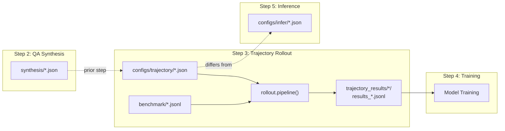
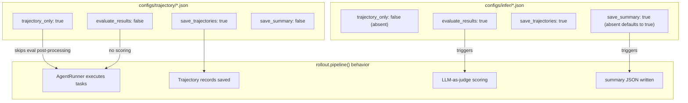
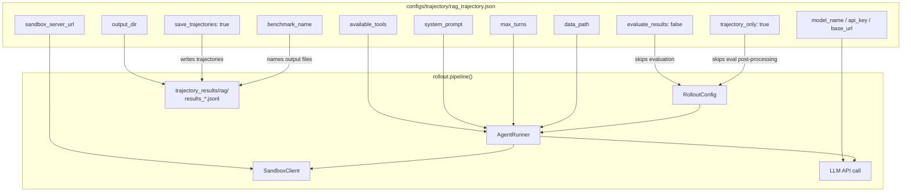

<!-- source: DeepWiki mcp.deepwiki.com · repo OpenDCAI/AgentFlow · page 8.3 Trajectory Config Schema · fetched 2026-11-02 -->

# Trajectory Config Schema

<details>
<summary>Relevant source files</summary>

The following files were used as context for generating this wiki page:

- [configs/infer/doc_infer.json](configs/infer/doc_infer.json)
- [configs/infer/rag_infer.json](configs/infer/rag_infer.json)
- [configs/synthesis/text2sql_config.json](configs/synthesis/text2sql_config.json)
- [configs/trajectory/doc_trajectory.json](configs/trajectory/doc_trajectory.json)
- [configs/trajectory/rag_trajectory.json](configs/trajectory/rag_trajectory.json)
- [examples/RAGAgent.md](examples/RAGAgent.md)
- [seeds/rag/seeds.jsonl](seeds/rag/seeds.jsonl)

</details>


Trajectory configs are JSON files stored under `configs/trajectory/` that control how the rollout pipeline generates agent trajectories from benchmark data. These configs are passed to `rollout.pipeline` and configure a trajectory-only run: the agent executes against benchmark questions and the resulting tool-call traces are saved as training data, but no accuracy evaluation is performed.

This page is specifically about `configs/trajectory/*.json`. For evaluation runs (which score model outputs), see the Inference Config Schema at [8.4](#8.4). For the synthesis pipeline configs (which drive trajectory tree sampling from seeds), see the Synthesis Config Schema at [8.2](#8.2). For how the rollout pipeline itself works, see [5.1](#5.1).

---

## Role in the Pipeline

The trajectory config is the input to Step 3 of the AgentFlow workflow — running a capable teacher model (e.g., `gpt-4.1`) against benchmark questions to produce labeled trajectories that will be used as training data.

**Diagram: Trajectory Config in the End-to-End Workflow**



Sources: [configs/trajectory/rag_trajectory.json:1-39](), [configs/trajectory/doc_trajectory.json:1-28](), [examples/RAGAgent.md:287-342]()

---

## Config Files

Two trajectory configs ship with the repository:

| File | Agent Type | Tools |
|------|-----------|-------|
| `configs/trajectory/rag_trajectory.json` | RAG | `rag_search` |
| `configs/trajectory/doc_trajectory.json` | Document | `doc_search`, `doc_read` |

Additional trajectory configs for other agent types follow the same schema and can be created by copying an existing file.

Sources: [configs/trajectory/rag_trajectory.json:1-39](), [configs/trajectory/doc_trajectory.json:1-28]()

---

## Full Parameter Reference

The trajectory config is consumed by `rollout.pipeline` and maps to the `RolloutConfig` object internally.

| Parameter | Type | Required | Default | Description |
|-----------|------|----------|---------|-------------|
| `benchmark_name` | `string` | Yes | — | Identifies the run; appears in output filenames |
| `model_name` | `string` | Yes | — | LLM model identifier (OpenAI-compatible) |
| `api_key` | `string` | Yes | — | API key; supports `${ENV_VAR}` substitution |
| `base_url` | `string` | Yes | — | API base URL (e.g., OpenRouter or local vLLM endpoint) |
| `max_turns` | `integer` | No | `100` | Maximum conversation turns per task before stopping |
| `available_tools` | `array[string]` | Yes | — | Tool names the agent may call; must match sandbox-registered tools |
| `system_prompt` | `array[string]` or `string` | No | Built-in default | System prompt lines; array elements are joined with newlines |
| `evaluate_results` | `boolean` | No | `true` | **Must be `false` for trajectory configs** — disables QA scoring |
| `evaluation_metric` | `string` | No | `"exact_match"` | Metric to use if `evaluate_results` were enabled; present for reference |
| `sandbox_server_url` | `string` | No | `"http://127.0.0.1:18890"` | URL of the running sandbox server |
| `sandbox_timeout` | `integer` | No | `120` | Seconds to wait for sandbox tool responses |
| `data_path` | `string` | Yes | — | Path to benchmark JSONL file; each line must have `id`, `question`, `answer` fields |
| `output_dir` | `string` | Yes | — | Directory where trajectory result files are written |
| `save_results` | `boolean` | No | `true` | Persist per-task result records to disk |
| `save_trajectories` | `boolean` | No | `true` | **Should be `true`** — saves full message histories as training trajectories |
| `trajectory_only` | `boolean` | No | `false` | **Must be `true` for trajectory configs** — suppresses evaluation post-processing |
| `save_summary` | `boolean` | No | `true` | Writes a run summary JSON; set to `false` since there are no metrics to summarize |
| `parallel` | `boolean` | No | `false` | Enables parallel task execution across workers |
| `max_retries` | `integer` | No | `3` | Number of retries on LLM call failures |
| `max_workers` | `integer` | No | `1` | Number of parallel workers when `parallel` is `true` |
| `_comment` | `string` | No | — | Human-readable annotation; ignored at runtime |

Sources: [configs/trajectory/rag_trajectory.json:1-39](), [configs/trajectory/doc_trajectory.json:1-28](), [examples/RAGAgent.md:431-449]()

---

## Distinguishing Fields: Trajectory vs. Inference

Three boolean flags define the behavioral difference between a trajectory config and an inference config. Getting these wrong causes the pipeline to either skip saving trajectories or attempt evaluation that will fail.

**Diagram: Flag Comparison Between Config Types**



Sources: [configs/trajectory/rag_trajectory.json:26-38](), [configs/trajectory/doc_trajectory.json:19-27](), [configs/infer/rag_infer.json:28-45](), [configs/infer/doc_infer.json:21-28]()

---

## `available_tools` and Sandbox Alignment

The `available_tools` array must list tool names that are registered in the running sandbox server. The sandbox server normalizes minor name variants (e.g., `rag_search`, `rag-search`, and `rag:search` all resolve to the same backend), but it is safest to use the canonical underscore form.

The agent can only call tools listed here; tools available on the server but absent from this array are invisible to the LLM.

| Agent Type | `available_tools` value | Sandbox backend config |
|------------|------------------------|----------------------|
| RAG | `["rag_search"]` | `configs/sandbox-server/rag_config.json` |
| Document | `["doc_search", "doc_read"]` | `configs/sandbox-server/doc_config.json` |

Sources: [configs/trajectory/rag_trajectory.json:11-11](), [configs/trajectory/doc_trajectory.json:10-10](), [examples/RAGAgent.md:453-458]()

---

## `system_prompt` Format

`system_prompt` may be a single string or an array of strings. When an array is provided, elements are joined with newlines before being sent to the LLM as the system message. This allows multiline prompts to be written readably in JSON.

Example from `rag_trajectory.json`:

[configs/trajectory/rag_trajectory.json:13-24]()

The system prompt in a trajectory config should describe the agent's role and available tools. It does not need to instruct the agent to produce structured evaluation output since `evaluate_results: false`.

---

## `data_path`: Benchmark Input Format

The file at `data_path` must be a JSONL file where each line is a JSON object. The required fields are:

| Field | Type | Description |
|-------|------|-------------|
| `id` | `string` | Unique task identifier |
| `question` | `string` | The question posed to the agent |
| `answer` | `string` | Ground-truth answer (used only if evaluation is later enabled) |

Example:
```jsonl
{"id": "task_001", "question": "What is the capital of France?", "answer": "Paris"}
{"id": "task_002", "question": "Who wrote Romeo and Juliet?", "answer": "William Shakespeare"}
```

Sources: [examples/RAGAgent.md:327-332]()

---

## Output Files

With the default settings (`save_results: true`, `save_trajectories: true`, `save_summary: false`), the pipeline writes one file per run to `output_dir`:

| File Pattern | Description |
|-------------|-------------|
| `results_{benchmark_name}_{timestamp}.jsonl` | One record per task: input, model output, tool call trace |

When `save_summary: false` (as is typical for trajectory configs), no summary JSON is written because there are no aggregate metrics to report.

Sources: [examples/RAGAgent.md:336-342](), [configs/trajectory/rag_trajectory.json:33-38]()

---

## Annotated Example: `rag_trajectory.json`

[configs/trajectory/rag_trajectory.json:1-39]()

```json
{
  "_comment": "RAG Inference Configuration - Rollout mode without evaluation",

  "benchmark_name": "rag_trajectory",        // used in output filenames
  "model_name": "gpt-4.1-2025-04-14",        // teacher model for trajectory generation
  "api_key": "${OPENROUTER_API_KEY}",         // environment variable substitution
  "base_url": "https://openrouter.ai/api/v1",

  "max_turns": 50,

  "available_tools": ["rag_search"],

  "system_prompt": [ ... ],                  // array joined with newlines

  "evaluate_results": false,                 // no LLM-as-judge scoring
  "evaluation_metric": "f1_score",           // retained for reference only

  "sandbox_server_url": "http://127.0.0.1:18890",

  "data_path": "benchmark/rag_benchmark.jsonl",
  "output_dir": "trajectory_results/rag",

  "save_results": true,
  "save_trajectories": true,
  "trajectory_only": true,                   // key flag: skips eval post-processing
  "save_summary": false,                     // no metrics → no summary file
  "parallel": false
}
```

Sources: [configs/trajectory/rag_trajectory.json:1-39]()

---

## Annotated Example: `doc_trajectory.json`

[configs/trajectory/doc_trajectory.json:1-28]()

Notable differences from the RAG config:

- `max_turns: 40` — document tasks use fewer turns
- `available_tools: ["doc_search", "doc_read"]` — two tools instead of one
- `sandbox_server_url` is explicitly set (no default assumed)
- `evaluation_metric` is omitted entirely (not required when `evaluate_results: false`)
- `parallel` field is absent (defaults to `false`)

Sources: [configs/trajectory/doc_trajectory.json:1-28]()

---

## Config Relationship Diagram

**Diagram: `RolloutConfig` fields mapped to config files and pipeline components**



Sources: [configs/trajectory/rag_trajectory.json:1-39](), [examples/RAGAgent.md:292-342]()

---

