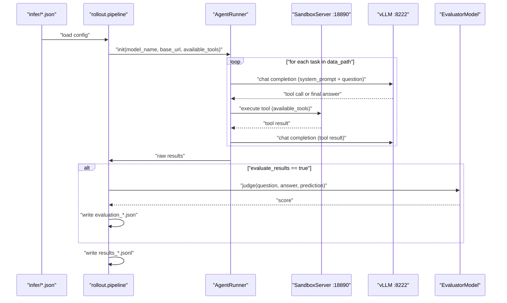
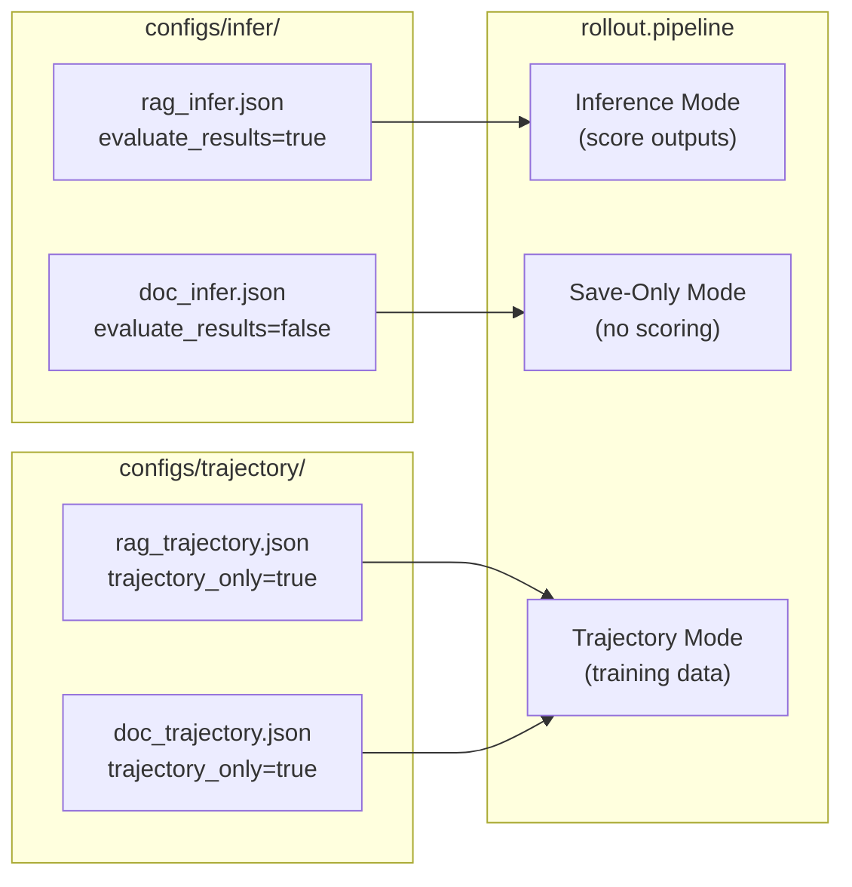

<!-- source: DeepWiki mcp.deepwiki.com · repo OpenDCAI/AgentFlow · page 8.4 Inference Config Schema · fetched 2026-11-02 -->

# Inference Config Schema

<details>
<summary>Relevant source files</summary>

The following files were used as context for generating this wiki page:

- [configs/infer/doc_infer.json](configs/infer/doc_infer.json)
- [configs/infer/rag_infer.json](configs/infer/rag_infer.json)
- [configs/synthesis/text2sql_config.json](configs/synthesis/text2sql_config.json)
- [configs/trajectory/doc_trajectory.json](configs/trajectory/doc_trajectory.json)
- [configs/trajectory/rag_trajectory.json](configs/trajectory/rag_trajectory.json)
- [examples/RAGAgent.md](examples/RAGAgent.md)
- [seeds/rag/seeds.jsonl](seeds/rag/seeds.jsonl)

</details>


Inference configs (`configs/infer/*.json`) control how `rollout.pipeline` runs a trained model against a benchmark dataset and optionally evaluates the results using a judge model. This page documents every field in these configuration files.

This page is scoped to the `configs/infer/` directory. For trajectory generation configs (which also use `rollout.pipeline` but in data-collection mode), see [Trajectory Config Schema](#8.3). For the underlying rollout pipeline that consumes these configs, see [Model Inference](#5.2) and [Evaluation System](#5.3).

---

## File Locations

| File | Agent Type |
|------|-----------|
| `configs/infer/rag_infer.json` | RAG Agent |
| `configs/infer/doc_infer.json` | Document Agent |

Both files are loaded by `rollout.pipeline` at runtime. The pipeline distinguishes inference mode from trajectory-only mode primarily by the `evaluate_results` flag and the absence of `trajectory_only: true`.

Sources: [configs/infer/rag_infer.json:1-46](), [configs/infer/doc_infer.json:1-29]()

---

## Config Structure Overview

**Diagram: Inference Config Field Groups**

```mermaid
graph TD
    root["infer/*.json"]

    root --> model_group["Model Settings"]
    root --> exec_group["Execution Settings"]
    root --> eval_group["Evaluation Settings"]
    root --> sandbox_group["Sandbox Settings"]
    root --> io_group["I/O Settings"]

    model_group --> mn["model_name"]
    model_group --> ak["api_key"]
    model_group --> bu["base_url"]

    exec_group --> mt["max_turns"]
    exec_group --> mr["max_retries"]
    exec_group --> mw["max_workers"]
    exec_group --> at["available_tools"]
    exec_group --> sp["system_prompt"]
    exec_group --> par["parallel"]

    eval_group --> er["evaluate_results"]
    eval_group --> em["evaluation_metric"]
    eval_group --> emn["evaluator_model_name"]
    eval_group --> eak["evaluator_api_key"]
    eval_group --> ebu["evaluator_base_url"]
    eval_group --> et["evaluator_temperature"]
    eval_group --> emr["evaluator_max_retries"]
    eval_group --> eep["evaluator_extra_params"]

    sandbox_group --> ssu["sandbox_server_url"]
    sandbox_group --> sto["sandbox_timeout"]

    io_group --> bn["benchmark_name"]
    io_group --> dp["data_path"]
    io_group --> od["output_dir"]
    io_group --> sv["save_results"]
    io_group --> st["save_trajectories"]
```



Sources: [configs/infer/rag_infer.json:1-46](), [configs/infer/doc_infer.json:1-29]()

---

## Inference vs. Trajectory Config Comparison

Both inference and trajectory configs share the same `RolloutConfig` schema and are consumed by the same `rollout.pipeline` entry point. The key behavioral difference is controlled by two boolean flags.

| Flag | Inference Config | Trajectory Config |
|------|-----------------|-------------------|
| `evaluate_results` | `true` (typically) | `false` |
| `trajectory_only` | absent / `false` | `true` |
| `save_summary` | absent | `false` |
| Evaluator fields | present | absent |

When `evaluate_results: true`, the pipeline invokes the LLM-as-judge evaluation subsystem. When `trajectory_only: true`, the pipeline skips evaluation and writes only the raw trajectory data.

Sources: [configs/infer/rag_infer.json:28-29](), [configs/trajectory/rag_trajectory.json:26-37]()

---

## Complete Parameter Reference

### Model Settings

These fields identify the inference model endpoint.

| Parameter | Type | Example | Description |
|-----------|------|---------|-------------|
| `model_name` | `string` | `"YOUR_MODEL_NAME"` | Model identifier as expected by the serving endpoint. For vLLM deployments, this matches `--served-model-name`. |
| `api_key` | `string` | `""` | API key for the inference endpoint. Can be empty for local vLLM servers. |
| `base_url` | `string` | `"VLLM_URL"` | Base URL of the OpenAI-compatible API endpoint (e.g., `http://localhost:8222/v1`). |

Sources: [configs/infer/rag_infer.json:4-7](), [configs/infer/doc_infer.json:4-7]()

---

### Execution Settings

These fields control agent execution behavior during inference.

| Parameter | Type | Default | Description |
|-----------|------|---------|-------------|
| `benchmark_name` | `string` | required | Logical name for this run; appears in output filenames. |
| `max_turns` | `integer` | `100` | Maximum number of conversation turns (user + assistant + tool) per task. |
| `max_retries` | `integer` | `3` | Number of times to retry a failed LLM API call before marking the task as errored. |
| `max_workers` | `integer` | `1` | Number of parallel workers when `parallel: true`. Set to `1` for sequential execution. |
| `available_tools` | `array[string]` | `[]` | Tool names exposed to the agent. Must match tool names registered in the sandbox server. See [Tool Schemas Reference](#3.3). |
| `system_prompt` | `string` or `array[string]` | built-in | The system prompt sent to the model. Arrays are joined with newlines. |
| `parallel` | `boolean` | `false` | If `true`, tasks are processed concurrently using `max_workers` threads. |

Sources: [configs/infer/rag_infer.json:9-26](), [configs/infer/doc_infer.json:9-20]()

---

### Evaluation Settings

These fields are active only when `evaluate_results: true`. They configure the LLM-as-judge that scores inference outputs.

| Parameter | Type | Example | Description |
|-----------|------|---------|-------------|
| `evaluate_results` | `boolean` | `true` | Master switch for evaluation. When `false`, the pipeline saves outputs but does not score them. |
| `evaluation_metric` | `string` | `"f1_score"` | Scoring method. Supported values include `"f1_score"` and `"exact_match"`. See [Evaluation System](#5.3). |
| `evaluator_model_name` | `string` | `"openai/gpt-oss-120b"` | Model used as the judge. Can differ from the inference model. |
| `evaluator_api_key` | `string` | `"sk-..."` | API key for the evaluator model endpoint. |
| `evaluator_base_url` | `string` | `"YOUR_BASE_URL"` | Base URL for the evaluator model endpoint. |
| `evaluator_temperature` | `float` | `0.0` | Sampling temperature for the evaluator. `0.0` produces deterministic judgments. |
| `evaluator_max_retries` | `integer` | `3` | Max retries for evaluator API calls. |
| `evaluator_extra_params` | `object` | `{}` | Additional parameters forwarded verbatim to the evaluator API call. |

> **Note:** `doc_infer.json` sets `evaluate_results: false` even though it lives in `configs/infer/`. This causes the pipeline to run inference and save outputs without scoring, which is useful when evaluation is handled externally.

Sources: [configs/infer/rag_infer.json:28-36](), [configs/infer/doc_infer.json:21-21]()

---

### Sandbox Settings

| Parameter | Type | Example | Description |
|-----------|------|---------|-------------|
| `sandbox_server_url` | `string` | `"http://127.0.0.1:18890"` | URL of the running sandbox server that provides tool execution. See [Server Configuration](#3.1). |
| `sandbox_timeout` | `integer` | `120` | Per-call timeout in seconds for tool execution requests to the sandbox. |

Sources: [configs/infer/rag_infer.json:37-38]()

---

### I/O Settings

| Parameter | Type | Example | Description |
|-----------|------|---------|-------------|
| `data_path` | `string` | `"benchmark/rag_benchmark.jsonl"` | Path to the benchmark dataset. Each line is a JSON object with at minimum `id`, `question`, and `answer` fields. |
| `output_dir` | `string` | `"infer_results/rag"` | Directory where output files are written. Created if it does not exist. |
| `save_results` | `boolean` | `true` | If `true`, per-task inference outputs are written to a `.jsonl` results file. |
| `save_trajectories` | `boolean` | `true` | If `true`, the full tool-call conversation history for each task is saved. |

Sources: [configs/infer/rag_infer.json:40-45](), [configs/infer/doc_infer.json:23-28]()

---

## Annotated Examples

### RAG Inference Config

[configs/infer/rag_infer.json:1-46]()

```
{
  "_comment": "RAG Benchmark Configuration - For document QA tasks",

  "benchmark_name": "rag_infer",
  "model_name": "YOUR_MODEL_NAME",     // Replace with vLLM served-model-name
  "api_key": "",                        // Empty for local vLLM
  "base_url": "VLLM_URL",              // e.g. http://localhost:8222/v1

  "max_turns": 50,
  "max_retries": 3,
  "max_workers": 1,

  "available_tools": ["rag_search"],

  "system_prompt": [...],

  "evaluate_results": true,            // Triggers LLM-as-judge scoring
  "evaluation_metric": "f1_score",
  "evaluator_model_name": "openai/gpt-oss-120b",
  "evaluator_api_key": "sk-",
  "evaluator_base_url": "YOUR_BASE_URL",
  "evaluator_temperature": 0.0,
  "evaluator_max_retries": 3,
  "evaluator_extra_params": {},

  "sandbox_server_url": "http://127.0.0.1:18890",
  "sandbox_timeout": 120,

  "data_path": "benchmark/rag_benchmark.jsonl",
  "output_dir": "infer_results/rag",

  "save_results": true,
  "save_trajectories": true,
  "parallel": false
}
```

### Document Inference Config (Evaluation Disabled)

[configs/infer/doc_infer.json:1-29]()

```
{
  "_comment": "Doc Benchmark Configuration - For document QA tasks",

  "benchmark_name": "doc_infer",
  "model_name": "YOUR_MODEL_NAME",
  "api_key": "",
  "base_url": "VLLM_URL",

  "max_turns": 50,
  "max_retries": 3,
  "max_workers": 1,

  "available_tools": ["doc_search", "doc_read"],

  "system_prompt": [...],

  "evaluate_results": false,           // No scoring; outputs saved only

  "data_path": "benchmark/doc_benchmark/Input/doc_benchmark.jsonl",
  "output_dir": "infer_results/doc",

  "save_results": true,
  "save_trajectories": true,
  "parallel": false
}
```

Sources: [configs/infer/rag_infer.json:1-46](), [configs/infer/doc_infer.json:1-29]()

---

## Output Files

When the pipeline runs with an inference config, it writes files to `output_dir` with names derived from `benchmark_name`.

| File Pattern | Controlled By | Content |
|-------------|---------------|---------|
| `results_{benchmark_name}_{timestamp}.jsonl` | `save_results: true` | Per-task model outputs, tool calls, and final answers. |
| `evaluation_{benchmark_name}_{timestamp}.json` | `evaluate_results: true` | Judgment scores per task, including `average_score`. |
| `summary_{benchmark_name}_{timestamp}.json` | implicit | Aggregate run statistics. |

Sources: [examples/RAGAgent.md:399-406]()

---

## Runtime Data Flow

**Diagram: rollout.pipeline Execution with Inference Config**



Sources: [configs/infer/rag_infer.json:1-46](), [examples/RAGAgent.md:364-406]()

---

## Relationship to Other Config Types

**Diagram: Config Files and Their rollout.pipeline Modes**



Sources: [configs/infer/rag_infer.json:28-29](), [configs/infer/doc_infer.json:21-21](), [configs/trajectory/rag_trajectory.json:26-37](), [configs/trajectory/doc_trajectory.json:19-27]()

---

## Environment Variable Substitution

Inference configs support `${VAR_NAME}` syntax for sensitive values. Common substitutions used across inference configs:

| Placeholder | Environment Variable | Used In |
|------------|---------------------|---------|
| `${OPENROUTER_API_KEY}` | `OPENROUTER_API_KEY` | `api_key` (for reference / trajectory configs) |
| `VLLM_URL` | set manually | `base_url` for the deployed model |

For the full list of supported environment variables, see [Environment Variables](#8.5).

Sources: [configs/trajectory/rag_trajectory.json:6-7](), [examples/RAGAgent.md:374-396]()

---

