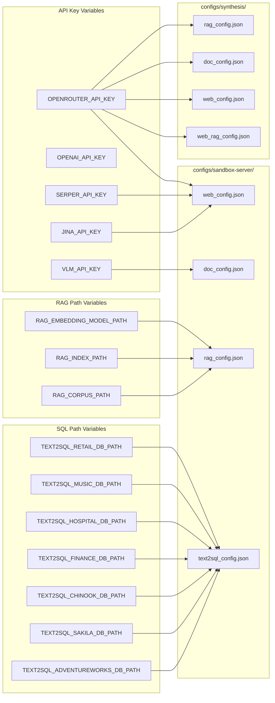

<!-- source: DeepWiki mcp.deepwiki.com · repo OpenDCAI/AgentFlow · page 8.5 Environment Variables · fetched 2026-11-02 -->

# Environment Variables

<details>
<summary>Relevant source files</summary>

The following files were used as context for generating this wiki page:

- [configs/sandbox-server/doc_config.json](configs/sandbox-server/doc_config.json)
- [configs/sandbox-server/rag_config.json](configs/sandbox-server/rag_config.json)
- [configs/sandbox-server/text2sql_config.json](configs/sandbox-server/text2sql_config.json)
- [configs/sandbox-server/web_config.json](configs/sandbox-server/web_config.json)
- [configs/synthesis/doc_config.json](configs/synthesis/doc_config.json)
- [configs/synthesis/rag_config.json](configs/synthesis/rag_config.json)
- [configs/synthesis/web_config.json](configs/synthesis/web_config.json)
- [configs/synthesis/web_rag_config.json](configs/synthesis/web_rag_config.json)

</details>


This page documents every environment variable recognized by AgentFlow's configuration system. It covers where each variable is declared, which configuration files consume it, what it enables, and whether it is required or optional.

This page is limited to environment variable substitution — it does not explain the structure of the configuration files themselves. For that, see the relevant config schema pages: sandbox server config ([8.1](#8.1)), synthesis config ([8.2](#8.2)), trajectory config ([8.3](#8.3)), and inference config ([8.4](#8.4)).

---

## Substitution Syntax

Configuration files use shell-style variable substitution. The loader replaces `${VAR_NAME}` with the value of the environment variable at load time. An optional default can be specified with `${VAR_NAME:-default}`, which substitutes `default` when the variable is unset or empty.

| Syntax | Behavior |
|---|---|
| `${VAR_NAME}` | Substitute the value; fail or leave empty if unset |
| `${VAR_NAME:-}` | Substitute the value; replace with empty string if unset |
| `${VAR_NAME:-default}` | Substitute the value; replace with `default` if unset |

For example, in [configs/sandbox-server/text2sql_config.json:12-18](), each database path uses `:-` with an empty default, so missing variables cause the database to be unconfigured rather than causing a hard error.

---

## Variable Reference

### API Keys

These variables supply credentials to external HTTP APIs. All are used inside `configs/sandbox-server/` and `configs/synthesis/` files.

| Variable | Required | Used In | Purpose |
|---|---|---|---|
| `OPENROUTER_API_KEY` | Yes (synthesis) | synthesis configs, `web_config.json` | LLM calls via OpenRouter for trajectory sampling, QA synthesis, and web content summarization |
| `OPENAI_API_KEY` | Alternative to above | inference/trajectory configs | Direct OpenAI API access; interchangeable with OpenRouter depending on `base_url` |
| `SERPER_API_KEY` | Yes (Web agent) | `web_config.json` | Serper search API used by `web-search` tool |
| `JINA_API_KEY` | Yes (Web agent) | `web_config.json` | Jina reader API used by `web-visit` tool |
| `VLM_API_KEY` | Yes (Doc agent) | `doc_config.json` | VLM API (e.g., `gpt-4o-mini` via OpenRouter) for document image understanding |

Sources: [configs/sandbox-server/web_config.json:8-14](), [configs/sandbox-server/doc_config.json:16-17](), [configs/synthesis/rag_config.json:4-5](), [configs/synthesis/doc_config.json:3-4](), [configs/synthesis/web_config.json:3-4]()

---

### RAG Backend Paths

These variables point to local filesystem resources required by the RAG backend (`RAGBackend` class). They must be absolute paths on the machine running the sandbox server.

| Variable | Required | Used In | Purpose |
|---|---|---|---|
| `RAG_EMBEDDING_MODEL_PATH` | Yes | `rag_config.json` (`model_name`) | Local path to the E5 encoder model directory |
| `RAG_INDEX_PATH` | Yes | `rag_config.json` (`index_path`) | Local path to the Faiss index file |
| `RAG_CORPUS_PATH` | Yes | `rag_config.json` (`corpus_path`) | Local path to the document corpus file |

Sources: [configs/sandbox-server/rag_config.json:19-22]()

---

### Text2SQL Database Paths

Each variable maps to a named SQLite database used by the `text2sql` backend. All use `:-` (empty default), so unset variables simply leave that database unavailable without blocking others.

| Variable | Database Name | Required |
|---|---|---|
| `TEXT2SQL_RETAIL_DB_PATH` | `retail` | Optional |
| `TEXT2SQL_MUSIC_DB_PATH` | `music` | Optional |
| `TEXT2SQL_HOSPITAL_DB_PATH` | `hospital` | Optional |
| `TEXT2SQL_FINANCE_DB_PATH` | `finance` | Optional |
| `TEXT2SQL_CHINOOK_DB_PATH` | `chinook` | Optional |
| `TEXT2SQL_SAKILA_DB_PATH` | `sakila` | Optional |
| `TEXT2SQL_ADVENTUREWORKS_DB_PATH` | `adventureworks` | Optional |

At least one database path must be set for the `sql:list_databases`, `sql:get_schema`, and `sql:execute` tools to have anything to operate on.

Sources: [configs/sandbox-server/text2sql_config.json:10-19]()

---

## Variable-to-Config File Mapping

The following diagram shows which environment variables are consumed by which configuration files.

**Diagram: Environment variable consumption per config file**



Sources: [configs/sandbox-server/web_config.json:1-18](), [configs/sandbox-server/doc_config.json:1-23](), [configs/sandbox-server/rag_config.json:1-35](), [configs/sandbox-server/text2sql_config.json:1-22](), [configs/synthesis/rag_config.json:1-6](), [configs/synthesis/doc_config.json:1-5](), [configs/synthesis/web_config.json:1-5](), [configs/synthesis/web_rag_config.json:1-6]()

---

## Variable-to-Agent-Type Mapping

The following diagram maps each variable to the agent type and backend class that depends on it. This is useful when setting up an environment for a specific agent type.

**Diagram: Variables required per agent type and backend**

```mermaid
graph TD
    subgraph "Web Agent"
        WA["web-search / web-visit tools"]
        WB["WebBackend"]
        SE2["SERPER_API_KEY"]
        JI2["JINA_API_KEY"]
        OR2["OPENROUTER_API_KEY\n(web summarization)"]
        SE2 --> WB
        JI2 --> WB
        OR2 --> WB
        WB --> WA
    end

    subgraph "Document Agent"
        DA["doc-search / doc-read tools"]
        DB["DocumentBackend"]
        VL2["VLM_API_KEY"]
        VL2 --> DB
        DB --> DA
    end

    subgraph "RAG Agent"
        RA["rag-search tool"]
        RB["RAGBackend"]
        RE2["RAG_EMBEDDING_MODEL_PATH"]
        RI2["RAG_INDEX_PATH"]
        RC3["RAG_CORPUS_PATH"]
        RE2 --> RB
        RI2 --> RB
        RC3 --> RB
        RB --> RA
    end

    subgraph "Text2SQL Agent"
        SA["sql:list / sql:get_schema / sql:execute tools"]
        SB["DatabaseBackend"]
        DB1b["TEXT2SQL_*_DB_PATH\n(one per database)"]
        DB1b --> SB
        SB --> SA
    end

    subgraph "Synthesis / Rollout LLM"
        LLM["TrajectorySampler\nQASynthesizer\nAgentRunner"]
        OR3["OPENROUTER_API_KEY\nor OPENAI_API_KEY"]
        OR3 --> LLM
    end
```



Sources: [configs/sandbox-server/web_config.json:7-16](), [configs/sandbox-server/doc_config.json:8-20](), [configs/sandbox-server/rag_config.json:8-28](), [configs/sandbox-server/text2sql_config.json:9-19](), [configs/synthesis/rag_config.json:3-5]()

---

## Setting Variables

All variables should be set in the shell environment before launching the sandbox server or running synthesis/rollout commands. A typical approach is a sourced shell script:

```sh
# LLM access
export OPENROUTER_API_KEY="sk-or-..."

# Web agent
export SERPER_API_KEY="..."
export JINA_API_KEY="..."

# Document agent
export VLM_API_KEY="sk-or-..."

# RAG agent
export RAG_EMBEDDING_MODEL_PATH="/data/models/e5-mistral-7b-instruct"
export RAG_INDEX_PATH="/data/rag/index.faiss"
export RAG_CORPUS_PATH="/data/rag/corpus.jsonl"

# Text2SQL agent
export TEXT2SQL_RETAIL_DB_PATH="/data/sql/retail.db"
export TEXT2SQL_CHINOOK_DB_PATH="/data/sql/chinook.db"
```

The comments in the config files explicitly note that absolute paths should not be committed to version control; these environment variables are the intended mechanism for supplying them. See [configs/sandbox-server/rag_config.json:19-19]() and [configs/sandbox-server/text2sql_config.json:10-10]() for the embedded `_comment_required` documentation.

---

## Quick-Reference Summary Table

| Variable | Category | Required For | Config File Location |
|---|---|---|---|
| `OPENROUTER_API_KEY` | API Key | All synthesis, Web summarization | `synthesis/*.json`, `sandbox-server/web_config.json` |
| `OPENAI_API_KEY` | API Key | Direct OpenAI access | inference/trajectory configs |
| `SERPER_API_KEY` | API Key | Web Agent (`web-search`) | `sandbox-server/web_config.json` |
| `JINA_API_KEY` | API Key | Web Agent (`web-visit`) | `sandbox-server/web_config.json` |
| `VLM_API_KEY` | API Key | Document Agent (`doc-search`, `doc-read`) | `sandbox-server/doc_config.json` |
| `RAG_EMBEDDING_MODEL_PATH` | Path | RAG Agent (`rag-search`) | `sandbox-server/rag_config.json` |
| `RAG_INDEX_PATH` | Path | RAG Agent (`rag-search`) | `sandbox-server/rag_config.json` |
| `RAG_CORPUS_PATH` | Path | RAG Agent (`rag-search`) | `sandbox-server/rag_config.json` |
| `TEXT2SQL_RETAIL_DB_PATH` | Path | Text2SQL Agent | `sandbox-server/text2sql_config.json` |
| `TEXT2SQL_MUSIC_DB_PATH` | Path | Text2SQL Agent | `sandbox-server/text2sql_config.json` |
| `TEXT2SQL_HOSPITAL_DB_PATH` | Path | Text2SQL Agent | `sandbox-server/text2sql_config.json` |
| `TEXT2SQL_FINANCE_DB_PATH` | Path | Text2SQL Agent | `sandbox-server/text2sql_config.json` |
| `TEXT2SQL_CHINOOK_DB_PATH` | Path | Text2SQL Agent | `sandbox-server/text2sql_config.json` |
| `TEXT2SQL_SAKILA_DB_PATH` | Path | Text2SQL Agent | `sandbox-server/text2sql_config.json` |
| `TEXT2SQL_ADVENTUREWORKS_DB_PATH` | Path | Text2SQL Agent | `sandbox-server/text2sql_config.json` |

Sources: [configs/sandbox-server/web_config.json:1-18](), [configs/sandbox-server/doc_config.json:1-23](), [configs/sandbox-server/rag_config.json:1-35](), [configs/sandbox-server/text2sql_config.json:1-22](), [configs/synthesis/rag_config.json:1-6](), [configs/synthesis/web_config.json:1-5]()

---

