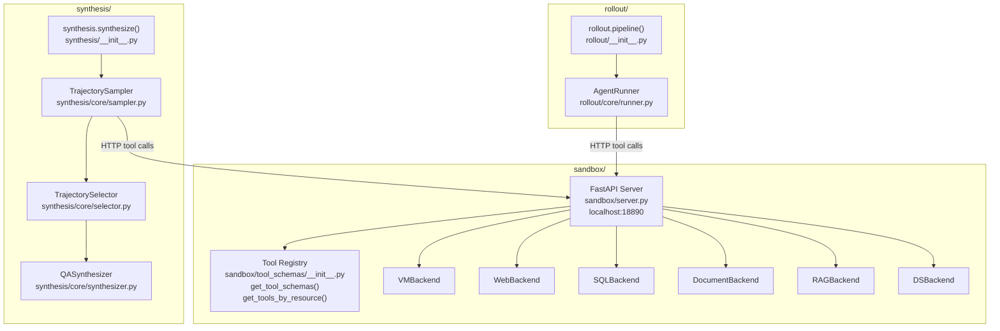
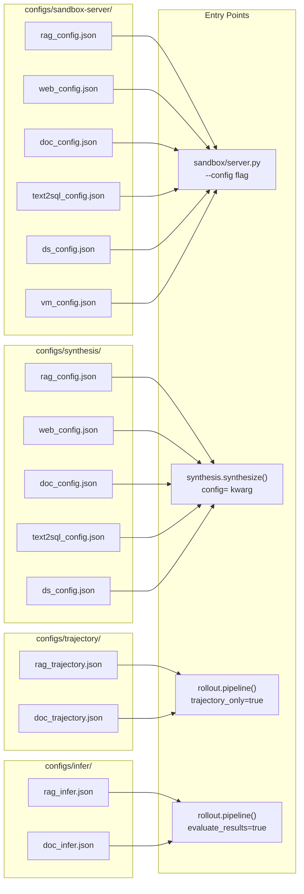

<!-- source: DeepWiki mcp.deepwiki.com · repo OpenDCAI/AgentFlow · page 9 Developer Guide · fetched 2026-11-02 -->

# Developer Guide

<details>
<summary>Relevant source files</summary>

The following files were used as context for generating this wiki page:

- [.gitignore](.gitignore)
- [install.sh](install.sh)
- [requirements.txt](requirements.txt)

</details>


This page provides orientation for developers who want to understand AgentFlow's internal structure, contribute to the project, or extend it with new capabilities. It covers the codebase layout, key module interfaces, and the primary extension points.

- For instructions on setting up a development environment, see [Development Environment](#9.1).
- For a step-by-step guide to implementing a new agent type end-to-end, see [Adding New Agent Types](#9.2).
- For details on registering new tools in the tool schema system, see [Extending Tool Schemas](#9.3).
- For user-facing configuration reference, see [Configuration Reference](#8).

---

## Codebase Layout

The repository is organized into five top-level modules, each with a distinct responsibility.

```
AgentFlow/
├── sandbox/               # Sandbox server: FastAPI service + backend implementations
│   ├── server.py          # FastAPI app entry point
│   ├── tool_schemas/      # Tool schema definitions and registry
│   │   ├── __init__.py    # get_tool_schemas(), get_tools_by_resource()
│   │   ├── vm_tools.py
│   │   ├── web_tools.py
│   │   ├── sql_tools.py
│   │   ├── doc_tools.py
│   │   ├── rag_tools.py
│   │   └── ds_tools.py
│   └── backends/          # Backend implementations per resource type
├── synthesis/             # Three-stage data synthesis pipeline
│   └── core/
│       ├── sampler.py     # TrajectorySampler
│       ├── selector.py    # TrajectorySelector
│       └── synthesizer.py # QASynthesizer
├── rollout/               # Agent runner for trajectory generation and inference
│   └── core/
│       └── runner.py      # AgentRunner
├── configs/               # Configuration files (no executable code)
│   ├── sandbox-server/
│   ├── synthesis/
│   ├── trajectory/
│   └── infer/
└── seeds/                 # Seed data per agent modality
    └── */seeds.jsonl
```

Sources: [requirements.txt:1-78](), [install.sh:1-110](), `.gitignore`

---

## Module Dependency Map

The following diagram maps the primary code modules and their runtime dependencies. Node names correspond to actual file paths or class names.

**Diagram: Runtime Module Dependencies**



Sources: [requirements.txt:1-20]()

---

## Key Abstractions

### Tool Schema System

Tool schemas are the interface contract between LLM agents and the sandbox server. Each schema module exports a list of dictionaries following the OpenAI function-calling format. The central registry in `sandbox/tool_schemas/__init__.py` aggregates these and exposes two functions:

| Function | Purpose |
|---|---|
| `get_tool_schemas(tool_names)` | Return schemas for a named subset of tools |
| `get_tools_by_resource(resource_type)` | Return all schemas belonging to a resource type |

The available schema modules and their tool counts are:

| Module | Resource Type | Tools |
|---|---|---|
| `sandbox/tool_schemas/vm_tools.py` | `vm` | ~15 (screenshot, click, type, key, scroll, …) |
| `sandbox/tool_schemas/web_tools.py` | `web` | 2 (web-search, web-visit) |
| `sandbox/tool_schemas/sql_tools.py` | `sql` | 3 (list_databases, get_schema, execute) |
| `sandbox/tool_schemas/doc_tools.py` | `doc` | 2 (doc-search, doc-read) |
| `sandbox/tool_schemas/rag_tools.py` | `rag` | 1 (rag-search) |
| `sandbox/tool_schemas/ds_tools.py` | `ds` | 3 (ds_inspect_data, ds_read_csv, ds_run_python) |

### Backend Resources

Each resource type has a backend class that the FastAPI server instantiates based on the sandbox configuration file. Backends handle session management (initialization, reinitialization, cleanup) and the actual tool execution logic. Adding a new agent type requires a new backend class and a corresponding tool schema module.

### Pipeline Stages

The synthesis pipeline is composed of three sequential classes:

| Class | File | Input | Output |
|---|---|---|---|
| `TrajectorySampler` | `synthesis/core/sampler.py` | Seed items + config | Trajectory tree |
| `TrajectorySelector` | `synthesis/core/selector.py` | Trajectory tree | Filtered trajectories |
| `QASynthesizer` | `synthesis/core/synthesizer.py` | Selected trajectories | QA pairs |

The rollout pipeline uses `AgentRunner` (`rollout/core/runner.py`) for both training trajectory generation (`trajectory_only=true`) and inference (`evaluate_results=true`). The mode is controlled entirely by configuration, not by different code paths.

---

## Configuration as the Extension Interface

All modality-specific behavior is injected through configuration files rather than through code switches. This means adding a new modality does not require modifying existing pipeline code.

**Diagram: Configuration Files Mapped to Code Entry Points**



Sources: [install.sh:109-109]()

---

## Development Dependencies

The project uses a tiered dependency model defined in `requirements.txt`:

| Tier | Install Command | Contents |
|---|---|---|
| Core | `pip install -r requirements.txt` | `requests`, `fastapi`, `pydantic`, `openai`, `httpx`, `pyyaml`, `tqdm`, `python-dotenv`, and supporting libraries |
| ML/DL (optional) | `./install.sh --ml` | `torch`, `transformers`, `accelerate`, `torchvision`, `vllm` |
| Cloud (optional) | `./install.sh --cloud` | Alibaba Cloud SDK |

The `install.sh` script handles all three tiers and also runs `playwright install chromium` for browser automation support.

Key runtime dependencies and their roles:

| Package | Role |
|---|---|
| `fastapi` | Sandbox server HTTP layer |
| `openai` | LLM API client (OpenAI and OpenRouter) |
| `httpx` / `httpx-retries` | HTTP client used by synthesis and rollout workers |
| `playwright` | Browser automation for web agent backends |
| `PyMuPDF` / `pdfplumber` | PDF parsing for document backends |
| `docker` | VM backend container management |
| `faiss` (external) | Vector index for RAG backend |
| `pytest` | Test runner |

Sources: [requirements.txt:1-78](), [install.sh:70-101]()

---

## Environment Variables

Credentials and machine-specific paths are never hardcoded in configuration files. Instead, configs use `${VAR_NAME}` substitution syntax. The following environment variables are expected across modalities:

| Variable | Used By |
|---|---|
| `OPENAI_API_KEY` | LLM calls in synthesis and rollout |
| `OPENROUTER_API_KEY` | Alternative LLM provider |
| `SERPER_API_KEY` | Web backend search |
| `JINA_API_KEY` | Web backend page reading |
| `VLM_API_KEY` | Document backend VLM calls |
| `RAG_EMBEDDING_MODEL_PATH` | RAG backend E5 model |
| `RAG_INDEX_PATH` | RAG backend Faiss index |
| `TEXT2SQL_*_DB_PATH` | SQL backend database files |

Store these in a `.env` file (which is `.gitignore`d) and load with `python-dotenv`, or export them in the shell before running any pipeline command.

Sources: [.gitignore:44-46](), [requirements.txt:14-14]()

---

## Where to Go Next

| Goal | Page |
|---|---|
| Set up a local dev environment, understand directory layout in depth | [Development Environment](#9.1) |
| Implement a new agent type from scratch | [Adding New Agent Types](#9.2) |
| Add a single new tool to an existing agent type | [Extending Tool Schemas](#9.3) |
| Understand the three pipeline stages in depth | [Three-Stage Data Synthesis Pipeline](#2.1) |
| Understand sandbox session management | [Session Management](#3.4) |
| Reference all config parameters | [Configuration Reference](#8) |

---

