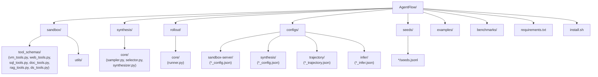
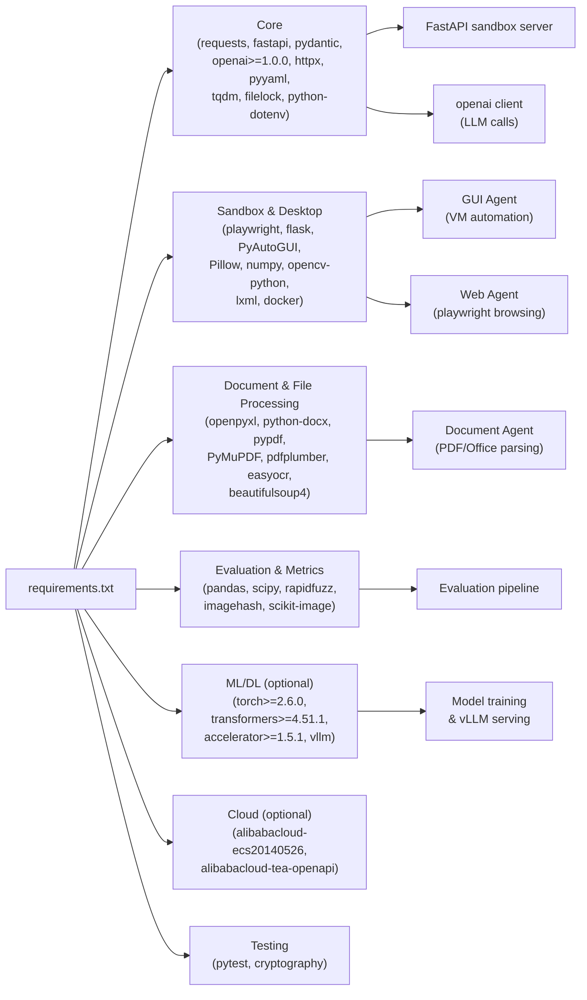
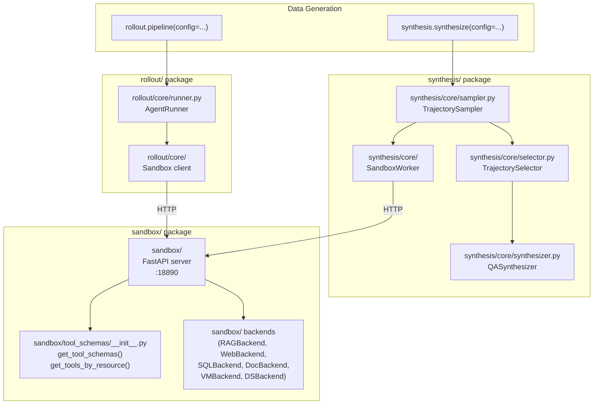
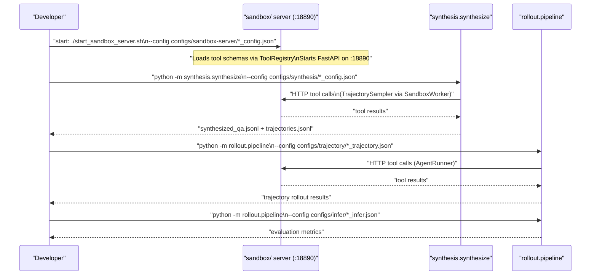

<!-- source: DeepWiki mcp.deepwiki.com · repo OpenDCAI/AgentFlow · page 9.1 Development Environment · fetched 2026-11-02 -->

# Development Environment

<details>
<summary>Relevant source files</summary>

The following files were used as context for generating this wiki page:

- [.gitignore](.gitignore)
- [install.sh](install.sh)
- [requirements.txt](requirements.txt)

</details>


This page describes how to set up a local development environment for working on the AgentFlow codebase, explains the repository layout, and documents development workflows. It is targeted at contributors who want to extend or modify the framework.

- For end-user installation and the quick-start tutorial, see [1.1](#1.1) and [1.2](#1.2).
- For adding a new agent type or extending tool schemas, see [9.2](#9.2) and [9.3](#9.3).

---

## Prerequisites

| Requirement | Minimum Version | Notes |
|---|---|---|
| Python | 3.8+ | Checked by `install.sh` at startup |
| pip | any | Must be discoverable via `python -m pip` |
| Docker | any | Required for GUI agent (VM backend) |
| Playwright browsers | chromium | Installed automatically by `install.sh` |

`install.sh` detects the Python interpreter by checking for `python3` then `python` in `PATH` [install.sh:10-18]().

---

## Repository Layout

The following diagram maps top-level directories to their roles in the system.

**Repository Directory Structure**



Sources: `.gitignore`, `requirements.txt`, high-level architecture diagrams

---

## Installation

### Core Installation

The recommended path is the provided shell script:

```bash
bash install.sh
```

This installs everything listed under the "Core", "Sandbox & Desktop Environment", "Document & File Processing", and "Evaluation & Metrics" groups in `requirements.txt`, then installs the Playwright chromium browser [install.sh:70-101]().

### Optional Dependency Groups

`install.sh` accepts flags to extend the installation:

| Flag | What it installs | When needed |
|---|---|---|
| `--ml` | `torch>=2.6.0`, `transformers>=4.51.1`, `accelerate>=1.5.1`, `torchvision` | Training or running local models |
| `--cloud` | `alibabacloud-ecs20140526`, `alibabacloud-tea-openapi`, `alibabacloud-tea-util` | Alibaba Cloud VM provisioning |
| `--all` | All of the above | Full installation |

Example:

```bash
bash install.sh --ml        # core + ML/DL
bash install.sh --all       # everything
```

The ML/DL packages are commented out in `requirements.txt` [requirements.txt:68-74]() and must be installed via the flag or manually, because they are large and not needed for data synthesis alone.

### Manual Installation

If you prefer to manage a virtual environment yourself:

```bash
python3 -m venv .venv
source .venv/bin/activate
pip install -r requirements.txt
python -m playwright install chromium
```

The `.gitignore` excludes `venv/`, `env/`, `ENV/`, and `.venv` [.gitignore:26-30](), so any of those names are safe to use.

Sources: [install.sh:1-110](), [requirements.txt:1-78](), [.gitignore:26-30]()

---

## Core Dependency Groups

The `requirements.txt` is organized into functional groups:

**Dependency Map**



Sources: [requirements.txt:1-78]()

---

## Environment Variables

All credentials and machine-specific paths are injected through environment variables rather than hardcoded in config files. The `python-dotenv` package (listed in core deps [requirements.txt:17]()) is used to load a `.env` file if present. The `.gitignore` excludes `.env` and `.env.local` [.gitignore:44-46]().

| Variable | Used By | Purpose |
|---|---|---|
| `OPENAI_API_KEY` | All synthesis and rollout | Primary LLM provider |
| `OPENROUTER_API_KEY` | All synthesis and rollout | Alternative LLM provider |
| `SERPER_API_KEY` | Web agent sandbox backend | Web search (Serper API) |
| `JINA_API_KEY` | Web agent sandbox backend | Web content extraction (Jina API) |
| `VLM_API_KEY` | Document agent sandbox backend | Multimodal VLM calls |
| `RAG_EMBEDDING_MODEL_PATH` | RAG sandbox backend | Local E5 embedding model path |
| `RAG_INDEX_PATH` | RAG sandbox backend | Faiss index file path |
| `TEXT2SQL_*_DB_PATH` | SQL sandbox backend | Per-domain SQLite database paths |

Config files reference these as `${VAR_NAME}` placeholders, which are substituted at load time. See [8.5](#8.5) for the complete environment variable reference.

A recommended `.env` file structure for a development setup:

```
OPENAI_API_KEY=sk-...
OPENROUTER_API_KEY=...
SERPER_API_KEY=...
JINA_API_KEY=...
VLM_API_KEY=...
RAG_EMBEDDING_MODEL_PATH=/path/to/e5-model
RAG_INDEX_PATH=/path/to/faiss.index
```

Sources: [.gitignore:44-46](), [requirements.txt:17]()

---

## Key Code Entry Points

The following diagram maps the primary operations a developer will perform to the exact Python modules and functions they invoke.

**Entry Points by Operation**



Sources: high-level architecture diagrams (Diagram 5, Diagram 6)

---

## Files Excluded from Version Control

The `.gitignore` documents which artifacts are generated locally and should not be committed.

| Pattern | Reason |
|---|---|
| `embeddingmodel/` | Large embedding model weights |
| `*.bin`, `*.safetensors`, `*.pt`, `*.pth` | All model weight formats |
| `venv/`, `env/`, `.venv` | Virtual environment directories |
| `results/` | Evaluation output files |
| `sandbox_recordings/` | GUI agent screen recordings |
| `osworld-image/` | VM disk images |
| `sql/` | Local SQL workspace databases |
| `*.db`, `*.sqlite`, `*.sqlite3` | SQLite database files |
| `.env`, `.env.local` | Credentials and local config |
| `logs/`, `*.log` | Runtime log files |
| `uploads/` | Temporary file upload cache |
| `__pycache__/`, `*.pyc` | Python bytecode cache |
| `.pytest_cache/`, `.mypy_cache/` | Tool caches |

Sources: [.gitignore:1-93]()

---

## Development Workflow Overview

The typical inner loop for developing a new feature or agent type:



Sources: [install.sh:109](), high-level architecture (Diagram 2)

---

## Running Tests

The `pytest` package is listed as a testing dependency [requirements.txt:76](), and a `.pytest_cache/` entry exists in `.gitignore` [.gitignore:61]().

Run the test suite from the repository root:

```bash
pytest
```

The `cryptography` package is also a test dependency [requirements.txt:77](), used by the BrowseComp-V3 benchmark data decryption tests. See [7.1](#7.1) for details.

Sources: [requirements.txt:75-77](), [.gitignore:61]()

---

## IDE and Editor Configuration

The `.gitignore` excludes `.vscode/` and `.idea/` [.gitignore:33-34](), meaning IDE-specific project files are not tracked. Developers can commit workspace-level settings in these directories without affecting other contributors.

Swap files (`*.swp`, `*.swo`, `*~`) from editors such as Vim are also excluded [.gitignore:35-36]().

Sources: [.gitignore:32-36]()

---

