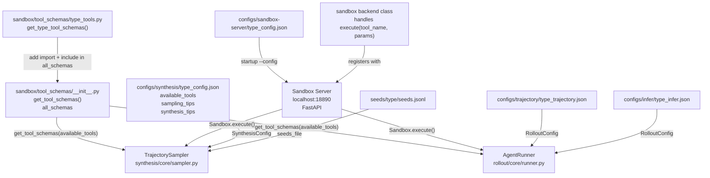
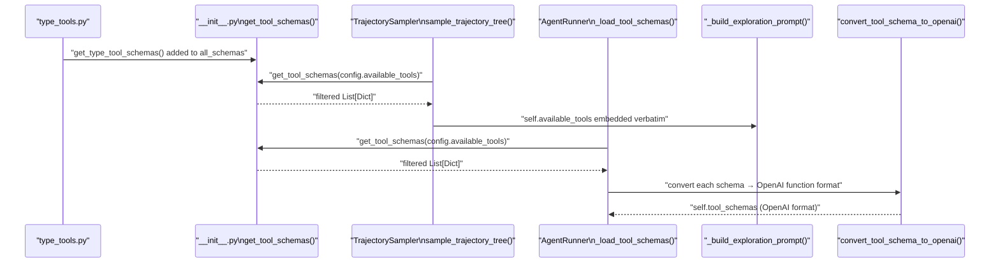

<!-- source: DeepWiki mcp.deepwiki.com · repo OpenDCAI/AgentFlow · page 9.2 Adding New Agent Types · fetched 2026-11-02 -->

# Adding New Agent Types

<details>
<summary>Relevant source files</summary>

The following files were used as context for generating this wiki page:

- [configs/synthesis/doc_config.json](configs/synthesis/doc_config.json)
- [configs/synthesis/rag_config.json](configs/synthesis/rag_config.json)
- [configs/synthesis/web_config.json](configs/synthesis/web_config.json)
- [configs/synthesis/web_rag_config.json](configs/synthesis/web_rag_config.json)
- [rollout/core/runner.py](rollout/core/runner.py)
- [sandbox/tests/test_tool_schemas.py](sandbox/tests/test_tool_schemas.py)
- [sandbox/tool_schemas/__init__.py](sandbox/tool_schemas/__init__.py)
- [sandbox/tool_schemas/doc_tools.py](sandbox/tool_schemas/doc_tools.py)
- [sandbox/tool_schemas/rag_tools.py](sandbox/tool_schemas/rag_tools.py)
- [sandbox/tool_schemas/sql_tools.py](sandbox/tool_schemas/sql_tools.py)
- [sandbox/tool_schemas/vm_tools.py](sandbox/tool_schemas/vm_tools.py)
- [sandbox/tool_schemas/web_tools.py](sandbox/tool_schemas/web_tools.py)
- [synthesis/core/sampler.py](synthesis/core/sampler.py)

</details>


## Purpose and Scope

This page is a step-by-step guide for implementing a new agent type in AgentFlow. It covers every file that must be created or modified, the required interfaces for each component, and how the pieces connect at runtime.

This page does not cover the synthesis or rollout pipeline operation in depth — see [4. Data Synthesis Pipeline](#4) and [5. Rollout and Inference](#5) for that. For a reference of tool schema parameters for existing types, see [3.3 Tool Schemas Reference](#3.3). For the configuration file format, see [8. Configuration Reference](#8).

---

## How an Agent Type Is Assembled

An agent type is defined by four independent components that are linked entirely through configuration — no changes to the core pipeline code are needed.

**Diagram: Components Required for a New Agent Type**



Sources: [sandbox/tool_schemas/__init__.py:1-127](), [synthesis/core/sampler.py:20-94](), [rollout/core/runner.py:30-142]()

---

## Step 1: Define Tool Schemas

Create `sandbox/tool_schemas/<type>_tools.py`. The file must expose a function named `get_<type>_tool_schemas()` that returns a list of schema dictionaries.

### Schema Dictionary Structure

Each tool is one dictionary with three keys:

| Key | Type | Description |
|---|---|---|
| `name` | `str` | Tool identifier used in API calls and config `available_tools` lists |
| `description` | `str` | Natural language description embedded in the LLM exploration prompt |
| `parameters` | `list[dict]` | Ordered list of parameter descriptors |

Each parameter descriptor has:

| Key | Type | Required | Description |
|---|---|---|---|
| `name` | `str` | yes | Parameter name |
| `type` | `str` | yes | One of: `string`, `integer`, `number`, `boolean`, `array`, `object` |
| `description` | `str` | yes | Passed to the LLM |
| `required` | `bool` | yes | Whether the LLM must supply this parameter |
| `array_type` | `str` | only when `type` is `array` | Element type, e.g. `"string"` |

### Naming Convention

Tool names follow the pattern `<type>-<action>`. The function `_tool_name_aliases()` in [sandbox/tool_schemas/__init__.py:18-31]() treats `-`, `_`, and `:` as interchangeable separators when filtering. A config entry of `"mytype-search"` is therefore equivalent to `"mytype_search"` and `"mytype:search"`. Wildcard filtering is also supported: `"mytype-*"` selects all tools whose names start with `mytype-`.

### Existing Schema Files for Reference

| Agent Type | Schema File | Tool Names |
|---|---|---|
| RAG | `sandbox/tool_schemas/rag_tools.py` | `rag-search` |
| Web | `sandbox/tool_schemas/web_tools.py` | `web-search`, `web-visit` |
| Document | `sandbox/tool_schemas/doc_tools.py` | `doc-search`, `doc-read` |
| Text2SQL | `sandbox/tool_schemas/sql_tools.py` | `text2sql-list_databases`, `text2sql-get_schema`, `text2sql-execute` |
| GUI/VM | `sandbox/tool_schemas/vm_tools.py` | `vm-click`, `vm-type`, `vm-key`, `vm-scroll`, and 10 others |
| Data Science | `sandbox/tool_schemas/ds_tools.py` | `ds_inspect_data`, `ds_read_csv`, `ds_run_python` |

Two implementation patterns exist in the codebase:

- **Simple list pattern** (used in `rag_tools.py`, `web_tools.py`, `doc_tools.py`): Each getter function constructs and returns schema dicts inline. See [sandbox/tool_schemas/rag_tools.py:11-49]() for the minimal case.
- **Module-level registration pattern** (used in `sql_tools.py`): A module-level list `_REGISTERED_SQL_TOOLS` is populated by calling individual schema functions at import time (see [sandbox/tool_schemas/sql_tools.py:12-77]()). This pattern is only necessary if schema registration order matters; the simple list pattern is sufficient for most new types.

Parameter array types are declared with `"type": "array"` and `"array_type": "<element_type>"`. See [sandbox/tool_schemas/web_tools.py:33-45]() for an example with `array` of `string`.

Sources: [sandbox/tool_schemas/rag_tools.py:1-49](), [sandbox/tool_schemas/web_tools.py:1-74](), [sandbox/tool_schemas/doc_tools.py:1-102](), [sandbox/tool_schemas/sql_tools.py:1-77](), [sandbox/tool_schemas/vm_tools.py:1-242]()

---

## Step 2: Register with the Tool Registry

Edit `sandbox/tool_schemas/__init__.py` in three places:

**1. Import block** — add the new getter alongside existing imports at [sandbox/tool_schemas/__init__.py:10-15]():

```
from .type_tools import get_type_tool_schemas
```

**2. `all_schemas` concatenation** — include the new schemas in `get_tool_schemas()` at [sandbox/tool_schemas/__init__.py:47-53]():

```
all_schemas = (
    get_rag_tool_schemas()
    + get_web_tool_schemas()
    + ...
    + get_type_tool_schemas()    # add this line
)
```

**3. `__all__` export list** — add the function name at [sandbox/tool_schemas/__init__.py:117-127]().

After these changes, the following calls will work as expected:
- `get_tool_schemas(["mytype-search"])` — returns the specific tool
- `get_tool_schemas(["mytype-*"])` — returns all tools with the `mytype-` prefix
- `get_tools_by_resource("mytype")` — returns all tools for the resource type

The test file `sandbox/tests/test_tool_schemas.py` contains assertions that validate schema structure. Run the existing test class `TestToolSchemaIntegration.test_all_tools_valid` after registration to confirm the new schemas satisfy the required fields.

**Diagram: Tool Schema Loading Flow**



Sources: [sandbox/tool_schemas/__init__.py:34-87](), [synthesis/core/sampler.py:70-74](), [rollout/core/runner.py:129-142](), [synthesis/core/sampler.py:247-314]()

---

## Step 3: Implement the Sandbox Backend

The sandbox server is a FastAPI service (default port `18890`) that dispatches tool execution requests to backend objects. Each agent type needs a backend class registered with the server.

The server startup configuration is read from the file specified with `--config`. Backends in the existing implementation include:

| Agent Type | Backend Reference | Execution Environment |
|---|---|---|
| RAG | `RAGBackend` | E5 embeddings + Faiss index |
| Web | `WebBackend` | Serper API (search) + Jina API (page fetch) |
| Text2SQL | `DatabaseBackend` | SQLite engines loaded from files |
| Document | `DocumentBackend` | VLM (`gpt-4o-mini`) + PDF parser |
| Data Science | `DSBackend` | Sandboxed Python with pandas/numpy whitelist |
| GUI/VM | `VMBackend` | Docker container running Ubuntu desktop |

### Backend Contract

The sandbox server routes a tool call from the client to the backend using the tool name prefix. When `AgentRunner._execute_tool()` calls `await self.sandbox.execute(tool_name, parameters)` ([rollout/core/runner.py:344]()), the server dispatches to the backend registered for that tool prefix.

The backend must return responses in the standard format:

```
{"code": 0, "data": <result_payload>, "message": ""}
```

A non-zero `code` is interpreted as failure. The `format_tool_result()` utility (imported in `sampler.py` at [synthesis/core/sampler.py:11]()) formats this response into a string for the LLM observation.

`TrajectorySampler._execute_action()` at [synthesis/core/sampler.py:206-221]() calls `self.worker.execute_tool(tool_name, parameters, **self.seed_kwargs)`. The `**seed_kwargs` mechanism passes per-seed parameters (such as a file path) into the tool call automatically. Implement the backend so that any extra keyword arguments are handled gracefully.

---

## Step 4: Create Configuration Files

Four JSON configuration files are required. All use `${VAR_NAME}` syntax for environment variable substitution (see [8.5 Environment Variables](#8.5)).

### 4.1 Sandbox Server Config

**Path:** `configs/sandbox-server/<type>_config.json`

Specifies the network settings and backend initialization parameters. Copy the closest existing config as a starting point (e.g., `configs/sandbox-server/rag_config.json` for a single-resource type). For full parameter reference see [8.1 Sandbox Server Config Schema](#8.1).

Key shared fields: `server.url`, `server.port` (default `18890`), `session_ttl`.

### 4.2 Synthesis Config

**Path:** `configs/synthesis/<type>_config.json`

Controls all three stages of the data synthesis pipeline. See [configs/synthesis/rag_config.json:1-60]() for a minimal working example. For the full parameter reference see [8.2 Synthesis Config Schema](#8.2).

Fields specific to the new agent type:

| Field | Type | Description |
|---|---|---|
| `available_tools` | `list[str]` | Tool names from the new schema; passed to `get_tool_schemas()` |
| `resource_types` | `list[str]` | Backend resource identifiers; used to create sandbox sessions |
| `resource_init_configs` | `dict` | Per-resource initialization params (e.g., `top_k` for RAG) |
| `sandbox_config_path` | `str` | Path to the sandbox server config above |
| `seed_description` | `str` | One-line description of what a seed entry contains; added to the exploration prompt |
| `sampling_tips` | `list[str]` | Bullet points injected into `_build_exploration_prompt()` at [synthesis/core/sampler.py:288-292]() |
| `synthesis_tips` | `list[str]` | Bullet points injected into the QA synthesis prompt |
| `qa_examples` | `list[dict]` | Few-shot examples of `{question, answer}` pairs |
| `seeds_file` | `str` | Path to `seeds/<type>/seeds.jsonl` |
| `output_dir` | `str` | Directory for synthesized QA pairs and trajectories |

The `sampling_tips` field is the primary domain-specialization lever. Concrete, domain-specific instructions here (such as "always call `mytype-lookup` before `mytype-detail`") directly control LLM exploration behavior. See [configs/synthesis/doc_config.json:28-40]() for a detailed multi-instruction example.

### 4.3 Trajectory Rollout Config

**Path:** `configs/trajectory/<type>_trajectory.json`

Used with `rollout.pipeline` to generate training trajectories from benchmark data. Set `trajectory_only: true` and `evaluate_results: false`. See [8.3 Trajectory Config Schema](#8.3).

### 4.4 Inference Config

**Path:** `configs/infer/<type>_infer.json`

Used with `rollout.pipeline` to evaluate a trained model. Set `evaluate_results: true` and configure `evaluation_metric` and `evaluator_model`. See [8.4 Inference Config Schema](#8.4).

Sources: [configs/synthesis/rag_config.json:1-60](), [configs/synthesis/doc_config.json:1-73](), [configs/synthesis/web_config.json:1-44]()

---

## Step 5: Create Seed Data

**Path:** `seeds/<type>/seeds.jsonl`

Each line is a JSON object. At minimum it should contain a content field that describes the starting entity or document for exploration. The `seeds_file` field in the synthesis config points to this file.

### The `kwargs` Mechanism

If the new tools require per-seed context (such as a file path or database ID), add a `kwargs` object to each seed entry. `TrajectorySampler` stores this as `self.seed_kwargs` and merges it into every tool call at [synthesis/core/sampler.py:213](). `AgentRunner._run_conversation()` passes `task.kwargs` to `_execute_tool()` the same way at [rollout/core/runner.py:280]().

Example: the document agent seeds include `"kwargs": {"seed_path": "/data/documents/report.pdf"}`, so `doc-search` and `doc-read` automatically receive the correct file path without the LLM having to supply it.

Sources: [synthesis/core/sampler.py:46-74](), [rollout/core/runner.py:221-281]()

---

## Summary Checklist

| # | Action | Location |
|---|---|---|
| 1 | Create tool schema module with `get_<type>_tool_schemas()` | `sandbox/tool_schemas/<type>_tools.py` |
| 2 | Import and include in `all_schemas`; add to `__all__` | `sandbox/tool_schemas/__init__.py` |
| 3 | Implement backend class; return `{"code", "data", "message"}` | `sandbox/backends/<type>/` |
| 4 | Create sandbox server config | `configs/sandbox-server/<type>_config.json` |
| 5 | Create synthesis config with `available_tools`, tips, and examples | `configs/synthesis/<type>_config.json` |
| 6 | Create trajectory rollout config (`trajectory_only: true`) | `configs/trajectory/<type>_trajectory.json` |
| 7 | Create inference config (`evaluate_results: true`) | `configs/infer/<type>_infer.json` |
| 8 | Create seed data | `seeds/<type>/seeds.jsonl` |

After completing these steps, run `get_tool_schemas(["<type>-*"])` to verify schema registration, start the sandbox server with the new config to verify backend startup, and execute a minimal synthesis run (`"number_of_seed": 1`, `"max_depth": 3`) to exercise the end-to-end path.

---

