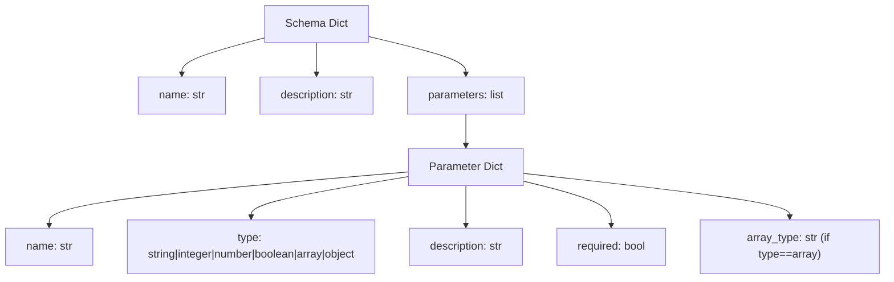
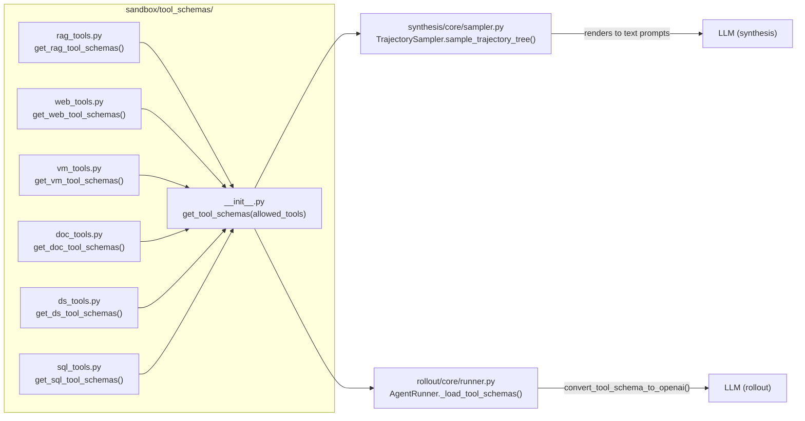
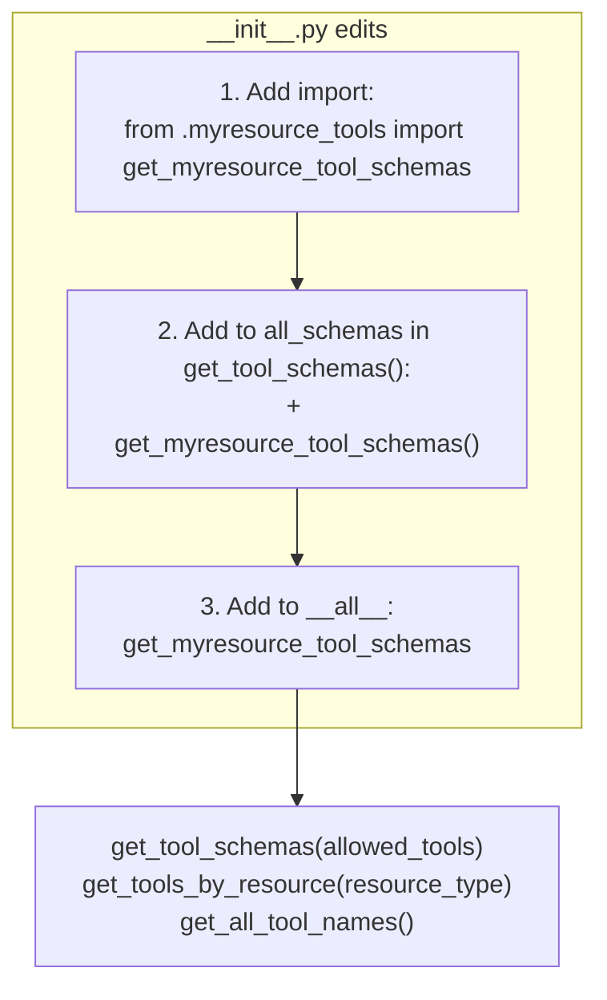

<!-- source: DeepWiki mcp.deepwiki.com · repo OpenDCAI/AgentFlow · page 9.3 Extending Tool Schemas · fetched 2026-11-02 -->

# Extending Tool Schemas

<details>
<summary>Relevant source files</summary>

The following files were used as context for generating this wiki page:

- [configs/sandbox-server/doc_config.json](configs/sandbox-server/doc_config.json)
- [configs/sandbox-server/rag_config.json](configs/sandbox-server/rag_config.json)
- [configs/sandbox-server/text2sql_config.json](configs/sandbox-server/text2sql_config.json)
- [configs/sandbox-server/web_config.json](configs/sandbox-server/web_config.json)
- [rollout/core/runner.py](rollout/core/runner.py)
- [sandbox/tests/test_tool_schemas.py](sandbox/tests/test_tool_schemas.py)
- [sandbox/tool_schemas/__init__.py](sandbox/tool_schemas/__init__.py)
- [sandbox/tool_schemas/doc_tools.py](sandbox/tool_schemas/doc_tools.py)
- [sandbox/tool_schemas/rag_tools.py](sandbox/tool_schemas/rag_tools.py)
- [sandbox/tool_schemas/sql_tools.py](sandbox/tool_schemas/sql_tools.py)
- [sandbox/tool_schemas/vm_tools.py](sandbox/tool_schemas/vm_tools.py)
- [sandbox/tool_schemas/web_tools.py](sandbox/tool_schemas/web_tools.py)
- [synthesis/core/sampler.py](synthesis/core/sampler.py)

</details>


This page explains how to add new tools to AgentFlow's tool schema system — both the schema definition that describes a tool to the LLM and the wiring that makes the registry and filtering machinery aware of it. It does **not** cover implementing the backend server-side handler that actually runs the tool (see [9.2 Adding New Agent Types](#9.2) for the full end-to-end flow including backend implementation) nor the sandbox server configuration files (see [3.1 Server Configuration](#3.1)).

---

## Overview

Tool schemas serve two roles simultaneously:

1. **LLM prompt construction** — The schema is rendered into a textual description of tool name, purpose, and parameters that the LLM reads to decide which tool to call and with what arguments.
2. **OpenAI function-calling format** — The rollout runner converts the schema to the OpenAI `tools` parameter format so the model can emit structured tool calls.

Every tool schema is a plain Python dictionary. All schemas are collected in per-resource modules under `sandbox/tool_schemas/` and aggregated through a single registry in `sandbox/tool_schemas/__init__.py`. Both the synthesis sampler (`synthesis/core/sampler.py`) and the rollout runner (`rollout/core/runner.py`) read from this registry.

---

## Schema Dictionary Format

Each tool is represented as a `Dict[str, Any]` with the following top-level keys:

| Key | Type | Required | Description |
|---|---|---|---|
| `name` | `str` | ✅ | Unique tool identifier. Must follow the prefix naming convention. |
| `description` | `str` | ✅ | Human-readable description used verbatim in LLM prompts. |
| `parameters` | `List[Dict]` | ✅ | List of parameter descriptors (may be empty). |

Each element of `parameters` is a dict with:

| Key | Type | Required | Description |
|---|---|---|---|
| `name` | `str` | ✅ | Parameter name |
| `type` | `str` | ✅ | One of `string`, `integer`, `number`, `boolean`, `array`, `object` |
| `description` | `str` | ✅ | Shown in both prompts and validation |
| `required` | `bool` | ✅ | Whether the LLM must supply this parameter |
| `array_type` | `str` | ❌ | Element type when `type` is `"array"` (e.g. `"string"`) |

**Schema Structure Diagram**



The test suite in `sandbox/tests/test_tool_schemas.py` validates that all schemas in the registry conform to this structure (`test_all_tools_valid`, `test_tool_schema_structure`, `test_parameter_structure`).

Sources: `sandbox/tool_schemas/web_tools.py`, `sandbox/tool_schemas/vm_tools.py`, `sandbox/tool_schemas/rag_tools.py`, `sandbox/tool_schemas/doc_tools.py`, `sandbox/tool_schemas/sql_tools.py`, `sandbox/tests/test_tool_schemas.py:65-104`

---

## Naming Convention

Tool names use a `{resource_type}{separator}{operation}` pattern. The separator can be `-`, `_`, or `:` — the registry treats all three as equivalent via `_tool_name_aliases` in `sandbox/tool_schemas/__init__.py`.

**Examples from existing modules:**

| Module | Tool name | Resource prefix |
|---|---|---|
| `rag_tools.py` | `rag-search` | `rag` |
| `web_tools.py` | `web-search`, `web-visit` | `web` |
| `doc_tools.py` | `doc-search`, `doc-read` | `doc` |
| `sql_tools.py` | `text2sql-list_databases`, `text2sql-get_schema`, `text2sql-execute` | `text2sql` |
| `vm_tools.py` | `vm-click`, `vm-type`, `vm-screenshot`, … | `vm` |
| `ds_tools.py` | `ds_inspect_data`, `ds_read_csv`, `ds_run_python` | `ds` |

The alias expansion in `_tool_name_aliases` means a caller filtering by `vm_*` will match tools named `vm-click`, `vm:click`, or `vm_click`. This is handled at the registry level — the schema itself only needs one canonical name.

Sources: `sandbox/tool_schemas/__init__.py:18-31`

---

## The Registry

`sandbox/tool_schemas/__init__.py` is the single point of aggregation. It imports all per-resource getter functions and exposes three public functions:

| Function | Signature | Purpose |
|---|---|---|
| `get_tool_schemas` | `(allowed_tools: Optional[List[str]]) -> List[Dict]` | Returns all schemas, or a filtered subset |
| `get_all_tool_names` | `() -> List[str]` | Returns all registered tool names |
| `get_tools_by_resource` | `(resource_type: str) -> List[Dict]` | Returns all schemas whose name starts with `resource_type` (any separator) |

`get_tool_schemas` supports two filter modes:

- **Exact name**: `"web-search"` matches only that tool (with alias expansion)
- **Wildcard prefix**: `"vm_*"` or `"vm-*"` or `"vm:*"` match all tools with that prefix

**Registry Data Flow Diagram**



Sources: `sandbox/tool_schemas/__init__.py`, `synthesis/core/sampler.py:70-74`, `rollout/core/runner.py:129-142`

---

## How Schemas Are Consumed

Understanding the two consumption paths is important when writing descriptions and parameter names, as each path renders the schema differently.

### Synthesis Sampler Path

`TrajectorySampler.sample_trajectory_tree` in `synthesis/core/sampler.py` calls `get_tool_schemas(self.config.available_tools)` to populate `self.available_tools`. The sampler then renders the schemas into a text block inside `_build_exploration_prompt`:

```
1. web-search: Perform batched web searches...
   Parameters:
   - query (array of string) (required): Array of query strings...
```

The `array_type` field is explicitly used here — it formats array parameters as `"array of {array_type}"` rather than just `"array"`. This text appears verbatim in every LLM prompt during trajectory sampling.

Sources: `synthesis/core/sampler.py:248-262`

### Rollout Runner Path

`AgentRunner._load_tool_schemas` in `rollout/core/runner.py` calls `get_tool_schemas(allowed_tools)` and then converts each schema using `convert_tool_schema_to_openai` (from `rollout/core/utils.py`). The converted schemas are passed as the `tools` argument to every `async_chat_completion` call, enabling native OpenAI function-calling.

Sources: `rollout/core/runner.py:129-142`, `rollout/core/runner.py:246-252`

---

## Adding a New Tool Schema: Step-by-Step

### Step 1: Create the Schema Module

Create `sandbox/tool_schemas/myresource_tools.py`. Follow the pattern of any existing module. The minimal structure is:

```
sandbox/tool_schemas/myresource_tools.py
```

Define one getter function per tool returning a schema dict, and one aggregator function that returns all of them as a list. See `sandbox/tool_schemas/web_tools.py:11-21` for the simplest example (two tools, two getters, one aggregator).

**Two patterns exist in the codebase:**

| Pattern | Example module | Description |
|---|---|---|
| Direct list return | `rag_tools.py`, `web_tools.py`, `doc_tools.py`, `vm_tools.py` | `get_*_tool_schemas()` constructs and returns schemas inline |
| Registration decorator | `sql_tools.py` | `register_sql_tool()` appends to a module-level list `_REGISTERED_SQL_TOOLS`; individual getters call it at module load time |

The registration pattern in `sql_tools.py` is useful when you want schemas to self-register on import, but both patterns produce identical results from the registry's perspective.

Sources: `sandbox/tool_schemas/sql_tools.py:12-17`, `sandbox/tool_schemas/web_tools.py:11-21`, `sandbox/tool_schemas/vm_tools.py:15-37`

### Step 2: Register in `__init__.py`

Open `sandbox/tool_schemas/__init__.py` and make two edits:

1. **Import the getter** at the top of the file alongside the existing imports [sandbox/tool_schemas/__init__.py:10-15]()
2. **Add the getter call** inside `get_tool_schemas` where `all_schemas` is assembled [sandbox/tool_schemas/__init__.py:47-54]()
3. **Export it** in the `__all__` list [sandbox/tool_schemas/__init__.py:117-127]()

**Wiring Diagram: Where to Edit**



Sources: `sandbox/tool_schemas/__init__.py:10-16`, `sandbox/tool_schemas/__init__.py:47-54`, `sandbox/tool_schemas/__init__.py:117-127`

### Step 3: Write Parameter Descriptors Carefully

Both consumers of the schema render descriptions directly to the LLM. Follow these guidelines from existing schemas:

- **Be explicit about units and defaults** — for example, `"Number of top relevant text chunks to retrieve (default: 10)"` from `rag_tools.py`.
- **Explain array semantics** — for example, `"Include multiple complementary search queries in a single call."` from `web_tools.py`.
- **Mark optionality clearly** — set `"required": False` and state the default in the description.
- **For array parameters**, always include `"array_type"` — the sampler prompt builder reads this field explicitly.

Sources: `sandbox/tool_schemas/rag_tools.py:44-47`, `sandbox/tool_schemas/web_tools.py:33-45`, `sandbox/tool_schemas/vm_tools.py:48-54`

### Step 4: Configure `available_tools` in Synthesis/Rollout Configs

Once the schema is registered, expose it to an agent by listing the tool name (or a wildcard prefix) in the `available_tools` field of a synthesis or rollout configuration file. For example:

```json
{
  "available_tools": ["myresource-search", "myresource-list"]
}
```

or with a wildcard:

```json
{
  "available_tools": ["myresource-*"]
}
```

The registry's wildcard expansion will resolve all tools with the `myresource` prefix regardless of which separator the tool names use.

Sources: `sandbox/tool_schemas/__init__.py:59-86`

---

## Filtering and Alias Resolution

The `get_tool_schemas` function resolves separators (`-`, `_`, `:`) as equivalent when matching. The internal function `_tool_name_aliases` generates this equivalence set for any given name.

**Example alias expansions:**

| Input name/pattern | Aliases generated |
|---|---|
| `"vm-click"` | `{"vm-click", "vm:click", "vm_click"}` |
| `"text2sql:execute"` | `{"text2sql:execute", "text2sql-execute", "text2sql_execute"}` |
| `"vm_*"` | prefix set `{"vm_", "vm-", "vm:"}` → matches any tool starting with any of these |

This means you can reference a tool by any separator variant in config files, and it will always match.

Sources: `sandbox/tool_schemas/__init__.py:18-31`, `sandbox/tool_schemas/__init__.py:59-87`

---

## Testing New Schemas

The test file `sandbox/tests/test_tool_schemas.py` contains the validation suite. When adding a new schema module, verify:

1. **`test_all_tools_valid`** passes — every schema has `name`, `description`, and valid parameter types.
2. **`test_get_specific_tools`** pattern — add a test that filters by your new tool name and asserts it is returned.
3. **`test_wildcard_tools`** pattern — add a test using your resource prefix wildcard and verify all new tools appear.
4. **`test_get_tools_by_resource`** — call `get_tools_by_resource("myresource")` and confirm the correct count.

Valid `type` values for parameters (enforced by `test_all_tools_valid`):

```
"string"  "integer"  "number"  "boolean"  "array"  "object"
```

Any other value will cause the integration test to fail.

Sources: `sandbox/tests/test_tool_schemas.py:91-104`, `sandbox/tests/test_tool_schemas.py:17-63`

---

## Summary of Touch Points

When adding a new tool, these are the files that must be changed or created:

| File | Change |
|---|---|
| `sandbox/tool_schemas/myresource_tools.py` | Create: define schema dicts and getter functions |
| `sandbox/tool_schemas/__init__.py` | Edit: import getter, add to `all_schemas`, add to `__all__` |
| `configs/synthesis/myresource_config.json` | Edit: add tool names to `available_tools` array |
| `configs/trajectory/myresource_trajectory.json` | Edit: add tool names to `available_tools` array |
| `configs/infer/myresource_infer.json` | Edit: add tool names to `available_tools` array |
| `sandbox/tests/test_tool_schemas.py` | Edit: add tests for the new tool names and wildcard |

The backend handler that actually executes the tool when called is a separate concern, registered with the sandbox server. See [9.2 Adding New Agent Types](#9.2) for that implementation path.

Sources: `sandbox/tool_schemas/__init__.py`, `rollout/core/runner.py:129-142`, `synthesis/core/sampler.py:70-74`

---

