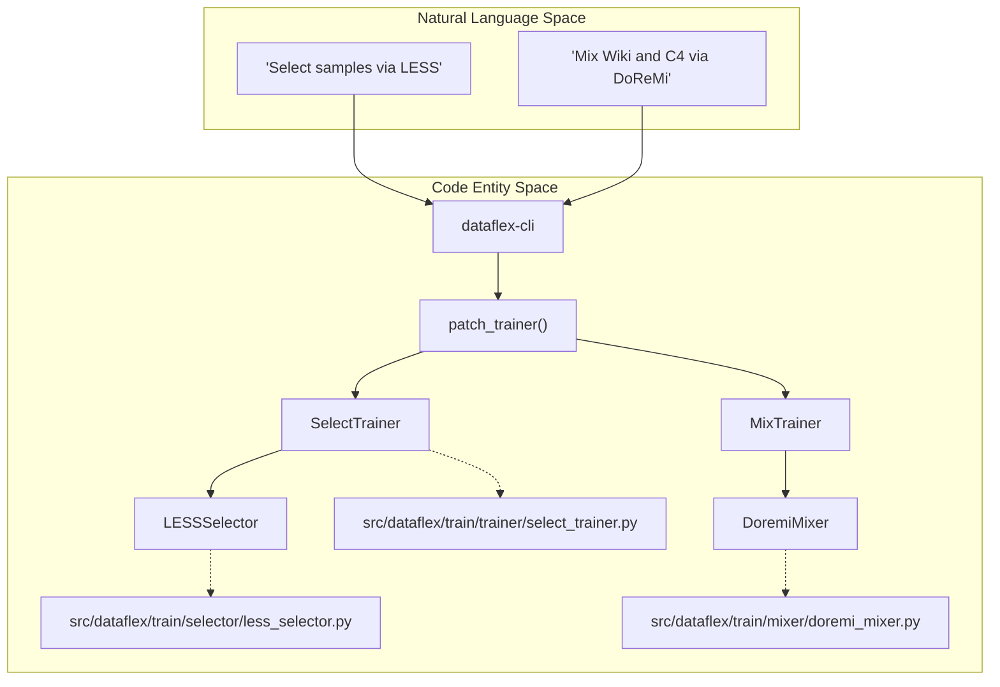
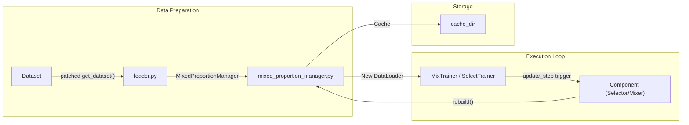

<!-- source: DeepWiki mcp.deepwiki.com · repo OpenDCAI/DataFlex · page 1 DataFlex Overview · fetched 2026-11-02 -->

# DataFlex Overview

<details>
<summary>Relevant source files</summary>

The following files were used as context for generating this wiki page:

- [README-zh.md](README-zh.md)
- [README.md](README.md)
- [pyproject.toml](pyproject.toml)
- [requirements.txt](requirements.txt)
- [skills/how_to_add_algorithm.md](skills/how_to_add_algorithm.md)
- [skills/how_to_use.md](skills/how_to_use.md)
- [src/dataflex/__init__.py](src/dataflex/__init__.py)
- [src/dataflex/version.py](src/dataflex/version.py)

</details>


DataFlex is a data-centric training framework designed to enhance Large Language Model (LLM) optimization by intelligently scheduling training data. Built as a non-invasive extension of [LLaMA-Factory](https://github.com/hiyouga/LLaMA-Factory), DataFlex enables researchers to implement and utilize complex data selection, mixing, and reweighting strategies directly within the training loop [README.md:32-38]().

The system integrates several state-of-the-art algorithms that are typically difficult to reproduce, providing a unified interface for data-centric AI experiments [README.md:35-37]().

## Core Capabilities

DataFlex operates across three primary dimensions of data control:

| Mode | Description | Key Algorithms |
| :--- | :--- | :--- |
| **Dynamic Selection** | Picks specific samples based on model state (e.g., "hard" samples). | LESS, NICE, Loss, Delta Loss, TSDS, NEAR [README.md:44-58]() |
| **Dynamic Mixing** | Adjusts ratios between different data domains (e.g., Wiki vs. Code). | DoReMi, ODM [README.md:62-71]() |
| **Dynamic Reweighting** | Adjusts per-sample loss weights during backpropagation. | Loss Reweighting [README.md:73-81]() |

For a deep dive into the underlying mechanics of these modes, see [Architecture & Design Principles](#1.1).

## Ecosystem Integration

DataFlex is designed as a drop-in wrapper for LLaMA-Factory. It utilizes runtime monkey-patching to inject data-centric logic without requiring permanent modifications to the LLaMA-Factory source code [skills/how_to_add_algorithm.md:7-12]().

### System Workflow: Natural Language to Code Entities
The following diagram illustrates how a user's high-level intent (Natural Language Space) translates into specific code entities and execution flows within DataFlex (Code Entity Space).

**Diagram: Intent to Execution Mapping**

Sources: [skills/how_to_add_algorithm.md:14-26](), [src/dataflex/train/selector/less_selector.py](), [src/dataflex/train/mixer/doremi_mixer.py]()

## Major Subsystems

DataFlex is organized into modular components managed by a central `Registry` [skills/how_to_add_algorithm.md:83-86]().

*   **CLI & Patching Layer**: Handled by `src/dataflex/cli.py`, this layer intercepts LLaMA-Factory's entry points to inject `DynamicFinetuningArguments` and specialized trainers [skills/how_to_add_algorithm.md:34-50]().
*   **Trainers**: Custom trainer classes (e.g., `SelectTrainer`, `MixTrainer`, `WeightTrainer`) that manage the "Model-in-the-Loop" lifecycle, including warmup and update steps [skills/how_to_use.md:75-151]().
*   **Components**: Specialized logic for algorithms.
    *   **Selectors**: Inherit from `BaseSelector` to return sample indices [skills/how_to_add_algorithm.md:112-124]().
    *   **Mixers**: Inherit from `BaseMixer` to return domain proportions [skills/how_to_add_algorithm.md:131-140]().
    *   **Weighters**: Inherit from `BaseWeighter` to modify the backward pass [skills/how_to_add_algorithm.md:147-160]().

### Data Flow & Component Interaction
This diagram bridges the conceptual "Training Loop" with the specific Python classes and files responsible for data movement.

**Diagram: Data Lifecycle in DataFlex**

Sources: [src/dataflex/train/data/loader.py](), [src/dataflex/train/dataset/mixed_proportion_manager.py](), [skills/how_to_add_algorithm.md:43-69]()

## Getting Started

DataFlex requires Python 3.10+ and can be installed via `pip` [README.md:89-101]().

```bash
pip install dataflex
# Or from source
pip install -e .
```

Training is invoked using `dataflex-cli`, which accepts standard LLaMA-Factory YAML configurations augmented with DataFlex-specific keys like `train_type` and `component_name` [skills/how_to_use.md:14-64]().

For detailed setup instructions, including NPU support and optional backends, see [Installation & Dependencies](#1.2).

---

