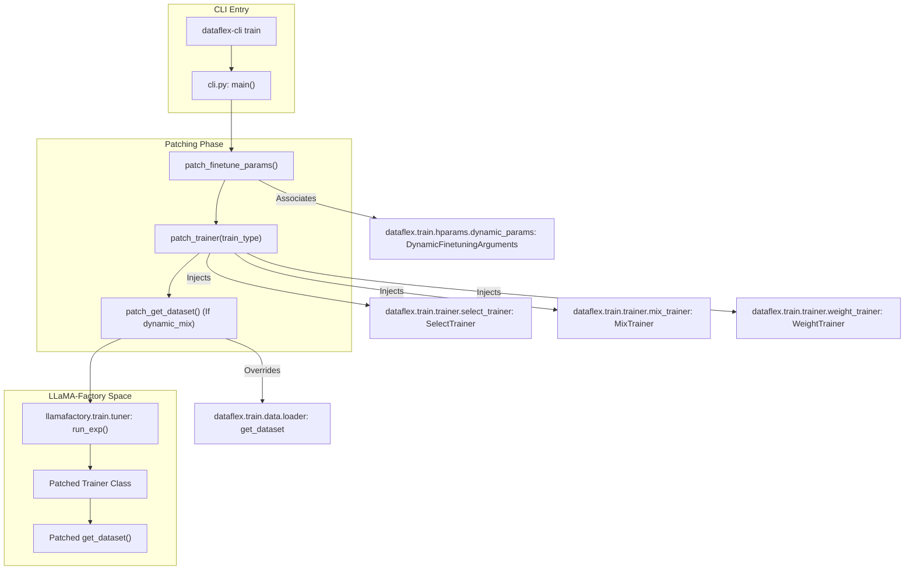

<!-- source: DeepWiki mcp.deepwiki.com · repo OpenDCAI/DataFlex · page 1.1 Architecture & Design Principles · fetched 2026-11-02 -->

# Architecture & Design Principles

<details>
<summary>Relevant source files</summary>

The following files were used as context for generating this wiki page:

- [.github/workflows/test.yml](.github/workflows/test.yml)
- [README-zh.md](README-zh.md)
- [README.md](README.md)
- [skills/how_to_add_algorithm.md](skills/how_to_add_algorithm.md)
- [skills/how_to_use.md](skills/how_to_use.md)
- [src/dataflex/cli.py](src/dataflex/cli.py)

</details>


DataFlex is a data-centric training framework designed to orchestrate data selection, mixture, and reweighting directly within the LLM training loop. It operates as a high-level wrapper around [LLaMA-Factory](https://github.com/hiyouga/LLaMA-Factory), extending its capabilities without requiring permanent modifications to the underlying library.

## Monkey-Patching Architecture

DataFlex utilizes a runtime monkey-patching strategy to inject custom logic into the LLaMA-Factory execution flow. This approach allows DataFlex to remain fully compatible with LLaMA-Factory's feature set (e.g., LoRA, DeepSpeed, FSDP) while intercepting critical points in the training lifecycle.

The patching process is managed by `src/dataflex/cli.py` and occurs in three primary stages before training begins:

1.  **Argument Patching**: `patch_finetune_params()` replaces LLaMA-Factory's `FinetuningArguments` and `DataArguments` with `DynamicFinetuningArguments` and `DataArguments` from DataFlex. This enables the system to recognize DataFlex-specific YAML fields like `train_type` and `component_name` `[src/dataflex/cli.py:41-49]()`.
2.  **Trainer Patching**: `patch_trainer()` identifies the `train_type` (e.g., `dynamic_select`) and replaces the standard `CustomSeq2SeqTrainer` or `CustomTrainer` in the `llamafactory.train` modules with a specialized DataFlex trainer class `[src/dataflex/cli.py:50-96]()`.
3.  **Data Loader Patching**: For `dynamic_mix` modes, `patch_get_dataset()` replaces the default LLaMA-Factory `get_dataset` function with a version that supports multi-source mixture management `[src/dataflex/cli.py:98-124]()`.

### DataFlex Initialization Flow
The following diagram illustrates how the `dataflex-cli` intercepts the standard training flow to apply patches.

"DataFlex Initialization Flow"

Sources: `[src/dataflex/cli.py:41-124]()`, `[skills/how_to_add_algorithm.md:7-26]()`.

## Training Modes & Model-in-the-Loop

DataFlex introduces three primary training modes that implement the "Model-in-the-Loop" concept. This means the model's current state (gradients, loss, or weights) is used to inform data scheduling decisions in real-time.

### 1. Dynamic Data Selection (`dynamic_select`)
Orchestrated by `SelectTrainer`, this mode implements a "Warmup-Update" cycle. Training begins with a random subset for `warmup_step` steps, after which the `Selector` component is invoked to select a new subset of indices based on criteria like gradient similarity (`LESS`) or loss distribution `[skills/how_to_use.md:75-91]()`.

*   **Key Class**: `SelectTrainer` `[src/dataflex/train/trainer/select_trainer.py]()`.
*   **Workflow**: The trainer triggers `selector.select()` at every `update_step`. It then calls `get_train_dataloader(indices)` to refresh the data stream without restarting the process `[skills/how_to_use.md:88-91]()`.

### 2. Dynamic Data Mixture (`dynamic_mix`)
Managed by `MixTrainer`, this mode adjusts the sampling proportions from multiple datasets (domains) during training. It is used for algorithms like `DoReMi` and `ODM` `[skills/how_to_use.md:98-113]()`.

*   **Key Class**: `MixTrainer` `[src/dataflex/train/trainer/mix_trainer.py]()`.
*   **Workflow**: The `MixedProportionManager` tracks domain-specific performance. The `Mixer` component calculates new weights, and the manager's `rebuild()` method updates the sampling distribution `[skills/how_to_use.md:111-113]()`.

### 3. Dynamic Data Reweighting (`dynamic_weight`)
Handled by `WeightTrainer`, this mode does not change the samples seen by the model but instead modifies the contribution of each sample to the total loss during the backward pass `[skills/how_to_use.md:132-143]()`.

*   **Key Class**: `WeightTrainer` `[src/dataflex/train/trainer/weight_trainer.py]()`.
*   **Workflow**: The trainer overrides the training step to allow a `Weighter` component to intercept the per-sample loss vector and apply a weighting strategy (e.g., emphasizing high-loss "hard" samples) `[skills/how_to_add_algorithm.md:147-162]()`.

## System Design & Component Registry

DataFlex uses a `Registry` system to decouple trainer logic from specific algorithm implementations. This allows users to add new selectors, mixers, or weighters by simply using a decorator.

"Code Entity Mapping: Registry & Components"
```mermaid
classDiagram
    class Registry {
        +dict _module_dict
        +register(category, name)
        +build(category, name, runtime, cfg)
    }

    class Selector {
        <<abstract>>
        +warmup()
        +select(model, step_id, num_samples)
    }

    class Mixer {
        <<abstract>>
        +mix(model, step_id)
    }

    class Weighter {
        <<abstract>>
        +get_weighted_loss(losses)
        +training_step()
    }

    Registry ..> Selector : builds
    Registry ..> Mixer : builds
    Registry ..> Weighter : builds

    style Selector font-style:italic
    style Mixer font-style:italic
    style Weighter font-style:italic
```
Sources: `[src/dataflex/core/registry.py:1-91]()`, `[skills/how_to_add_algorithm.md:81-105]()`.

### Component Loading Logic
1.  **Configuration**: Parameters for algorithms are defined in `src/dataflex/configs/components.yaml` `[skills/how_to_use.md:154-177]()`.
2.  **Registration**: Developers use `@register_selector("name")` to add classes to the `REGISTRY` `[skills/how_to_add_algorithm.md:88-91]()`.
3.  **Instantiation**: The `REGISTRY.build` method merges YAML configuration with runtime parameters (like `accelerator` or `dataset`) and instantiates the class using only the arguments declared in the component's `__init__` signature `[skills/how_to_add_algorithm.md:99-104]()`.

## Data Flow: Multi-Source Mixing
For `dynamic_mix`, DataFlex introduces the `MixedProportionManager` to handle complex sampling rules across disparate datasets.

| Rule | Description | Implementation |
| :--- | :--- | :--- |
| `mixture` | Samples according to specified floating-point proportions. | `MixedProportionManager` |
| `stratified` | Samples proportional to the total size of each source dataset. | `MixedProportionManager` |
| `uniform` | Samples an equal number of items from each source. | `MixedProportionManager` |

Sources: `[skills/how_to_use.md:66-71]()`, `[skills/how_to_add_algorithm.md:46-47]()`.

---

