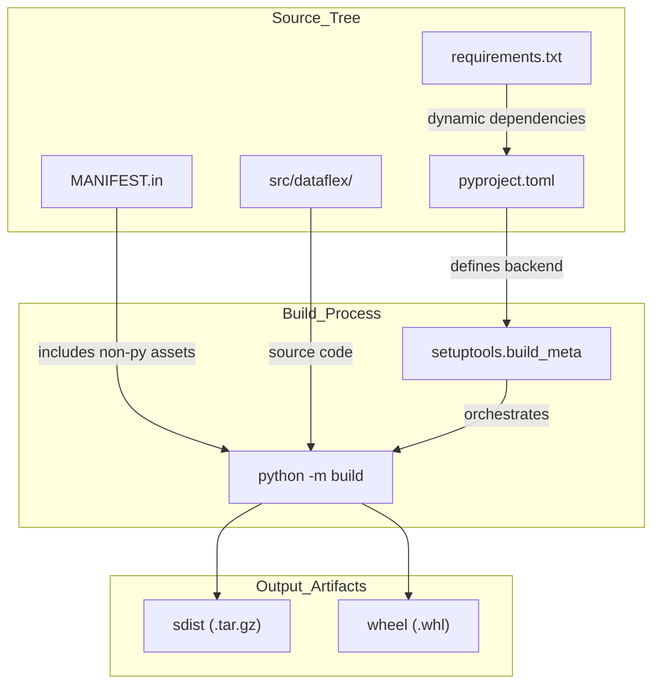
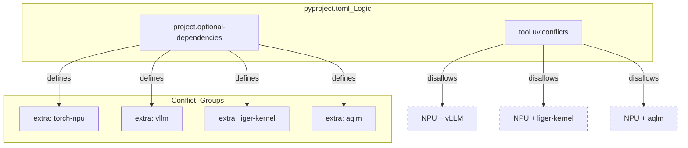

<!-- source: DeepWiki mcp.deepwiki.com · repo OpenDCAI/DataFlex · page 1.2 Installation & Dependencies · fetched 2026-11-02 -->

# Installation & Dependencies

Relevant source files

The following files were used as context for generating this wiki page:

- [.github/workflows/python-publish.yml](.github/workflows/python-publish.yml)
- [LICENSE](LICENSE)
- [MANIFEST.in](MANIFEST.in)
- [pyproject.toml](pyproject.toml)
- [requirements.txt](requirements.txt)

This page provides technical details regarding the installation process, dependency management, and optional hardware/software extensions for DataFlex. DataFlex utilizes a modern Python packaging stack centered around `uv` for dependency resolution and `setuptools` for builds, ensuring compatibility with the LLaMA-Factory ecosystem while maintaining its own suite of dynamic data selection tools.

## Core Installation

DataFlex is designed to be installed as a Python package. The installation process resolves core dependencies required for the dynamic training loops and basic model orchestration.

### Dependency Specification
The project defines its primary dependencies in `requirements.txt`, which are then dynamically loaded into the `project` metadata via `pyproject.toml` [pyproject.toml:69-69](). This approach ensures that the standalone requirements file remains the single source of truth for both development and distribution.

| Category | Key Packages | Version Constraints |
| :--- | :--- | :--- |
| **Deep Learning** | `torch`, `accelerate`, `trl`, `peft` | `torch>=2.4.0`, `accelerate>=1.3.0` |
| **Model Hubs** | `transformers`, `datasets` | `transformers>=4.41.2` (varies by Python version) |
| **Infrastructure** | `llamafactory` | `>=0.9.4` |
| **Data/Math** | `numpy`, `pandas`, `scipy`, `traker` | `numpy>=1.24.0`, `traker` (for LESS/NICE) |
| **Config/CLI** | `omegaconf`, `tyro`, `fire` | `omegaconf` (for YAML parsing) |

Sources: [requirements.txt:1-32](), [pyproject.toml:69-69]()

### Build and Distribution
DataFlex uses the `setuptools.build_meta` backend [pyproject.toml:1-3](). The `MANIFEST.in` file ensures that non-Python assets, such as default component configurations (`.yaml`), scripts (`.sh`), and JSON metadata, are included in the source distribution (sdist) and wheel [MANIFEST.in:1-14]().

**Package Distribution Diagram**
This diagram shows how the build system transforms the source tree into a distributable entity.

Sources: [pyproject.toml:1-30](), [MANIFEST.in:1-14](), [.github/workflows/python-publish.yml:23-24]()

## Optional Extras

DataFlex provides several "extras" to support specific hardware backends, quantization methods, and optimization kernels. These are defined in the `[project.optional-dependencies]` section of `pyproject.toml` [pyproject.toml:40-60]().

### Hardware & Kernel Support
*   **NPU Support (`torch-npu`)**: Specifically for Huawei Ascend hardware, pinning `torch` and `torch-npu` to `2.4.0` [pyproject.toml:42-42]().
*   **Flash Attention (`flash-attn`)**: High-performance attention kernels [pyproject.toml:44-44]().
*   **Liger Kernel (`liger-kernel`)**: Efficient Triton-based kernels for LLM training [pyproject.toml:45-45]().

### Inference & Quantization
*   **vLLM (`vllm`)**: Used for high-throughput embedding generation in offline selectors like `offline_near_selector.py` [pyproject.toml:51-51]().
*   **Quantization Backends**: Support for `bitsandbytes`, `hqq`, `eetq`, `gptq`, and `aqlm` [pyproject.toml:46-50]().

### Optimization Algorithms
*   **GaLore/Apollo/BAdam**: Low-rank and memory-efficient optimizers [pyproject.toml:52-55]().

Sources: [pyproject.toml:40-60]()

## Environment Conflict Management

Because DataFlex integrates multiple hardware backends and specialized kernels, certain combinations of dependencies are mutually exclusive. These rules are managed via the `[tool.uv]` configuration [pyproject.toml:101-115]().

### Conflict Rules
The `uv` resolver enforces the following constraints to prevent broken environments:
1.  **NPU vs. Specialized Kernels**: `torch-npu` cannot be installed alongside `liger-kernel` [pyproject.toml:107-110]().
2.  **NPU vs. vLLM**: `torch-npu` is incompatible with the standard `vllm` extra [pyproject.toml:111-114]().
3.  **NPU vs. AQLM**: `torch-npu` cannot coexist with `aqlm` quantization [pyproject.toml:103-106]().

**Dependency Resolution Logic**
This diagram maps the relationship between the `pyproject.toml` configuration and the resulting environment state.

Sources: [pyproject.toml:40-60](), [pyproject.toml:101-115]()

## CI/CD and Versioning

DataFlex uses GitHub Actions for automated building and publishing.

### Versioning System
The package version is dynamically fetched from `src/dataflex/version.py` using the `attr` directive in `setuptools` [pyproject.toml:68-68](). This ensures that the version string remains consistent across the CLI (`dataflex-cli version`) and the PyPI metadata.

### Publishing Workflow
The `python-publish.yml` workflow automates the release process:
1.  **Release Build**: Triggered on a GitHub release. It installs dependencies from `requirements.txt`, then uses the `build` module to create `sdist` and `wheel` [.github/workflows/python-publish.yml:17-24]().
2.  **Validation**: Uses `twine check` to verify the metadata of the generated artifacts [.github/workflows/python-publish.yml:27-27]().
3.  **PyPI Deployment**: Uploads the verified artifacts to PyPI using the official `pypa/gh-action-pypi-publish` action with OpenID Connect (OIDC) permissions [.github/workflows/python-publish.yml:35-54]().

Sources: [pyproject.toml:68-68](), [.github/workflows/python-publish.yml:1-54]()

---

