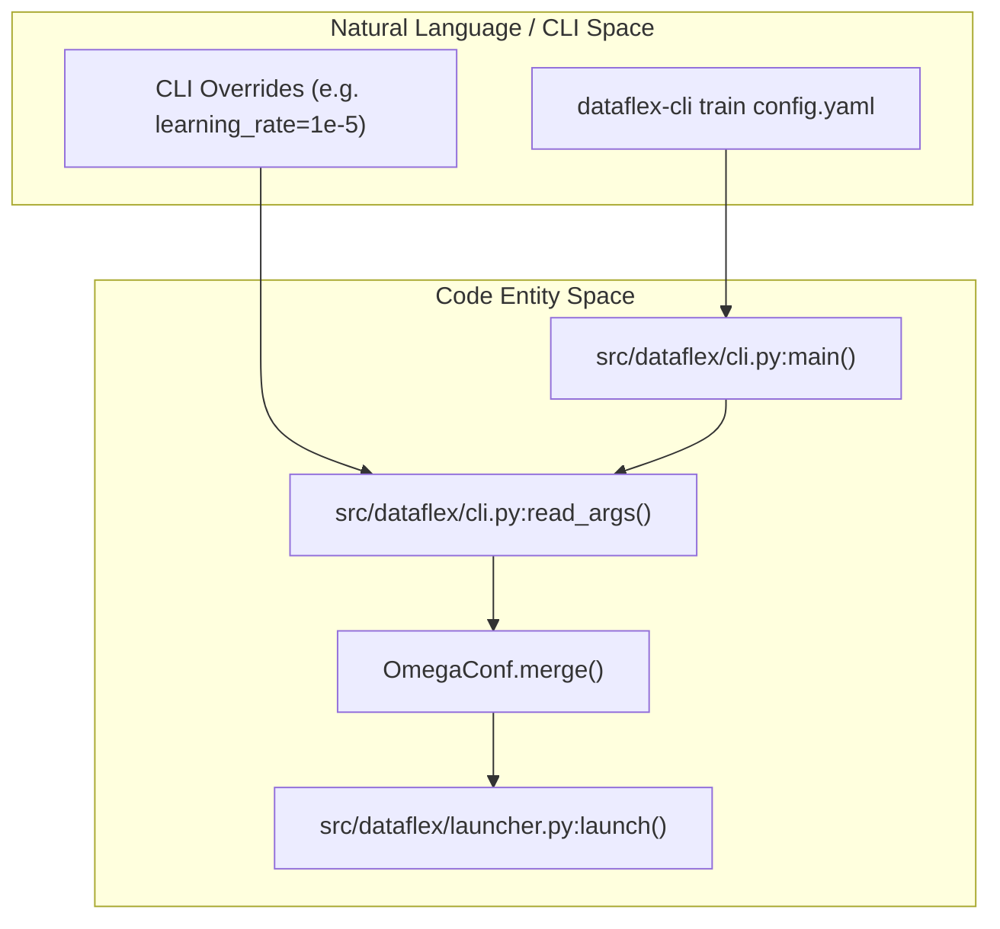
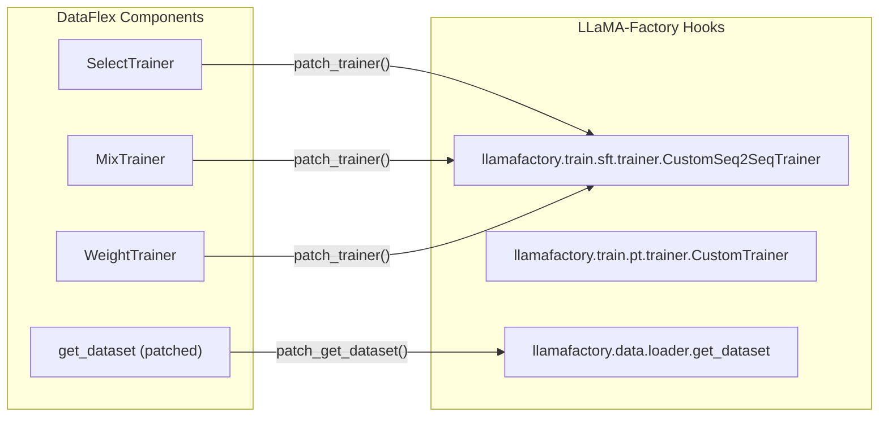

<!-- source: DeepWiki mcp.deepwiki.com · repo OpenDCAI/DataFlex · page 2 CLI & Entry Points · fetched 2026-11-02 -->

# CLI & Entry Points

Relevant source files

The following files were used as context for generating this wiki page:

- [.github/workflows/test.yml](.github/workflows/test.yml)
- [src/dataflex/cli.py](src/dataflex/cli.py)
- [src/dataflex/launcher.py](src/dataflex/launcher.py)

DataFlex is designed to wrap LLaMA-Factory seamlessly, providing a unified command-line interface (CLI) that manages the lifecycle of monkey-patching and training orchestration. Users interact with DataFlex primarily through the `dataflex-cli` command, which handles configuration merging, environment setup, and distributed execution.

## The `dataflex-cli` Command

The `dataflex-cli` is the primary entry point for all DataFlex operations. It supports subcommands like `train` and `version` [src/dataflex/cli.py:159-164](). When running a training job, the CLI reads YAML configurations and CLI overrides using **OmegaConf**, merges them, and then initiates the patching process before handing control over to the training engine [src/dataflex/cli.py:125-135]().

For multi-GPU or multi-node environments, the CLI automatically detects the device count and wraps the execution in `torchrun` unless Ray is being used [src/dataflex/cli.py:180-184](). Users can also force this behavior by setting the `FORCE_TORCHRUN` environment variable [src/dataflex/cli.py:179]().

For details, see [dataflex-cli Command](#2.1).

### CLI to Code Mapping
The following diagram illustrates how CLI arguments are transformed into internal configuration objects and passed to the launcher.

**Diagram: CLI Execution Flow**

**Sources:** [src/dataflex/cli.py:125-135](), [src/dataflex/cli.py:157-196](), [src/dataflex/launcher.py:134-147]()

---

## Configuration Reference

DataFlex extends the standard LLaMA-Factory configuration schema with specific fields to control dynamic data selection, mixing, and reweighting. Key parameters include `train_type` (which selects the orchestration mode), `warmup_step`, and `update_step` [src/dataflex/cli.py:58-70](). 

Configurations are typically defined in YAML files, but the CLI supports full OmegaConf syntax for overriding nested parameters on the fly. This allows for rapid experimentation without modifying static files.

For details, see [Configuration Reference](#2.2).

---

## Patching Lifecycle

The core innovation of DataFlex is its non-invasive "patching" mechanism. Instead of forking LLaMA-Factory, DataFlex modifies its behavior at runtime by replacing key classes and functions with DataFlex-specific implementations.

The patching occurs in three stages within `src/dataflex/cli.py`:
1.  **Hparams Patching**: Replaces `FinetuningArguments` and `DataArguments` to support DataFlex-specific YAML fields [src/dataflex/cli.py:41-49]().
2.  **Trainer Patching**: Based on the `train_type` in the config, it injects `SelectTrainer`, `MixTrainer`, or `WeightTrainer` into the `llamafactory` namespace [src/dataflex/cli.py:50-95]().
3.  **Data Loader Patching**: Specifically for `dynamic_mix` mode, it replaces the `get_dataset` function to allow for per-domain sampling adjustments [src/dataflex/cli.py:98-124]().

**Diagram: Patching Architecture**

**Sources:** [src/dataflex/cli.py:50-95](), [src/dataflex/cli.py:98-124](), [src/dataflex/launcher.py:47-92]()

---

## Launcher and Distributed Execution

The `src/dataflex/launcher.py` script serves as the target for `torchrun`. When a distributed job is launched, `torchrun` executes `launcher.py` on every rank. The launcher repeats the patching process to ensure the local Python environment on every worker is correctly configured before calling `llamafactory.train.tuner.run_exp()` [src/dataflex/launcher.py:134-143]().

The CLI manages the orchestration of these processes by setting `MASTER_ADDR`, `MASTER_PORT`, and calculating `NPROC_PER_NODE` based on available hardware [src/dataflex/cli.py:181-193]().

**Sources:** [src/dataflex/cli.py:179-196](), [src/dataflex/launcher.py:134-147](), [.github/workflows/test.yml:62-69]()

---

