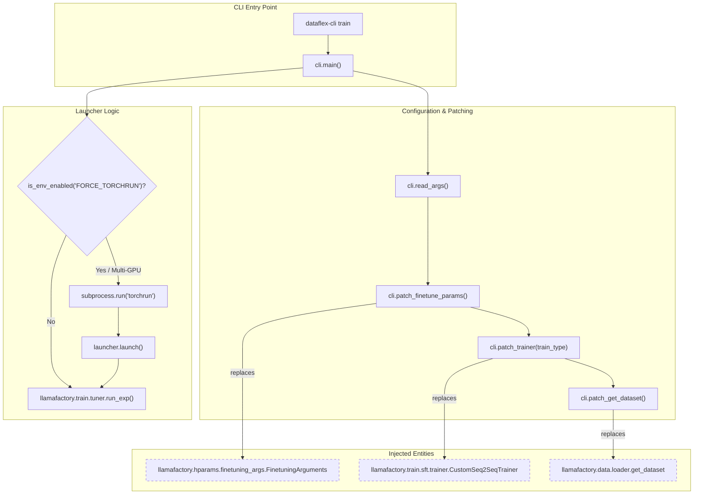
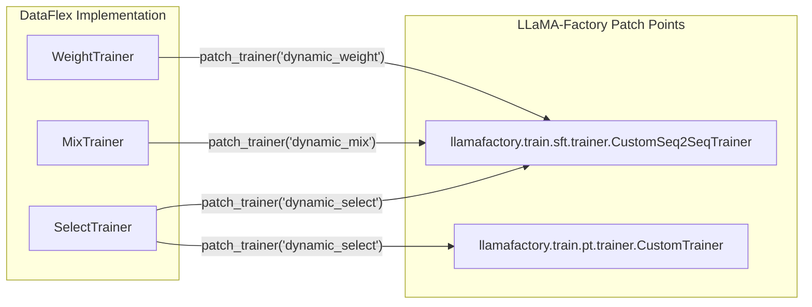

<!-- source: DeepWiki mcp.deepwiki.com · repo OpenDCAI/DataFlex · page 2.1 dataflex-cli Command · fetched 2026-11-02 -->

# dataflex-cli Command

<details>
<summary>Relevant source files</summary>

The following files were used as context for generating this wiki page:

- [.github/workflows/test.yml](.github/workflows/test.yml)
- [README-zh.md](README-zh.md)
- [skills/how_to_add_algorithm.md](skills/how_to_add_algorithm.md)
- [skills/how_to_use.md](skills/how_to_use.md)
- [src/dataflex/cli.py](src/dataflex/cli.py)
- [src/dataflex/launcher.py](src/dataflex/launcher.py)

</details>


The `dataflex-cli` is the primary entry point for the DataFlex system. It wraps the [LLaMA-Factory](https://github.com/hiyouga/LLaMA-Factory) command-line interface, extending it with dynamic data scheduling capabilities through runtime monkey-patching.

## Command Overview

The CLI provides two primary subcommands: `train` and `version`. The `train` command is the core driver for all dynamic training modes (Selection, Mixing, and Reweighting).

### Subcommands and Syntax

| Subcommand | Usage | Description |
|:---|:---|:---|
| `train` | `dataflex-cli train <config.yaml> [overrides]` | Launches the training process with optional OmegaConf overrides. |
| `version` | `dataflex-cli version` | Displays the installed DataFlex version and welcome message. |

**Source:** [src/dataflex/cli.py:158-164]()

---

## The `train` Subcommand

When `dataflex-cli train` is invoked, the system performs a sequence of initialization steps before handing control over to the LLaMA-Factory execution engine.

### Argument Parsing and OmegaConf Overrides
DataFlex uses `OmegaConf` to manage configurations. It supports loading a base YAML file and applying command-line overrides using the `key=value` syntax [src/dataflex/cli.py:125-135]().

**Example:**
```bash
dataflex-cli train examples/train_lora/selectors/less.yaml learning_rate=5e-5 warmup_step=20
```

### Initialization Workflow
The `main()` function in `cli.py` orchestrates the following lifecycle:
1. **Config Loading**: Merges the YAML file with CLI overrides [src/dataflex/cli.py:165]().
2. **Hparam Patching**: Replaces LLaMA-Factory argument classes with `DynamicFinetuningArguments` and `DataArguments` to support DataFlex-specific fields [src/dataflex/cli.py:41-49]().
3. **Trainer Patching**: Injects a specialized trainer (`SelectTrainer`, `MixTrainer`, or `WeightTrainer`) into the LLaMA-Factory namespace based on the `train_type` field [src/dataflex/cli.py:50-96]().
4. **Dataset Patching**: If `train_type` is `dynamic_mix`, it replaces the standard `get_dataset` function with the DataFlex implementation to support multi-source mixing [src/dataflex/cli.py:98-124]().
5. **Execution**: Hands off the patched environment to `llamafactory.train.tuner.run_exp()` [src/dataflex/cli.py:171]().

**Sources:** [src/dataflex/cli.py:157-171](), [skills/how_to_add_algorithm.md:7-12]()

---

## Distributed Training & `FORCE_TORCHRUN`

DataFlex automatically detects multi-GPU environments. If the device count is greater than 1, or if the environment variable `FORCE_TORCHRUN=1` is set, the CLI transitions from a direct process to a distributed execution via `torchrun` [src/dataflex/cli.py:179-184]().

### Environment Variables
The launcher respects standard distributed training environment variables:
- `NNODES`: Number of nodes (default: 1).
- `NODE_RANK`: Rank of the current node (default: 0).
- `NPROC_PER_NODE`: Number of processes per node (default: device count).
- `MASTER_ADDR`: IP address of the master node (default: 127.0.0.1).
- `MASTER_PORT`: Port for communication (default: random between 20001-29999).

**Sources:** [src/dataflex/cli.py:180-202](), [skills/how_to_use.md:32-36]()

---

## Implementation Architecture

The following diagrams illustrate how the `dataflex-cli` bridges user-level commands to the underlying code entities and patches the LLaMA-Factory framework.

### CLI Execution and Patching Flow
"Natural Language Space" (Commands) to "Code Entity Space" (Classes/Functions).


**Sources:** [src/dataflex/cli.py:157-202](), [src/dataflex/launcher.py:134-144](), [skills/how_to_add_algorithm.md:14-26]()

### Trainer Injection Mapping
Detailed mapping of `train_type` configuration to the specific DataFlex Trainer class injected into LLaMA-Factory.

| `train_type` Value | Target Trainer Class | Target LLaMA-Factory Module |
|:---|:---|:---|
| `dynamic_select` | `SelectTrainer` | `llamafactory.train.sft.trainer.CustomSeq2SeqTrainer` |
| `dynamic_mix` | `MixTrainer` | `llamafactory.train.sft.trainer.CustomSeq2SeqTrainer` |
| `dynamic_weight` | `WeightTrainer` | `llamafactory.train.sft.trainer.CustomSeq2SeqTrainer` |
| `static` | `None` (Standard LF) | N/A |


**Sources:** [src/dataflex/cli.py:58-95](), [src/dataflex/launcher.py:47-92]()

---

## The `version` Subcommand

The `version` subcommand provides a simple utility to verify the installation and versioning of the package.

### Version Retrieval
The CLI attempts to retrieve the version using `importlib.metadata`. It prints a welcome banner and the currently installed version string [src/dataflex/cli.py:137-155]().

**Example Output:**
```text
============================================================
 🎉 Welcome to DataFlex, a data-centric training system.
 🚀 Installed version: 0.1.0
============================================================
```

**Sources:** [src/dataflex/cli.py:137-162](), [.github/workflows/test.yml:67-68]()

---

