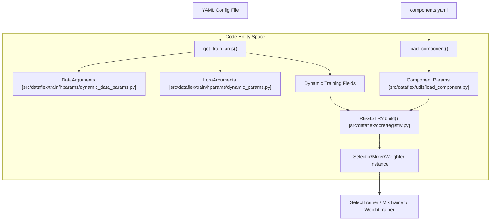
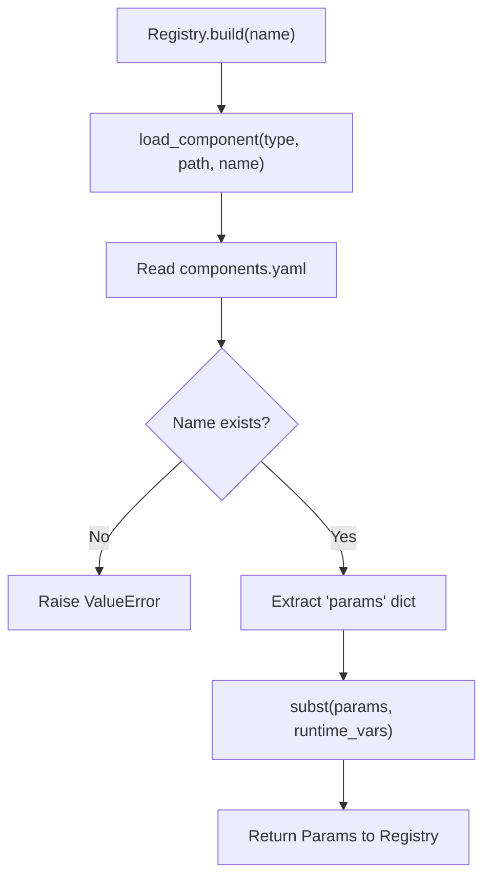

<!-- source: DeepWiki mcp.deepwiki.com · repo OpenDCAI/DataFlex · page 2.2 Configuration Reference · fetched 2026-11-02 -->

# Configuration Reference

Relevant source files

The following files were used as context for generating this wiki page:

- [src/dataflex/configs/components.yaml](src/dataflex/configs/components.yaml)
- [src/dataflex/train/hparams/__init__.py](src/dataflex/train/hparams/__init__.py)
- [src/dataflex/train/hparams/dynamic_data_params.py](src/dataflex/train/hparams/dynamic_data_params.py)
- [src/dataflex/train/hparams/dynamic_params.py](src/dataflex/train/hparams/dynamic_params.py)
- [src/dataflex/train/mixer/base_mixer.py](src/dataflex/train/mixer/base_mixer.py)
- [src/dataflex/train/mixer/random_mixer.py](src/dataflex/train/mixer/random_mixer.py)
- [src/dataflex/utils/load_component.py](src/dataflex/utils/load_component.py)

DataFlex utilizes a hierarchical configuration system that merges standard LLaMA-Factory parameters with DataFlex-specific dynamic training arguments and a component-based parameter registry. This page serves as a technical reference for all available configuration fields and the structure of the `components.yaml` file.

## 1. Configuration Architecture

The configuration lifecycle involves three distinct layers:
1.  **Standard Training Arguments**: Fields inherited from LLaMA-Factory for model, data, and training hyper-parameters.
2.  **DataFlex Dynamic Arguments**: Fields defined in `src/dataflex/train/hparams/` that control the behavior of selectors, mixers, and weighers.
3.  **Component Parameters**: Algorithm-specific parameters defined in `src/dataflex/configs/components.yaml` and loaded via the `REGISTRY`.

### Data Flow and Initialization
The following diagram illustrates how configurations are parsed and used to instantiate the training environment.

**Configuration Parsing and Entity Association**

Sources: [src/dataflex/train/hparams/dynamic_data_params.py:22-24](), [src/dataflex/train/hparams/dynamic_params.py:56-58](), [src/dataflex/utils/load_component.py:4-24](), [src/dataflex/core/registry.py:1-40]()

---

## 2. DataFlex-Specific Fields

These fields are added to the standard LLaMA-Factory YAML schema to enable dynamic data orchestration.

### 2.1 Core Orchestration Fields
| Field | Type | Description |
| :--- | :--- | :--- |
| `train_type` | `str` | Determines the training mode: `dynamic_select`, `dynamic_mix`, or `dynamic_weight`. |
| `component_name` | `str` | The name of the algorithm to load from the registry (e.g., `less`, `doremi`, `loss`). |
| `warmup_step` | `int` | Number of initial steps before the dynamic algorithm starts updating proportions or selections. |
| `update_step` | `int` | Frequency (in steps) at which the selector/mixer/weighter is invoked to update data state. |
| `update_times` | `int` | Total number of times the selection/mixing state should be updated during training. |
| `static_mix` | `bool` | If true, uses fixed proportions throughout training (often used in DoReMi Step 1/3). |
| `train_step` | `int` | Used in specific mixers to define total training steps independent of LLaMA-Factory's `max_steps`. |
| `freeze_gate` | `bool` | Specific to MoE models; freezes the router/gate layers during dynamic mixing updates. |

### 2.2 Data Management Fields
Located in `DataArguments` [src/dataflex/train/hparams/dynamic_data_params.py:22-152]():
*   **`mixture_sample_rule`**: Defines how `MixedProportionManager` samples from multiple sources. Choices: `mixture`, `stratified`, `uniform` [src/dataflex/train/hparams/dynamic_data_params.py:141-144]().
*   **`init_mixture_proportions`**: A list of floats representing the starting probability distribution for datasets [src/dataflex/train/hparams/dynamic_data_params.py:145-148]().
*   **`mixer_eval_dataset`**: Separate dataset(s) used by mixers (like `DynamicMoeMixer`) to evaluate gate loads or domain losses [src/dataflex/train/hparams/dynamic_data_params.py:149-152]().

---

## 3. The components.yaml File

The `src/dataflex/configs/components.yaml` file is the central repository for algorithm-specific hyperparameters. It is divided into three top-level keys: `selectors`, `mixers`, and `weighters`.

### 3.1 Selectors Reference
Used when `train_type: dynamic_select`.

| Selector | Key Parameters | Purpose |
| :--- | :--- | :--- |
| **NICE** | `proj_dim`, `mc_samples`, `reward_model_backend` | RL-based selection using gradient similarity to a reward signal [src/dataflex/configs/components.yaml:4-32](). |
| **LESS** | `gradient_type`, `proj_dim` | Influence-based selection using Adam/SGD gradient projections [src/dataflex/configs/components.yaml:34-42](). |
| **Loss** | `focus` (low/medium/high) | Selects samples based on their raw loss value distribution [src/dataflex/configs/components.yaml:43-48](). |
| **Delta Loss**| `window_size` | Curriculum-based selection using the change in loss over time [src/dataflex/configs/components.yaml:49-54](). |

### 3.2 Mixers Reference
Used when `train_type: dynamic_mix`.

| Mixer | Key Parameters | Purpose |
| :--- | :--- | :--- |
| **DoReMi** | `reference_model_path`, `reweight_eta`, `reweight_eps` | Domain reweighting based on excess loss relative to a reference model [src/dataflex/configs/components.yaml:85-95](). |
| **ODM** | `alpha`, `reward_scale`, `min_exploration_rate` | Online Data Mixing using the Exp3 Multi-Armed Bandit algorithm [src/dataflex/configs/components.yaml:106-130](). |
| **Dynamic MoE**| `eta`, `collect_steps`, `eval_samples` | Adjusts mixing proportions based on Mixture-of-Experts gate utilization [src/dataflex/configs/components.yaml:131-139](). |

### 3.3 Weighters Reference
Used when `train_type: dynamic_weight`.

| Weighter | Key Parameters | Purpose |
| :--- | :--- | :--- |
| **Loss** | `strategy` (linupper, uniform, quadratic), `delta` | Per-sample loss reweighting to emphasize specific difficulty levels [src/dataflex/configs/components.yaml:142-147](). |

---

## 4. Implementation Detail: Component Loading

The function `load_component` [src/dataflex/utils/load_component.py:4-24]() is responsible for fetching parameters from the YAML file. It supports **Runtime Variable Substitution**, allowing the use of placeholders like `${output_dir}` which are resolved at training time.

**Component Loading Logic**

Sources: [src/dataflex/utils/load_component.py:4-24](), [src/dataflex/configs/components.yaml:1-152]()

## 5. Standard LLaMA-Factory Field Extensions

DataFlex inherits and respects standard fields while extending their utility:
*   **LoRA Arguments**: `lora_rank`, `lora_alpha`, and `lora_target` are critical when using selectors like `LESS` or `NICE`, as gradients are typically computed with respect to these adapters [src/dataflex/train/hparams/dynamic_params.py:57-124]().
*   **Freeze Arguments**: `freeze_trainable_layers` allows for partial parameter training, which is compatible with `dynamic_weight` modes [src/dataflex/train/hparams/dynamic_params.py:21-54]().

Sources:
- [src/dataflex/configs/components.yaml:1-152]()
- [src/dataflex/train/hparams/dynamic_data_params.py:22-152]()
- [src/dataflex/train/hparams/dynamic_params.py:21-124]()
- [src/dataflex/utils/load_component.py:4-24]()
- [src/dataflex/train/mixer/random_mixer.py:7-26]()
- [src/dataflex/train/mixer/base_mixer.py:4-21]()

---

