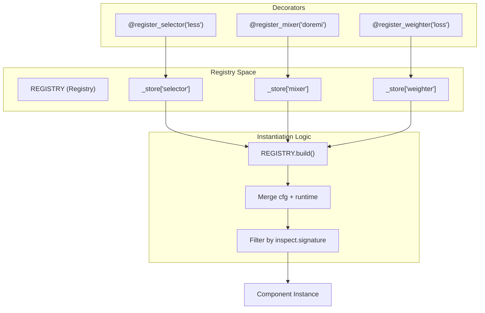
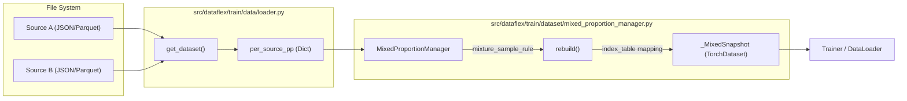

<!-- source: DeepWiki mcp.deepwiki.com · repo OpenDCAI/DataFlex · page 3 Core Infrastructure · fetched 2026-11-02 -->

# Core Infrastructure

Relevant source files

The following files were used as context for generating this wiki page:

- [src/dataflex/core/__init__.py](src/dataflex/core/__init__.py)
- [src/dataflex/core/registry.py](src/dataflex/core/registry.py)
- [src/dataflex/train/data/loader.py](src/dataflex/train/data/loader.py)
- [src/dataflex/train/dataset/__init__.py](src/dataflex/train/dataset/__init__.py)
- [src/dataflex/train/dataset/mixed_proportion_manager.py](src/dataflex/train/dataset/mixed_proportion_manager.py)
- [src/dataflex/train/mixer/static_mixer.py](src/dataflex/train/mixer/static_mixer.py)
- [src/dataflex/utils/__init__.py](src/dataflex/utils/__init__.py)

The Core Infrastructure of DataFlex provides the foundational mechanisms for component management and data handling that enable dynamic training. It bridges the gap between static configuration and the runtime execution of selectors, mixers, and weighters. This layer ensures that regardless of the training mode selected, the system can consistently load datasets, manage proportions, and instantiate the necessary algorithmic components.

## Registry & Component System

The `Registry` is the central authority for managing the lifecycle of DataFlex components. It uses a decorator-based registration pattern to map string identifiers (from YAML configurations) to Python classes. This decoupling allows users to easily plug in custom algorithms without modifying the core trainer logic.

### Component Registration and Instantiation
The system categorizes components into three types: `selector`, `mixer`, and `weighter`. When a trainer is initialized, it uses the `REGISTRY.build` method to instantiate the requested component, merging static configuration parameters with runtime dependencies (like the model or tokenizer).

**Registry Architecture**

For details on implementing custom components and the internal merging logic, see **[Registry & Component System](#3.1)**.

**Sources:**
- `Registry` class definition: [src/dataflex/core/registry.py:4-28]()
- Registration decorators: [src/dataflex/core/registry.py:30-32]()
- Mixer registration example: [src/dataflex/train/mixer/static_mixer.py:7-8]()

---

## Data Loading & MixedProportionManager

DataFlex extends the standard LLaMA-Factory data pipeline to support multi-source datasets and dynamic resampling. This is primarily achieved through a patched `get_dataset` function and the `MixedProportionManager`, which maintains the state of data mixtures throughout the training process.

### The Loading Lifecycle
1.  **Per-Source Loading**: Unlike standard training which merges all data immediately, DataFlex loads datasets into a `per_source_pp` (preprocessed) dictionary [src/dataflex/train/data/loader.py:114-119]().
2.  **Manager Initialization**: A `MixedProportionManager` is created to wrap these sources, handling the sampling logic based on rules like `mixture`, `stratified`, or `uniform` [src/dataflex/train/dataset/mixed_proportion_manager.py:31-58]().
3.  **Snapshot Generation**: The manager produces `_MixedSnapshot` objects—read-only, index-mapped datasets that the `DataLoader` can consume [src/dataflex/train/dataset/mixed_proportion_manager.py:7-22]().

**Data Flow: From Raw Files to Trainer**

### MixedProportionManager Roles
The manager is responsible for calculating sampling probabilities and generating a global index table. It ensures that even when proportions change (e.g., during a DoReMi update), the resulting dataset remains compatible with the training loop. It also injects a `domain_id` into every sample to facilitate per-source loss tracking [src/dataflex/train/dataset/mixed_proportion_manager.py:18-21]().

For details on sampling rules and the rebuild process, see **[Data Loading & MixedProportionManager](#3.2)**.

**Sources:**
- `get_dataset` implementation: [src/dataflex/train/data/loader.py:42-152]()
- `MixedProportionManager` class: [src/dataflex/train/dataset/mixed_proportion_manager.py:24-107]()
- `_MixedSnapshot` logic: [src/dataflex/train/dataset/mixed_proportion_manager.py:7-22]()
- Sampling rule logic: [src/dataflex/train/dataset/mixed_proportion_manager.py:60-84]()

---

