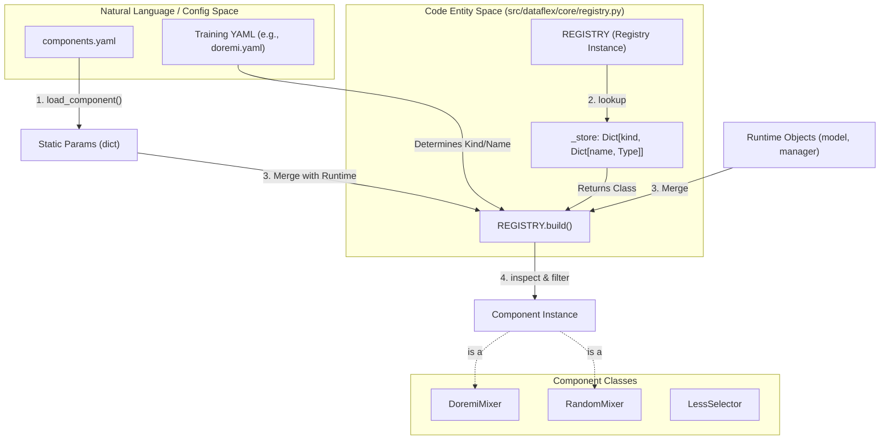
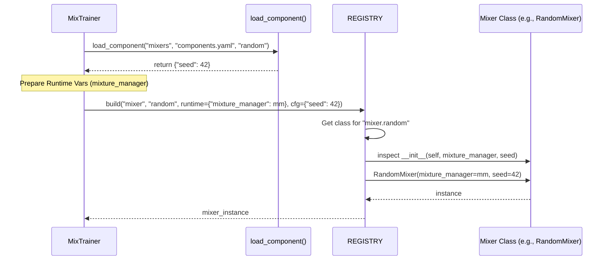

<!-- source: DeepWiki mcp.deepwiki.com · repo OpenDCAI/DataFlex · page 3.1 Registry & Component System · fetched 2026-11-02 -->

# Registry & Component System

<details>
<summary>Relevant source files</summary>

The following files were used as context for generating this wiki page:

- [src/dataflex/configs/components.yaml](src/dataflex/configs/components.yaml)
- [src/dataflex/core/__init__.py](src/dataflex/core/__init__.py)
- [src/dataflex/core/registry.py](src/dataflex/core/registry.py)
- [src/dataflex/train/hparams/dynamic_data_params.py](src/dataflex/train/hparams/dynamic_data_params.py)
- [src/dataflex/train/mixer/base_mixer.py](src/dataflex/train/mixer/base_mixer.py)
- [src/dataflex/train/mixer/random_mixer.py](src/dataflex/train/mixer/random_mixer.py)
- [src/dataflex/utils/__init__.py](src/dataflex/utils/__init__.py)
- [src/dataflex/utils/load_component.py](src/dataflex/utils/load_component.py)

</details>


The **Registry & Component System** is the central nervous system of DataFlex. It provides a decoupled architecture for managing algorithms across the three primary training modes: Selection, Mixing, and Reweighting. By using a centralized `Registry` class and a YAML-based configuration, DataFlex allows developers to swap complex logic (like `DoremiMixer` or `LessSelector`) without modifying the core trainer loops.

## The Registry Class

The `Registry` class, defined in [src/dataflex/core/registry.py:4-28](), is a singleton-pattern container that maps string identifiers to Python classes. It handles the registration, retrieval, and instantiation (building) of components.

### Internal Storage
The registry uses a nested dictionary `_store` where the first key is the **kind** (e.g., "selector", "mixer", "weighter") and the second key is the **name** of the specific algorithm [src/dataflex/core/registry.py:6-6]().

### Registration Decorators
DataFlex provides three specialized decorators to register new components into the global `REGISTRY` object:
- `@register_selector(name)`: Adds a class to the "selector" bucket [src/dataflex/core/registry.py:30-30]().
- `@register_mixer(name)`: Adds a class to the "mixer" bucket [src/dataflex/core/registry.py:31-31]().
- `@register_weighter(name)`: Adds a class to the "weighter" bucket [src/dataflex/core/registry.py:32-32]().

**Example Implementation:**
[src/dataflex/train/mixer/random_mixer.py:7-8]()
```python
@register_mixer("random")
class RandomMixer(Mixer):
    # Implementation...
```

**Sources:** [src/dataflex/core/registry.py:1-33](), [src/dataflex/train/mixer/random_mixer.py:1-12]()

---

## Component Loading Workflow

The lifecycle of a component involves reading static parameters from a configuration file and merging them with runtime objects (like the model or data manager).

### 1. Static Configuration: `load_component`
The `load_component` function [src/dataflex/utils/load_component.py:4-24]() is responsible for reading `src/dataflex/configs/components.yaml`. 

- **Filtering:** It navigates the YAML tree using the `type` (kind) and `name` [src/dataflex/utils/load_component.py:7-11]().
- **Variable Substitution:** It supports simple placeholder replacement (e.g., `${output_dir}`) if `runtime_vars` are provided [src/dataflex/utils/load_component.py:14-22]().

### 2. Parameter Merging: `REGISTRY.build`
The `build` method [src/dataflex/core/registry.py:20-27]() is the final step of instantiation. It performs a "Smart Merge" between two sources:
1.  **`cfg`**: Static parameters loaded from YAML.
2.  **`runtime`**: Objects created during training (e.g., the `model`, `tokenizer`, or `mixture_manager`).

**Merge Logic:**
- **Priority:** Runtime dependencies override configuration values [src/dataflex/core/registry.py:23-23]().
- **Inspection:** It uses `inspect.signature` to check the `__init__` method of the target class [src/dataflex/core/registry.py:24-25]().
- **Filtering:** It only passes arguments that the class constructor explicitly accepts, preventing `TypeError` from unexpected YAML fields [src/dataflex/core/registry.py:26-27]().

### Diagram: From YAML to Code Entity
The following diagram illustrates how a string name in a YAML configuration is resolved to a specific Python class and instantiated with merged parameters.

**Component Instantiation Flow**

**Sources:** [src/dataflex/core/registry.py:20-27](), [src/dataflex/utils/load_component.py:4-24](), [src/dataflex/configs/components.yaml:1-152]()

---

## Configuration Schema (`components.yaml`)

The `components.yaml` file [src/dataflex/configs/components.yaml:1-152]() acts as a central repository for algorithm-specific hyperparameters.

| Component Type | Examples | Key Parameters |
| :--- | :--- | :--- |
| **Selectors** | `nice`, `less`, `loss` | `cache_dir`, `gradient_type`, `proj_dim`, `mc_samples` |
| **Mixers** | `doremi`, `odm`, `static` | `reweight_eta`, `alpha`, `warmup_steps`, `proportions` |
| **Weighters** | `loss`, `custom` | `strategy`, `delta` |

**Sources:** [src/dataflex/configs/components.yaml:1-152]()

---

## Data Flow: Building a Mixer

This diagram bridges the gap between the `Registry` logic and the actual training execution by showing how a `Mixer` is prepared for a `MixTrainer`.

**Mixer Initialization Sequence**


**Sources:** [src/dataflex/core/registry.py:20-27](), [src/dataflex/train/mixer/random_mixer.py:7-11](), [src/dataflex/utils/load_component.py:4-11]()

---

