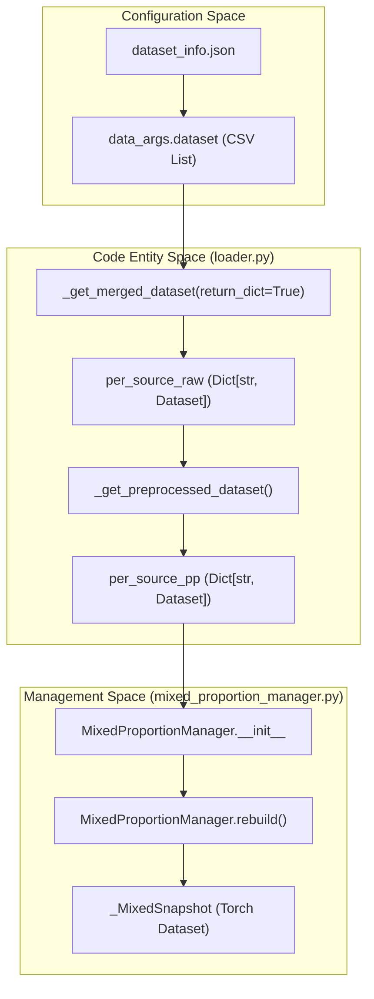
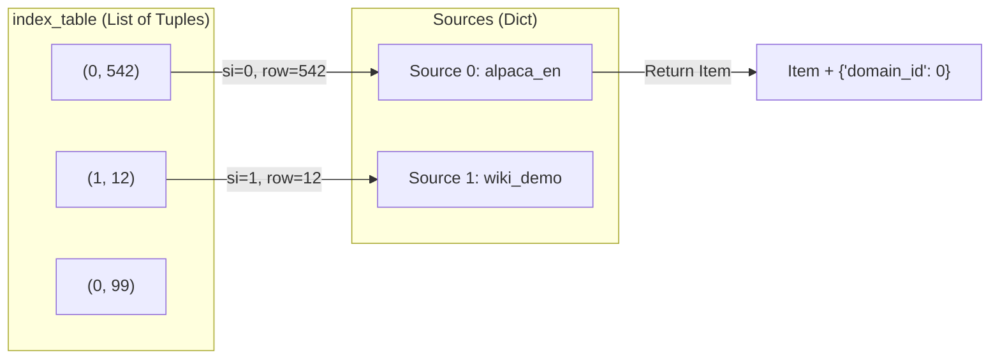

<!-- source: DeepWiki mcp.deepwiki.com · repo OpenDCAI/DataFlex · page 3.2 Data Loading & MixedProportionManager · fetched 2026-11-02 -->

# Data Loading & MixedProportionManager

<details>
<summary>Relevant source files</summary>

The following files were used as context for generating this wiki page:

- [data/c4_demo.jsonl](data/c4_demo.jsonl)
- [data/dataset_info.json](data/dataset_info.json)
- [data/wiki_demo.jsonl](data/wiki_demo.jsonl)
- [examples/train_lora/mixers/doremi_step2_dynamic_qwen_pt_lora.yaml](examples/train_lora/mixers/doremi_step2_dynamic_qwen_pt_lora.yaml)
- [src/dataflex/train/data/loader.py](src/dataflex/train/data/loader.py)
- [src/dataflex/train/dataset/__init__.py](src/dataflex/train/dataset/__init__.py)
- [src/dataflex/train/dataset/mixed_proportion_manager.py](src/dataflex/train/dataset/mixed_proportion_manager.py)
- [src/dataflex/train/mixer/static_mixer.py](src/dataflex/train/mixer/static_mixer.py)

</details>


This page describes the core data infrastructure of DataFlex. It covers how the library patches standard data loading workflows to support multi-source datasets and how the `MixedProportionManager` dynamically orchestrates data mixtures during training.

## Patched Data Loading: `get_dataset`

DataFlex implements a patched version of the `get_dataset` function in `src/dataflex/train/data/loader.py`. While it maintains compatibility with LLaMA-Factory's standard preprocessing, it introduces logic to handle per-source dataset construction required for dynamic mixing modes.

### Key Implementation Details
*   **Dual Loading Path**: The function first loads the standard merged dataset for baseline operations `[src/dataflex/train/data/loader.py:73-81]()`. Simultaneously, it builds a `per_source_raw` dictionary where each key corresponds to a dataset name defined in the configuration `[src/dataflex/train/data/loader.py:84-88]()`.
*   **Per-Source Preprocessing**: Each individual dataset source is passed through `_get_preprocessed_dataset` independently `[src/dataflex/train/data/loader.py:114-119]()`. This ensures that templates, tokenization, and formatting are applied correctly before the sources are handed to the mixture manager.
*   **Mixer Evaluation Datasets**: It supports loading independent evaluation datasets specifically for mixers (e.g., for monitoring gate loads in MoE-based mixing) `[src/dataflex/train/data/loader.py:137-148]()`.

### Data Flow: From Configuration to Manager
The following diagram illustrates how raw dataset definitions are transformed into a managed mixture.

**Figure 1: Data Transformation Flow**

Sources: `[src/dataflex/train/data/loader.py:71-135]()`, `[src/dataflex/train/dataset/mixed_proportion_manager.py:24-39]()`

---

## MixedProportionManager

The `MixedProportionManager` is the central authority for handling data proportions across multiple domains. It encapsulates the logic for sampling from various sources and provides a mechanism to "rebuild" the training set whenever mixing weights are updated by a `Mixer` component.

### Sampling Rules
The manager supports three primary sampling strategies defined in `set_proportions` `[src/dataflex/train/dataset/mixed_proportion_manager.py:60-83]()`:

| Rule | Description | Implementation |
| :--- | :--- | :--- |
| `mixture` | Uses explicit weights provided by the user or a dynamic algorithm. | `probs = proportions / proportions.sum()` |
| `stratified` | Samples based on the natural size of each source dataset. | `probs = sizes / sizes.sum()` |
| `uniform` | Forces equal representation for all data sources. | `probs = 1.0 / k` |

### The Rebuild Process
The `rebuild()` method is called by trainers (like `MixTrainer`) to generate a fresh dataset view `[src/dataflex/train/dataset/mixed_proportion_manager.py:108-167]()`.
1.  **Validation**: It ensures the probability distribution is finite and sums to 1 `[src/dataflex/train/dataset/mixed_proportion_manager.py:116-121]()`.
2.  **Allocation**: It calculates the exact number of samples (`n_per`) to take from each source based on the requested `num_samples` `[src/dataflex/train/dataset/mixed_proportion_manager.py:125-137]()`.
3.  **Indexing**: It performs random sampling with replacement from each source to fulfill the allocation `[src/dataflex/train/dataset/mixed_proportion_manager.py:151-156]()`.
4.  **Snapshot**: It returns a `_MixedSnapshot` object.

Sources: `[src/dataflex/train/dataset/mixed_proportion_manager.py:60-167]()`

---

## _MixedSnapshot Dataset

The `_MixedSnapshot` class is a lightweight PyTorch `Dataset` that acts as a read-only view of the data at a specific point in time `[src/dataflex/train/dataset/mixed_proportion_manager.py:7-22]()`.

### Domain Tracking
A critical feature of `_MixedSnapshot` is the injection of a `domain_id` into each sample. When `__getitem__` is called, the class adds the index of the source dataset to the returned dictionary `[src/dataflex/train/dataset/mixed_proportion_manager.py:14-22]()`. 

This `domain_id` is essential for algorithms like **DoReMi**, which require tracking per-domain losses to update mixture weights in subsequent steps.

**Figure 2: Snapshot Indexing Logic**

Sources: `[src/dataflex/train/dataset/mixed_proportion_manager.py:7-22]()`

---

## Integration with Mixers

The `MixedProportionManager` is designed to be consumed by components registered via the DataFlex Registry. For example, the `StaticMixer` validates proportions against the manager's domain names during initialization `[src/dataflex/train/mixer/static_mixer.py:7-37]()`.

### Example Configuration
In a `dynamic_mix` scenario, the configuration defines the initial state which the manager then executes:
```yaml
### dynamic_train
train_type: dynamic_mix
mixture_sample_rule: mixture
init_mixture_proportions: [0.5, 0.5] # Corresponds to the order in 'dataset' field
```
Sources: `[examples/train_lora/mixers/doremi_step2_dynamic_qwen_pt_lora.yaml:56-64]()`

---

