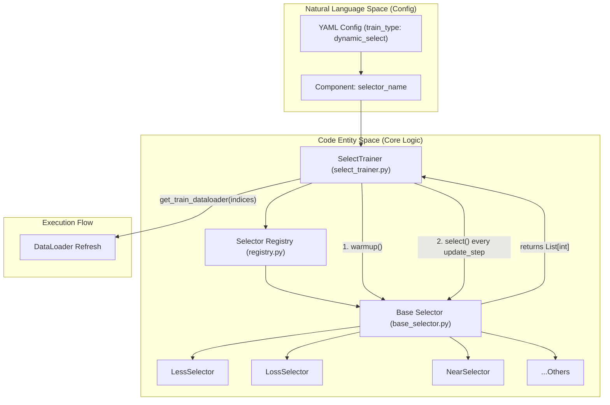

<!-- source: DeepWiki mcp.deepwiki.com · repo OpenDCAI/DataFlex · page 4 Dynamic Data Selection · fetched 2026-11-02 -->

# Dynamic Data Selection

Relevant source files

The following files were used as context for generating this wiki page:

- [src/dataflex/train/selector/__init__.py](src/dataflex/train/selector/__init__.py)
- [src/dataflex/train/selector/base_selector.py](src/dataflex/train/selector/base_selector.py)
- [src/dataflex/train/selector/custom_selector.py](src/dataflex/train/selector/custom_selector.py)
- [src/dataflex/train/trainer/select_trainer.py](src/dataflex/train/trainer/select_trainer.py)
- [src/dataflex/utils/logging.py](src/dataflex/utils/logging.py)
- [src/dataflex/utils/selector_io.py](src/dataflex/utils/selector_io.py)

The `dynamic_select` training mode in DataFlex implements a "Model-in-the-Loop" data selection strategy. Instead of training on a static dataset, the system dynamically identifies the most informative samples from a large pool at runtime. This process is orchestrated by the `SelectTrainer`, which manages a cycle of model warmup, sample scoring via a `Selector` component, and DataLoader refreshing.

### System Architecture

The dynamic selection workflow bridges high-level training configurations with low-level data manipulation. The `SelectTrainer` intercepts the standard training loop to trigger selection events based on user-defined intervals.

**Selector System Overview**

**Sources:**
- [src/dataflex/train/trainer/select_trainer.py:1-163]()
- [src/dataflex/train/selector/base_selector.py:6-56]()
- [src/dataflex/core/registry.py:1-40]()

---

### SelectTrainer Orchestration

The `SelectTrainer` is a specialized subclass of `CustomSeq2SeqTrainer` [src/dataflex/train/trainer/select_trainer.py:47](). It manages the synchronization between the model's current state and the data it consumes.

*   **Warmup Phase**: Before the main selection loop begins, the trainer calls `selector.warmup()` to obtain an initial set of indices, ensuring the model has a baseline state before it starts "choosing" its own data [src/dataflex/train/selector/base_selector.py:14-40]().
*   **Update Cycle**: Every `update_step` (defined in the config), the trainer pauses training, invokes the selector's `select()` method, and broadcasts the resulting indices across all distributed ranks using `dist.broadcast_object_list` [src/dataflex/train/trainer/select_trainer.py:35]().
*   **DataLoader Refresh**: Unlike standard trainers that use a static sampler, `SelectTrainer` re-instantiates the DataLoader mid-training via `get_train_dataloader(indices)` to inject the newly selected subset.

For a deep dive into the synchronization and state management, see [SelectTrainer](#4.1).

---

### Selector Interface

All selection algorithms inherit from the `Selector` abstract base class. This ensures a consistent interface for the `SelectTrainer` to interact with diverse algorithms, ranging from gradient-based similarity to simple random sampling.

| Method | Role | Implementation |
| :--- | :--- | :--- |
| `warmup()` | Provides initial indices for the first training steps. | Default: Random sampling [src/dataflex/train/selector/base_selector.py:14](). |
| `select()` | Core logic: scores samples and returns a list of indices. | Abstract: Must be implemented by child classes [src/dataflex/train/selector/base_selector.py:43](). |

**Sources:**
- [src/dataflex/train/selector/base_selector.py:6-56]()
- [src/dataflex/train/selector/custom_selector.py:5-38]()

---

### Selector Algorithm Families

DataFlex provides several families of selectors, each optimized for different computational budgets and selection signals.

#### Gradient-Based Selectors
These selectors (e.g., `LESS`, `NICE`) use the model's gradients to determine sample influence. They often utilize low-rank projections (like Rademacher) to handle the high dimensionality of LLM gradients.
*   **Key Files**: `less_selector.py`, `nice_selector.py`.
*   **Details**: See [Gradient-Based Selectors (LESS & NICE)](#4.2).

#### Loss-Based Selectors
These selectors (e.g., `Loss`, `DeltaLoss`) use the model's training loss or the change in loss over time as a proxy for "learnability" or "forgetting."
*   **Key Files**: `loss_selector.py`, `delta_loss_selector.py`.
*   **Details**: See [Loss-Based Selectors (Loss & Delta Loss)](#4.3).

#### Distribution & Offline Selectors
These selectors use pre-computed features or embeddings. `NEAR` uses FAISS for vector similarity, while `TSDS` focuses on diversity in the embedding space.
*   **Key Files**: `near_selector.py`, `tsds_selector.py`, `offline_near_selector.py`.
*   **Details**: See [Distribution-Based & Offline Selectors (TSDS, NEAR, Random)](#4.4).

#### Custom Selectors
Users can implement their own logic by extending the `Selector` class and using the `@register_selector` decorator.
*   **Template**: `custom_selector.py`.
*   **Details**: See [Custom Selectors](#4.5).

---

### Data Persistence and I/O

The selection process is integrated with `selector_io.py` to ensure that selected indices and their associated metrics (e.g., scores, losses) are saved to the `cache_dir`. This allows for training resumption and post-hoc analysis of what data the model found most useful at different stages of training.

**Sources:**
- [src/dataflex/utils/selector_io.py:12-45]()
- [src/dataflex/train/selector/base_selector.py:7-12]()

---

