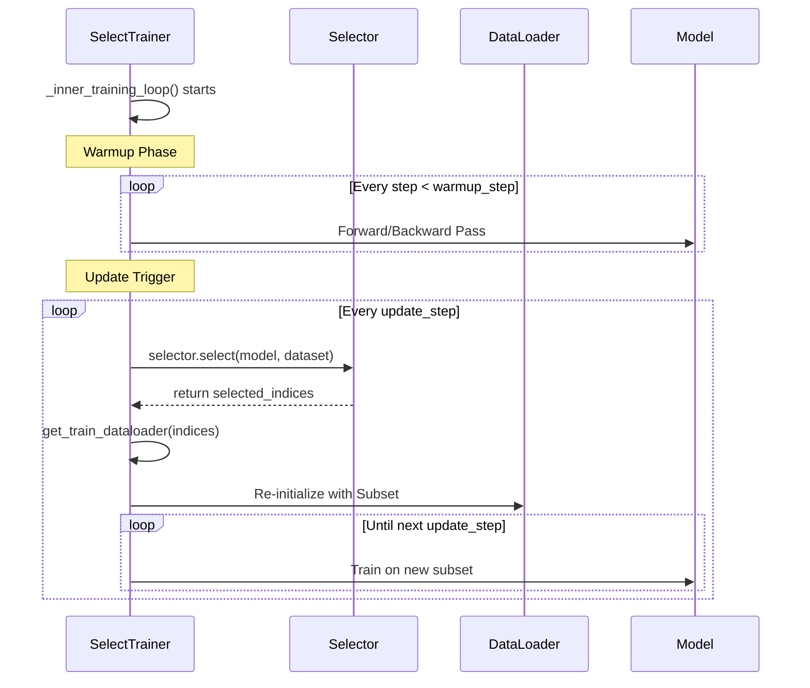
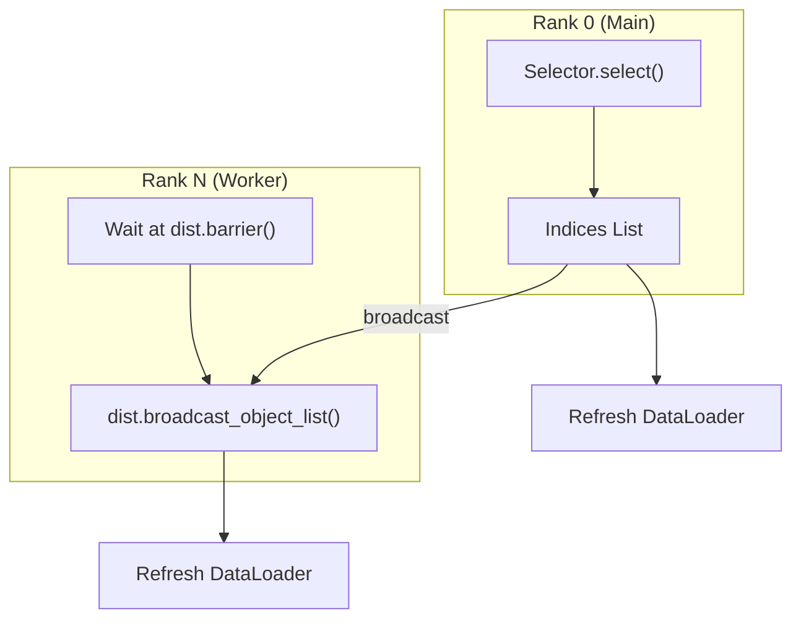

<!-- source: DeepWiki mcp.deepwiki.com · repo OpenDCAI/DataFlex · page 4.1 SelectTrainer · fetched 2026-11-02 -->

# SelectTrainer

<details>
<summary>Relevant source files</summary>

The following files were used as context for generating this wiki page:

- [src/dataflex/train/selector/__init__.py](src/dataflex/train/selector/__init__.py)
- [src/dataflex/train/trainer/select_trainer.py](src/dataflex/train/trainer/select_trainer.py)

</details>


`SelectTrainer` is the core orchestration class for the `dynamic_select` training mode. It extends the `CustomSeq2SeqTrainer` from LLaMA-Factory to implement a "model-in-the-loop" data selection lifecycle. Unlike standard trainers that iterate over a fixed dataset, `SelectTrainer` periodically invokes a `Selector` component to evaluate data samples and refresh the `DataLoader` with a newly selected subset of indices.

## Core Architecture and Lifecycle

The `SelectTrainer` manages the transition between a **warmup phase** (where the model trains on a subset or full data to stabilize) and an **update phase** (where data is re-selected based on model feedback).

### Implementation Details
The trainer overrides the `_inner_training_loop` to inject selection logic. Key configuration parameters include:
*   `warmup_step`: The number of steps to train before the first selection occurs.
*   `update_step`: The frequency (in steps) at which the dataset is re-evaluated and updated.
*   `update_times`: The total number of times the selection process should be triggered.

### System Flow: Selection Loop
The following diagram illustrates the interaction between the `SelectTrainer`, the `Selector` component, and the `DataLoader`.

**Title: SelectTrainer Selection Lifecycle**

Sources: [src/dataflex/train/trainer/select_trainer.py:417-450](), [src/dataflex/train/trainer/select_trainer.py:530-580]()

---

## Distributed Synchronization

In multi-GPU environments, `SelectTrainer` ensures that all ranks stay synchronized during the selection process. This is critical because selection algorithms (like `LossSelector`) often require gathering metrics from all ranks, but the final index list must be identical across the distributed process group to prevent training divergence.

### Synchronization Mechanisms
1.  **Barrier**: Uses `dist.barrier()` to ensure all ranks have finished their current training steps before starting the selection phase [src/dataflex/train/trainer/select_trainer.py:438-440]().
2.  **Broadcast**: Only the main process (Rank 0) typically performs the final index calculation (especially for offline or CPU-heavy selectors). The resulting `indices` list is then distributed to all other ranks using `dist.broadcast_object_list` [src/dataflex/train/trainer/select_trainer.py:442-448]().

**Title: Distributed Index Synchronization**

Sources: [src/dataflex/train/trainer/select_trainer.py:430-455]()

---

## DataLoader Refreshing

A unique feature of `SelectTrainer` is its ability to refresh the `DataLoader` mid-loop without restarting the training state. This is handled by the `get_train_dataloader` method.

### get_train_dataloader(indices)
When selection occurs, `SelectTrainer` creates a `torch.utils.data.Subset` of the original training dataset using the provided `indices`. It then re-instantiates the `DataLoader` and wraps it with the `accelerator` to handle sharding and prefetching.

*   **Function Signature**: `get_train_dataloader(self, indices: Optional[List[int]] = None)` [src/dataflex/train/trainer/select_trainer.py:1005-1010]()
*   **Logic**:
    1.  If `indices` are provided, it creates a `Subset(self.train_dataset, indices)` [src/dataflex/train/trainer/select_trainer.py:1015-1020]().
    2.  It configures a `RandomSampler` or `SequentialSampler` based on the `training_args` [src/dataflex/train/trainer/select_trainer.py:1040-1055]().
    3.  The new `DataLoader` is passed through `self.accelerator.prepare()`, ensuring it is ready for distributed execution [src/dataflex/train/trainer/select_trainer.py:1080-1085]().

Sources: [src/dataflex/train/trainer/select_trainer.py:1005-1090]()

---

## Manual Gradient Management

For specific selectors (like `LessSelector` or `NICESelector`), the trainer must compute gradients for evaluation purposes without updating the model weights. `SelectTrainer` manages this through manual gradient manipulation.

### Gradient Synchronization Control
The trainer uses `self.accelerator.gradient_state._set_sync_gradients(False)` to prevent the `accelerator` from automatically syncing gradients across GPUs during the evaluation/scoring phase of a selector. This allows each rank to compute its local gradient contribution (e.g., for a specific data batch) which the `Selector` then processes.

### Implementation in _inner_training_loop
Within the selection trigger, the trainer performs the following:
1.  **Switch to Eval/Selection Mode**: Disables weight updates.
2.  **Selector Call**: Calls `self.selector.select(...)`.
3.  **Reset Gradient State**: Ensures the `optimizer` and `accelerator` states are clean before resuming the standard training loop.

Sources: [src/dataflex/train/trainer/select_trainer.py:410-430](), [src/dataflex/train/trainer/select_trainer.py:550-570]()

---

## Component Loading

The `SelectTrainer` initializes the appropriate `Selector` class by looking up the `train_type` and `component_name` in the `REGISTRY`.

### Selector Initialization
During `__init__`, the trainer calls `load_component` to fetch the configuration and class definition:
```python
self.selector = load_component(
    component_type="selector",
    component_name=dataflex_args.component_name,
    # ... runtime parameters
)
```
This enables the trainer to be agnostic of the specific selection algorithm (e.g., `LossSelector` vs `LessSelector`), as they all adhere to the `BaseSelector` interface.

Sources: [src/dataflex/train/trainer/select_trainer.py:230-250](), [src/dataflex/core/registry.py:10-30]()

---

