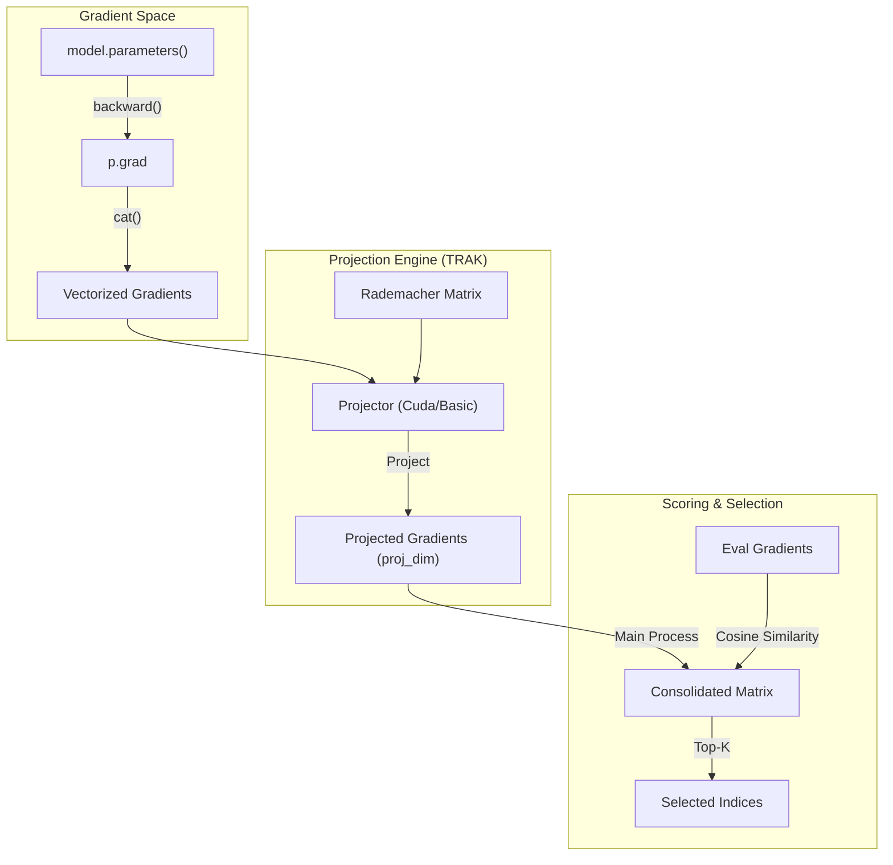
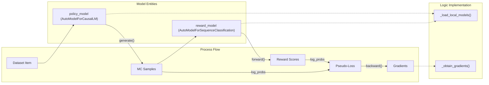

<!-- source: DeepWiki mcp.deepwiki.com · repo OpenDCAI/DataFlex · page 4.2 Gradient-Based Selectors (LESS & NICE) · fetched 2026-11-02 -->

# Gradient-Based Selectors (LESS & NICE)

Relevant source files

The following files were used as context for generating this wiki page:

- [examples/train_lora/selectors/less.yaml](examples/train_lora/selectors/less.yaml)
- [examples/train_lora/selectors/nice.yaml](examples/train_lora/selectors/nice.yaml)
- [src/dataflex/train/selector/less_selector.py](src/dataflex/train/selector/less_selector.py)
- [src/dataflex/train/selector/nice_selector.py](src/dataflex/train/selector/nice_selector.py)

This page provides a technical deep dive into the gradient-based selection algorithms implemented in DataFlex: **LESS** (Low-rank Gradient Similarity Search) and **NICE** (Next-Instruction-based Contrastive Evaluation). These selectors utilize projected gradient vectors to estimate the influence of training samples on model performance on a target evaluation set.

## Overview of Gradient Projection

Both `LessSelector` and `NICESelector` rely on the TRAK framework to handle high-dimensional gradient vectors. Since raw LLM gradients are too large to store and compare efficiently, DataFlex uses random projections to map these gradients into a lower-dimensional subspace (typically 8192) while preserving cosine similarity properties [src/dataflex/train/selector/less_selector.py:45]().

### Projector Implementation
DataFlex supports two projection backends via the `trak` library:
1.  **CudaProjector**: Utilizes `fast_jl` for high-performance Rademacher projection on NVIDIA GPUs [src/dataflex/train/selector/less_selector.py:146-149]().
2.  **BasicProjector**: A fallback CPU/PyTorch-based implementation used when CUDA kernels are unavailable [src/dataflex/train/selector/less_selector.py:153-155]().

### Data Flow: Gradient to Score
The following diagram illustrates the transformation from raw model parameters to the final selection indices.

**Diagram: Gradient Projection and Scoring Flow**

**Sources:** [src/dataflex/train/selector/less_selector.py:100-141](), [src/dataflex/train/selector/less_selector.py:143-157]()

---

## LessSelector Implementation

The `LessSelector` implements the LESS algorithm, which selects data by calculating the similarity between training gradients and evaluation gradients.

### Gradient Types: Adam vs SGD
LESS supports two gradient computation modes:
*   **SGD**: Uses raw gradients directly [src/dataflex/train/selector/less_selector.py:135-136]().
*   **Adam**: Incorporates optimizer states ($m$ and $v$) to compute "effective" gradients, mimicking the actual update step of the Adam optimizer [src/dataflex/train/selector/less_selector.py:125-134]().

### DeepSpeed ZeRO-3 Support
When training with DeepSpeed ZeRO-3, parameters and optimizer states are partitioned across ranks. `LessSelector` handles this by:
1.  Using `safe_get_full_optimizer_state` to gather `exp_avg` and `exp_avg_sq` [src/dataflex/train/selector/less_selector.py:77-84]().
2.  Using `safe_get_full_grad` to reconstruct the full gradient vector from partitioned shards [src/dataflex/train/selector/less_selector.py:108-114]().
3.  Calculating total parameter counts using `p.ds_numel` to ensure correct vector sizing [src/dataflex/train/selector/less_selector.py:63-66]().

**Sources:** [src/dataflex/train/selector/less_selector.py:27-142]()

---

## NICESelector Implementation

`NICESelector` extends gradient-based selection to Reinforcement Learning from Human Feedback (RLHF) scenarios. It computes gradients based on a Policy Model and a Reward Model using Monte Carlo sampling.

### RL-Mode Gradient Computation
Unlike standard SFT gradients, NICE computes the gradient of the expected reward:
1.  **Generation**: The `policy_model` generates multiple completions (`mc_samples`) for a given instruction [src/dataflex/train/selector/nice_selector.py:228-245]().
2.  **Scoring**: The `reward_model` assigns a scalar score to each completion [src/dataflex/train/selector/nice_selector.py:255-265]().
3.  **Loss Construction**: A pseudo-loss is constructed using the log-probabilities of the generated sequences weighted by their rewards [src/dataflex/train/selector/nice_selector.py:272-277]().
4.  **Backpropagation**: The gradient of this pseudo-loss is projected and stored [src/dataflex/train/selector/nice_selector.py:279-281]().

### System Architecture: NICE Code Entities
This diagram maps the natural language RL concepts to specific classes and functions in `nice_selector.py`.

**Diagram: NICE RL Gradient Pipeline**

**Sources:** [src/dataflex/train/selector/nice_selector.py:107-130](), [src/dataflex/train/selector/nice_selector.py:199-291]()

---

## Distributed Storage & Consolidation

To handle large datasets across multiple GPUs, DataFlex employs a rank-specific storage strategy.

### 1. Distributed Projection
Each rank processes a subset of the dataset. Projected gradients are saved locally to the `cache_dir` in chunks (controlled by `save_interval`) [src/dataflex/train/selector/less_selector.py:214-220](). Files are named with the rank ID to prevent collisions (e.g., `grads-16-rank0.pt`) [src/dataflex/train/selector/less_selector.py:217]().

### 2. Main Process Consolidation
During the `select()` phase:
1.  The main process (rank 0) scans the `cache_dir` for all `.pt` files [src/dataflex/train/selector/less_selector.py:254-257]().
2.  It loads and concatenates these tensors into a single global gradient matrix [src/dataflex/train/selector/less_selector.py:261-267]().
3.  Cosine similarity is computed between the training matrix and the evaluation gradient vector [src/dataflex/train/selector/less_selector.py:285-286]().
4.  The top-K indices are broadcasted to all other ranks using `dist.broadcast_object_list` (handled by the `SelectTrainer`) [src/dataflex/train/selector/less_selector.py:291]().

| Feature | LESS | NICE |
| :--- | :--- | :--- |
| **Primary Goal** | SFT Influence Modeling | RLHF Policy Improvement |
| **Gradient Source** | Standard Cross-Entropy | Reward-Weighted Log-Probs |
| **Model Requirements** | Training Model | Policy + Reward Model |
| **Projection** | Rademacher (TRAK) | Rademacher (TRAK) |
| **Checkpointing** | Resumable via index tracking | Resumable via index tracking |

**Sources:** [src/dataflex/train/selector/less_selector.py:240-295](), [src/dataflex/train/selector/nice_selector.py:60-106]()

---

