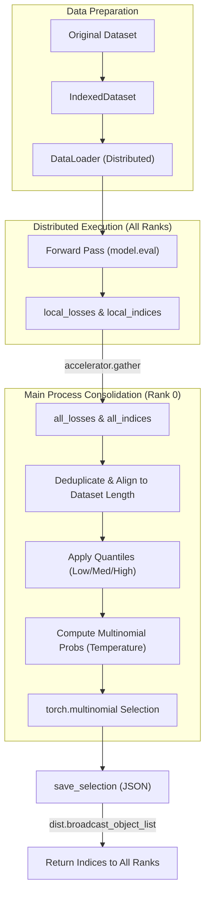
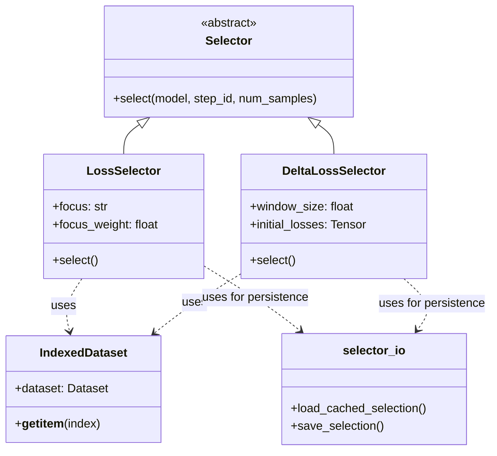

<!-- source: DeepWiki mcp.deepwiki.com · repo OpenDCAI/DataFlex · page 4.3 Loss-Based Selectors (Loss & Delta Loss) · fetched 2026-11-02 -->

# Loss-Based Selectors (Loss & Delta Loss)

Relevant source files

The following files were used as context for generating this wiki page:

- [examples/train_lora/selectors/delta_loss.yaml](examples/train_lora/selectors/delta_loss.yaml)
- [examples/train_lora/selectors/loss.yaml](examples/train_lora/selectors/loss.yaml)
- [src/dataflex/train/selector/delta_loss_selector.py](src/dataflex/train/selector/delta_loss_selector.py)
- [src/dataflex/train/selector/loss_selector.py](src/dataflex/train/selector/loss_selector.py)

Loss-based selectors implement dynamic data selection by evaluating the model's current performance on the candidate dataset. These selectors prioritize samples based on their raw loss values or the change in loss over time (Delta Loss). They utilize distributed gathering to efficiently compute metrics across multiple GPUs and apply quantile-based weighting for final sample selection.

## LossSelector

The `LossSelector` [src/dataflex/train/selector/loss_selector.py:25]() ranks data samples based on the cross-entropy loss produced by the model. It supports focusing on different parts of the loss distribution (e.g., high-loss samples that the model finds difficult, or low-loss samples for stability).

### Implementation Workflow
1.  **Distributed Evaluation**: The selector wraps the dataset in an `IndexedDataset` [src/dataflex/train/selector/loss_selector.py:13-22]() to track original indices. It uses `accelerator.prepare` to shard the evaluation across all available GPUs [src/dataflex/train/selector/loss_selector.py:77]().
2.  **Loss Gathering**: Each rank computes local losses. These are gathered using `self.accelerator.gather` [src/dataflex/train/selector/loss_selector.py:105-106]().
3.  **Deduplication & Alignment**: The main process aligns gathered losses to their original indices, ensuring deterministic behavior by handling potential padding or repeats from the distributed sampler [src/dataflex/train/selector/loss_selector.py:109-118]().
4.  **Quantile Weighting**: The distribution is split into three buckets (Low, Medium, High) based on the `quantiles` parameter [src/dataflex/train/selector/loss_selector.py:138-143]().
5.  **Sampling**: Probabilities are calculated using a `temperature` control and `focus_weight` [src/dataflex/train/selector/loss_selector.py:150-162](). Final indices are selected via `torch.multinomial` [src/dataflex/train/selector/loss_selector.py:175-178]().

### Configuration Parameters
| Parameter | Type | Default | Description |
| :--- | :--- | :--- | :--- |
| `focus` | `str` | `"high"` | Target bucket: `"high"`, `"medium"`, or `"low"`. |
| `focus_weight` | `float` | `5.0` | Multiplier for the target bucket's selection probability. |
| `quantiles` | `tuple` | `(0.33, 0.66)` | Thresholds for bucket categorization. |
| `temperature` | `float` | `1.0` | Controls the sharpness of the probability distribution. |

**Sources:** [src/dataflex/train/selector/loss_selector.py:26-47](), [src/dataflex/train/selector/loss_selector.py:129-163]()

---

## DeltaLossSelector

The `DeltaLossSelector` [src/dataflex/train/selector/delta_loss_selector.py:40]() selects samples based on the reduction in loss between two checkpoints. This approach targets samples where the model is actively learning or "forgetting." It features a sliding window curriculum to focus on specific segments of the dataset over time.

### Sliding Window Curriculum
The selector calculates a window within the dataset that shifts as training progresses, governed by a sigmoid function [src/dataflex/train/selector/delta_loss_selector.py:13-25]().

*   **Window Position**: `calculate_window_position` uses `current_update_times` and `update_times` to determine the `window_start` and `window_end` [src/dataflex/train/selector/delta_loss_selector.py:17-25]().
*   **Sigmoid Mapping**: The `scaled_iteration` (progress through total updates) is passed through a sigmoid to create a non-linear progression through the dataset indices [src/dataflex/train/selector/delta_loss_selector.py:13-14]().

### Selection Logic
1.  **Initial State**: On the first call, it computes and caches "Initial Losses" and returns a random warmup selection [src/dataflex/train/selector/delta_loss_selector.py:112-164]().
2.  **Delta Calculation**: In subsequent steps, it computes "Current Losses." The metric used for selection is `delta = initial_loss - current_loss` [src/dataflex/train/selector/delta_loss_selector.py:195-201]().
3.  **Window Filtering**: Only samples within the current curriculum window are considered [src/dataflex/train/selector/delta_loss_selector.py:204-207]().
4.  **Ranking**: It selects the top `num_samples` with the largest delta (highest learning progress) [src/dataflex/train/selector/delta_loss_selector.py:210-213]().

**Sources:** [src/dataflex/train/selector/delta_loss_selector.py:13-25](), [src/dataflex/train/selector/delta_loss_selector.py:195-215]()

---

## System Architecture: Data Flow

The following diagram illustrates the flow from raw data through the distributed loss calculation to the final selection indices.

### Loss Calculation and Selection Flow

**Sources:** [src/dataflex/train/selector/loss_selector.py:70-121](), [src/dataflex/train/selector/loss_selector.py:129-182]()

---

## Code Entity Map

This diagram maps the natural language concepts of "Caching" and "Selection Strategy" to the specific classes and utility functions in the codebase.

### Entity Relationship Diagram

**Sources:** [src/dataflex/train/selector/loss_selector.py:13-25](), [src/dataflex/train/selector/delta_loss_selector.py:28-40](), [src/dataflex/utils/selector_io.py:1-11]()

---

## Caching and Resumption

Both selectors utilize `selector_io` to persist selection results. This ensures that if a training job is interrupted and resumed, the selector can reload previous decisions instead of re-evaluating the entire dataset.

*   **Cache Check**: At the start of `select()`, the code checks if `step_{step_id}.json` exists [src/dataflex/train/selector/loss_selector.py:54-56]().
*   **Loading**: `load_cached_selection` is called on the main process [src/dataflex/train/selector/loss_selector.py:58]().
*   **Synchronization**: The loaded indices are broadcast to all ranks using `dist.broadcast_object_list` to maintain consistency across the distributed environment [src/dataflex/train/selector/loss_selector.py:63]().
*   **Storage**: `save_selection` writes the selected indices and the associated metrics (loss or delta) to the `cache_dir` [src/dataflex/train/selector/loss_selector.py:182]().

**Sources:** [src/dataflex/train/selector/loss_selector.py:53-67](), [src/dataflex/train/selector/delta_loss_selector.py:116-127]()

---

