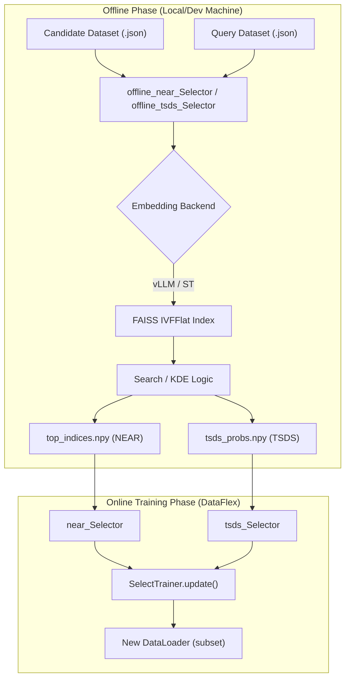
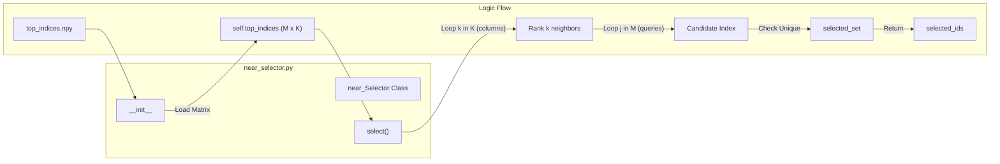

<!-- source: DeepWiki mcp.deepwiki.com · repo OpenDCAI/DataFlex · page 4.4 Distribution-Based & Offline Selectors (TSDS, NEAR, Random) · fetched 2026-11-02 -->

# Distribution-Based & Offline Selectors (TSDS, NEAR, Random)

<details>
<summary>Relevant source files</summary>

The following files were used as context for generating this wiki page:

- [examples/train_lora/selectors/random.yaml](examples/train_lora/selectors/random.yaml)
- [examples/train_lora/selectors/tsds.yaml](examples/train_lora/selectors/tsds.yaml)
- [src/dataflex/offline_selector/offline_near_selector.py](src/dataflex/offline_selector/offline_near_selector.py)
- [src/dataflex/offline_selector/offline_tsds_selector.py](src/dataflex/offline_selector/offline_tsds_selector.py)
- [src/dataflex/train/selector/near_selector.py](src/dataflex/train/selector/near_selector.py)
- [src/dataflex/train/selector/random_selector.py](src/dataflex/train/selector/random_selector.py)
- [src/dataflex/train/selector/tsds_selector.py](src/dataflex/train/selector/tsds_selector.py)

</details>


This page details the implementation of data selection algorithms that rely on pre-computed features or simple distributions rather than active model gradients. These selectors are divided into two phases: an **Offline Pre-computation** phase that generates indices or probability distributions, and an **Online Selection** phase where the training loop consumes these pre-computed artifacts.

## Offline Pre-computation Workflow

The offline selectors are standalone utilities designed to process large-scale datasets and query sets to generate static selection maps. They utilize FAISS for efficient similarity searching and support multiple embedding backends.

### Embedding Backends
Both `offline_near_selector.py` and `offline_tsds_selector.py` implement an "auto" mode for text embedding [src/dataflex/offline_selector/offline_near_selector.py:83-131]().
1.  **vLLM**: Preferred for high-throughput GPU acceleration using `llm.embed(texts)` [src/dataflex/offline_selector/offline_near_selector.py:86-90]().
2.  **Sentence-Transformers**: Fallback for standard CPU/GPU embedding using `SentenceTransformer.encode()` [src/dataflex/offline_selector/offline_near_selector.py:106-111]().

### Similarity Indexing
The system uses `FaissIndexIVFFlat` to manage large embedding collections. It calculates the number of clusters (`nlist`) as `sqrt(N) // 2` and uses an `IndexFlatL2` quantizer [src/dataflex/offline_selector/offline_near_selector.py:25-34]().

### Workflow Diagram: Offline to Online Transition

The following diagram illustrates how the offline scripts produce artifacts consumed by the `Selector` classes during training.

**Data Flow: Offline Selection Artifacts**

Sources: `[src/dataflex/offline_selector/offline_near_selector.py:148-176]()`, `[src/dataflex/offline_selector/offline_tsds_selector.py:156-200]()`, `[src/dataflex/train/selector/near_selector.py:8-45]()`.

---

## NEAR Selector (Nearest Neighbor)

The NEAR algorithm selects samples that are semantically closest to a provided query set (e.g., a high-quality validation set).

### Implementation Detail
1.  **Offline**: `offline_near_Selector` computes the `top_K` nearest neighbors for every query in the query set [src/dataflex/offline_selector/offline_near_selector.py:160-165](). It saves a matrix of shape `(M, max_K)` where `M` is the number of queries.
2.  **Online**: The `near_Selector` class performs **Column-Wise Selection**. It iterates through the neighbor ranks (columns) first, ensuring that the closest neighbor for every query is considered before moving to the second-closest [src/dataflex/train/selector/near_selector.py:63-78]().

### NEAR Logic Diagram
**Entity Association: near_Selector Implementation**

Sources: `[src/dataflex/train/selector/near_selector.py:11-84]()`.

---

## TSDS Selector (Targeted Subset Data Selection)

TSDS improves upon simple similarity by incorporating Kernel Density Estimation (KDE) to balance diversity and relevance.

### Offline KDE and Optimization
The `offline_tsds_selector.py` computes a KDE for candidates to identify data density [src/dataflex/offline_selector/offline_tsds_selector.py:180-188](). It then uses a heap-based optimization to select samples that maximize the TSDS objective, saving the resulting sampling probabilities to a `.npy` file [src/dataflex/offline_selector/offline_tsds_selector.py:190-200]().

### Online Selection
The online `tsds_Selector` is a lightweight wrapper that performs multinomial sampling based on these pre-computed probabilities.
*   **Initialization**: Loads `probs_path` and validates that the length matches the dataset [src/dataflex/train/selector/tsds_selector.py:21-30]().
*   **Selection**: Uses `np.random.choice` with the `p=self.probs` parameter to sample `num_samples` without replacement [src/dataflex/train/selector/tsds_selector.py:38-43]().

---

## Random Selector

The `RandomSelector` serves as the baseline for all selection experiments. It implements a distributed-safe random sampling strategy.

### Distributed Synchronization
To ensure all ranks in a distributed training environment (DDP) use the same subset of data:
1.  The **Main Process** (rank 0) generates the random indices using a `torch.Generator` seeded with `base_seed + step_id` [src/dataflex/train/selector/random_selector.py:27-30]().
2.  The indices are then shared with all other ranks via `dist.broadcast_object_list` [src/dataflex/train/selector/random_selector.py:53-55]().

---

## Configuration Examples

### TSDS Configuration
The following YAML snippet demonstrates how to configure a TSDS selector using a pre-computed probability file.

```yaml
# examples/train_lora/selectors/tsds.yaml
train_type: dynamic_select
component_name: tsds
warmup_step: 10
update_step: 10
# Component specific args (defined in components.yaml)
# probs_path: /path/to/tsds_probs.npy
```
Sources: `[examples/train_lora/selectors/tsds.yaml:51-60]()`.

### Selector Parameters Summary

| Selector | Offline Script | Key Parameter | Online Mechanism |
| :--- | :--- | :--- | :--- |
| **NEAR** | `offline_near_selector.py` | `indices_path` | Column-wise matrix traversal [src/dataflex/train/selector/near_selector.py:63-78]() |
| **TSDS** | `offline_tsds_selector.py` | `probs_path` | Multinomial sampling via `np.random.choice` [src/dataflex/train/selector/tsds_selector.py:38-43]() |
| **Random** | N/A | `seed` | `torch.randperm` with distributed broadcast [src/dataflex/train/selector/random_selector.py:44-55]() |

Sources: `[src/dataflex/train/selector/near_selector.py:8-9]()`, `[src/dataflex/train/selector/tsds_selector.py:7-8]()`, `[src/dataflex/train/selector/random_selector.py:9-10]()`.

---

