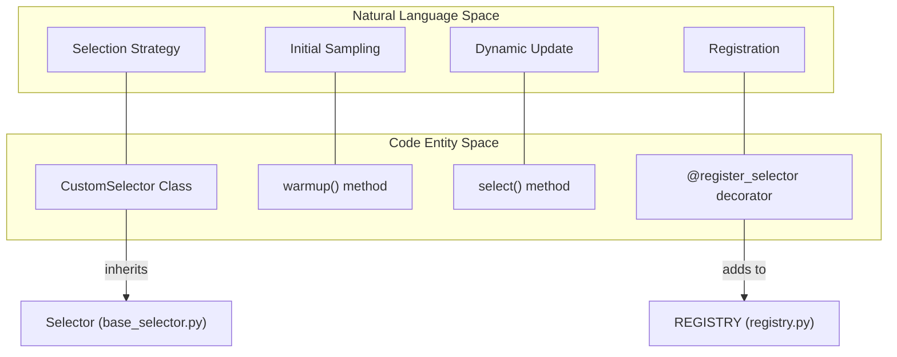
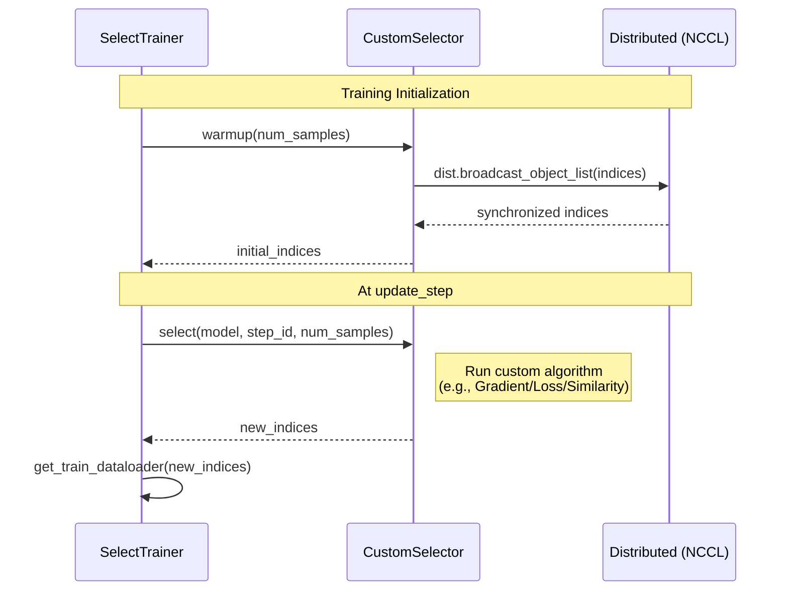

<!-- source: DeepWiki mcp.deepwiki.com · repo OpenDCAI/DataFlex · page 4.5 Custom Selectors · fetched 2026-11-02 -->

# Custom Selectors

<details>
<summary>Relevant source files</summary>

The following files were used as context for generating this wiki page:

- [examples/train_lora/selectors/custom.yaml](examples/train_lora/selectors/custom.yaml)
- [src/dataflex/train/selector/base_selector.py](src/dataflex/train/selector/base_selector.py)
- [src/dataflex/train/selector/custom_selector.py](src/dataflex/train/selector/custom_selector.py)
- [src/dataflex/utils/logging.py](src/dataflex/utils/logging.py)
- [src/dataflex/utils/selector_io.py](src/dataflex/utils/selector_io.py)

</details>


The `Custom Selectors` page provides a technical guide for extending DataFlex's dynamic data selection capabilities. By inheriting from the base infrastructure, developers can implement proprietary selection algorithms that integrate seamlessly with the `SelectTrainer` orchestration loop.

## Overview of Selector Implementation

A custom selector in DataFlex is a class that implements a specific interface to determine which data samples should be used for the next training interval. The system relies on the `Selector` abstract base class to define the contract between the selection algorithm and the `SelectTrainer`.

### Core Components

| Component | Role | File Reference |
| :--- | :--- | :--- |
| `Selector` | Abstract base class defining the `warmup` and `select` interface. | [src/dataflex/train/selector/base_selector.py:6-56]() |
| `@register_selector` | Decorator used to register the class into the global `REGISTRY`. | [src/dataflex/core/registry.py:1-20]() |
| `SelectTrainer` | Orchestrator that calls `warmup()` at start and `select()` at `update_step`. | [src/dataflex/train/trainer/select_trainer.py:1-100]() |

### Natural Language to Code Entity Mapping

The following diagram illustrates how high-level selection concepts map to specific code entities within the DataFlex framework.

**Selector Architecture Mapping**

Sources: [src/dataflex/train/selector/base_selector.py:6-56](), [src/dataflex/train/selector/custom_selector.py:1-38]()

## Implementation Guide

To create a custom selector, follow these steps:

### 1. Inherit from the Selector Base Class
The `Selector` class provides the necessary context for selection, including the dataset, accelerator for distributed training, and a data collator.

*   **Initialization**: The constructor `__init__` must call `super().__init__` to ensure the `dataset`, `accelerator`, `data_collator`, and `cache_dir` are correctly assigned [src/dataflex/train/selector/base_selector.py:7-12]().
*   **Warmup Logic**: The default `warmup` method implements random sampling (with or without replacement) and synchronizes the selected indices across all distributed processes using `dist.broadcast_object_list` [src/dataflex/train/selector/base_selector.py:14-40]().

### 2. Implement the `select()` Method
The `select` method is the core of the algorithm. It is invoked by the trainer at every `update_step`.

*   **Inputs**: Receives the current `model`, the current `step_id`, and the required `num_samples` [src/dataflex/train/selector/base_selector.py:43-55]().
*   **Outputs**: Must return a `List[int]` containing the indices of the samples chosen for the next training block [src/dataflex/train/selector/custom_selector.py:33-38]().

### 3. Register the Selector
Use the `@register_selector('name')` decorator. This allows the selector to be referenced in YAML configuration files via the `component_name` field [src/dataflex/train/selector/custom_selector.py:5-6]().

## Data Flow and Interaction

The diagram below shows the interaction between the `SelectTrainer`, the `CustomSelector`, and the distributed environment.

**Selector Execution Flow**

Sources: [src/dataflex/train/selector/base_selector.py:14-40](), [src/dataflex/train/selector/custom_selector.py:23-38]()

## Configuration Example

To use a custom selector, configure the `train_type` and `component_name` in your YAML file.

```yaml
### Dataflex args
train_type: dynamic_select   # Enable selector mode
component_name: custom        # Matches @register_selector('custom')
warmup_step: 10               # Steps before first select() call
update_step: 10               # Frequency of select() calls
update_times: 2               # Number of selection cycles
```
Sources: [examples/train_lora/selectors/custom.yaml:51-60]()

## Template: custom_selector.py

The following template illustrates the minimal implementation required for a custom selector.

```python
from dataflex.core.registry import register_selector
from .base_selector import Selector

@register_selector('custom')
class CustomSelector(Selector):
    def __init__(self, dataset, accelerator, data_collator, cache_dir):
        super().__init__(dataset, accelerator, data_collator, cache_dir)

    def select(self, model, step_id: int, num_samples: int, **kwargs):
        # Implement your selection logic here
        # Example: select first N samples
        return list(range(num_samples))
```
Sources: [src/dataflex/train/selector/custom_selector.py:1-38]()

## Utilities for Custom Selectors

When implementing complex selectors, use the following utilities:

*   **Logging**: Use `dataflex.utils.logging.logger` to ensure consistent output across distributed ranks [src/dataflex/utils/logging.py:1-6]().
*   **Persistence**: Use `save_selection` and `load_cached_selection` from `selector_io.py` to cache indices and metrics. This ensures that only the main process writes to disk and that selection can be resumed after a crash [src/dataflex/utils/selector_io.py:12-43]().

Sources: [src/dataflex/utils/logging.py:1-6](), [src/dataflex/utils/selector_io.py:12-43]()

---

