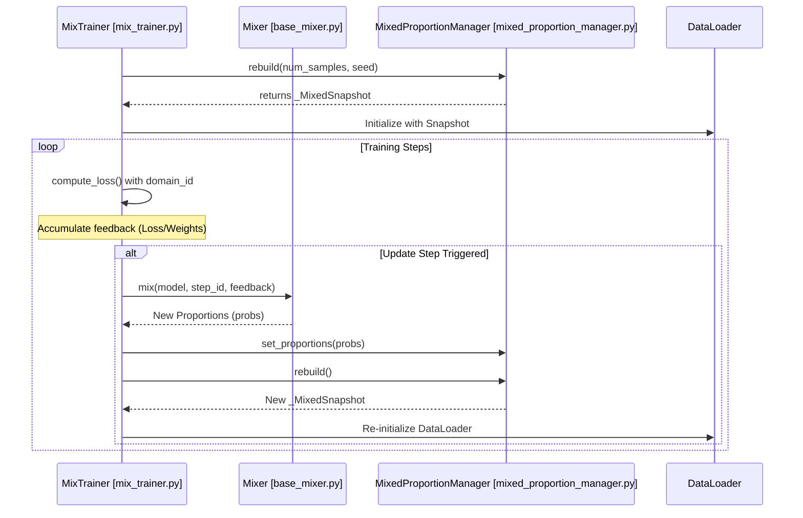

<!-- source: DeepWiki mcp.deepwiki.com · repo OpenDCAI/DataFlex · page 5 Dynamic Data Mixing · fetched 2026-11-02 -->

# Dynamic Data Mixing

<details>
<summary>Relevant source files</summary>

The following files were used as context for generating this wiki page:

- [src/dataflex/train/data/loader.py](src/dataflex/train/data/loader.py)
- [src/dataflex/train/dataset/mixed_proportion_manager.py](src/dataflex/train/dataset/mixed_proportion_manager.py)
- [src/dataflex/train/mixer/__init__.py](src/dataflex/train/mixer/__init__.py)
- [src/dataflex/train/mixer/dynamic_moe_mixer.py](src/dataflex/train/mixer/dynamic_moe_mixer.py)
- [src/dataflex/train/mixer/static_mixer.py](src/dataflex/train/mixer/static_mixer.py)
- [src/dataflex/train/trainer/mix_trainer.py](src/dataflex/train/trainer/mix_trainer.py)

</details>


The `dynamic_mix` training mode in DataFlex enables automated adjustments of data proportions from multiple sources during the training process. This mode is designed to solve the "data mixture" problem: determining the optimal ratio of datasets (e.g., code, math, general web text) to maximize model performance.

DataFlex implements this through a feedback loop where a `Mixer` component analyzes training signals (like loss or gate loads) and instructs a `MixedProportionManager` to rebuild the training dataset with updated weights.

### System Architecture

The dynamic mixing system consists of three primary entities working in concert:
1.  **`MixTrainer`**: The orchestration engine that manages the training loop and triggers mixture updates.
2.  **`MixedProportionManager`**: The data governor that maintains per-source datasets and generates new snapshots based on target proportions.
3.  **`Mixer`**: The algorithmic component (e.g., DoReMi, ODM) that calculates new proportions based on model feedback.

#### Mixing Control Flow
The following diagram illustrates the interaction between these entities during a training run.

**Diagram: Dynamic Mixing Feedback Loop**

**Sources:**
- [src/dataflex/train/trainer/mix_trainer.py:1516-1550]() (Update logic)
- [src/dataflex/train/dataset/mixed_proportion_manager.py:108-167]() (`rebuild` implementation)

---

### Core Components

#### MixTrainer
The `MixTrainer` extends the standard training loop to support mid-run dataset swaps. Unlike standard trainers that use a static dataset, `MixTrainer` monitors the `update_step` configuration. When a trigger is met, it invokes the `Mixer`, updates the `MixedProportionManager`, and replaces the current `DataLoader` without restarting the process.

For algorithms like DoReMi, `MixTrainer` overrides `compute_loss` to utilize `domain_id` metadata attached to each sample, allowing it to track per-source performance.

For details, see [MixTrainer](#5.1).

**Sources:**
- [src/dataflex/train/trainer/mix_trainer.py:47-48]() (Class definition)
- [src/dataflex/train/trainer/mix_trainer.py:1568-1580]() (Loss override for domain tracking)

#### MixedProportionManager & Data Loading
DataFlex patches the `get_dataset` function to ensure that instead of merging all sources into one flat list, each source is kept distinct. These sources are passed to the `MixedProportionManager`.

- **`_MixedSnapshot`**: A read-only `TorchDataset` created during `rebuild()`. It contains an `index_table` that maps global indices to specific `(source_id, row_id)` pairs.
- **`domain_id`**: Every sample returned by the manager includes a `domain_id` key, which is critical for mixers to attribute loss or metrics to specific data sources.

**Sources:**
- [src/dataflex/train/data/loader.py:128-134]() (Manager initialization)
- [src/dataflex/train/dataset/mixed_proportion_manager.py:7-22]() (`_MixedSnapshot` definition)
- [src/dataflex/train/dataset/mixed_proportion_manager.py:149-160]() (Index table generation)

---

### Available Mixer Algorithms

DataFlex provides several built-in mixing strategies, registered via the `@register_mixer` decorator.

| Mixer Name | Class | Logic Summary |
| :--- | :--- | :--- |
| **DoReMi** | `DoremiMixer` | Uses excess loss relative to a reference model to upweight "difficult" domains. |
| **ODM** | `ODMMixer` | Online Data Mixing using Multi-Armed Bandit (Exp3) based on loss reduction. |
| **Dynamic MoE** | `DynamicMoEMixer` | Adjusts proportions based on Mixture-of-Experts gate load balancing. |
| **Static** | `StaticMixer` | Maintains fixed, user-defined proportions throughout training. |
| **Random** | `RandomMixer` | Periodically shuffles proportions randomly (baseline). |

#### DoReMi Mixer
The `DoremiMixer` implements a distributionally robust optimization approach. It requires a reference model to compute "excess loss." If the current model performs significantly worse on a domain than the reference model, that domain's proportion is increased.

For details, see [DoReMi Mixer](#5.2).

**Sources:**
- [src/dataflex/train/mixer/doremi_mixer.py:24-30]() (Registration and Class)

#### Online Data Mixing (ODM) & Others
The `ODMMixer` treats data mixing as a bandit problem, where the "reward" is the improvement in model loss. It is highly efficient for online adaptation without requiring a reference model. The `DynamicMoEMixer` is specialized for MoE architectures, using gate utilization metrics to balance data.

For details, see [ODM & Other Mixers (Online Data Mixing, Static, Random, Dynamic MoE)](#5.3).

**Sources:**
- [src/dataflex/train/mixer/odm_mixer.py:22-23]() (ODM Registration)
- [src/dataflex/train/mixer/dynamic_moe_mixer.py:28-29]() (Dynamic MoE Registration)
- [src/dataflex/train/mixer/static_mixer.py:7-8]() (Static Registration)

---

### Code-to-System Mapping

The following diagram maps high-level system concepts to their specific implementations in the `src/dataflex/train/mixer` and `src/dataflex/train/trainer` directories.

**Diagram: Entity Mapping**
```mermaid
graph TD
    subgraph "Training Engine"
        MT["MixTrainer (mix_trainer.py)"]
        CL["compute_loss()"]
        ITL["_inner_training_loop()"]
    end

    subgraph "Data Management"
        MPM["MixedProportionManager (mixed_proportion_manager.py)"]
        MS["_MixedSnapshot (Dataset)"]
        GD["get_dataset (loader.py)"]
    end

    subgraph "Mixer Algorithms"
        B["Mixer (base_mixer.py)"]
        DR["DoremiMixer (doremi_mixer.py)"]
        ODM["ODMMixer (odm_mixer.py)"]
        MOE["DynamicMoEMixer (dynamic_moe_mixer.py)"]
    end

    MT -->|triggers| B
    B <|-- DR
    B <|-- ODM
    B <|-- MOE
    MT -->|updates| MPM
    MPM -->|generates| MS
    GD -->|initializes| MPM
    MT -.->|provides feedback| B
```
**Sources:**
- [src/dataflex/train/mixer/__init__.py:1-5]() (Mixer exports)
- [src/dataflex/train/trainer/mix_trainer.py:1516-1520]() (Mixer invocation)
- [src/dataflex/train/data/loader.py:42-50]() (Loader entry point)

---

