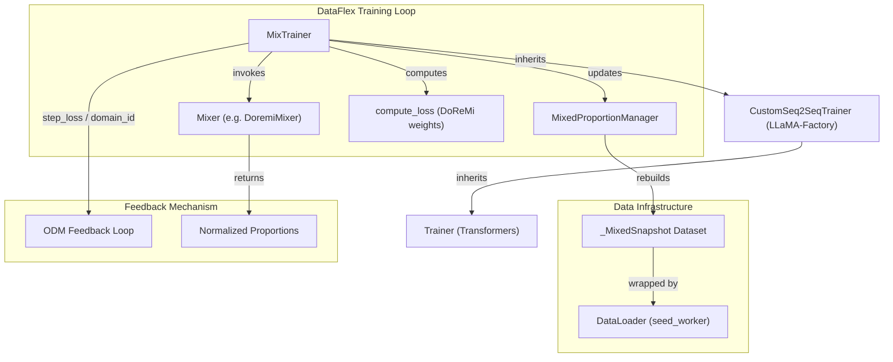
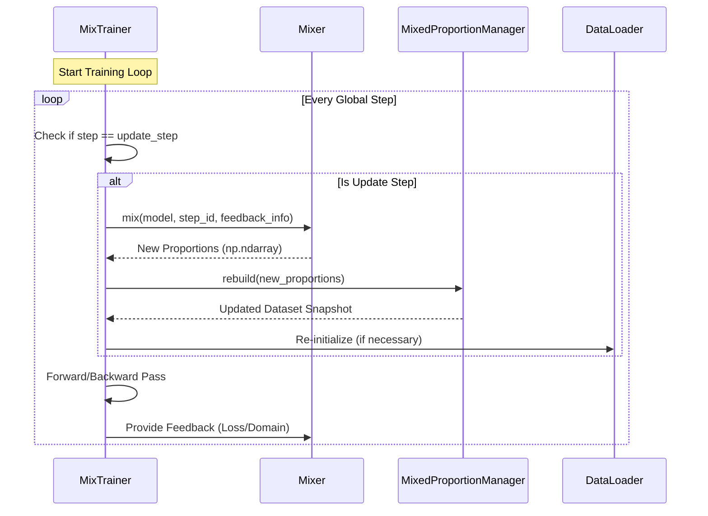

<!-- source: DeepWiki mcp.deepwiki.com · repo OpenDCAI/DataFlex · page 5.1 MixTrainer · fetched 2026-11-02 -->

# MixTrainer

Relevant source files

The following files were used as context for generating this wiki page:

- [src/dataflex/train/hparams/dynamic_data_params.py](src/dataflex/train/hparams/dynamic_data_params.py)
- [src/dataflex/train/mixer/base_mixer.py](src/dataflex/train/mixer/base_mixer.py)
- [src/dataflex/train/mixer/random_mixer.py](src/dataflex/train/mixer/random_mixer.py)
- [src/dataflex/train/trainer/mix_trainer.py](src/dataflex/train/trainer/mix_trainer.py)
- [src/dataflex/utils/load_component.py](src/dataflex/utils/load_component.py)

The `MixTrainer` is a specialized trainer class designed for **Dynamic Data Mixing**. It extends `CustomSeq2SeqTrainer` to orchestrate the lifecycle of training where data proportions from multiple sources are adjusted dynamically throughout the training process. It manages the interaction between the model, the data mixture manager, and various mixing algorithms (e.g., DoReMi, ODM).

## Core Responsibilities

`MixTrainer` handles the following high-level tasks:
1.  **Component Initialization**: Loads the mixing algorithm (Mixer) via the `REGISTRY` [src/dataflex/train/trainer/mix_trainer.py:214-228]().
2.  **Training Loop Orchestration**: Overrides the `_inner_training_loop` to implement step-based logic for warming up and updating data mixtures [src/dataflex/train/trainer/mix_trainer.py:448-620]().
3.  **Loss Computation**: Overrides `compute_loss` to support per-sample reweighting, specifically for domain-weighted algorithms like DoReMi [src/dataflex/train/trainer/mix_trainer.py:350-410]().
4.  **Feedback Loops**: Collects training metadata (like loss per domain) and feeds it back to the Mixer (e.g., for Online Data Mixing) [src/dataflex/train/trainer/mix_trainer.py:530-540]().

### System Architecture & Data Flow

The following diagram illustrates how `MixTrainer` bridges the high-level mixing logic with the underlying LLaMA-Factory and Transformers infrastructure.

**MixTrainer Component Interaction**

Sources: [src/dataflex/train/trainer/mix_trainer.py:202-212](), [src/dataflex/train/trainer/mix_trainer.py:350-355](), [src/dataflex/train/trainer/mix_trainer.py:532-545]()

## Implementation Details

### Mixer Initialization
During `__init__`, `MixTrainer` resolves the mixing component. It reads parameters from `components.yaml` using `load_component` and then builds the mixer instance using the `REGISTRY` [src/dataflex/train/trainer/mix_trainer.py:214-228]().

| Variable | Source | Purpose |
| :--- | :--- | :--- |
| `mixer_name` | `finetuning_args.component_name` | The ID of the mixer (e.g., "doremi", "odm"). |
| `mixture_manager` | `train_dataset.mixture_manager` | Reference to the manager controlling data source ratios. |
| `mixer` | `REGISTRY.build` | The instantiated Mixer object. |

Sources: [src/dataflex/train/trainer/mix_trainer.py:214-228]()

### compute_loss and DoReMi Integration
`MixTrainer` overrides `compute_loss` to facilitate per-sample domain reweighting. This is essential for the DoReMi algorithm, where the loss for a sample is scaled by its domain's current weight.

*   **Domain Identification**: It extracts `domain_id` from the batch [src/dataflex/train/trainer/mix_trainer.py:372-373]().
*   **Weight Application**: If the mixer provides domain weights, the loss is multiplied by `domain_weights[domain_id]` before the backward pass [src/dataflex/train/trainer/mix_trainer.py:389-395]().
*   **Reference Model**: For DoReMi, it may compute "excess loss" by comparing current model loss against a frozen reference model [src/dataflex/train/trainer/mix_trainer.py:380-385]().

Sources: [src/dataflex/train/trainer/mix_trainer.py:350-410]()

### The Inner Training Loop
The `_inner_training_loop` is the core of the dynamic behavior. It tracks `global_step` to trigger updates based on the configuration [src/dataflex/train/trainer/mix_trainer.py:448-450]().

**Training Step Logic**

Sources: [src/dataflex/train/trainer/mix_trainer.py:520-560](), [src/dataflex/train/trainer/mix_trainer.py:580-595]()

### Key Functions

#### `get_train_dataloader`
`MixTrainer` ensures that the `DataLoader` is correctly initialized with a `seed_worker` to maintain reproducibility across mixture updates [src/dataflex/train/trainer/mix_trainer.py:318-348](). It uses the `_MixedSnapshot` dataset provided by the `MixedProportionManager`.

#### `_save_average_weights`
At the end of training, or at specific checkpoints, `MixTrainer` can save the average domain weights used throughout the process. This is particularly useful for DoReMi to output the final static proportions for the next stage of training [src/dataflex/train/trainer/mix_trainer.py:650-665]().

## Feedback Mechanisms

For algorithms like **ODM (Online Data Mixing)**, the trainer must provide feedback to the mixer.
1.  **Batch Info**: The trainer collects the loss and domain ID for every batch [src/dataflex/train/trainer/mix_trainer.py:532-535]().
2.  **Mixer Feedback**: This info is passed to `mixer.feedback(batch_info)` so the mixer can update its internal state (e.g., updating Multi-Armed Bandit weights) [src/dataflex/train/trainer/mix_trainer.py:540-545]().

Sources: [src/dataflex/train/trainer/mix_trainer.py:532-545]()

## Configuration Parameters

The behavior of `MixTrainer` is governed by `FinetuningArguments` and `DataArguments`:

| Parameter | Type | Description |
| :--- | :--- | :--- |
| `warmup_step` | `int` | Number of steps to run with initial proportions before the first update [src/dataflex/train/hparams/dynamic_data_params.py:141-145](). |
| `update_step` | `int` | Interval (in steps) between subsequent mixture updates [src/dataflex/train/hparams/dynamic_data_params.py:141-145](). |
| `mixture_sample_rule` | `str` | Strategy for sampling (e.g., `proportional`, `uniform`) [src/dataflex/train/hparams/dynamic_data_params.py:141-143](). |

Sources: [src/dataflex/train/hparams/dynamic_data_params.py:140-153]()

---

